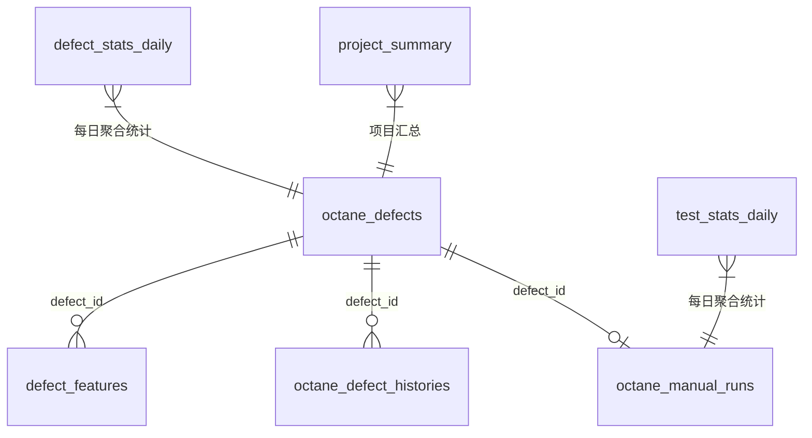

# 📊 local_data.db 数据库指南（Agent 参考手册）

> **数据库类型**: SQLite 3.x | **文件大小**: ~5.4 GB | **路径**: `/Users/tonyorz/aianalysis/database/local_data.db`

---

## 一、业务背景

这是一个**汽车电子软件质量管理系统（DTSV）** 的本地数据仓库，数据来源于 **Micro Focus Octane** 平台。
核心业务是追踪和管理汽车电子（车载信息娱乐系统 IuK、EE_MAIN、AF 等）的**缺陷（Defect）**和**手工测试用例执行（Manual Run）**。

- **项目/产品线**: IuK（车载信息娱乐）, EE_MAIN, AF, EA, EF
- **团队**: DTSV_China（中国团队）, DTSV_Japan, IuK_TSP_*（各子团队如 Audio, HMI, Navi 等）
- **数据时间范围**: 2024-01 至 2026-03

---

## 二、表结构总览

| 表名 | 行数 | 说明 |
|---|---|---|
| `octane_defects` | 16,178 | **核心表** — 缺陷主数据，每个缺陷一行 |
| `octane_manual_runs` | 67,787 | **核心表** — 手工测试执行记录，每条执行一行 |
| `defect_features` | 16,178 | 缺陷特征评分（Top Issue 风险分数等） |
| `defect_stats_daily` | 3,260 | 缺陷每日聚合统计（按 program/team/severity） |
| `test_stats_daily` | 716 | 测试每日聚合统计（按 program/status） |
| `project_summary` | 5 | 项目级汇总（总缺陷/Showstopper/PMG/通过率） |
| `semantic_catalog` | 4 | 语义查询目录（预定义查询模板，供 AI Agent 使用） |
| `octane_payloads` | 32 | 原始 API payload 缓存 |
| `octane_defect_histories` | 13,592 | 缺陷历史变更记录 |
| `octane_history_events` | 0 | 历史事件（当前为空） |
| `aida_mappings` | 0 | AIDA 映射（当前为空） |

---

## 三、核心表详细字段

### 3.1 `octane_defects` — 缺陷主表

| 字段 | 类型 | 说明 | 示例值 |
|---|---|---|---|
| `defect_id` | TEXT PK | 缺陷 ID | `1702573` |
| `name` | TEXT | 缺陷标题 | `[U12][IDC 2403]BT automatically turned off...` |
| `creation_time` | TEXT | 创建时间 (ISO) | `2024-01-02T02:39:17Z` |
| `last_modified` | TEXT | 最后修改时间 | `2024-07-13T09:59:01Z` |
| `team` | TEXT | 所属团队 | `DTSV_China`, `IuK_TSP_Audio` |
| `problem_finder_team` | TEXT | 发现问题的团队 | |
| `program` | TEXT | 项目/产品线 | `IuK`, `EE_MAIN`, `AF`, `EA`, `EF` |
| `author` | TEXT | 创建人 | `Dian Wang` |
| `aida_businesskey` | TEXT | AIDA 业务键 | `UR-0004782` |
| `aida_english` | TEXT | AIDA 英文名 | `Manage CE Devices Bluetooth` |
| `top_aida` | TEXT | 顶层 AIDA 功能 | |
| `product_areas` | TEXT | 产品区域标签（逗号分隔） | `IuK_TSP_ConnAudio,...` |
| `user_tags` | TEXT | 用户标签（逗号分隔） | |
| `phase` | TEXT | 缺陷阶段 | `00-Draft` ~ `09-Concluded without action` |
| `severity` | TEXT | 严重程度 | `Critical`, `High`, `Medium`, `Low`, `Very High` |
| `problem_severity` | TEXT | 问题严重度 | `05-unsatisfactory` 等 |
| `status_phase` | TEXT | 状态+严重度组合 | `09-Concluded without action_Medium` |
| `owner` | TEXT | 当前负责人 | |
| `detected_by` | TEXT | 发现人 | |
| `detected_in_release` | TEXT | 发现的 Release | `R-23-13` |
| `software_version` | TEXT | 软件版本 | `pu2` |
| `vin` | TEXT | 车辆识别号 | |
| `assigned_ecu` | TEXT | 分配的 ECU | |
| `lead_model` | TEXT | 领先车型 | `U25` |
| `ecu_no_of_changes` | INTEGER | ECU 变更次数 | |
| `parent_id` | TEXT | 父缺陷 ID | |
| `parent_child_type` | TEXT | 父子关系类型 | |
| `relation_to` | TEXT | 关联 | |
| `test_week` | TEXT | 测试周 | `26-03` |
| `risk_score` | REAL | 风险评分 | |
| `fv` | TEXT | 功能版本 (Funktionsversion) | |
| `fvp` | TEXT | FV Plus | |
| `tqr` | TEXT | TQR | |
| `blocking_reason` | TEXT | 阻塞原因 | |
| `error_occurrence` | TEXT | 错误出现频率 | |
| `solution_responsible` | TEXT | 解决方案负责人 | |
| `solution_cluster` | TEXT | 解决方案集群 | |
| `reporting_class` | TEXT | 报告分类 | `Showstopper_Candidate`, `Top_Issue_Confirmed` |
| `function_responsible` | TEXT | 功能负责人 | |
| `involved_i_step` | TEXT | 涉及的 i-step | |
| `first_use_sop_of_function` | TEXT | 功能首次使用 SOP | `24-03` |
| `tolerated_count` | INTEGER | 容忍计数 | |
| `reprel_changes` | TEXT | reprel 变更 | |
| `raw_json` | TEXT | 原始 JSON（完整 Octane 响应） | |
| `year` | INTEGER | 年份 | `2024` |
| `fetched_at` | TEXT | 数据抓取时间 | `2026-02-02T03:28:47Z` |
| `is_showstopper` | INTEGER | 是否 Showstopper (0/1) | |
| `is_pmg` | INTEGER | 是否 PMG (0/1) | |
| `is_top_issue` | INTEGER | 是否 Top Issue (0/1) | |

**常用枚举值**:
- `program`: `IuK`, `EE_MAIN`, `AF`, `EA`, `EF`
- `severity`: `Critical`, `High`, `Medium`, `Low`, `Very High`
- `phase`: `00-Draft`, `01-New`, `02-In Pre-Analysis`, `03-In Analysis`, `04-In Progress`, `05-In Testing`, `06-Concluded`, `07-In Pre-Verification`, `08-In Verification`, `09-Concluded without action`
- `reporting_class`: `Showstopper_Candidate`, `Showstopper_Confirmed`, `Top_Issue_Confirmed`, `Preventing Maturity Grade ConDrive`, `Homologation L-labelled`, `No_Showstopper_Confirmed`
- `team` (主要): `DTSV_China`, `DTSV_Japan`, `IuK_TSP_Audio`, `IuK_TSP_HMI`, `IuK_TSP_Navi`, `IuK_TSP_Connectivity`, `IuK_TSP_Entertainment`, `IuK_TSP_Carfunctions`, `IuK_TSP_AZV`, `IuK_TSP_Stability_Performance`

### 3.2 `octane_manual_runs` — 手工测试执行表

| 字段 | 类型 | 说明 | 示例值 |
|---|---|---|---|
| `mr_id` | TEXT PK | 执行记录 ID | `9613927` |
| `name` | TEXT | 执行名称 | `[DTSV_China]_IDCEVO-25_...` |
| `test_name` | TEXT | 测试用例名称 | |
| `test_id` | TEXT | 测试用例 ID | |
| `creation_time` | TEXT | 创建时间 (ISO) | |
| `last_modified` | TEXT | 最后修改时间 | |
| `started` | TEXT | 开始执行时间 | |
| `finished` | TEXT | 完成时间 | |
| `defect_id` | TEXT | 关联的缺陷 ID | |
| `run_team` | TEXT | 执行团队 | `DTSV_China` |
| `program` | TEXT | 项目 | `IuK`, `EE_MAIN` |
| `author` | TEXT | 创建人 | |
| `run_by` | TEXT | 执行人 | |
| `status` | TEXT | 执行状态 | `Passed`, `Failed`, `Requires Attention`, `Planned` |
| `native_status` | TEXT | 原始状态 | |
| `is_completed` | INTEGER | 是否完成 (0/1) | |
| `steps_num` | INTEGER | 测试步骤数 | |
| `version_stamp` | TEXT | 版本标记 | |
| `release` | TEXT | Release | `R-24-01` |
| `exec_model_series` | TEXT | 执行车型系列 | |
| `execution_sw_version` | TEXT | 执行软件版本 | |
| `test_version` | TEXT | 测试版本 | `0.4.0` |
| `product_areas` | TEXT | 产品区域 | |
| `domain` | TEXT | 领域 | `IuK_IuA` |
| `test_phase` | TEXT | 测试阶段 | `Ready` |
| `testing_tool_type` | TEXT | 测试工具类型 | `Manual Runner` |
| `taxonomies` | TEXT | 分类法 | |
| `target_ecu_conf` | TEXT | 目标 ECU 配置 | |
| `testplatformid` | TEXT | 测试平台 ID | |
| `raw_json` | TEXT | 原始 JSON | |
| `year` | INTEGER | 年份 | |
| `spec` | TEXT | 规格/Release 标识 | `R-24-01` |
| `fetched_at` | TEXT | 数据抓取时间 | |

### 3.3 `defect_features` — 缺陷特征/评分表

| 字段 | 类型 | 说明 |
|---|---|---|
| `defect_id` | TEXT PK | 缺陷 ID |
| `topissue_risk_score` | REAL | Top Issue 风险分数 (0-100) |
| `topissue_display` | TEXT | 显示用风险分数 |
| `topissue_recommend_reason` | TEXT | 推荐为 Top Issue 的原因 |
| `is_topissue` | INTEGER | 是否被标记为 Top Issue (0/1) |
| `is_master_score` | INTEGER | 是否主评分 (0/1) |
| `source_fetched_at` | TEXT | 数据源抓取时间 |
| `computed_at` | TEXT | 计算时间 |
| `feature_version` | TEXT | 特征版本 (`topissue_v1`) |

### 3.4 `defect_stats_daily` — 缺陷每日统计

| 字段 | 类型 | 说明 |
|---|---|---|
| `date` | TEXT | 日期 |
| `program` | TEXT | 项目 |
| `team` | TEXT | 团队 |
| `severity` | TEXT | 严重程度 |
| `defect_count` | INTEGER | 缺陷数量 |
| `showstopper_count` | INTEGER | Showstopper 数量 |
| `pmg_count` | INTEGER | PMG 数量 |

### 3.5 `test_stats_daily` — 测试每日统计

| 字段 | 类型 | 说明 |
|---|---|---|
| `date` | TEXT | 日期 |
| `program` | TEXT | 项目 |
| `status` | TEXT | 测试状态 (Passed/Failed/Requires Attention) |
| `test_count` | INTEGER | 测试数量 |

### 3.6 `project_summary` — 项目汇总

| 字段 | 类型 | 说明 |
|---|---|---|
| `project` | TEXT | 项目名 |
| `total_defects` | INTEGER | 总缺陷数 |
| `showstoppers` | INTEGER | Showstopper 数 |
| `pmg` | INTEGER | PMG 数 |
| `total_tests` | INTEGER | 总测试数 |
| `passed_tests` | INTEGER | 通过数 |
| `pass_rate` | REAL | 通过率 |
| `defect_density` | REAL | 缺陷密度 |

---

## 四、表关系



---

## 五、常用查询示例

### 缺陷分析
```sql
-- 按项目统计缺陷总数和 Showstopper
SELECT program, COUNT(*) as total,
       SUM(is_showstopper) as showstoppers,
       SUM(is_pmg) as pmg
FROM octane_defects GROUP BY program;

-- Top Issue 高风险缺陷
SELECT d.defect_id, d.name, d.severity, f.topissue_risk_score, f.topissue_recommend_reason
FROM octane_defects d
JOIN defect_features f ON d.defect_id = f.defect_id
WHERE f.is_topissue = 1 ORDER BY f.topissue_risk_score DESC;

-- 长周期未关闭缺陷（Long Runner）
SELECT defect_id, name, creation_time, phase,
       CAST(julianday('now') - julianday(creation_time) AS INTEGER) as days_open
FROM octane_defects
WHERE phase NOT IN ('06-Concluded', '09-Concluded without action')
ORDER BY days_open DESC LIMIT 20;

-- 按 AIDA 功能模块统计高频缺陷
SELECT top_aida, COUNT(*) as cnt FROM octane_defects
WHERE top_aida IS NOT NULL AND top_aida != ''
GROUP BY top_aida ORDER BY cnt DESC LIMIT 20;

-- Showstopper 缺陷
SELECT defect_id, name, severity, phase, owner, reporting_class
FROM octane_defects WHERE is_showstopper = 1 ORDER BY creation_time DESC;
```

### 测试分析
```sql
-- 测试通过率按项目
SELECT program, COUNT(*) as total_runs,
       SUM(CASE WHEN status='Passed' THEN 1 ELSE 0 END) as passed,
       ROUND(SUM(CASE WHEN status='Passed' THEN 1 ELSE 0 END)*100.0/COUNT(*), 1) as pass_rate
FROM octane_manual_runs GROUP BY program;

-- 失败测试用例
SELECT mr_id, test_name, run_team, status, started
FROM octane_manual_runs WHERE status = 'Failed' ORDER BY started DESC LIMIT 20;

-- 按团队测试通过率
SELECT run_team, COUNT(*) as total,
       SUM(CASE WHEN status='Passed' THEN 1 ELSE 0 END) as passed
FROM octane_manual_runs GROUP BY run_team ORDER BY total DESC;
```

### 趋势分析
```sql
-- 每月新增缺陷趋势
SELECT strftime('%Y-%m', creation_time) as month, COUNT(*)
FROM octane_defects GROUP BY month ORDER BY month;

-- 每日测试统计趋势
SELECT date, status, SUM(test_count) FROM test_stats_daily
GROUP BY date, status ORDER BY date;

-- 每日缺陷统计趋势
SELECT date, SUM(defect_count), SUM(showstopper_count)
FROM defect_stats_daily GROUP BY date ORDER BY date;
```

---

## 六、关键业务概念

| 概念 | 说明 |
|---|---|
| **Showstopper** | 最严重的缺陷，可能阻塞发布。`reporting_class` 含 `Showstopper_Confirmed` |
| **PMG** | Preventing Maturity Grade，阻碍成熟度评级的缺陷 |
| **Top Issue** | 风险评分模型识别的关键问题，评分在 `defect_features.topissue_risk_score` |
| **AIDA** | 功能标识体系（如 `Manage CE Devices Bluetooth`），按功能模块归类缺陷 |
| **Phase** | 缺陷生命周期：Draft → New → Analysis → Progress → Testing → Concluded |
| **Release** | 版本发布标识（如 `R-24-01`），`detected_in_release` 表示在哪次发布中发现 |
| **Long Runner** | 长时间未关闭的缺陷，通常 open > 30 天 |
| **ECU** | Electronic Control Unit，电子控制单元 |
| **VIN** | Vehicle Identification Number，车辆识别号 |
| **SOP** | Start of Production，量产开始 |
| **Test Week** | 测试周标识（如 `26-03` = 2026年第3周） |
