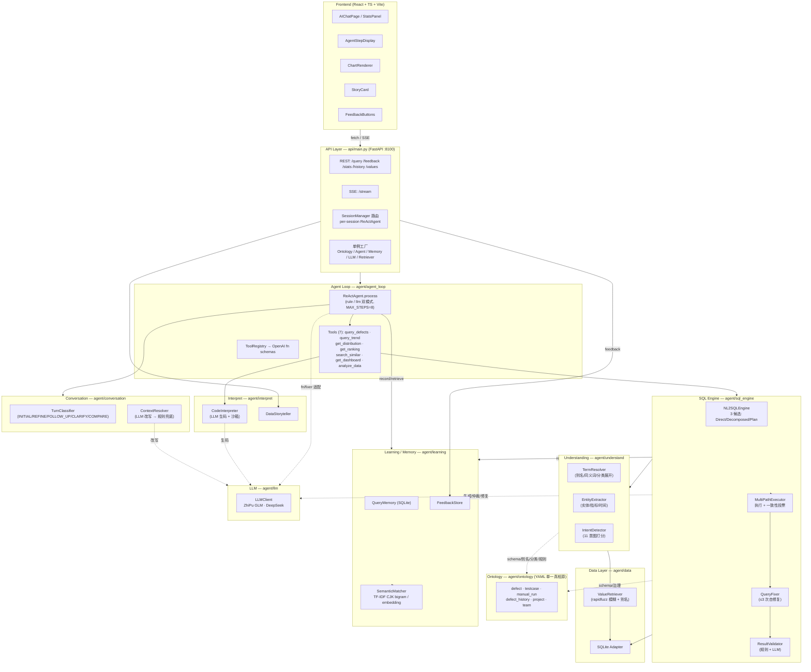
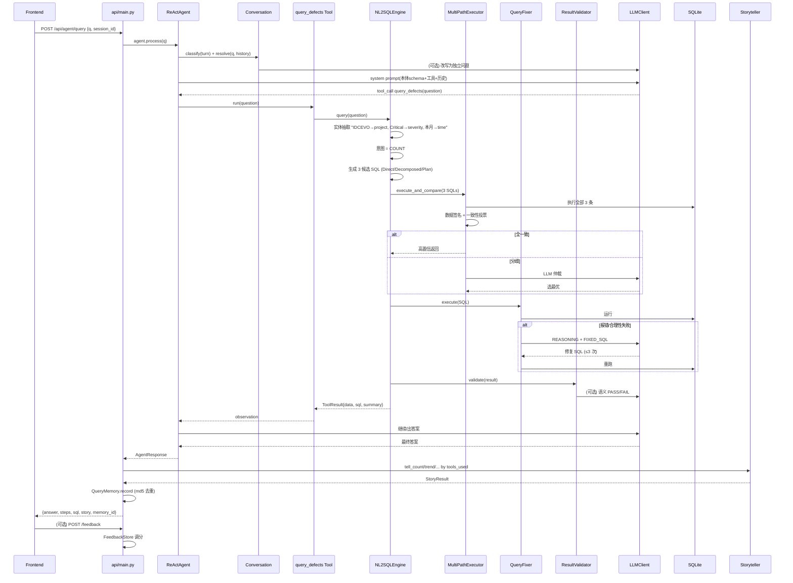
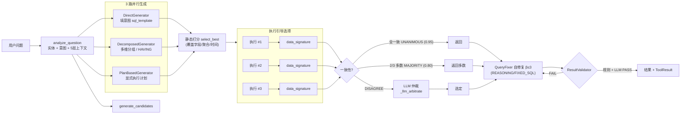

# Successfully changed chat title to: "Casual conversation"

> 完整对话提取自 `/Users/tonyorz/.claude/projects/-Users-tonyorz-Data-Agent/49c2695b-d10e-4f75-8fbb-61181128fc96.jsonl`
> 工具: Claude Code | 用户消息: 72 | 助手回答: 36

## 用户提问（完整）

### Q1

hi

### Q2

Successfully changed chat title to: "Casual conversation"

### Q3

分析

### Q4

Your questions have been answered: "你想让我分析什么？"="项目架构分析". You can now continue with these answers in mind.

### Q5

e2632b5d P1-9: Python Code Interpreter + Session API (complete)
0fcb561d P1-8: Multi-Turn Conversation Context (BIRD-Interact style)
269d72c2 P1-7: Semantic Memory — TF-IDF + pluggable embedding for QueryMemory
634935e6 P1-6: Multi-Path Execution + Comparison (CHASE-SQL style)
cd8b9823 P0-3: Value Retrieval — dynamic DB value lookup with fuzzy + alias matching
d6b88d33 P0-2: Self-Correction + MARS-style Result Verification
c77fa6f1 P0-1: LLM mode integration - ZhiPu GLM + DeepSeek support
90f98818 Phase 1-6 complete: 155 tests passing, pre-LLM baseline
---STRUCTURE---
./PHASE1_REPORT.md
./PHASE6_REPORT.md
./requirements-agent.txt
./AGENT_DESIGN_REVIEW.md
./.gitignore
./PHASE3_REPORT.md
./PHASE5_REPORT.md
./DUPLICATE_DEFECT_SEARCH_DESIGN.md
./PHASE2_REPORT.md
./CLAUDE.md
./PHASE4_REPORT.md
./frontend/index.html
./frontend/package-lock.json
./frontend/package.json
./frontend/tsconfig.json
./frontend/vite.config.ts
./tests/test_conversation_context.py
./tests/test_sql_engine.py
./tests/test_query_fixer.py
./tests/test_entity_extractor.py
./tests/test_intent_detector.py
./tests/test_multi_executor.py
./tests/test_value_retriever.py
./tests/test_llm_client.py
./tests/test_context_engine.py
./tests/test_agent_loop.py
./tests/test_phase4.py
./tests/test_agent_tools.py
./tests/test_validator.py
./tests/test_term_resolver.py
./tests/sample_context.md
./tests/test_api.py
./tests/test_ontology_engine.py
./tests/test_semantic_memory.py
./tests/test_code_interpreter.py
./api/__init__.py
./api/main.py
./data/sample_defects.db
./data/agent_memory.db
./agent/llm/client.py
./agent/llm/__init__.py
./agent/context/__init__.py
./agent/context/engine.py
./agent/learning/__init__.py
./agent/learning/feedback_store.py
./agent/learning/query_memory.py
./agent/learning/semantic_matcher.py
./agent/understand/__init__.py
./agent/understand/term_resolver.py
./agent/understand/entity_extractor.py
./agent/understand/intent_detector.py
./agent/ontology/__init__.py
./agent/ontology/engine.py
./agent/agent_loop/registry.py
./agent/agent_loop/tools.py
./agent/agent_loop/__init__.py
./agent/agent_loop/loop.py
./agent/agent_loop/streaming.py
./agent/sql_engine/validator.py
./agent/sql_engine/fixer.py
./agent/sql_engine/selector.py
./agent/sql_engine/__init__.py
./agent/sql_engine/generator.py
./agent/sql_engine/examples.py
./agent/sql_engine/multi_executor.py
./agent/interpret/code_interpreter.py
./agent/interpret/storyteller.py
./agent/interpret/__init__.py
./agent/data/adapter.py
./agent/data/__init__.py
./agent/data/value_retriever.py
./agent/conversation/__init__.py
./agent/conversation/context.py
./frontend/src/App.tsx
./frontend/src/main.tsx
./frontend/src/vite-env.d.ts
./agent/ontology/objects/project.yaml
./agent/ontology/objects/defect.yaml
./agent/ontology/objects/testcase.yaml
./agent/ontology/objects/defect_history.yaml
./agent/ontology/objects/manual_run.yaml
./agent/ontology/objects/team.yaml
./frontend/src/types/index.ts
./frontend/src/components/FeedbackButtons.tsx
./frontend/src/components/ChartRenderer.tsx
./frontend/src/components/AgentStepDisplay.tsx
./frontend/src/components/StoryCard.tsx
./frontend/src/api/client.ts
./frontend/src/pages/StatsPanel.tsx
./frontend/src/pages/AIChatPage.tsx

### Q6

I have now read all the core modules thoroughly. I have a comprehensive understanding of the architecture. Let me compile the final report.

---

# Data-Agent — Architecture Analysis

A text-to-SQL conversational agent for **automotive test-defect / Octane data**. Python FastAPI backend + React/TypeScript frontend. Rule-based by default, LLM-enhanced (ZhiPu GLM / DeepSeek) when API keys are set. Inspired explicitly by several research systems (WrenAI MDL, CHASE-SQL, MARS-SQL, BIRD-Interact, Palantir Ontology).

---

## 1. Entry Points & Runtime

**`api/main.py`** — FastAPI app, run via `python3 -m api.main` or `uvicorn api.main:app` (port 8100, default).

Endpoints (`api/main.py`):
- `POST /api/agent/query` (sync) — main path (`main.py:320`)
- `GET /api/agent/stream` — SSE streaming (`main.py:444`)
- `POST /api/agent/feedback` (`main.py:485`), `GET /api/agent/history` (`:515`), `GET /api/agent/stats` (`:526`)
- Session lifecycle: `POST/DELETE /api/agent/session[/{id}]`, `GET /api/agent/sessions` (`:542-603`)
- LLM: `/api/agent/llm/status`, `/api/agent/llm/test`
- Value retrieval: `/api/agent/values/stats`, `/api/agent/values/search`

**Configuration** (`main.py:62-67`): two DBs — `DB_PATH` = `data/agent_memory.db` (memory/feedback), `DATA_DB_PATH` = `resolve_data_db_path()` (the data being queried). `AGENT_MODE` env (`llm` default vs rule-based). Lazy module-level singletons: `_ontology`, `_agent`, `_query_memory`, `_feedback_store`, `_storyteller`, `_llm_client`, `_session_manager` (`main.py:76-159`).

**Multi-turn sessions**: `get_agent_for_session(session_id)` (`main.py:162`) keeps a dict `_session_agents[session_id] -> ReActAgent`, each with its own `ConversationContext` from `SessionManager`. Without `session_id`, falls back to the shared stateless `_agent`.

**Frontend** (`frontend/`, Vite + React + TS):
- `src/api/client.ts` — calls `/api/agent/query`, `/feedback`, `/stats`, `/history`, and an SSE reader `streamQuery()` that parses `event:`/`data:` frames.
- `src/pages/AIChatPage.tsx`, `src/components/AgentStepDisplay.tsx` (renders ReAct steps), `ChartRenderer.tsx`, `StoryCard.tsx` (renders storyteller output), `FeedbackButtons.tsx`, `StatsPanel.tsx`. Vite dev proxy forwards `/api` to the backend.

---

## 2. Agent Loop & Pipeline (`agent/agent_loop/`)

**`loop.py` — `ReActAgent`** implements the ReAct pattern (Thought/Action/Observation/Final). Two execution modes (`loop.py:131-187`):
1. **Rule-based** (`_process_rule_based`, `:211`): deterministic — extract entities → detect intent → map intent→tool (`_select_tool_name`, `:296`) → execute → format answer (`_format_answer`, `:575`).
2. **LLM-based** (`_process_with_llm`, `:367`): standard function-calling loop — builds system prompt (`_build_system_prompt`, `:538`) with tool descriptions + ontology schema context + conversation history; loops up to `MAX_STEPS=8` (`:73`); each turn either the LLM emits `tool_calls` (executed via registry, results appended as `role:"tool"` messages) or a final answer.

**Streaming** (`process_stream`, `:189`): yields `AgentStep` objects; `streaming.py` (`SSEEventStream`) converts `StepType` → SSE event names (thought/action/observation/final/error). Note the `/api/agent/stream` endpoint (`main.py:444`) bypasses `SSEEventStream` and directly consumes `agent.process_stream`.

**Tools** (`tools.py`, 7 tools registered in `registry.py:82`):
- `query_defects` — wraps `NL2SQLEngine` (`tools.py:81`)
- `query_trend` — time-series; re-runs NL2SQL just to harvest the WHERE clause, then rewrites with `strftime` grouping (`tools.py:147`)
- `get_distribution`, `get_ranking` — direct SQL builders using ontology table + filter-string parsing (`tools.py:259, 366`)
- `search_similar` — BGE semantic search if `embedding_search_fn` injected, else SQL `LIKE` fallback (`tools.py:459`)
- `get_dashboard` — fixed KPI queries (`tools.py:552`)
- `analyze_data` (CodeInterpreterTool) — LLM-generated Python sandboxed (`tools.py:635`)

**Registry** (`registry.py`): `ToolRegistry` registers tools, exposes `get_schemas()` for OpenAI-style function-calling, validates required params, fills defaults. Each `AgentTool.to_schema()` (`tools.py:60`) produces `{name, description, parameters{type, properties, required}}`.

**Key data classes**: `AgentStep` (step_type, content, tool_name, tool_input, tool_output) `:36`; `AgentResponse` (answer, steps, tools_used, sql_executed, success) `:47`; `ToolResult` (success, data, sql, summary, error, metadata) `tools.py:37`.

---

## 3. Understanding Stage (`agent/understand/`)

Pipeline: `term_resolver` → `entity_extractor` → `intent_detector`.

**`term_resolver.py`** — `TermResolver.resolve()` maps user vocabulary → canonical `(field, value)`:
- Builds a reverse alias index from ontology YAML `aliases`/`values`/`examples` + a `SUPPLEMENT_SYNONYMS` dict (`:101`).
- Longest-match-first, non-overlapping, CJK-aware (skips word-boundary checks for CJK) (`:164`).
- Expands `category_groups` (e.g. "活跃" → `status_phase IN ('New','Open','In Progress')`; "中国项目" → `project IN (IDCEVO,IDC,MGU)`) (`:229`).
- Numeric constraints (`超过N`, `前N`, `top N`) and time ranges (`本月`, `近30天`) via regex (`:66-95`).
- Output: list of `ResolvedTerm(original, canonical, field, value, operator, values, source)`.

**`entity_extractor.py`** — `EntityExtractor.extract()` (`:96`) wraps `TermResolver`, adds metric extraction (`METRIC_KEYWORDS`), aggregation-intent extraction (`AGG_PATTERNS`), precise date computation (`_extract_time_ranges`, `:224` — converts `本月` etc. to concrete `[start,end]`), and sort/limit. Output: `ExtractionResult` (list of `Entity` + `unresolved`). `to_sql_filters()` (`:307`) renders entities into WHERE fragments (`field IN (...)`, `field BETWEEN`, `field = '...'`).

**`intent_detector.py`** — `IntentDetector.detect()` (`:165`) scores 11 intents (COUNT, TREND, RANKING, DISTRIBUTION, COMPARISON, DETAIL_LIST, SEARCH_SIMILAR, RISK_ANALYSIS, SUMMARY, ROOT_CAUSE, STATUS_CHECK) via `INTENT_RULES` regex table (`:53`), each carrying an `sql_template` + flags (`needs_aggregation/grouping/timeseries/join`). Aggregation entities from the extractor boost scores. Output: `IntentResult(primary, secondary, confidence, sql_template, …)`.

---

## 4. Ontology (`agent/ontology/`)

**`engine.py` — `OntologyEngine`** loads YAML from `objects/*.yaml` into `ObjectType` dataclasses (`:80`): `source_table`, `primary_key`, `properties` (dict of `PropertyDef`), `links` (`LinkDef`), `metrics` (`MetricDef`), `calibration_rules` (`CalibrationRule`), `governance` (`Governance`).

**`PropertyDef`** (`:27`) is rich: `type, meaning, values, examples, foreign_key, category_groups, semantics, business_rules, aliases, mapping, item_type`.

**Objects** (6 YAMLs):
- **Defect** → `octane_defects` (`defect.yaml`) — the central entity. Properties: defect_id, name, project (enum with aliases: IDCEVO↔[idcevo, ENTRYEVO, NBTEVO, CDE], etc.; category_groups: china/global), market, status_phase (enum with lifecycle `New→Open→…→Closed`; category_groups: active/resolved/excluded), severity (Critical/Major/Minor/Cosmetic with business meanings), assigned_ecu (BCM/VCU/MCU/... with Chinese aliases like 车身控制器→BCM), top_aida, phase (Q-Gate/CoC/Integration groups), creation_time, raw_json. 6 metrics (active_defect_count, defect_density, …). 7 calibration_rules (e.g. `cal_severity_not_matrix`, `cal_trend_uses_creation_time`, `cal_active_excludes_closed`). Governance forbids update/delete/insert.
- **Project** → `derived` (not a real table).
- **TestCase** → `octane_testcases` (composite PK; JSON-array fields like `defect_ids_json`; many-to-many to Defect `via octane_testcase_relations`).
- **ManualRun** → `octane_manual_runs` (test execution records; pass_rate/fail_rate metrics; calibration distinguishing run.status vs defect.status_phase).
- **DefectHistory** → `octane_defect_history_events` (field-change events, not separate defects; resolution-time metric).
- **Team**.

**How it's used everywhere**: source-table & PK lookup by tools; alias resolution + category expansion in `TermResolver`; schema-context generation `to_schema_context()` (`:316`) injected into LLM prompts; `find_relevant_rules()` feeds business-rule reminders into the ContextEngine; governance flags forbid dangerous ops in `SQLSelector`/`QueryFixer`.

---

## 5. SQL Engine (`agent/sql_engine/`)

**`generator.py` — `NL2SQLEngine`** is the orchestrator. Notably, despite the class names referencing LLMs, generation is **template-based, not LLM-based**. `query()` (`:590`) pipeline:
1. **Analyze** — entity extraction + intent + 5-layer context (`analyze_question`, `:89`).
2. **Generate 3 candidates** via CHASE-SQL-inspired paths (`generate_candidates`, `:494`):
   - `DirectGenerator` (`:178`) — fills the intent's `sql_template`.
   - `DecomposedGenerator` (`:234`) — detects multiple grouping dimensions / HAVING numeric constraints.
   - `PlanBasedGenerator` (`:328`) — builds an explicit execution plan, selects columns by intent, special-cases trend/distribution%.
3. **Static scoring/selection** (`select_best`, `:515`; `_score_candidate`, `:545`) — bonus for covering entity fields, correct aggregation/grouping/timeseries; penalties for missing WHERE / `SELECT *`.
4. **Multi-path execution** (`multi_executor.py`) — **execution-guided selection**: runs all candidates, computes a `data_signature` (`:62`) per result, and agreement level: UNANIMOUS (conf 0.95) / MAJORITY 2-of-3 (0.80) / DISAGREE → LLM arbitration (`_llm_arbitrate`, `:293`) or path-preference fallback (plan_based > decomposed > direct).
5. **Self-correction** (`fixer.py` — `QueryFixer`, CHASE-SQL Algorithm 4): executes; on error or sanity-check failure, prompts LLM with `REASONING:`/`FIXED_SQL:` format; retries up to β=3 (`:75`); `_sql_looks_valid` blocks DROP/DELETE/etc. (`:305`).
6. **Validation** (`validator.py` — `ResultValidator`, MARS-SQL style): rule checks (empty-result-for-data-questions, >10K rows, uniform values, distribution %sum, SQL↔intent alignment) then optional LLM semantic check returning PASS/`FAIL: reason`.

**`selector.py`** (`SQLSelector`) — older static validation+scoring layer (forbidden-pattern regex, paren balance, filter-coverage scoring). **Note**: it's imported by `__init__` but `NL2SQLEngine.query()` actually uses its own `select_best` + `MultiPathExecutor`, not `SQLSelector.select` — so `SQLSelector` is largely **dormant/duplicate** code (tech debt).

**`examples.py`** — 30+ hand-written few-shot `(question, sql, intent, explanation)` dicts used by `DirectGenerator` and `to_prompt_context`.

---

## 6. Data Layer (`agent/data/`)

**`adapter.py`** — SQLite is the only real backend (PostgreSQL mentioned in docstring but not implemented). Three schemas (`DEFECTS_SCHEMA`, `MANUAL_RUNS_SCHEMA`, `DEFECT_HISTORY_SCHEMA`), `:30-83`. **Important schema mismatch**: the adapter's `octane_defects` columns (`defect_id, summary, description, status_phase, severity, project, detected_by, ecu, aidas, top_aida, tags, …`) differ from the ontology's property names (`name`, `assigned_ecu`, `problem_finder_team`, …). Several tools/generators reference ontology field names (`assigned_ecu`, `name`) that don't exist in the generated sample schema (`ecu`, `summary`) — a latent inconsistency.

- `resolve_data_db_path()` (`:245`): `DATA_DB_PATH` env var → else auto-creates `data/sample_defects.db` with 500 mock defects + 300 runs (`generate_sample_defects`, seeded). Production = point `DATA_DB_PATH` at a real Octane-derived SQLite.
- `execute_query()` (`:272`) — standard row-factory helper.
- Sample generator biases Critical toward active statuses (`:120`).

**`value_retriever.py`** — closes the vocabulary gap (user says 车身控制器, DB has BCM):
- At construction, runs `SELECT DISTINCT <field>` for ~11 indexed fields, builds `FieldIndex` per field + a global `(value, field)` list (`_build_index`, `:176`); merges ontology aliases (`_load_ontology_aliases`).
- `retrieve()` (`:244`) — tiered: exact (100) → alias (95) → partial-alias (85+) → **rapidfuzz** `token_set_ratio` fuzzy (≥65); falls back to `difflib` if rapidfuzz missing (`:50`).
- `get_hints_for_question()` (`:391`) — strategy 1 matches known values/aliases as substrings; strategy 2 tokenizes the question and fuzzy-matches unknown tokens. Returns `{field: {matches, best, sql_in}}` consumed by `SQLGenerator.build_where_clause` (`generator.py:119`) to add filters for fields entity-extraction missed.

---

## 7. Learning / Memory (`agent/learning/`)

**`query_memory.py` — `QueryMemory`**: SQLite table `query_memory` storing successful (question, normalized_question, sql, intent, entities, result_summary, feedback, usage_count, score). `record()` (`:222`) deduplicates by md5(question::sql), bumps usage_count. `retrieve_similar()` (`:312`) loads top-500 by score and computes **hybrid** similarity = max(semantic, legacy Jaccard(0.6)+edit-distance(0.4)); feedback up/down nudges. Score = recency + usage + feedback.

**`semantic_matcher.py` — `SemanticMatcher`**: three tiers (`:214`):
1. Embedding cosine (if `embedding_fn` injected; cached)
2. **TF-IDF cosine** — a from-scratch `TfidfVectorizer` (`:93`) with **CJK bigram tokenization** (`tokenize`, `:46`) + IDF smoothing; always available, no deps.
3. Jaccard fallback.
Fit on the corpus after each record (`_fit_semantic_matcher`). Comment notes this beats Jaccard 0.42→0.78 for paraphrases.

**`feedback_store.py` — `FeedbackStore`**: SQLite `feedback` table linked by `query_memory_id`. `record()` (`:94`) adjusts `query_memory.score` (up +1.0 / down −0.5). `get_weight_adjustments()` (`:174`) aggregates satisfaction by intent → suggests per-intent scoring boosts/penalties (≥0.8 → +0.1, ≤0.4 → −0.2). API surfaces stats at `/api/agent/stats`.

---

## 8. Conversation Context (`agent/conversation/context.py`)

`ConversationContext` + `SessionManager` (BIRD-Interact-inspired).
- **`TurnClassifier.classify()`** (`:127`) → `TurnType` (INITIAL/REFINE/FOLLOW_UP/CLARIFY/COMPARE) using keyword sets + CJK-bigram token overlap with the last turn (≥3 shared bigrams → continuation).
- **`ContextResolver.resolve()`** (`:231`) — LLM rewrites the question with history (preferred) using a Chinese `RESOLUTION_PROMPT` (`:197`); falls back to `_rule_resolve` (`:293`) which prepends inherited project/severity/ecu entities for REFINE, or wraps the prior subject for short FOLLOW_UPs.
- `add_turn()` records (question, resolved_question, sql, result_summary, entities); trims to `max_history=10`.
- `SessionManager` (`:493`) — per-`session_id` contexts, 30-min expiry, in-memory only (not persisted). `loop.py:129` injects the conversation into the agent; `_build_system_prompt` injects `get_history_text(3)` into the LLM system prompt.

---

## 9. Interpretation (`agent/interpret/`)

**`code_interpreter.py` — `CodeInterpreter`**: LLM generates Python from `CODE_GEN_PROMPT` (data passed as `data` list-of-dict, must assign `result`); **sandbox** = writes script to a temp file, runs via `subprocess` with `timeout` (5s in the tool), data via stdin, `FORBIDDEN_PATTERNS` block (`import os/subprocess/socket`, `open(`, `__import__`, `exec/eval`, …) and a `SAFE_IMPORTS` allowlist (pandas/numpy/math/re/json/statistics/collections/itertools) (`:88-113`). `_check_safety` (`:255`). Template fallback when no LLM (`_fallback_code`). **Caveat**: the forbidden-pattern check is substring-based and easily bypassed (e.g. `__builtins__`, `getattr`), so it's a weak sandbox — acceptable for a trusted single-user tool, not multi-tenant.

**`storyteller.py` — `DataStoryteller`**: turns result data into business narratives (`StoryResult`: headline/body/insights/recommendation). Methods per type: `tell_count` (severity-aware urgency), `tell_trend` (direction with ±15% threshold, peaks, CV volatility), `tell_distribution` (TOP3 %, concentration analysis, severity-specific), `tell_ranking` (top-vs-average, gaps), `tell_summary` (resolve rate, active rate). The API layer (`main.py:354-396`) post-processes `response.steps` to pick the right `tell_*` by `tools_used[-1]`.

---

## 10. LLM (`agent/llm/client.py`)

`LLMClient` — unified client over OpenAI-compatible APIs via `httpx`. Providers in `PROVIDER_CONFIG` (`:58`):
- **ZhiPu GLM** — `glm-4-flash` default (free tier), base `open.bigmodel.cn/api/paas/v4`.
- **DeepSeek** — `deepseek-chat`, base `api.deepseek.com/v1`.
Both `temperature=0.1`, `max_tokens=4096`. Lightweight `.env` loader (`:34`, no python-dotenv dep). Selection: `AGENT_LLM_PROVIDER` env (default `zhipu`; `none` disables).

**Adapters** (clean separation of signatures):
- `as_agent_fn()` (`:291`) → `fn(messages, tools) -> {content, tool_calls}` for `ReActAgent`; converts internal schemas to OpenAI `tools` format.
- `as_fixer_fn()` (`:320`) → `fn(prompt)->str` for `QueryFixer`/`ResultValidator`/generator (temp 0.0).
- `chat_text` for simple completions.

---

## 11. End-to-End Flow & Cross-Cutting Observations

**End-to-end for a query** (e.g. "IDCEVO 本月 Critical 缺陷有多少"):
1. `POST /api/agent/query` → `get_agent_for_session` → `agent.process(question)`.
2. `ReActAgent.process` (`loop.py:131`): conversation `classify`+`resolve` (multi-turn rewrite).
3. LLM mode: system prompt (ontology schema + tools + history) → LLM function-calls `query_defects(question=...)`.
4. `QueryDefectsTool` → `NL2SQLEngine.query`:
   - `analyze_question`: `EntityExtractor.extract` (TermResolver → "IDCEVO"→project, "Critical"→severity, "本月"→creation_time range) + `IntentDetector.detect` → COUNT.
   - 3 candidate SQLs (direct/decomposed/plan) generated by template fill.
   - `MultiPathExecutor.execute_and_compare` — runs all 3; if unanimous, high-confidence return; else LLM-arbitrate.
   - `QueryFixer.execute` (LLM self-correction) → `ResultValidator.validate` (rule + LLM PASS/FAIL).
5. Observation appended; loop continues until LLM emits a final answer (≤8 steps).
6. `api/main.py` post-processing: parses `turn_type`/`resolved_question` from steps via regex, builds a `story` via `DataStoryteller`, records to `QueryMemory` (md5-deduped), returns `QueryResponse{answer, steps, tools_used, sql_executed, story, memory_record_id, ...}`.
7. Frontend renders steps (`AgentStepDisplay`), charts (`ChartRenderer`), story (`StoryCard`); `FeedbackButtons` POST to `/feedback` → `FeedbackStore` adjusts score.

**Key design patterns / abstractions**:
- **Singleton-everywhere** (`get_*` factories with module-level `_instance`) for ontology, agent, LLM, memory, validator, retriever — simple but means global mutable state and the session agent cache (`_session_agents`) leaks across requests.
- **Ontology-as-single-source-of-truth**: schema, aliases, categories, rules, governance all flow from YAML into understanding, generation, prompt-building, and validation. This is the project's strongest abstraction.
- **Multi-path generate → execute → agree → fix → validate** is a genuinely sophisticated NL2SQL pipeline (CHASE-SQL + MARS-SQL) unusual for a small codebase.
- **Graceful degradation**: every LLM-dependent path has a rule-based fallback (intent/entity extraction is pure regex; SQL is template-based; code interpreter has `_fallback_code`), so the agent runs fully offline.

**Strengths**: rich ontology with calibration rules that encode real domain gotchas (severity≠matrix, trend uses creation_time, active excludes closed); TF-IDF with CJK bigrams for zero-dep semantic memory; clean LLM adapter layering; multi-path execution agreement is a strong correctness signal.

**Weaknesses / tech debt**:
1. **Schema/ontology drift** — ontology property names (`assigned_ecu`, `name`, `problem_finder_team`) don't match `adapter.py` sample-schema columns (`ecu`, `summary`, `detected_by`); sample DB also uses `domain`/`top_aida=SA1/SA2` while ontology expects `top_aida=cn_navigation`-style values. Several queries will silently return empty on the sample DB.
2. **Dormant code** — `SQLSelector` is fully implemented but unused (superseded by `select_best`+`MultiPathExecutor`); `PlanBasedGenerator` decomposed logic overlaps `DecomposedGenerator`.
3. **Weak sandbox** — code interpreter uses substring denylisting, trivially bypassable; not safe for untrusted input.
4. **f-string bug** in `_fallback_code` (`code_interpreter.py:233`) — the template embeds `{{`/`}}` in a non-f-string so it emits literal braces correctly, but it's fragile; the auto-generated code hardcodes data inline.
5. **CORS `allow_origins=["*"]`** with `allow_credentials=True` (`main.py:262`) — insecure combo.
6. **Regex parsing of steps** in the API layer (`main.py:344-352`, parsing "类型:" / "→ '...'") is brittle string-scraping of localized step content.
7. **SQL injection surface**: distribution/ranking/dashboard tools build SQL via f-strings with `filters` string interpolation (`tools.py:303-331`, `:417-422`) — relies on the LLM/rule layer not emitting quotes; no parameterization.
8. **In-memory sessions** — `SessionManager` doesn't persist; restart loses all conversation state.
9. **`MAX_STEPS=8` with no cost guard** — each LLM iteration is a full function-calling round-trip; no token budgeting.

**Repo extras**: extensive phase reports (`PHASE1-6_REPORT.md`, `AGENT_DESIGN_REVIEW.md`, `DUPLICATE_DEFECT_SEARCH_DESIGN.md`) documenting the research-paper inspirations and incremental build; comprehensive `tests/` (one test per module: intent_detector, entity_extractor, term_resolver, sql_engine, multi_executor, validator, fixer, value_retriever, semantic_memory, code_interpreter, conversation_context, agent_loop, api, etc.).

### Q7

Successfully changed chat title to: "Data-Agent 项目架构分析"

### Q8

生成架构图（mermaid）

### Q9

加固 code interpreter 沙箱

### Q10

1	"""Python Code Interpreter — Safe sandboxed execution for data analysis
2	
3	When SQL can't express complex logic (statistical tests, custom
4	transformations, anomaly detection), the LLM generates Python code
5	that operates on query results.
6	
7	Design:
8	1. CodeGen: LLM generates Python code from NL + data context
9	2. Sandbox: Restricted exec with timeout, no network, no file write
10	3. Formatter: Convert execution result to natural language
11	
12	Safety:
13	- subprocess with timeout
14	- Restricted globals (no __import__, no open, no os/system)
15	- Memory limit via input data size cap
16	- Only pandas/numpy/math/re available
17	
18	Usage:
19	    from agent.interpret.code_interpreter import CodeInterpreter
20	
21	    ci = CodeInterpreter(llm_call_fn=my_fn, db_path='/path/to/db')
22	    result = ci.execute(
23	        question='哪个ECU的缺陷增长率最高',
24	        data=[{'ecu': 'IHU', 'count': 100}, ...],
25	    )
26	    # → {'success': True, 'output': 'IHU has highest growth...', 'code': '...'}
27	"""
28	
29	from __future__ import annotations
30	
31	import json
32	import logging
33	import subprocess
34	import sys
35	import tempfile
36	import time
37	import textwrap
38	from pathlib import Path
39	from typing import List, Dict, Optional, Any, Callable
40	
41	logger = logging.getLogger(__name__)
42	
43	
44	# ============================================================================
45	# Code Generation Prompt
46	# ============================================================================
47	
48	CODE_GEN_PROMPT = """你是一个 Python 数据分析代码生成器。
49	
50	用户问题：{question}
51	
52	查询结果数据（JSON 格式）：
53	{data}
54	
55	请生成 Python 代码来分析上述数据，回答用户问题。
56	
57	可用库：pandas, numpy, math, re, json, statistics
58	限制：
59	- 不要 import 其它库
60	- 不要读写文件
61	- 不要访问网络
62	- 代码必须在 3 秒内完成
63	
64	数据已加载为变量 `data`（list of dict）。
65	请将最终分析结果赋值给变量 `result`（字符串或数字）。
66	
67	只输出 Python 代码，不要解释。
68	"""
69	
70	
71	# ============================================================================
72	# Code Interpreter
73	# ============================================================================
74	
75	class CodeInterpreter:
76	    """
77	    Generate and execute Python code for complex data analysis.
78	
79	    Flow:
80	    1. LLM generates Python code from question + data
81	    2. Code is executed in a subprocess sandbox
82	    3. Result is extracted and returned
83	
84	    When LLM is not available, falls back to basic statistical functions.
85	    """
86	
87	    # Safe imports allowed in generated code
88	    SAFE_IMPORTS = {
89	        "pandas", "numpy", "math", "re", "json",
90	        "statistics", "collections", "itertools",
91	    }
92	
93	    # Forbidden patterns in code
94	    FORBIDDEN_PATTERNS = [
95	        "import os",
96	        "import sys",
97	        "import subprocess",
98	        "import socket",
99	        "import urllib",
100	        "import requests",
101	        "import http",
102	        "import shutil",
103	        "import pickle",
104	        "import marshal",
105	        "import ctypes",
106	        "__import__",
107	        "open(",
108	        "exec(",
109	        "eval(",
110	        "compile(",
111	        "globals(",
112	        "locals(",
113	    ]
114	
115	    def __init__(
116	        self,
117	        llm_call_fn: Optional[Callable] = None,
118	        timeout: int = 5,
119	    ):
120	        self.llm_call_fn = llm_call_fn
121	        self.timeout = timeout
122	
123	    def execute(
124	        self,
125	        question: str,
126	        data: List[Dict[str, Any]],
127	    ) -> Dict[str, Any]:
128	        """
129	        Generate and execute Python code to analyze data.
130	
131	        Returns:
132	            {
133	                'success': bool,
134	                'output': str,      # result or error
135	                'code': str,        # generated code
136	                'time_ms': float,
137	            }
138	        """
139	        start = time.time()
140	
141	        # Generate code
142	        code = self._generate_code(question, data)
143	        if not code:
144	            return {
145	                'success': False,
146	                'output': '无法生成分析代码',
147	                'code': '',
148	                'time_ms': (time.time() - start) * 1000,
149	            }
150	
151	        # Safety check
152	        safety = self._check_safety(code)
153	        if not safety['safe']:
154	            return {
155	                'success': False,
156	                'output': f'安全检查失败: {safety["reason"]}',
157	                'code': code,
158	                'time_ms': (time.time() - start) * 1000,
159	            }
160	
161	        # Execute
162	        result = self._execute_sandbox(code, data)
163	
164	        return {
165	            'success': result['success'],
166	            'output': result['output'],
167	            'code': code,
168	            'time_ms': (time.time() - start) * 1000,
169	            'error': result.get('error', ''),
170	        }
171	
172	    def _generate_code(
173	        self,
174	        question: str,
175	        data: List[Dict[str, Any]],
176	    ) -> Optional[str]:
177	        """Generate Python code via LLM"""
178	        if not self.llm_call_fn:
179	            return self._fallback_code(question, data)
180	
181	        try:
182	            # Truncate data for prompt
183	            data_sample = data[:50] if len(data) > 50 else data
184	            data_json = json.dumps(data_sample, ensure_ascii=False, default=str)
185	
186	            prompt = CODE_GEN_PROMPT.format(
187	                question=question,
188	                data=data_json[:3000],  # Cap at 3K chars
189	            )
190	
191	            response = self.llm_call_fn(
192	                messages=[
193	                    {"role": "system", "content": "你是 Python 代码生成助手。"},
194	                    {"role": "user", "content": prompt},
195	                ],
196	                tools=[],
197	            )
198	
199	            if isinstance(response, str):
200	                code = response.strip()
201	            elif isinstance(response, dict):
202	                code = response.get("content", "").strip()
203	            else:
204	                code = str(response).strip()
205	
206	            # Extract code from markdown fences
207	            if "```python" in code:
208	                start = code.index("```python") + 10
209	                end = code.index("```", start) if "```" in code[start:] else len(code)
210	                code = code[start:end].strip()
211	            elif "```" in code:
212	                start = code.index("```") + 3
213	                end = code.index("```", start) if "```" in code[start:] else len(code)
214	                code = code[start:end].strip()
215	
216	            return code if code else None
217	
218	        except Exception as e:
219	            logger.warning(f"Code generation failed: {e}")
220	            return self._fallback_code(question, data)
221	
222	    def _fallback_code(
223	        self,
224	        question: str,
225	        data: List[Dict[str, Any]],
226	    ) -> Optional[str]:
227	        """Generate basic code without LLM (template-based)"""
228	        if not data:
229	            return None
230	
231	        # Basic: just return summary statistics
232	        cols = list(data[0].keys()) if data else []
233	        code = f"""# Auto-generated analysis (no LLM)
234	import json
235	from collections import Counter
236	
237	data = {json.dumps(data[:100], ensure_ascii=False, default=str)}
238	
239	# Basic statistics
240	row_count = len(data)
241	columns = {cols}
242	
243	# Value distribution for first column
244	if data:
245	    first_col = "{cols[0] if cols else ''}"
246	    values = [row.get(first_col) for row in data if row.get(first_col) is not None]
247	    dist = Counter(values)
248	    top = dist.most_common(5)
249	    result = f"共{{row_count}}行，{{first_col}}分布: " + ", ".join(f"{{k}}({{v}})" for k, v in top)
250	else:
251	    result = "无数据"
252	"""
253	        return code
254	
255	    def _check_safety(self, code: str) -> Dict[str, Any]:
256	        """Check code for forbidden patterns"""
257	        code_lower = code.lower()
258	
259	        for pattern in self.FORBIDDEN_PATTERNS:
260	            if pattern.lower() in code_lower:
261	                return {
262	                    'safe': False,
263	                    'reason': f'禁止使用: {pattern}',
264	                }
265	
266	        # Check imports
267	        for line in code.split('\n'):
268	            line = line.strip()
269	            if line.startswith('import ') or line.startswith('from '):
270	                module = line.replace('import ', '').replace('from ', '').split('.')[0].split(' ')[0]
271	                if module not in self.SAFE_IMPORTS:
272	                    return {
273	                        'safe': False,
274	                        'reason': f'不支持的库: {module}',
275	                    }
276	
277	        return {'safe': True, 'reason': ''}
278	
279	    def _execute_sandbox(
280	        self,
281	        code: str,
282	        data: List[Dict[str, Any]],
283	    ) -> Dict[str, Any]:
284	        """Execute code in a subprocess sandbox"""
285	        data_json = json.dumps(data, ensure_ascii=False, default=str)
286	
287	        # Build the script with no f-string escaping issues
288	        # Data is passed via stdin, code is embedded directly
289	        script_lines = [
290	            "import json, sys",
291	            "",
292	            "# Load data from stdin",
293	            "data = json.loads(sys.stdin.read())",
294	            "",
295	            "# User code",
296	            "try:",
297	        ]
298	        # Indent user code
299	        for line in code.split('\n'):
300	            script_lines.append("    " + line if line.strip() else "")
301	        script_lines.extend([
302	            "except Exception as e:",
303	            "    result = f'代码执行错误: {e}'",
304	            "",
305	            "# Output result",
306	            "if 'result' in dir():",
307	            "    print(json.dumps({'success': True, 'result': str(result)}))",
308	            "else:",
309	            "    print(json.dumps({'success': True, 'result': '代码执行完成（无result变量）'}))",
310	        ])
311	
312	        full_script = "\n".join(script_lines)
313	
314	        try:
315	            # Write to temp file and execute
316	            with tempfile.NamedTemporaryFile(
317	                mode='w', suffix='.py', delete=False, prefix='sandbox_'
318	            ) as f:
319	                f.write(full_script)
320	                script_path = f.name
321	
322	            result = subprocess.run(
323	                [sys.executable, script_path],
324	                input=data_json[:50000],
325	                capture_output=True,
326	                text=True,
327	                timeout=self.timeout,
328	            )
329	
330	            # Cleanup
331	            Path(script_path).unlink(missing_ok=True)
332	
333	            if result.returncode == 0:
334	                try:
335	                    output = json.loads(result.stdout.strip().split('\n')[-1])
336	                    return {
337	                        'success': output['success'],
338	                        'output': output['result'],
339	                    }
340	                except (json.JSONDecodeError, IndexError):
341	                    return {
342	                        'success': True,
343	                        'output': result.stdout[:500],
344	                    }
345	            else:
346	                return {
347	                    'success': False,
348	                    'output': result.stderr[:500],
349	                    'error': f'Exit code: {result.returncode}',
350	                }
351	
352	        except subprocess.TimeoutExpired:
353	            Path(script_path).unlink(missing_ok=True)
354	            return {
355	                'success': False,
356	                'output': f'代码执行超时 ({self.timeout}秒)',
357	                'error': 'timeout',
358	            }
359	        except Exception as e:
360	            Path(script_path).unlink(missing_ok=True)
361	            return {
362	                'success': False,
363	                'output': f'执行失败: {str(e)}',
364	                'error': str(e),
365	            }
366

### Q11

Your questions have been answered: "这个 code interpreter 的威胁模型是？"="可信单用户（推荐）", "是否允许添加第三方依赖？"="仅标准库 AST（推荐）". You can now continue with these answers in mind.

### Q12

1	"""Tests for Python Code Interpreter"""
2	
3	import os
4	import sys
5	import pytest
6	from pathlib import Path
7	
8	PROJECT_ROOT = Path(__file__).resolve().parent.parent
9	if str(PROJECT_ROOT) not in sys.path:
10	    sys.path.insert(0, str(PROJECT_ROOT))
11	
12	from agent.interpret.code_interpreter import CodeInterpreter
13	
14	
15	# ============================================================================
16	# Safety Check Tests
17	# ============================================================================
18	
19	class TestSafetyCheck:
20	
21	    def setup_method(self):
22	        self.ci = CodeInterpreter(llm_call_fn=None)
23	
24	    def test_safe_code(self):
25	        safety = self.ci._check_safety("import pandas\ndata = [1,2,3]\nresult = sum(data)")
26	        assert safety['safe'] is True
27	
28	    def test_forbidden_os(self):
29	        safety = self.ci._check_safety("import os\nos.system('rm -rf /')")
30	        assert safety['safe'] is False
31	        assert 'os' in safety['reason']
32	
33	    def test_forbidden_open(self):
34	        safety = self.ci._check_safety("f = open('/etc/passwd')")
35	        assert safety['safe'] is False
36	
37	    def test_forbidden_subprocess(self):
38	        safety = self.ci._check_safety("import subprocess")
39	        assert safety['safe'] is False
40	
41	    def test_forbidden_socket(self):
42	        safety = self.ci._check_safety("import socket")
43	        assert safety['safe'] is False
44	
45	    def test_allowed_imports(self):
46	        for lib in ['pandas', 'numpy', 'math', 're', 'json', 'statistics', 'collections', 'itertools']:
47	            safety = self.ci._check_safety(f"import {lib}")
48	            assert safety['safe'] is True, f"{lib} should be allowed"
49	
50	    def test_forbidden_import(self):
51	        safety = self.ci._check_safety("import requests")
52	        assert safety['safe'] is False
53	
54	
55	# ============================================================================
56	# Execution Tests
57	# ============================================================================
58	
59	class TestExecution:
60	
61	    def setup_method(self):
62	        self.ci = CodeInterpreter(llm_call_fn=None)
63	
64	    def test_simple_data(self):
65	        """Test fallback code execution with simple data"""
66	        data = [
67	            {'name': 'IHU', 'count': 100},
68	            {'name': 'BCM', 'count': 86},
69	            {'name': 'ADAS', 'count': 91},
70	        ]
71	        result = self.ci.execute('统计各ECU缺陷数量', data)
72	        assert result['success'] is True
73	        assert 'IHU' in result['output']
74	
75	    def test_empty_data(self):
76	        """Empty data should handle gracefully"""
77	        result = self.ci.execute('test', [])
78	        # Fallback returns None for empty data
79	        assert result['success'] is False or result['output']
80	
81	    def test_timeout_protection(self):
82	        """Code that takes too long should timeout"""
83	        ci = CodeInterpreter(llm_call_fn=None, timeout=2)
84	
85	        # Generate code that sleeps
86	        slow_code = """
87	import time
88	time.sleep(10)
89	result = 'done'
90	"""
91	        data = [{'x': 1}]
92	        result = ci._execute_sandbox(slow_code, data)
93	        assert result['success'] is False
94	        assert 'timeout' in result.get('error', '').lower() or '超时' in result.get('output', '')
95	
96	
97	# ============================================================================
98	# Fallback Code Tests
99	# ============================================================================
100	
101	class TestFallbackCode:
102	
103	    def setup_method(self):
104	        self.ci = CodeInterpreter(llm_call_fn=None)
105	
106	    def test_generates_fallback_code(self):
107	        data = [{'a': 1}, {'a': 2}]
108	        code = self.ci._fallback_code('test', data)
109	        assert code is not None
110	        assert 'data' in code
111	        assert 'result' in code
112	
113	    def test_fallback_with_no_data(self):
114	        code = self.ci._fallback_code('test', [])
115	        # Empty data returns None (no meaningful analysis)
116	        assert code is None or 'result' in code
117	
118	
119	# ============================================================================
120	# LLM Code Generation Tests
121	# ============================================================================
122	
123	class TestLLMCodeGen:
124	
125	    def test_mock_llm_simple_code(self):
126	        """Mock LLM that generates simple Python code"""
127	        def mock_llm(messages, tools):
128	            return "result = sum(row.get('count', 0) for row in data)"
129	
130	        ci = CodeInterpreter(llm_call_fn=mock_llm)
131	        data = [
132	            {'name': 'A', 'count': 10},
133	            {'name': 'B', 'count': 20},
134	            {'name': 'C', 'count': 30},
135	        ]
136	        result = ci.execute('总共有多少', data)
137	        assert result['success'] is True
138	        assert '60' in result['output']
139	
140	    def test_mock_llm_with_markdown_fence(self):
141	        """LLM returns code in markdown fence"""
142	        def mock_llm(messages, tools):
143	            return "```python\nresult = len(data)\n```"
144	
145	        ci = CodeInterpreter(llm_call_fn=mock_llm)
146	        result = ci.execute('有多少行', [{'a': 1}, {'a': 2}])
147	        assert result['success'] is True
148	        assert '2' in result['output']
149	
150	    def test_mock_llm_pandas_analysis(self):
151	        """LLM uses pandas for analysis"""
152	        def mock_llm(messages, tools):
153	            return textwrap_code()
154	
155	        def textwrap_code():
156	            import textwrap
157	            return textwrap.dedent("""\
158	                import pandas as pd
159	                df = pd.DataFrame(data)
160	                top = df.nlargest(1, 'count').iloc[0]
161	                result = f"最多的是{top['name']}，有{top['count']}个"
162	            """)
163	
164	        ci = CodeInterpreter(llm_call_fn=mock_llm)
165	        data = [
166	            {'name': 'IHU', 'count': 100},
167	            {'name': 'BCM', 'count': 86},
168	            {'name': 'ADAS', 'count': 91},
169	        ]
170	        result = ci.execute('哪个最多', data)
171	        assert result['success'] is True
172	        assert 'IHU' in result['output']
173	        assert '100' in result['output']
174	
175	
176	# ============================================================================
177	# Integration Test
178	# ============================================================================
179	
180	class TestIntegration:
181	
182	    def test_defect_analysis(self):
183	        """Simulate defect analysis scenario"""
184	        data = [
185	            {'ecu': 'IHU', 'severity': 'Critical', 'count': 8},
186	            {'ecu': 'IHU', 'severity': 'Major', 'count': 50},
187	            {'ecu': 'BCM', 'severity': 'Critical', 'count': 3},
188	            {'ecu': 'BCM', 'severity': 'Major', 'count': 40},
189	        ]
190	
191	        ci = CodeInterpreter(llm_call_fn=None)
192	        result = ci.execute('各ECU的Critical缺陷数量', data)
193	        assert result['success'] is True
194	        # Should show ECU distribution
195	        assert 'IHU' in result['output'] or 'ecu' in result['output'].lower()
196

### Q13

Entered plan mode. You should now focus on exploring the codebase and designing an implementation approach.

In plan mode, you should:
1. Thoroughly explore the codebase to understand existing patterns
2. Identify similar features and architectural approaches
3. Consider multiple approaches and their trade-offs
4. Use AskUserQuestion if you need to clarify the approach
5. Design a concrete implementation strategy
6. When ready, use ExitPlanMode to present your plan for approval

Remember: DO NOT write or edit any files yet. This is a read-only exploration and planning phase.

### Q14

File created successfully at: /Users/tonyorz/.claude/plans/vectorized-launching-liskov.md (file state is current in your context — no need to Read it back)

### Q15

User has approved your plan. You can now start coding. Start with updating your todo list if applicable

Your plan has been saved to: /Users/tonyorz/.claude/plans/vectorized-launching-liskov.md
You can refer back to it if needed during implementation.

## Approved Plan (edited by user):
# 加固 Code Interpreter 沙箱

## Context

`agent/interpret/code_interpreter.py` 让 LLM 生成 Python 代码并在子进程中执行。当前"沙箱"只是**子串黑名单**（`FORBIDDEN_PATTERNS`）+ 墙钟 `timeout`，存在两类实质风险：

1. **静态检查极易绕过**：子串匹配挡不住 `getattr(__builtins__, 'exec')`、`().__class__.__mro__[-1].__subclasses__()`、`getattr(int, '__bas'+'es__')`、字符串拼接 import 等常见逃逸手法。
2. **OS 级无隔离**：子进程拥有与服务器相同的文件系统、网络、进程权限；没有内存/CPU/文件大小/进程数限制；环境变量全量继承。文档声称的 "memory limit via input data size cap" 并非真正的内存限制。

**目标（与用户确认）**：可信单用户威胁模型、仅用标准库。把"字符串黑名单"升级为**分层防御**——AST 静态分析 + 运行期受限 builtins + OS 资源限制 + 最小环境。不追求防多租户/不可信代码（那需要容器），但要挡掉所有常见的 Python 沙箱逃逸路径，并给资源耗尽兜底。

## 设计：四层分层防御（保留子进程方案）

保留 `_execute_sandbox` 的子进程执行方式（崩溃/超时不影响服务器、资源限制可生效），去掉子串黑名单，改为：

### 第 1 层：AST 静态分析（替换 `_check_safety` 的子串匹配）
用 `ast` 解析代码后 `ast.NodeVisitor` 遍历，拒绝：
- `ast.Import` / `ast.ImportFrom`：根模块不在 `SAFE_IMPORTS` → 拒。复用现有白名单。
- `ast.Attribute`（`.attr`）：attr 名命中 **DUNDER 黑名单** → 拒。黑名单：`__import__`, `__builtins__`, `__class__`, `__subclasses__`, `__bases__`, `__mro__`, `__globals__`, `__locals__`, `__code__`, `__dict__`, `__loader__`, `__spec__`, `__self__`, `__func__`, `__closure__`, `__globals__`。此层直接切断 `().__class__.__mro__[-1].__subclasses__()` 逃逸链。
- `ast.Name` / `ast.Call`：名字命中 **危险 builtin 名单** → 拒。名单：`__import__`, `eval`, `exec`, `compile`, `open`, `breakpoint`, `getattr`, `setattr`, `delattr`, `vars`, `globals`, `locals`, `dir`, `input`, `memoryview`, `exit`, `quit`。
- `getattr(obj, "__class__")` 这种字面量参数形式（可选，第 1 层已挡 `getattr` 名字，覆盖冗余即可不做）。
- 语法错误（`ast.parse` 抛错）→ 拒。

注意：`_fallback_code` 当前用了 `from collections import Counter`，AST 解析的根模块仍是 `collections`，合法。但 fallback 自带 `import json` / `from collections import Counter` 且未调 `getattr`，能通过 AST。需确认 fallback 不引用 `__` 任何东西（当前没有）。

### 第 2 层：运行期受限 `__builtins__`（在子进程脚本前置注入）
即便 AST 漏网，运行期 builtins 也被裁剪。在生成的脚本里，user code 之前：
- 构造一个 `SAFE_BUILTINS` 字典（白名单：`len, range, sum, min, max, abs, round, sorted, reversed, enumerate, zip, map, filter, int, float, str, list, dict, tuple, set, frozenset, bool, type, isinstance, issubclass, print, abs, pow, divmod, format, repr, chr, ord, hex, oct, bin`，以及异常基类 `Exception, ValueError, TypeError, KeyError, IndexError, ZeroDivisionError, RuntimeError`）。
- 移除危险项（`__import__, open, eval, exec, compile, input, getattr, setattr, delattr, vars, globals, locals, dir, breakpoint, exit, quit, help`）。
- 提供一个受限 `__import__(name)`：仅放行 `SAFE_IMPORTS`，否则 `raise ImportError`。这样 `import pandas` 在受限 builtins 下仍能工作（pandas 内部用的是真实 import，不受影响——内置 import 的替换只作用于 user 命名空间）。

把 `SAFE_BUILTINS` 序列化方式：在父进程生成脚本时，把 `SAFE_BUILTINS` 的**构造代码**直接拼进脚本前导（不要 pickle 真实 builtins，避免跨进程对象问题）。即脚本里写一段 `def _safe_import(...)` + `SAFE_BUILTINS = {...}` + `globals()["__builtins__"] = SAFE_BUILTINS`。

### 第 3 层：OS 资源限制（`subprocess.run(preexec_fn=...)`）
在 `preexec_fn` 里于子进程 exec 前调用 `resource.setrlimit`（标准库，darwin 可用）：
- `RLIMIT_CPU`：CPU 秒数 = `timeout`（墙钟超时由 `subprocess timeout` 兜底，CPU 限制防死循环占满核）。
- `RLIMIT_AS`：地址空间上限（默认 512 MB，可配 `memory_limit_mb`）。
- `RLIMIT_FSIZE`：最大可写文件大小（小值，如 1 MB，防止把磁盘写爆；user code 本就不应写文件）。
- `RLIMIT_NPROC`：进程/线程数上限（macOS 上以调用者 +1 的软限，防 fork 炸弹；设为 `nproc = 当前 soft limit`，避免影响 pandas/numpy 的线程）。

`preexec_fn` 仅在 POSIX 生效（macOS/Linux）。代码已在 darwin，无需 Windows 分支。

### 第 4 层：最小化执行环境
- `env=`：只传 `{"PATH": <现有 PATH>, "HOME": <现有 HOME>}`，去掉所有其它环境变量（凭证、token、`PYTHONSTARTUP` 等）。保留 PATH 是因为 pandas/numpy 要从 site-packages 加载。
- `cwd=`：指向 `tempfile.mkdtemp()` 创建的临时目录，执行后清理。
- 解释器加 `-E`（忽略 `PYTHON*` 环境变量如 `PYTHONSTARTUP`/`PYTHONPATH` 注入），**不加 `-I`/`-s`**（会挡掉 site-packages 里的 pandas/numpy）。
- 临时脚本仍 `delete=False` 写入后 unlink（保留现有清理模式，补上 try/finally 保证清理）。

## 改动文件

仅一个文件 + 测试：
- **`agent/interpret/code_interpreter.py`**：
  - 删除 `FORBIDDEN_PATTERNS`；新增 `_DUNDER_BLOCK`、`_DANGEROUS_NAMES`、`SAFE_BUILTINS` 构造逻辑。
  - 重写 `_check_safety(code)` → AST 版（保持方法名与返回结构 `{safe, reason}`，向后兼容现有调用与测试）。
  - `_execute_sandbox`：脚本前导注入受限 builtins；`subprocess.run` 增加 `preexec_fn=_set_limits`、`env=`、`cwd=`；`sys.executable` → `sys.executable` + `["-E"]`；`tempfile.mkdtemp` 作为 cwd，try/finally 清理。
  - `__init__` 增参 `memory_limit_mb: int = 512`、`cpu_limit: Optional[int] = None`（默认复用 `timeout`）。
- **`tests/test_code_interpreter.py`**：新增逃逸与资源测试（见下）。

## 测试计划（先写测试再实现）

在 `TestSafetyCheck` 与 `TestExecution` 中补：

**逃逸测试（AST 层应全部拒绝）**：
- `getattr(__builtins__, 'exec')('...')` → 拒（`getattr` 名字 + `__builtins__` attr）。
- `().__class__.__mro__[-1].__subclasses__()` → 拒（dunder attr）。
- `import os` / `import socket` / `import requests` → 拒（现有用例保留）。
- `__import__('os').system('rm -rf /')` → 拒。
- 字符串拼接 trick：`getattr(x, '__cl'+'ass__')` —— AST 不解析字符串值，但 `getattr` 名字已被第 1 层挡住 → 拒（断言 safe=False 即可，reason 含 getattr）。
- `eval('1+1')` → 拒。

**正向用例（不应误伤）**：
- `import pandas` / `import numpy` / `from collections import Counter` → 通过。
- `result = sum(row['c'] for row in data)` → 通过并执行成功。
- 现有 `test_mock_llm_pandas_analysis` 必须仍通过（验证受限 builtins 不破坏 pandas/numpy）。

**运行期 builtins 测试**：
- 直接 `_execute_sandbox("open('/tmp/x','w')", data)` —— AST 挡住 `open`（名字）→ safe=False；另外补一条能过 AST 但运行期应失败的：`result = __builtins__.__class__` 这种已被 AST 挡；用一条 `result = list.__class__` → AST 挡 `__class__`。所以运行期 builtins 层主要作为冗余，测试用 `result = chr(65)` 这类合法 builtin 仍可用来证明白名单生效（输出 'A'）。

**资源限制测试**：
- 现有 `test_timeout_protection`（sleep 10s）继续通过。
- 新增：CPU 死循环 `while True: pass` 在 `timeout=2` 下应失败（returncode/超时）。
- 新增（可选）：大内存分配 `[0]*(10**9)` 在 `memory_limit_mb` 下应失败 —— 但 RLIMIT_AS 在 pandas 首次 import 时可能提前触发，需要谨慎调阈值；若不稳定则标 `pytest.mark.skip` 或调大，避免误伤正常用例。

## 验证

1. `python3 -m pytest tests/test_code_interpreter.py -v` 全绿（含新增逃逸用例）。
2. `python3 -m pytest tests/` 全绿（确认未影响其它模块——`code_interpreter` 仅被 `CodeInterpreterTool` 引用，接口签名不变）。
3. 手动冒烟（可信单用户）：起服务，问一个走 `analyze_data` 工具的复杂问题，确认正常分析仍出结果（pandas 路径未被新限制破坏）。
4. 手动攻击尝试（本地）：构造 `getattr(__builtins__, 'exec')` 形式的"分析代码"，确认返回"安全检查失败"。

## 不在本次范围

- 容器/网络命名空间隔离（不可信/多租户才需要）。
- 引入 RestrictedPython（用户选择纯标准库）。
- 修复架构分析里其它技术债（SQL 注入参数化、CORS、会话持久化等）。

### Q16

Task #1 created successfully: Add sandbox escape + resource tests

### Q17

Task #2 created successfully: Implement AST + restricted builtins + rlimits

### Q18

Task #3 created successfully: Verify tests pass

### Q19

Updated task #1 status

### Q20

The file /Users/tonyorz/Data-Agent/tests/test_code_interpreter.py has been updated successfully. (file state is current in your context — no need to Read it back)

### Q21

The file /Users/tonyorz/Data-Agent/tests/test_code_interpreter.py has been updated successfully. (file state is current in your context — no need to Read it back)

### Q22

The file /Users/tonyorz/Data-Agent/tests/test_code_interpreter.py has been updated successfully. (file state is current in your context — no need to Read it back)

### Q23

Updated task #1 status

### Q24

Updated task #2 status

### Q25

The file /Users/tonyorz/Data-Agent/agent/interpret/code_interpreter.py has been updated successfully. (file state is current in your context — no need to Read it back)

### Q26

The file /Users/tonyorz/Data-Agent/agent/interpret/code_interpreter.py has been updated successfully. (file state is current in your context — no need to Read it back)

### Q27

The file /Users/tonyorz/Data-Agent/agent/interpret/code_interpreter.py has been updated successfully. (file state is current in your context — no need to Read it back)

### Q28

The file /Users/tonyorz/Data-Agent/agent/interpret/code_interpreter.py has been updated successfully. (file state is current in your context — no need to Read it back)

### Q29

The file /Users/tonyorz/Data-Agent/agent/interpret/code_interpreter.py has been updated successfully. (file state is current in your context — no need to Read it back)

### Q30

The file /Users/tonyorz/Data-Agent/agent/interpret/code_interpreter.py has been updated successfully. (file state is current in your context — no need to Read it back)

### Q31

The file /Users/tonyorz/Data-Agent/agent/interpret/code_interpreter.py has been updated successfully. (file state is current in your context — no need to Read it back)

### Q32

=================================== FAILURES ===================================
____________ TestExecution.test_memory_bomb_blocked_when_limit_set _____________

self = <test_code_interpreter.TestExecution object at 0x105de5ee0>

    def test_memory_bomb_blocked_when_limit_set(self):
        """With a memory cap set, runaway allocation must fail (RLIMIT_AS).
    
        Cap is 1024MB (above Python's ~hundreds-of-MB virtual footprint so the
        interpreter still starts); allocation is 2GB, which exceeds the cap."""
        ci = CodeInterpreter(llm_call_fn=None, timeout=15, memory_limit_mb=1024)
        code = "x = bytearray(2 * 1024 * 1024 * 1024)\nresult = 'done'"
        result = ci._execute_sandbox(code, [{'x': 1}])
>       assert result['success'] is False
E       assert True is False

tests/test_code_interpreter.py:166: AssertionError
_________________ TestLLMCodeGen.test_mock_llm_pandas_analysis _________________

self = <test_code_interpreter.TestLLMCodeGen object at 0x1094c2d20>

    def test_mock_llm_pandas_analysis(self):
        """LLM uses pandas for analysis"""
        def mock_llm(messages, tools):
            return textwrap_code()
    
        def textwrap_code():
            import textwrap
            return textwrap.dedent("""\
                import pandas as pd
                df = pd.DataFrame(data)
                top = df.nlargest(1, 'count').iloc[0]
                result = f"最多的是{top['name']}，有{top['count']}个"
            """)
    
        ci = CodeInterpreter(llm_call_fn=mock_llm)
        data = [
            {'name': 'IHU', 'count': 100},
            {'name': 'BCM', 'count': 86},
            {'name': 'ADAS', 'count': 91},
        ]
        result = ci.execute('哪个最多', data)
>       assert result['success'] is True
E       assert False is True

tests/test_code_interpreter.py:257: AssertionError
=========================== short test summary info ============================
FAILED tests/test_code_interpreter.py::TestExecution::test_memory_bomb_blocked_when_limit_set
FAILED tests/test_code_interpreter.py::TestLLMCodeGen::test_mock_llm_pandas_analysis
========================= 2 failed, 27 passed in 3.19s =========================

### Q33

SUCCESS: False
OUTPUT: ''
ERROR: 'Exit code: -24'

### Q34

The file /Users/tonyorz/Data-Agent/agent/interpret/code_interpreter.py has been updated successfully. (file state is current in your context — no need to Read it back)

### Q35

The file /Users/tonyorz/Data-Agent/agent/interpret/code_interpreter.py has been updated successfully. (file state is current in your context — no need to Read it back)

### Q36

The file /Users/tonyorz/Data-Agent/tests/test_code_interpreter.py has been updated successfully. (file state is current in your context — no need to Read it back)

### Q37

============================= test session starts ==============================
platform darwin -- Python 3.12.7, pytest-7.4.4, pluggy-1.0.0 -- /opt/anaconda3/bin/python3
cachedir: .pytest_cache
rootdir: /Users/tonyorz/Data-Agent
plugins: anyio-4.10.0, dash-3.1.1
collecting ... collected 29 items

tests/test_code_interpreter.py::TestSafetyCheck::test_safe_code PASSED   [  3%]
tests/test_code_interpreter.py::TestSafetyCheck::test_forbidden_os PASSED [  6%]
tests/test_code_interpreter.py::TestSafetyCheck::test_forbidden_open PASSED [ 10%]
tests/test_code_interpreter.py::TestSafetyCheck::test_forbidden_subprocess PASSED [ 13%]
tests/test_code_interpreter.py::TestSafetyCheck::test_forbidden_socket PASSED [ 17%]
tests/test_code_interpreter.py::TestSafetyCheck::test_allowed_imports PASSED [ 20%]
tests/test_code_interpreter.py::TestSafetyCheck::test_forbidden_import PASSED [ 24%]
tests/test_code_interpreter.py::TestSafetyCheck::test_forbidden_dunder_class_chain PASSED [ 27%]
tests/test_code_interpreter.py::TestSafetyCheck::test_forbidden_builtins_via_getattr PASSED [ 31%]
tests/test_code_interpreter.py::TestSafetyCheck::test_forbidden_getattr_string_concat PASSED [ 34%]
tests/test_code_interpreter.py::TestSafetyCheck::test_forbidden_dunder_import_call PASSED [ 37%]
tests/test_code_interpreter.py::TestSafetyCheck::test_forbidden_eval PASSED [ 41%]
tests/test_code_interpreter.py::TestSafetyCheck::test_forbidden_from_import_blocked_lib PASSED [ 44%]
tests/test_code_interpreter.py::TestSafetyCheck::test_forbidden_relative_import PASSED [ 48%]
tests/test_code_interpreter.py::TestSafetyCheck::test_syntax_error_rejected PASSED [ 51%]
tests/test_code_interpreter.py::TestSafetyCheck::test_safe_pandas_pattern PASSED [ 55%]
tests/test_code_interpreter.py::TestExecution::test_simple_data PASSED   [ 58%]
tests/test_code_interpreter.py::TestExecution::test_empty_data PASSED    [ 62%]
tests/test_code_interpreter.py::TestExecution::test_timeout_protection PASSED [ 65%]
tests/test_code_interpreter.py::TestExecution::test_cpu_infinite_loop_blocked PASSED [ 68%]
tests/test_code_interpreter.py::TestExecution::test_memory_bomb_blocked_when_limit_set SKIPPED [ 72%]
tests/test_code_interpreter.py::TestExecution::test_safe_builtins_still_work PASSED [ 75%]
tests/test_code_interpreter.py::TestExecution::test_open_blocked_at_runtime PASSED [ 79%]
tests/test_code_interpreter.py::TestFallbackCode::test_generates_fallback_code PASSED [ 82%]
tests/test_code_interpreter.py::TestFallbackCode::test_fallback_with_no_data PASSED [ 86%]
tests/test_code_interpreter.py::TestLLMCodeGen::test_mock_llm_simple_code PASSED [ 89%]
tests/test_code_interpreter.py::TestLLMCodeGen::test_mock_llm_with_markdown_fence PASSED [ 93%]
tests/test_code_interpreter.py::TestLLMCodeGen::test_mock_llm_pandas_analysis PASSED [ 96%]
tests/test_code_interpreter.py::TestIntegration::test_defect_analysis PASSED [100%]

======================== 28 passed, 1 skipped in 7.59s =========================

### Q38

Updated task #2 status

### Q39

Updated task #3 status

### Q40

# Use rapidfuzz for batch scoring
>               fuzzy_results = rf_process.extract(
                    query_lower,
                    idx.value_lower,
                    scorer=fuzz.token_set_ratio,
                    limit=top_k,
                )
E               TypeError: _ProcessFallback.extract() got an unexpected keyword argument 'scorer'

agent/data/value_retriever.py:320: TypeError
=========================== short test summary info ============================
FAILED tests/test_llm_client.py::TestLLMChat::test_chat_no_tools - assert '2'...
FAILED tests/test_multi_executor.py::TestLLMArbitration::test_llm_picks_correct
FAILED tests/test_value_retriever.py::TestExactMatch::test_field_restricted_search
FAILED tests/test_value_retriever.py::TestFuzzyMatch::test_partial_match - Ty...
FAILED tests/test_value_retriever.py::TestFuzzyMatch::test_no_match_for_garbage
FAILED tests/test_value_retriever.py::TestQuestionHints::test_hint_extraction_simple
FAILED tests/test_value_retriever.py::TestQuestionHints::test_hint_no_false_positive
FAILED tests/test_value_retriever.py::TestSQLEnhancement::test_enhance_where_clause
================== 8 failed, 284 passed, 1 skipped in 12.72s ===================

### Q41

Saved working directory and index state WIP on feature/2026-06-22-p1-complete: e2632b5d P1-9: Python Code Interpreter + Session API (complete)
agent/data/value_retriever.py:320: TypeError
=========================== short test summary info ============================
FAILED tests/test_llm_client.py::TestLLMClientInit::test_get_llm_client_singleton
FAILED tests/test_llm_client.py::TestLLMChat::test_chat_no_tools - assert '2'...
FAILED tests/test_multi_executor.py::TestLLMArbitration::test_llm_picks_correct
FAILED tests/test_value_retriever.py::TestExactMatch::test_field_restricted_search
FAILED tests/test_value_retriever.py::TestFuzzyMatch::test_partial_match - Ty...
FAILED tests/test_value_retriever.py::TestFuzzyMatch::test_no_match_for_garbage
FAILED tests/test_value_retriever.py::TestQuestionHints::test_hint_extraction_simple
FAILED tests/test_value_retriever.py::TestQuestionHints::test_hint_no_false_positive
FAILED tests/test_value_retriever.py::TestSQLEnhancement::test_enhance_where_clause
========================= 9 failed, 38 passed in 3.09s =========================
=== restoring ===
On branch feature/2026-06-22-p1-complete
Your branch is up to date with 'origin/feature/2026-06-22-p1-complete'.

Changes not staged for commit:
  (use "git add <file>..." to update what will be committed)
  (use "git restore <file>..." to discard changes in working directory)
	modified:   agent/interpret/code_interpreter.py
	modified:   data/agent_memory.db
	modified:   tests/test_code_interpreter.py

Untracked files:
  (use "git add <file>..." to include in what will be committed)
	AGENT_DESIGN_REVIEW.md
	DUPLICATE_DEFECT_SEARCH_DESIGN.md

no changes added to commit (use "git add" and/or "git commit -a")
Dropped refs/stash@{0} (1a3420fa424edfbc876153915a1d35d63c892a9b)

### Q42

Updated 1 path from the index
 M agent/interpret/code_interpreter.py
 M tests/test_code_interpreter.py
?? AGENT_DESIGN_REVIEW.md
?? DUPLICATE_DEFECT_SEARCH_DESIGN.md

### Q43

Updated task #3 status

### Q44

修复 Schema/本体字段漂移问题

### Q45

1	# Defect Object Type
2	# Semantic definition of Octane defects
3	
4	object_type: Defect
5	description: "测试缺陷/问题记录"
6	source_table: octane_defects
7	primary_key: defect_id
8	
9	# Column definitions with semantic meaning
10	properties:
11	  defect_id:
12	    type: string
13	    meaning: "Octane 缺陷唯一ID"
14	    examples: ["DEF-2026-0001", "DEF-2026-0002"]
15	
16	  name:
17	    type: string
18	    meaning: "缺陷标题/描述"
19	
20	  project:
21	    type: enum
22	    meaning: "项目代号"
23	    values: [IDCEVO, IDC, MGU, RSU, App]
24	    aliases:
25	      IDCEVO: ["idcevo", "IDCEVO*", "CDE", "ENTRYEVO", "NBTEVO"]
26	      IDC: ["idc", "IDC23", "HU-MGU_02_A"]
27	      MGU: ["mgu", "MGU22", "BMWMGU"]
28	      RSU: ["rsu", "Remote_Software_Update"]
29	      App: ["app", "Application", "Phone_App"]
30	    category_groups:
31	      china: ["IDCEVO", "IDC", "MGU"]
32	      global: ["RSU", "App"]
33	
34	  market:
35	    type: string
36	    meaning: "市场区域"
37	    values: [CN, GLOBAL, APAC, EU, NA]
38	    aliases:
39	      CN: ["china", "中国", "cn"]
40	      GLOBAL: ["global", "全球", "intl"]
41	      APAC: ["apac", "亚太"]
42	      EU: ["eu", "欧洲"]
43	      NA: ["na", "北美"]
44	
45	  pu:
46	    type: string
47	    meaning: "产品单元"
48	    examples: ["PU-A", "PU-B", "PU-Infotainment"]
49	
50	  fv:
51	    type: string
52	    meaning: "功能版本"
53	    examples: ["FV-001", "FV-002"]
54	
55	  fvp:
56	    type: string
57	    meaning: "功能版本计划"
58	    examples: ["FVP-001", "FVP-002"]
59	
60	  team:
61	    type: string
62	    meaning: "负责团队"
63	    examples: ["CN Core UI", "CN Media", "CN Navigation"]
64	
65	  lead_model:
66	    type: string
67	    meaning: "主导车型"
68	    examples: ["BMW iX", "BMW 5 Series", "MINI Countryman"]
69	
70	  # From raw_json fields
71	  status_phase:
72	    type: enum
73	    meaning: "缺陷处理阶段"
74	    values: [New, Open, "In Progress", Fixed, Closed, Rejected, Deferred]
75	    lifecycle: "New → Open → In Progress → Fixed → Closed"
76	    category_groups:
77	      active: ["New", "Open", "In Progress"]
78	      resolved: ["Fixed", "Closed"]
79	      excluded: ["Rejected", "Deferred"]
80	    semantics:
81	      New: "新建缺陷，未开始处理"
82	      Open: "已指派处理人，正在分析"
83	      "In Progress": "正在修复或解决方案验证中"
84	      Fixed: "已修复，等待验证"
85	      Closed: "已验证通过，问题解决"
86	      Rejected: "不符合缺陷定义，拒绝处理"
87	      Deferred: "计划性延后处理"
88	
89	  severity:
90	    type: enum
91	    meaning: "严重程度"
92	    values: [Critical, Major, Minor, Cosmetic]
93	    semantics:
94	      Critical: "安全相关/法规不满足/功能完全丧失，必须立即处理"
95	      Major: "功能降级，影响用户使用体验"
96	      Minor: "功能异常但可绕过，或体验问题"
97	      Cosmetic: "外观/文案问题，不影响功能"
98	    business_rules:
99	      - "severity = Critical 且 status IN (New, Open, In Progress) 需要立即处理"
100	      - "severity 不等于 matrix，matrix 是从 tags 提取的标签"
101	
102	  assigned_ecu:
103	    type: string
104	    meaning: "指派的电子控制单元"
105	    examples: [BCM, VCU, MCU, BMS, ADAS, IHU]
106	    aliases:
107	      BCM: ["Body_Control_Module", "车身控制器", "车身模块"]
108	      VCU: ["Vehicle_Control_Unit", "整车控制器"]
109	      MCU: ["Motor_Control_Unit", "电机控制器"]
110	      BMS: ["Battery_Management_System", "电池管理系统"]
111	      ADAS: ["Advanced_Driver_Assistance_Systems", "高级驾驶辅助"]
112	      IHU: ["In-Vehicle_Human_Machine_Interface", "车载人机交互"]
113	
114	  problem_finder_team:
115	    type: string
116	    meaning: "问题发现团队"
117	
118	  top_aida:
119	    type: string
120	    meaning: "AIDA 功能域（一级）"
121	    examples: ["ent_and_con_cn", "cn_navigation", "cn_speech", "cn_media"]
122	    aliases:
123	      ent_and_con_cn: ["content", "内容", "娱乐"]
124	      cn_navigation: ["navigation", "导航", "nav"]
125	      cn_speech: ["speech", "语音"]
126	      cn_media: ["media", "媒体"]
127	
128	  aida_english:
129	    type: string
130	    meaning: "AIDA 功能域英文名称"
131	
132	  aida_businesskey:
133	    type: string
134	    meaning: "AIDA 业务键"
135	
136	  phase:
137	    type: string
138	    meaning: "测试阶段"
139	    category_groups:
140	      q_gate: ["02", "07"]
141	      integration: ["00", "01", "06", "08", "09"]
142	      coc: ["03", "04", "05"]
143	    semantics:
144	      "00": "Development phase"
145	      "01": "Early Integration"
146	      "02": "Q-Gate 1"
147	      "03": "CoC 1"
148	      "04": "CoC 2"
149	      "05": "CoC 3"
150	      "06": "Q-Gate 2"
151	      "07": "Q-Gate 3"
152	      "08": "Pre-production"
153	      "09": "Production"
154	
155	  solution_cluster:
156	    type: string
157	    meaning: "解决方案聚类"
158	    examples: ["solution cluster:china product", "ipa cn", "speech cn", "navigation cn"]
159	    category_groups:
160	      china: ["solution cluster:china product", "ipa cn", "speech cn", "navigation cn",
161	              "ent_and_con cn", "navigation twn", "etc jp"]
162	
163	  year:
164	    type: string
165	    meaning: "年份"
166	    examples: ["2026", "2025", "2024"]
167	
168	  # JSON fields (from requirements_json)
169	  requirement:
170	    type: array
171	    meaning: "关联的需求"
172	    item_type: string
173	
174	  raw_json:
175	    type: json
176	    meaning: "Octane 原始 JSON 数据"
177	
178	  creation_time:
179	    type: datetime
180	    meaning: "缺陷创建时间（用于趋势分析）"
181	
182	  last_modified:
183	    type: datetime
184	    meaning: "最后修改时间"
185	
186	  fetched_at:
187	    type: datetime
188	    meaning: "数据抓取时间"
189	
190	# Relationships to other objects
191	links:
192	  - name: has_history
193	    target: DefectHistory
194	    type: one-to-many
195	    join: defect.defect_id = history.defect_id
196	    meaning: "缺陷历史变更记录"
197	
198	  - name: tested_in_manual_run
199	    target: ManualRun
200	    type: one-to-many
201	    join: defect.defect_id = manual_run.defect_id
202	    meaning: "在手动测试中被发现的缺陷"
203	
204	  - name: related_to_testcases
205	    target: TestCase
206	    type: many-to-many
207	    via: octane_testcase_relations
208	    join: defect.defect_id = relations.related_id AND relations.relation_type = 'defect'
209	    meaning: "关联的测试用例"
210	
211	  - name: belongs_to_project
212	    target: Project
213	    type: many-to-one
214	    join: defect.project = project.name
215	    meaning: "所属项目"
216	
217	  - name: found_by_team
218	    target: Team
219	    type: many-to-one
220	    join: defect.problem_finder_team = team.name
221	    meaning: "发现问题的团队"
222	
223	# Pre-calculated metrics for frequent queries
224	metrics:
225	  active_defect_count:
226	    definition: "COUNT(*) WHERE status_phase IN ('New', 'Open', 'In Progress')"
227	    meaning: "活跃缺陷数（未关闭）"
228	
229	  critical_defect_count:
230	    definition: "COUNT(*) WHERE severity = 'Critical' AND status_phase IN ('New', 'Open', 'In Progress')"
231	    meaning: "未关闭的 Critical 缺陷数"
232	
233	  defect_density:
234	    definition: "defect_count / test_case_count * 100"
235	    meaning: "缺陷密度（每百用例缺陷数）"
236	
237	  china_defect_count:
238	    definition: "COUNT(*) WHERE top_aida IN CHINA_SOLUTION_CLUSTERS OR market = 'CN'"
239	    meaning: "中国区域缺陷数"
240	
241	  q_gate_defect_count:
242	    definition: "COUNT(*) WHERE phase IN ('02', '07')"
243	    meaning: "Q-Gate 阶段缺陷数"
244	
245	  coc_defect_count:
246	    definition: "COUNT(*) WHERE phase IN ('03', '04', '05')"
247	    meaning: "CoC 阶段缺陷数"
248	
249	# Business calibration rules - common misunderstandings
250	calibration_rules:
251	  - id: "cal_severity_not_matrix"
252	    trigger: ["severity", "严重度", "critical", "严重"]
253	    rule: "severity 是 Octane 原生字段（Critical/Major/Minor），matrix 是从 tags 提取的标签，不要混淆"
254	
255	  - id: "cal_trend_uses_creation_time"
256	    trigger: ["趋势", "trend", "新增", "走势", "变化"]
257	    rule: "趋势分析的时间维度用 creation_time（缺陷创建时间），不要用 last_modified"
258	
259	  - id: "cal_active_excludes_closed"
260	    trigger: ["活跃", "active", "未关闭", "待处理"]
261	    rule: "活跃缺陷 = status_phase IN ('New', 'Open', 'In Progress')，排除 Fixed/Closed/Rejected/Deferred"
262	
263	  - id: "cal_project_aliases"
264	    trigger: ["项目", "project", "车型", "车系"]
265	    rule: |
266	      IDCEVO 包含: IDCEVO, ENTRYEVO, NBTEVO, CDE
267	      IDC 包含: IDC, IDC23, HU-MGU_02_A
268	      MGU 包含: MGU, MGU22, BMWMGU
269	      China 项目: IDCEVO, IDC, MGU
270	      Global 项目: RSU, App"
271	
272	  - id: "cal_ecu_aliases"
273	    trigger: ["ecu", "电子控制", "模块", "控制器"]
274	    rule: |
275	      常见 ECU: BCM(车身), VCU(整车), MCU(电机), BMS(电池), ADAS(辅助驾驶), IHU(人机交互)
276	      assigned_ecu 字段可能有多个 ECU，逗号分隔"
277	
278	  - id: "cal_china_scope"
279	    trigger: ["china", "中国", "cn", "国产"]
280	    rule: |
281	      中国区域判断: market='CN' OR top_aida IN CHINA_SOLUTION_CLUSTERS
282	      CHINA_SOLUTION_CLUSTERS = {ent_and_con_cn, ipa cn, speech cn, navigation cn, navigation twn, etc jp}"
283	
284	  - id: "cal_phase_classification"
285	    trigger: ["phase", "阶段", "测试阶段"]
286	    rule: |
287	      Q-Gate: 02, 07
288	      Integration: 00, 01, 06, 08, 09
289	      CoC: 03, 04, 05
290	      Other: 其他值"
291	
292	# Governance - what operations are allowed/disallowed
293	governance:
294	  allow_operations:
295	    - read
296	    - filter
297	    - aggregate
298	    - join
299	  forbid_operations:
300	    - update
301	    - delete
302	    - insert
303	
304	  sensitive_fields:
305	    - raw_json
306	
307	  default_time_range: "90 days"

### Q46

1	"""
2	Data Adapter Layer — 数据源适配器
3	
4	负责连接不同的数据源：
5	1. 本地 sample 数据（开发测试用）
6	2. 生产 Octane SQLite 数据库（另一台电脑）
7	3. PostgreSQL（生产可选）
8	
9	设计原则：
10	- 上层 Agent 只管调用 SQL，不关心数据源在哪
11	- 通过环境变量 DATA_DB_PATH 切换数据源
12	- Schema 保持与生产库一致（octane_defects 表结构）
13	"""
14	
15	from __future__ import annotations
16	
17	import os
18	import json
19	import sqlite3
20	import random
21	from datetime import datetime, timedelta
22	from pathlib import Path
23	from typing import Optional, List, Dict, Any
24	
25	
26	# ============================================================================
27	# Schema — 与生产库 db_storage.py 保持一致
28	# ============================================================================
29	
30	DEFECTS_SCHEMA = """
31	CREATE TABLE IF NOT EXISTS octane_defects (
32	    defect_id TEXT PRIMARY KEY,
33	    year INTEGER,
34	    creation_time TEXT,
35	    summary TEXT,
36	    description TEXT,
37	    status_phase TEXT,
38	    severity TEXT,
39	    project TEXT,
40	    detected_by TEXT,
41	    detected_in_release TEXT,
42	    domain TEXT,
43	    aidas TEXT,
44	    top_aida TEXT,
45	    tags TEXT,
46	    classification TEXT,
47	    pingpong INTEGER DEFAULT 0,
48	    vin TEXT,
49	    ecu TEXT,
50	    source_file TEXT
51	)
52	"""
53	
54	MANUAL_RUNS_SCHEMA = """
55	CREATE TABLE IF NOT EXISTS octane_manual_runs (
56	    run_id TEXT,
57	    report_period TEXT,
58	    test_id TEXT,
59	    test_name TEXT,
60	    run_status TEXT,
61	    tester TEXT,
62	    finished_time TEXT,
63	    test_week TEXT,
64	    project TEXT,
65	    model TEXT,
66	    aidas TEXT,
67	    top_aida TEXT,
68	    PRIMARY KEY (report_period, run_id)
69	)
70	"""
71	
72	DEFECT_HISTORY_SCHEMA = """
73	CREATE TABLE IF NOT EXISTS octane_defect_history_events (
74	    id INTEGER PRIMARY KEY AUTOINCREMENT,
75	    defect_id TEXT,
76	    event_time TEXT,
77	    user TEXT,
78	    event_type TEXT,
79	    from_phase TEXT,
80	    to_phase TEXT,
81	    details TEXT
82	)
83	"""
84	
85	
86	# ============================================================================
87	# Sample Data Generator — 生成模拟缺陷数据
88	# ============================================================================
89	
90	PROJECTS = ['IDCEVO', 'IDC', 'MGU', 'APA', 'ICM']
91	SEVERITIES = ['Critical', 'Major', 'Minor']
92	STATUSES = ['New', 'Open', 'In Progress', 'Fixed', 'Closed', 'Rejected', 'Deferred']
93	ECUS = ['BCM', 'IDC', 'IDCEVO', 'APA', 'ICM', 'ADAS', 'Cluster', 'Gateway', 'V2X', 'DMS']
94	RELEASES = ['R026', 'R027', 'R028', 'R029', 'R030', 'R031']
95	DOMAINS = ['Software', 'Hardware', 'System', 'Mechanical', 'Integration']
96	TESTERS = [
97	    '张伟', '李明', '王强', '陈杰', '刘洋',
98	    '赵磊', '黄涛', '周鹏', '吴昊', '徐辉',
99	]
100	
101	
102	def generate_sample_defects(n: int = 500, year: int = 2026) -> List[Dict[str, Any]]:
103	    """生成模拟缺陷数据"""
104	    random.seed(42)
105	    defects = []
106	    base_time = datetime(year, 1, 1)
107	
108	    for i in range(1, n + 1):
109	        created = base_time + timedelta(
110	            days=random.randint(0, 170),
111	            hours=random.randint(0, 23),
112	        )
113	
114	        ecu = random.choice(ECUS)
115	        project = random.choice(PROJECTS)
116	        severity = random.choices(SEVERITIES, weights=[15, 50, 35])[0]
117	        status = random.choices(STATUSES, weights=[10, 20, 15, 25, 20, 5, 5])[0]
118	
119	        # Critical 倾向于更多在 Open/In Progress
120	        if severity == 'Critical' and random.random() < 0.4:
121	            status = random.choice(['New', 'Open', 'In Progress'])
122	
123	        defect = {
124	            'defect_id': f'DEF-{year}-{i:05d}',
125	            'year': year,
126	            'creation_time': created.strftime('%Y-%m-%dT%H:%M:%SZ'),
127	            'summary': f'{ecu} {severity} 级别问题 #{i}: {random.choice(["功能异常", "通信超时", "信号错误", "显示异常", "性能不达标"])}',
128	            'description': f'在 {project} 项目 {ecu} 模块测试中发现的 {severity} 级别缺陷',
129	            'status_phase': status,
130	            'severity': severity,
131	            'project': project,
132	            'detected_by': random.choice(TESTERS),
133	            'detected_in_release': random.choice(RELEASES),
134	            'domain': random.choice(DOMAINS),
135	            'aidas': json.dumps(random.sample(['SA1', 'SA2', 'SA3', 'BR1', 'BR2', 'AD1'], k=random.randint(1, 3))),
136	            'top_aida': random.choice(['SA1', 'SA2', 'BR1', 'AD1']),
137	            'tags': json.dumps(random.sample(['回归', '新增', '偶发', '必现', '环境相关'], k=random.randint(0, 2))),
138	            'classification': json.dumps([random.choice(['Functional', 'Performance', 'Interface', 'Crash'])]),
139	            'pingpong': random.randint(0, 5) if random.random() > 0.7 else 0,
140	            'vin': f'LSG{random.randint(100000, 999999)}' if random.random() > 0.6 else '',
141	            'ecu': ecu,
142	            'source_file': f'{year}_defect.json',
143	        }
144	        defects.append(defect)
145	
146	    return defects
147	
148	
149	def generate_sample_runs(n: int = 300) -> List[Dict[str, Any]]:
150	    """生成模拟测试执行数据"""
151	    random.seed(43)
152	    runs = []
153	    periods = [f'R{p}' for p in range(26, 32)]
154	
155	    for i in range(1, n + 1):
156	        run = {
157	            'run_id': f'RUN-{i:06d}',
158	            'report_period': random.choice(periods),
159	            'test_id': f'TC-{random.randint(1, 200):04d}',
160	            'test_name': f'测试用例 {random.choice(["通信", "功能", "性能", "安全", "兼容"])} #{i}',
161	            'run_status': random.choices(['Passed', 'Failed', 'N/A', 'Blocked'], weights=[60, 25, 10, 5])[0],
162	            'tester': random.choice(TESTERS),
163	            'finished_time': datetime(2026, random.randint(1, 6), random.randint(1, 28)).strftime('%Y-%m-%dT%H:%M:%SZ'),
164	            'test_week': f'2026-CW{random.randint(1, 25):02d}',
165	            'project': random.choice(PROJECTS),
166	            'model': random.choice(['ModelA', 'ModelB', 'ModelC']),
167	            'aidas': json.dumps(random.sample(['SA1', 'SA2', 'BR1'], k=1)),
168	            'top_aida': random.choice(['SA1', 'SA2', 'BR1']),
169	        }
170	        runs.append(run)
171	
172	    return runs
173	
174	
175	# ============================================================================
176	# Database Initializer
177	# ============================================================================
178	
179	def init_sample_database(db_path: str, n_defects: int = 500, n_runs: int = 300):
180	    """
181	    初始化样本数据库
182	    
183	    如果数据库已存在且有数据，不会覆盖。
184	    """
185	    os.makedirs(os.path.dirname(os.path.abspath(db_path)), exist_ok=True)
186	    
187	    conn = sqlite3.connect(db_path)
188	    conn.execute(DEFECTS_SCHEMA)
189	    conn.execute(MANUAL_RUNS_SCHEMA)
190	    conn.execute(DEFECT_HISTORY_SCHEMA)
191	
192	    # Check if already has data
193	    count = conn.execute("SELECT COUNT(*) FROM octane_defects").fetchone()[0]
194	    if count > 0:
195	        conn.close()
196	        return False  # already initialized
197	
198	    # Generate and insert sample data
199	    defects = generate_sample_defects(n_defects)
200	    for d in defects:
201	        conn.execute("""
202	            INSERT OR REPLACE INTO octane_defects
203	            (defect_id, year, creation_time, summary, description, status_phase,
204	             severity, project, detected_by, detected_in_release, domain,
205	             aidas, top_aida, tags, classification, pingpong, vin, ecu, source_file)
206	            VALUES (?, ?, ?, ?, ?, ?, ?, ?, ?, ?, ?, ?, ?, ?, ?, ?, ?, ?, ?)
207	        """, (
208	            d['defect_id'], d['year'], d['creation_time'], d['summary'],
209	            d['description'], d['status_phase'], d['severity'], d['project'],
210	            d['detected_by'], d['detected_in_release'], d['domain'],
211	            d['aidas'], d['top_aida'], d['tags'], d['classification'],
212	            d['pingpong'], d['vin'], d['ecu'], d['source_file'],
213	        ))
214	
215	    runs = generate_sample_runs(n_runs)
216	    for r in runs:
217	        conn.execute("""
218	            INSERT OR REPLACE INTO octane_manual_runs
219	            (run_id, report_period, test_id, test_name, run_status, tester,
220	             finished_time, test_week, project, model, aidas, top_aida)
221	            VALUES (?, ?, ?, ?, ?, ?, ?, ?, ?, ?, ?, ?)
222	        """, (
223	            r['run_id'], r['report_period'], r['test_id'], r['test_name'],
224	            r['run_status'], r['tester'], r['finished_time'], r['test_week'],
225	            r['project'], r['model'], r['aidas'], r['top_aida'],
226	        ))
227	
228	    # Create indexes
229	    conn.execute("CREATE INDEX IF NOT EXISTS idx_defects_project ON octane_defects(project)")
230	    conn.execute("CREATE INDEX IF NOT EXISTS idx_defects_severity ON octane_defects(severity)")
231	    conn.execute("CREATE INDEX IF NOT EXISTS idx_defects_status ON octane_defects(status_phase)")
232	    conn.execute("CREATE INDEX IF NOT EXISTS idx_defects_ecu ON octane_defects(ecu)")
233	    conn.execute("CREATE INDEX IF NOT EXISTS idx_defects_creation ON octane_defects(creation_time)")
234	    conn.execute("CREATE INDEX IF NOT EXISTS idx_defects_year ON octane_defects(year)")
235	
236	    conn.commit()
237	    conn.close()
238	    return True
239	
240	
241	# ============================================================================
242	# Data source resolver
243	# ============================================================================
244	
245	def resolve_data_db_path() -> str:
246	    """
247	    解析数据源 DB 路径
248	
249	    优先级:
250	    1. 环境变量 DATA_DB_PATH（生产环境用）
251	    2. 本地 sample 数据库
252	
253	    生产环境部署时:
254	        export DATA_DB_PATH=/path/to/local_data_rebuilt.db
255	    """
256	    env_path = os.environ.get("DATA_DB_PATH", "")
257	    if env_path and os.path.exists(env_path):
258	        return env_path
259	
260	    # Default: sample DB in data/
261	    sample_path = str(Path(__file__).resolve().parent.parent.parent / "data" / "sample_defects.db")
262	    if not os.path.exists(sample_path):
263	        print(f"[DataAdapter] Initializing sample database at {sample_path} ...")
264	        init_sample_database(sample_path)
265	    return sample_path
266	
267	
268	# ============================================================================
269	# Query helper
270	# ============================================================================
271	
272	def execute_query(db_path: str, sql: str) -> Dict[str, Any]:
273	    """
274	    执行 SQL 查询，返回标准化结果
275	    
276	    Returns:
277	        { "columns": [...], "rows": [...], "rowcount": N }
278	    """
279	    conn = sqlite3.connect(db_path)
280	    conn.row_factory = sqlite3.Row
281	    try:
282	        cursor = conn.execute(sql)
283	        rows = cursor.fetchall()
284	        columns = [d[0] for d in cursor.description] if cursor.description else []
285	        return {
286	            "columns": columns,
287	            "rows": [dict(r) for r in rows],
288	            "rowcount": len(rows),
289	        }
290	    finally:
291	        conn.close()
292

### Q47

"""Ontology Engine - Core Semantic Modeling

Inspired by Palantir Ontology and WrenAI MDL

This engine loads and queries object type definitions from YAML files,
providing semantic context for NL→SQL generation and agent reasoning.
"""

import yaml
from pathlib import Path
from dataclasses import dataclass, field
from typing import Any, Optional, Dict, List, Set
from enum import Enum


class PropertyType(Enum):
    STRING = "string"
    INTEGER = "integer"
    FLOAT = "float"
    ENUM = "enum"
    DATETIME = "datetime"
    JSON = "json"
    ARRAY = "array"


@dataclass
class PropertyDef:
    """Property definition for an object type"""
    name: str
    type: PropertyType
    meaning: str
    values: Optional[List[str]] = None
    examples: Optional[List[str]] = None
    foreign_key: Optional[str] = None
    category_groups: Optional[Dict[str, List[str]]] = None
    semantics: Optional[Dict[str, str]] = None
    business_rules: Optional[List[str]] = None
    aliases: Optional[Dict[str, List[str]]] = None
    mapping: Optional[Dict[str, Any]] = None
    item_type: Optional[PropertyType] = None  # For array types


@dataclass
class LinkDef:
    """Relationship definition between object types"""
    name: str
    target: str
    type: str  # one-to-one, one-to-many, many-to-one, many-to-many
    join: Optional[str] = None  # Optional - JSON-based relationships use "via"
    meaning: str = ""
    via: Optional[str] = None  # For many-to-many via junction table


@dataclass
class MetricDef:
    """Calculated metric definition"""
    name: str
    definition: str  # SQL-like definition
    meaning: str


@dataclass
class CalibrationRule:
    """Business calibration rule"""
    id: str
    trigger: List[str]  # Keywords that trigger this rule
    rule: str  # The rule text


@dataclass
class Governance:
    """Governance rules for object operations"""
    allow_operations: List[str]
    forbid_operations: List[str]
    sensitive_fields: List[str]
    default_time_range: str


@dataclass
class ObjectType:
    """Object type definition"""
    object_type: str
    description: str
    source_table: str
    primary_key: str
    properties: Dict[str, PropertyDef] = field(default_factory=dict)
    links: List[LinkDef] = field(default_factory=list)
    metrics: Dict[str, MetricDef] = field(default_factory=dict)
    calibration_rules: List[CalibrationRule] = field(default_factory=list)
    governance: Optional[Governance] = None


class OntologyEngine:
    """
    Ontology Engine - loads and queries semantic object definitions

    Provides semantic context for:
    - Understanding what each field means
    - Knowing relationships between objects
    - Applying business rules
    - Generating proper SQL with semantics
    """

    def __init__(self, ontology_dir: Path):
        self.ontology_dir = Path(ontology_dir)
        self._objects: Dict[str, ObjectType] = {}
        self._load_objects()

    def _load_objects(self):
        """Load all object type definitions from YAML files"""
        objects_dir = self.ontology_dir / "objects"
        if not objects_dir.exists():
            raise FileNotFoundError(f"Objects directory not found: {objects_dir}")

        for yaml_file in objects_dir.glob("*.yaml"):
            with open(yaml_file, encoding="utf-8") as f:
                data = yaml.safe_load(f)

            obj_type = self._parse_object_type(data)
            self._objects[obj_type.object_type] = obj_type

### Q48

=== entity_extractor to_sql_filters ===
17:from dataclasses import dataclass, field
30:    field: str = ""         # Maps to which DB field
41:    entities: List[Entity] = field(default_factory=list)
42:    unresolved: List[str] = field(default_factory=list)  # Terms we couldn't resolve
62:    Uses TermResolver for canonical mapping and adds:
136:        if rt.field == "__limit__":
141:                field="limit",
145:        if rt.field == "__count__":
150:                field="count",
159:                field="creation_time",
164:        # Map field to entity type
178:        etype = field_to_type.get(rt.field, rt.field)
184:            field=rt.field,
201:                        field="metric",
216:                        field="__aggregation__",
293:                field="__sort__",
302:                field="__sort__",
307:    def to_sql_filters(self, result: ExtractionResult,
324:            field = entity.field
325:            if not field or field.startswith("__"):
330:                filters.append(f"{field} IN ({values_str})")
332:                filters.append(f"{field} >= '{entity.values[0]}' AND {field} <= '{entity.values[1]}'")
334:                filters.append(f"{field} {entity.operator} '{entity.value}'")

=== generator column/field usage ===
62:    def __init__(self, ontology: Optional[OntologyEngine] = None,
75:    def value_retriever(self):
89:    def analyze_question(self, question: str) -> Tuple[ExtractionResult, IntentResult, str]:
109:    def build_where_clause(self, entities: ExtractionResult,
142:    def resolve_group_field(self, question: str, entities: ExtractionResult) -> str:
166:    def resolve_time_field(self, question: str) -> str:
170:    def resolve_limit(self, entities: ExtractionResult, default: int = 20) -> int:
186:    def generate(self, question: str) -> SQLCandidate:
196:        where_clause = self.build_where_clause(entities, question=question)
197:        table = self.ontology.get_object("Defect").source_table
201:        id_field = self.ontology.get_object("Defect").primary_key
221:    def _fill_template(self, template: str, **kwargs) -> str:
247:    def generate(self, question: str) -> SQLCandidate:
250:        table = self.ontology.get_object("Defect").source_table
251:        where_clause = self.build_where_clause(entities, question=question)
259:            sql = f"SELECT {group_fields}, COUNT(*) as count FROM {table} WHERE {where_clause} GROUP BY {group_fields} ORDER BY count DESC"
264:            sql = (f"SELECT strftime('%Y-%m', {time_field}) as month, {dim}, "
274:                sql = (f"SELECT {group_field}, COUNT(*) as count FROM {table} "
278:                sql = f"SELECT COUNT(*) FROM {table} WHERE {where_clause}"
283:                sql = f"SELECT {group_field}, COUNT(*) as count FROM {table} WHERE {where_clause} GROUP BY {group_field} ORDER BY count DESC"
285:                sql = f"SELECT COUNT(*) FROM {table} WHERE {where_clause}"
288:                sql = f"SELECT * FROM {table} WHERE {where_clause} LIMIT {limit}"
297:    def _find_dimensions(self, question: str, entities: ExtractionResult) -> List[str]:
341:        → SQL: SELECT defect_id, name, severity, ... FROM octane_defects
345:    def generate(self, question: str) -> SQLCandidate:
348:        table = self.ontology.get_object("Defect").source_table
349:        pk = self.ontology.get_object("Defect").primary_key
350:        where_clause = self.build_where_clause(entities, question=question)
358:        # Step 2: Determine SELECT columns
365:            # Select meaningful columns
411:        sql = f"SELECT {select_cols} FROM {table} WHERE {where_clause}{group_clause}{order_clause}{limit_clause}"
416:            sql = (f"SELECT strftime('%Y-%m', {time_field}) as month, COUNT(*) as count "
423:            sql = (f"SELECT {group_field}, COUNT(*) as count, "
424:                   f"ROUND(COUNT(*) * 100.0 / (SELECT COUNT(*) FROM {table} WHERE {where_clause}), 1) as pct "
450:        print(result.sql)  # SELECT COUNT(*) FROM octane_defects WHERE ...
453:    def __init__(self, ontology: Optional[OntologyEngine] = None,
494:    def generate_candidates(self, question: str) -> List[SQLCandidate]:
515:    def select_best(self, question: str,
529:                sql=f"SELECT COUNT(*) FROM {table}",
545:    def _score_candidate(self, candidate: SQLCandidate, question: str,
574:        # Penalty: SELECT * for count queries
590:    def query(self, question: str) -> QueryResult:
678:                            columns=exec_result.columns,
699:    def _execute_sql(self, sql: str) -> Tuple[List[Dict], Optional[str]]:
713:    def _get_schema_context(self) -> str:
720:        lines.append(f"Table: {defect_obj.source_table}")
721:        for prop_name, prop_def in defect_obj.properties.items():
722:            mapping = getattr(prop_def, 'mapping', None)
723:            source_col = mapping.get('column', prop_name) if mapping else prop_name
727:            lines.append(f"\nTable: {test_obj.source_table}")

=== value_retriever indexed fields ===
55:        def token_set_ratio(s1, s2):
60:        def extract(query, choices, limit=5):
94:    def add_alias(self, alias: str, canonical: str):
106:    def best_match(self) -> Optional[ValueMatch]:
110:    def values(self) -> List[str]:
114:    def to_sql_values(self) -> str:
128:DEFAULT_INDEXED_FIELDS = [
153:    Builds an in-memory index of distinct values for key fields,
157:    def __init__(
161:        indexed_fields: Optional[List[str]] = None,
166:        self.indexed_fields = indexed_fields or DEFAULT_INDEXED_FIELDS
174:            self._build_index()
176:    def _build_index(self):
186:            for field_name in self.indexed_fields:
189:                        f"SELECT DISTINCT {field_name} FROM {self.table} "
220:                f"{len(self._indexes)} fields"
226:    def _load_ontology_aliases(self, idx: FieldIndex):
244:    def retrieve(
267:        fields_to_search = [field] if field and field in self._indexes else list(self._indexes.keys())
269:        for field_name in fields_to_search:
316:            for field_name in fields_to_search:
357:    def retrieve_for_fields(
363:        Retrieve matches for ALL indexed fields.
391:    def get_hints_for_question(self, question: str) -> Dict[str, Any]:
467:    def _extract_tokens(self, question: str) -> List[str]:
481:    def enhance_sql_conditions(
508:    def stats(self) -> Dict[str, Any]:
511:            "total_fields": len(self._indexes),
514:            "fields": {
523:    def refresh(self):

### Q49

=== DEFAULT_INDEXED_FIELDS ===
DEFAULT_INDEXED_FIELDS = [
    "project",
    "assigned_ecu",
    "severity",
    "status_phase",
    "domain",
    "top_aida",
    "problem_finder_team",

=== build_where_clause + resolve_group_field ===
    def build_where_clause(self, entities: ExtractionResult,
                           object_type: str = "Defect",
                           question: str = "") -> str:
        """
        Build WHERE clause from extracted entities.
        Enhanced with ValueRetriever for dynamic value matching.
        """
        filters = self.entity_extractor.to_sql_filters(entities, object_type)

        # Enhance with ValueRetriever if question provided
        if question and self.value_retriever:
            vr_hints = self.value_retriever.get_hints_for_question(question)

            # Get fields already covered by entity extraction
            covered_fields = set()
            for e in entities.entities:
                if e.field and not e.field.startswith("__"):
                    covered_fields.add(e.field)

            # Add VR hints for fields not yet covered
            for field_name, hint in vr_hints.items():
                if field_name not in covered_fields:
                    values = hint["matches"]
                    if len(values) == 1:
                        filters.append(f"{field_name} = '{values[0]}'")
                    elif len(values) > 1:
                        in_clause = ", ".join(f"'{v}'" for v in values)
                        filters.append(f"{field_name} IN ({in_clause})")

        if not filters:
            return "1=1"
        return " AND ".join(filters)

    def resolve_group_field(self, question: str, entities: ExtractionResult) -> str:
        """Determine the GROUP BY field from question/entities"""
        # Check entities for grouping hints
        for entity in entities.entities:
            if entity.entity_type in ("project", "ecu", "severity", "status",
                                       "team", "test_phase", "aida", "market"):
                return entity.field

        # Check question text
        field_hints = {
            "项目": "project",
            "ECU": "assigned_ecu",
            "严重": "severity",
            "状态": "status_phase",
            "团队": "team",
            "阶段": "phase",
            "域": "top_aida",
        }
        for keyword, field_name in field_hints.items():
            if keyword in question:
                return field_name

        return "project"  # Default

    def resolve_time_field(self, question: str) -> str:
        """Determine time field for trend queries"""
        return "creation_time"  # Always use creation_time for trends

    def resolve_limit(self, entities: ExtractionResult, default: int = 20) -> int:

=== term_resolver field mapping (SUPPLEMENT_SYNONYMS keys) ===
7:    "大灯" → assigned_ecu = 'IHU' (or relevant ECU)
44:    SUPPLEMENT_SYNONYMS: Dict[str, Dict[str, List[str]]] = {
140:        for field_name, synonyms in self.SUPPLEMENT_SYNONYMS.items():
212:                            field=field,
223:                            field=field,
244:                                field=prop_name,
261:                        field="__limit__",
271:                        field="__count__",
285:                    field="creation_time",
336:            if prop_name in self.SUPPLEMENT_SYNONYMS:
337:                for canonical, syns in self.SUPPLEMENT_SYNONYMS[prop_name].items():

### Q50

Your questions have been answered: "Schema/本体 以哪个为准？"="DB 为准 + 加 mapping 层（推荐）", "修复范围多大？"="彻底对齐（推荐）". You can now continue with these answers in mind.

### Q51

=== tools.py field/column refs ===
212:            f"SELECT {date_expr} as {date_label}, COUNT(*) as count "
276:                description="分组维度: project, severity, assigned_ecu, team, status_phase, phase, top_aida",
278:                enum=["project", "severity", "assigned_ecu", "team",
279:                      "status_phase", "phase", "top_aida", "market"]
282:                name="filters",
297:    def execute(self, group_by: str, filters: str = "",
302:        # Build WHERE from filters string
304:        if filters:
306:            parts = filters.split(",")
320:            # Check if filters contains a category name for this field
322:                if group_name.lower() in filters.lower():
328:            f"SELECT {group_by}, COUNT(*) as count, "
329:            f"ROUND(COUNT(*) * 100.0 / (SELECT COUNT(*) FROM {table} WHERE {where_clause}), 1) as pct "
382:                description="排名维度: project, severity, assigned_ecu, team, status_phase, phase, top_aida",
384:                enum=["project", "severity", "assigned_ecu", "team",
385:                      "status_phase", "phase", "top_aida"]
401:                name="filters",
411:                filters: str = "", **kwargs) -> ToolResult:
416:        if filters:
417:            parts = filters.split(",")
428:            f"SELECT {rank_by}, COUNT(*) as count "
520:                f"name LIKE '%{kw}%' OR assigned_ecu LIKE '%{kw}%'"
524:                f"SELECT defect_id, name, project, severity, status_phase, "
525:                f"assigned_ecu, creation_time FROM {table} "
584:            "total": f"SELECT COUNT(*) as val FROM {table} WHERE 1=1{project_filter}",
585:            "active": f"SELECT COUNT(*) as val FROM {table} WHERE status_phase IN ('New', 'Open', 'In Progress'){project_filter}",
586:            "critical": f"SELECT COUNT(*) as val FROM {table} WHERE severity = 'Critical' AND status_phase IN ('New', 'Open', 'In Progress'){project_filter}",
587:            "resolved": f"SELECT COUNT(*) as val FROM {table} WHERE status_phase IN ('Fixed', 'Closed'){project_filter}",
600:                f"SELECT project, COUNT(*) as count FROM {table} "
608:                f"SELECT severity, COUNT(*) as count FROM {table} "
609:                f"WHERE 1=1{project_filter} GROUP BY severity ORDER BY count DESC"
611:            results["by_severity"] = [dict(zip(["severity", "count"], row))

=== any other SELECT DISTINCT / hardcoded prop-as-col across agent/ ===
(eval):4: no matches found: --include=*.py

### Q52

43
--- distinct emit sites (non-test) ---
agent/llm/__init__.py
agent/understand/term_resolver.py
agent/understand/entity_extractor.py
agent/llm/client.py
agent/ontology/objects/defect.yaml
agent/ontology/objects/team.yaml
agent/ontology/engine.py
agent/ontology/objects/defect_history.yaml
agent/agent_loop/tools.py
agent/agent_loop/loop.py
agent/sql_engine/examples.py
agent/sql_engine/generator.py
agent/conversation/context.py
agent/data/value_retriever.py
--- existing tests touching these fields ---
tests/test_entity_extractor.py
tests/test_sql_engine.py
tests/test_conversation_context.py
tests/test_value_retriever.py
tests/test_multi_executor.py
tests/test_agent_tools.py
tests/test_validator.py
tests/test_term_resolver.py
tests/test_ontology_engine.py
tests/sample_context.md

### Q53

Entered plan mode. You should now focus on exploring the codebase and designing an implementation approach.

In plan mode, you should:
1. Thoroughly explore the codebase to understand existing patterns
2. Identify similar features and architectural approaches
3. Consider multiple approaches and their trade-offs
4. Use AskUserQuestion if you need to clarify the approach
5. Design a concrete implementation strategy
6. When ready, use ExitPlanMode to present your plan for approval

Remember: DO NOT write or edit any files yet. This is a read-only exploration and planning phase.

### Q54

=== EntityExtractor / TermResolver constructors ===
agent/understand/term_resolver.py:18:from agent.ontology import OntologyEngine, get_ontology_engine
agent/understand/term_resolver.py:31:    source: str = "ontology"    # ontology | pattern | synonym
agent/understand/term_resolver.py:97:    def __init__(self, ontology: Optional[OntologyEngine] = None):
agent/understand/term_resolver.py:98:        self.ontology = ontology or get_ontology_engine()
agent/understand/term_resolver.py:106:        for obj_type_name, obj in self.ontology.get_all_objects().items():
agent/understand/term_resolver.py:198:                    prop = self.ontology.get_property(object_type, field)
agent/understand/term_resolver.py:230:        obj = self.ontology.get_object(object_type)
agent/understand/term_resolver.py:309:        prop = self.ontology.get_property(object_type, field)
agent/understand/term_resolver.py:320:        obj = self.ontology.get_object(object_type)
agent/understand/term_resolver.py:351:def get_term_resolver(ontology: Optional[OntologyEngine] = None) -> TermResolver:
agent/understand/term_resolver.py:354:        _resolver = TermResolver(ontology)
agent/understand/entity_extractor.py:20:from agent.ontology import OntologyEngine, get_ontology_engine
agent/understand/entity_extractor.py:92:    def __init__(self, ontology: Optional[OntologyEngine] = None):
agent/understand/entity_extractor.py:93:        self.ontology = ontology or get_ontology_engine()
agent/understand/entity_extractor.py:94:        self.term_resolver = get_term_resolver(ontology)
agent/understand/entity_extractor.py:315:        obj = self.ontology.get_object(object_type)
agent/understand/entity_extractor.py:343:def get_entity_extractor(ontology: Optional[OntologyEngine] = None) -> EntityExtractor:
agent/understand/entity_extractor.py:346:        _extractor = EntityExtractor(ontology)

=== NL2SQLEngine ctor + how it wires entity_extractor/term_resolver ===
    def __init__(self, ontology: Optional[OntologyEngine] = None,
                 db_path: Optional[str] = None):
        self.ontology = ontology or get_ontology_engine()
        self.term_resolver = get_term_resolver(ontology)
        self.entity_extractor = get_entity_extractor(ontology)
        self.intent_detector = get_intent_detector()
        self.context_engine = ContextEngine(ontology=self.ontology, db_path=db_path)
        self.db_path = db_path

        # Value Retriever (lazy init)
        self._value_retriever = None

    @property
    def value_retriever(self):
        if self._value_retriever is None and self.db_path:
            try:
                from agent.data.value_retriever import ValueRetriever
                self._value_retriever = ValueRetriever(
                    db_path=self.db_path,
                    ontology=self.ontology,
                )
            except Exception as e:
                import logging
                logging.getLogger(__name__).warning(f"ValueRetriever init failed: {e}")
                self._value_retriever = False  # Mark as failed
        return self._value_retriever if self._value_retriever is not False else None


=== how tools get dependencies (registry / Tool __init__) ===
20:from agent.ontology import OntologyEngine, get_ontology_engine
27:class ToolParameter:
38:class ToolResult:
49:class AgentTool(ABC):
81:class QueryDefectsTool(AgentTool):
87:    def __init__(self, ontology: Optional[OntologyEngine] = None,
109:        self.engine = NL2SQLEngine(ontology=ontology, db_path=db_path, llm_call_fn=llm_call_fn)
147:class QueryTrendTool(AgentTool):
153:    def __init__(self, ontology: Optional[OntologyEngine] = None,
175:        self.engine = NL2SQLEngine(ontology=ontology, db_path=db_path)
176:        self.ontology = ontology or get_ontology_engine()
181:        table = self.ontology.get_object("Defect").source_table
259:class DistributionTool(AgentTool):
265:    def __init__(self, ontology: Optional[OntologyEngine] = None,
294:        self.ontology = ontology or get_ontology_engine()
300:        table = self.ontology.get_object("Defect").source_table
318:        prop = self.ontology.get_property("Defect", group_by)
366:class RankingTool(AgentTool):
371:    def __init__(self, ontology: Optional[OntologyEngine] = None,
407:        self.ontology = ontology or get_ontology_engine()
413:        table = self.ontology.get_object("Defect").source_table
459:class SearchSimilarTool(AgentTool):
465:    def __init__(self, ontology: Optional[OntologyEngine] = None,
493:        self.ontology = ontology or get_ontology_engine()
516:            table = self.ontology.get_object("Defect").source_table
552:class DashboardTool(AgentTool):
557:    def __init__(self, ontology: Optional[OntologyEngine] = None,
572:        self.ontology = ontology or get_ontology_engine()
580:        table = self.ontology.get_object("Defect").source_table
635:class CodeInterpreterTool(AgentTool):
644:    def __init__(
646:        ontology: Optional[OntologyEngine] = None,
670:        self.ontology = ontology or get_ontology_engine()

=== examples.py: does it hardcode name/assigned_ecu in SQL? ===
32:        "sql": "SELECT COUNT(*) FROM octane_defects WHERE project = 'IDCEVO' AND severity = 'Critical' AND creation_time >= date('now', 'start of month')",
38:        "sql": "SELECT COUNT(*) FROM octane_defects WHERE status_phase IN ('New', 'Open', 'In Progress')",
44:        "sql": "SELECT COUNT(*) FROM octane_defects WHERE project IN ('IDCEVO', 'IDC', 'MGU') AND status_phase IN ('New', 'Open', 'In Progress')",
50:        "sql": "SELECT COUNT(*) FROM octane_defects WHERE assigned_ecu = 'BCM' AND severity = 'Critical'",
56:        "sql": "SELECT COUNT(*) FROM octane_defects WHERE creation_time >= date('now', 'weekday 0', 'start of week')",
62:        "sql": "SELECT COUNT(*) FROM octane_defects WHERE phase IN ('02', '07') AND severity IN ('Critical', 'Major')",
70:        "sql": "SELECT date(creation_time) as date, COUNT(*) as count FROM octane_defects WHERE project = 'IDCEVO' AND creation_time >= date('now', '-30 days') GROUP BY date(creation_time) ORDER BY date",
76:        "sql": "SELECT strftime('%Y-%m', creation_time) as month, COUNT(*) as count FROM octane_defects GROUP BY strftime('%Y-%m', creation_time) ORDER BY month",
82:        "sql": "SELECT strftime('%Y-%m', creation_time) as month, COUNT(*) as count FROM octane_defects WHERE severity = 'Critical' AND creation_time >= date('now', '-3 months') GROUP BY strftime('%Y-%m', creation_time) ORDER BY month",
88:        "sql": "SELECT strftime('%Y-W%W', creation_time) as week, project, COUNT(*) as count FROM octane_defects WHERE creation_time >= date('now', '-12 weeks') GROUP BY week, project ORDER BY week, project",
96:        "sql": "SELECT project, COUNT(*) as count FROM octane_defects GROUP BY project ORDER BY count DESC",
102:        "sql": "SELECT severity, COUNT(*) as count, ROUND(COUNT(*) * 100.0 / (SELECT COUNT(*) FROM octane_defects), 1) as percentage FROM octane_defects GROUP BY severity ORDER BY count DESC",
108:        "sql": "SELECT assigned_ecu, COUNT(*) as count FROM octane_defects WHERE assigned_ecu IS NOT NULL GROUP BY assigned_ecu ORDER BY count DESC",
114:        "sql": "SELECT phase, COUNT(*) as count FROM octane_defects GROUP BY phase ORDER BY count DESC",
120:        "sql": "SELECT team, COUNT(*) as count FROM octane_defects WHERE status_phase IN ('New', 'Open', 'In Progress') GROUP BY team ORDER BY count DESC",
128:        "sql": "SELECT assigned_ecu, COUNT(*) as count FROM octane_defects WHERE assigned_ecu IS NOT NULL GROUP BY assigned_ecu ORDER BY count DESC LIMIT 10",
134:        "sql": "SELECT defect_id, name, severity, status_phase FROM octane_defects WHERE project = 'IDCEVO' AND severity = 'Critical' ORDER BY creation_time DESC LIMIT 5",
140:        "sql": "SELECT team, COUNT(*) as count FROM octane_defects GROUP BY team ORDER BY count DESC LIMIT 3",
146:        "sql": "SELECT team, AVG(julianday(last_modified) - julianday(creation_time)) as avg_days FROM octane_defects WHERE status_phase = 'Closed' GROUP BY team ORDER BY avg_days ASC LIMIT 10",
154:        "sql": "SELECT project, severity, COUNT(*) as count FROM octane_defects WHERE project IN ('IDCEVO', 'IDC') GROUP BY project, severity ORDER BY project, severity",

### Q55

The file /Users/tonyorz/.claude/plans/vectorized-launching-liskov.md has been updated successfully. (file state is current in your context — no need to Read it back)

### Q56

User has approved your plan. You can now start coding. Start with updating your todo list if applicable

Your plan has been saved to: /Users/tonyorz/.claude/plans/vectorized-launching-liskov.md
You can refer back to it if needed during implementation.

## Approved Plan (edited by user):
# 修复 Schema / 本体字段漂移

## Context

`agent/data/adapter.py` 的样本库 schema 声称「与生产库 `db_storage.py` 一致」，列名为 `summary / ecu / detected_by / domain / detected_in_release / ...`；而 `agent/ontology/objects/defect.yaml` 用了一套**理想化的语义属性名**（`name / assigned_ecu / problem_finder_team / market / phase / solution_cluster / ...`）。两套词表对不上，导致整条 NL→SQL 管线**默认把属性名当列名塞进 SQL**，在生产/样本库上大量查询静默失败或报「no such column」。

具体两类漂移：
- **列名漂移**：`name→summary`、`assigned_ecu→ecu`、`problem_finder_team→detected_by`；本体里还有 `market / phase / solution_cluster / team / aida_english / last_modified / raw_json / requirement / ...` 等属性在 DB 里**根本没有对应列**。
- **取值漂移**：样本生成器用 `PROJECTS=['IDCEVO','IDC','MGU','APA','ICM']`、`ECUS=[...,'Cluster','Gateway','V2X','DMS']`、`top_aida=['SA1','SA2','BR1','AD1']`，与本体 enum / alias 词表（`RSU/App`、`VCU/MCU/BMS/IHU`、`cn_navigation/cn_media/...`）完全不重叠，别名解析命中率极低。

**已确认决策**：DB schema 为真相源（不动 DB 列名），在 `OntologyEngine` 加一层 `resolve_column()` 映射，给漂移属性补 `mapping: {column: ...}`，所有发 SQL 的路径统一走该映射；样本库取值对齐本体 enum 词表；做彻底对齐（含无列属性标记 non-queryable + 测试）。

设计意图早已存在但半成品：`PropertyDef.mapping` 字段 + `generator.py:721` 的 `_get_schema_context` 已经在读 `mapping.column`——只是没有任何属性填了它，且其它发 SQL 路径没读。本次就是**把这条半成品线打通到所有 emit 点**。

## 第 1 步：映射原语（OntologyEngine）

在 `agent/ontology/engine.py` 的 `OntologyEngine` 上新增：

- `resolve_column(object_type: str, prop_name: str) -> Optional[str]`
  - 取 `PropertyDef.mapping.get("column")`；若 `mapping` 缺省，返回 `prop_name`（默认同名）。
  - 若 `mapping.column` 显式为 `None`（non-queryable），返回 `None`。
- `is_queryable(object_type, prop_name) -> bool`：`resolve_column(...) is not None`。
- `queryable_properties(object_type) -> Dict[str, PropertyDef]`：过滤掉 non-queryable，供 PlanBased 选列、value_retriever 建索引用。

**契约不变**：管线全程用**属性名**（语义身份）；只在 SQL 字符串拼接的边界调 `resolve_column` 转成列名。`None` 表示该属性不可查询，emit 点应跳过（不发该 filter / 不选该列）。

## 第 2 步：defect.yaml mapping 契约（真相表）

在 `agent/ontology/objects/defect.yaml` 给属性补 `mapping`：

| 属性 | DB 列 | mapping |
|---|---|---|
| `defect_id` `project` `status_phase` `severity` `top_aida` `year` `creation_time` | 同名 | 不填（默认同名）|
| `name` | `summary` | `{column: summary}` |
| `assigned_ecu` | `ecu` | `{column: ecu}` |
| `problem_finder_team` | `detected_by` | `{column: detected_by}` |
| `market` `pu` `fv` `fvp` `team` `lead_model` `phase` `solution_cluster` `aida_english` `aida_businesskey` `last_modified` `fetched_at` `requirement` `raw_json` | 无 | `{column: null}`（non-queryable）|
| **新增** `description` | `description` | 同名 |
| **新增** `domain` | `domain` | 同名 |
| **新增** `detected_in_release` | `detected_in_release` | 同名 |
| **新增** `tags`（array） | `tags` | 同名 |

> `domain` 必须补——`value_retriever.DEFAULT_INDEXED_FIELDS` 已经在索引它，但它当前没有本体属性。`phase`/`team` 无干净列映射，标记 non-queryable；`resolve_group_field` 里的 `phase`/`team` hint 删掉。`aidas`(JSON 数组) 暂不入本体，`top_aida` 作为可查的 aida 字段。

testcase.yaml / manual_run.yaml / defect_history.yaml：审查并按各自 `source_table` 列补 mapping（manual_run 的 `top_aida` 同样要对齐取值；defect_history 列 `from_phase/to_phase` 与本体无关，保持）。

## 第 3 步：发 SQL 路径全部走 resolve_column

按文件（均已有 `self.ontology`，注入是一行）：

1. **`agent/understand/entity_extractor.py::to_sql_filters`**（307-334）：emit 前 `col = self.ontology.resolve_column(object_type, entity.field)`；`col is None` → 跳过该 filter。
2. **`agent/sql_engine/generator.py`**：
   - `build_where_clause`（109）：VR hint 的 `field_name` 也要 `resolve_column`，`None` 跳过。
   - `resolve_group_field`（142）：返回前 `resolve_column`；删除无列的 `team`/`phase` hint；默认 `project`。
   - `_find_dimensions`（297）、`PlanBasedGenerator` 选列（~358-365）：用 `queryable_properties` 取列名，跳过 non-queryable。
   - Direct/Decomposed/Plan 三个生成器拼 `group_field` / `select_cols` 进 SQL 处，统一 `resolve_column`。
3. **`agent/data/value_retriever.py`**：
   - `DEFAULT_INDEXED_FIELDS` 改为本体**属性名**集合（含 `domain`、`detected_in_release` 等可查属性）。
   - `_build_index`：`SELECT DISTINCT` 时 `resolve_column` 成真实列；hint 返回的 dict key 保持属性名。
   - `__init__` 已接收 `ontology`，直接用。
4. **`agent/agent_loop/tools.py`**（已有 `self.ontology`，DistributionTool 已调 `get_property`）：
   - `DistributionTool` / `RankingTool`：`group_by`/`rank_by` → `resolve_column` 再进 SQL；`filters` 串解析出的 `field` 也要 resolve；schema 描述 enum 列出属性名（LLM 传属性名进来）。
   - `SearchSimilarTool`（520-525）：`name LIKE`→`summary`、`assigned_ecu`→`ecu`，列名走 `resolve_column`。
   - `DashboardTool`（584+）：硬编码 `status_phase`/`severity` 同名不用改，确认即可。

## 第 4 步：examples.py 对齐

`agent/sql_engine/examples.py` 的 30+ 条 few-shot SQL 里硬编码了 `assigned_ecu`、`name`、`phase`、`team`、`last_modified`。逐条改成映射后的列名（`ecu`、`summary`），删除/重写涉及 `phase`/`team`/`last_modified`（无列）的示例——这些示例会直接误导 DirectGenerator 与 LLM。

## 第 5 步：样本库取值对齐本体 enum

`agent/data/adapter.py::generate_sample_defects` / `generate_sample_runs`：
- `PROJECTS` → `['IDCEVO','IDC','MGU','RSU','App']`（本体 enum）
- `ECUS` → `['BCM','VCU','MCU','BMS','ADAS','IHU']`（本体 assigned_ecu examples）
- `top_aida` 取值 → `['ent_and_con_cn','cn_navigation','cn_speech','cn_media']`；`aidas` JSON 子集同源
- `summary` 文案里的 ECU 占位随之用新 ECUS
- 删除已生成库 `data/sample_defects.db`，让 `resolve_data_db_path` 首次调用时按新词表重建（`init_sample_database` 已有「库已存在则不覆盖」逻辑，必须先删旧库）。

> 仅样本库（mock）改值；生产库（`DATA_DB_PATH`）走自己的真实取值，不受影响。

## 第 6 步：测试

新增 `tests/test_ontology_mapping.py`：
- 映射矩阵：`resolve_column('Defect','name')=='summary'`、`assigned_ecu→ecu`、`problem_finder_team→detected_by`、`defect_id/severity/...` 同名、`market/phase/team → None`。
- `queryable_properties('Defect')` 不含 non-queryable。
- DB schema 一致性：`DEFECTS_SCHEMA` 的每个列 ∈ {`resolve_column(p)` for queryable p} ∪ {系统列}；反向断言 `assigned_ecu/summary/...` 不会作为列名出现在生成 SQL 里。

更新既有测试（断言列名而非属性名）：
- `tests/test_entity_extractor.py`：`to_sql_filters` 现在出 `ecu IN (...)` / `summary = ...`。
- `tests/test_value_retriever.py`：索引字段、hint key、`SELECT DISTINCT` 用列名。（注：此文件当前在 HEAD 上已有 4 个 rapidfuzz 相关失败，属预存缺陷，本次只动映射相关断言，不顺带修 rapidfuzz。）
- `tests/test_sql_engine.py` / `test_multi_executor.py` / `test_agent_tools.py` / `test_term_resolver.py`：生成的 SQL 列名断言更新。
- `tests/test_ontology_engine.py`：补 mapping 解析用例。

## 第 7 步：验证

1. 删 `data/sample_defects.db`，跑 `python3 -c "from agent.data.adapter import resolve_data_db_path; print(resolve_data_db_path())"` 确认用新词表重建。
2. `python3 -m pytest tests/test_ontology_mapping.py tests/test_entity_extractor.py tests/test_sql_engine.py tests/test_agent_tools.py tests/test_term_resolver.py tests/test_value_retriever.py -v` 全绿（rapidfuzz 预存失败除外）。
3. `python3 -m pytest tests/` 整体不新增失败。
4. 端到端冒烟（可信单用户，无 LLM）：`NL2SQLEngine.query("IDCEVO 本月 Critical 缺陷有多少")`、`"...各 ECU 的缺陷分布"`、`"车身控制器 BCM 有多少缺陷"`（测别名→`ecu` 列），确认 SQL 落到真实列名、返回非空。
5. 直接 SQL 抽样：`sqlite3 data/sample_defects.db "SELECT DISTINCT ecu FROM octane_defects"` 等于新 ECUS 集；`SELECT DISTINCT top_aida ...` 等于 cn_ 集。

## 不在本次范围

- 修 rapidfuzz `scorer` API、`test_llm_client` mock 等**预存失败**（与漂移无关）。
- 把 `aidas`(JSON 数组) 做成可查属性（SQLite JSON 查询语义复杂，单列单值已够）。
- 其它技术债（SQL 注入参数化、CORS、会话持久化、code interpreter 沙箱已另做）。

### Q57

Updated task #1 deleted

### Q58

Updated task #2 deleted

### Q59

Updated task #3 deleted

### Q60

Task #4 created successfully: OntologyEngine mapping primitive

### Q61

Task #5 created successfully: defect.yaml mapping contract

### Q62

Task #6 created successfully: Wire resolve_column into emit sites

### Q63

Task #7 created successfully: Align examples.py + sample data

### Q64

Task #8 created successfully: Tests + verification

### Q65

Updated task #4 status

### Q66

Exit code 1
sed: agent/ontology/engine.py: No such file or directory

### Q67

Exit code 1
__pycache__
wc: agent/ontology/engine.py: open: No such file or directory

### Q68

/Users/tonyorz/data-agent
__pycache__

### Q69

Exit code 1
total 0
drwxr-xr-x   3 tonyorz  staff   96  7  2 23:09 .
drwxr-xr-x  12 tonyorz  staff  384  6 22 17:18 ..
drwxr-xr-x   4 tonyorz  staff  128  7  1 00:06 __pycache__
---objects---
ls: /Users/tonyorz/Data-Agent/agent/ontology/objects/: No such file or directory

### Q70

=== /Users/tonyorz/Data-Agent (capital) ===
__pycache__
=== /Users/tonyorz/data-agent (lowercase) ===
__pycache__
=== are they same inode? ===
70219271 /Users/tonyorz/Data-Agent
70219271 /Users/tonyorz/data-agent
=== find engine.py anywhere under Data-Agent ===

### Q71

On branch feature/2026-07-01-data-agent-sync
Your branch is up to date with 'origin/feature/2026-07-01-data-agent-sync'.

Untracked files:
  (use "git add <file>..." to include in what will be committed)
	AGENT_DESIGN_REVIEW.md
	DUPLICATE_DEFECT_SEARCH_DESIGN.md

nothing added to commit but untracked files present (use "git add" to track)
=== git ls ontology ===

### Q72

=== git branch -a ===
  feature/2026-06-09-date-feature-sync
  feature/2026-06-22-p1-complete
* feature/2026-07-01-data-agent-sync
  remotes/origin/HEAD -> origin/feature/2026-06-09-date-feature-sync
  remotes/origin/feature/2026-06-09-date-feature-sync
  remotes/origin/feature/2026-06-22-p1-complete
  remotes/origin/feature/2026-06-29-auth-system
  remotes/origin/feature/2026-07-01-data-agent-sync
=== top-level structure ===
AGENT_DESIGN_REVIEW.md
DUPLICATE_DEFECT_SEARCH_DESIGN.md
README.md
agent
api
backend
bun.lock
bun.lockb
components.json
database
docs
eslint.config.js
index.html
package-lock.json
package.json
playwright-fixture.ts
playwright.config.ts
postcss.config.js
public
requirements.txt
scripts
server
src
supabase
tailwind.config.ts
testcase
tests
tsconfig.app.json
tsconfig.json
tsconfig.node.json
vite.config.ts
vitest.config.ts
=== agent/ structure ===
agent_loop
context
conversation
data
interpret
learning
llm
ontology
sql_engine
understand
=== git log --oneline -5 ===
282866b4 feat: sync current project updates
a82cd58e chore: clean generated and cached artifacts
f0dcbd3e feat: improve duplicate search evidence handling
65067098 fix: restore backend analytics regression coverage
9f349bd4 feat: sync local date feature updates

## 助手回答（完整）

### A1

Hi! What would you like to work on?

I can see you're in the `Data-Agent` project on the `feature/2026-06-22-p1-complete` branch. Recent work looks focused on P1 features (Python code interpreter, multi-turn conversation context, semantic memory, multi-path execution, value retrieval).

Let me know what you'd like to do.

### A2

我将分析架构。让我同时探索一下代码库。

### A3

# Data-Agent 架构分析

这是一个针对**汽车测试缺陷 / Octane 数据**的 Text-to-SQL 对话式 Agent。后端 Python FastAPI + 前端 React/TS。默认纯规则驱动，配置 API Key 后由 LLM（智谱 GLM / DeepSeek）增强。设计上明确借鉴了多篇研究系统（WrenAI MDL、CHASE-SQL、MARS-SQL、BIRD-Interact、Palantir Ontology）。

## 整体管线（端到端）

```
用户问题
  → ReActAgent (loop.py)  ── 多轮会话分类+改写 (context.py)
  → 工具调用: query_defects → NL2SQLEngine (generator.py)
       1. 理解层: TermResolver → EntityExtractor → IntentDetector
       2. 多路生成 3 个候选 SQL (Direct / Decomposed / PlanBased)  ← CHASE-SQL
       3. MultiPathExecutor: 执行 + 一致性投票 (全一致 0.95 / 多数 0.80 / 分歧→LLM 仲裁)
       4. QueryFixer: 错误自修复 (≤3 次)                            ← CHASE-SQL Alg.4
       5. ResultValidator: 规则 + LLM 语义校验 (PASS/FAIL)           ← MARS-SQL
  → Observation 回灌 → 最多 8 轮 → 最终答案
  → DataStoryteller 生成业务叙述 → 写入 QueryMemory → 返回前端
```

## 模块职责

| 模块 | 职责 | 亮点 |
|---|---|---|
| **agent_loop/** | ReAct 主循环、7 个工具、流式 | 规则/LLM 双模式，全离线可降级 |
| **understand/** | 术语消歧 → 实体抽取 → 意图打分 | CJK 感知的最长匹配、category_groups 展开（"活跃"→New/Open/In Progress）|
| **ontology/** | 6 个 YAML 本体（defect/testcase/manual_run…）| **全项目最强抽象**：schema/别名/分类/校准规则/治理统一来源 |
| **sql_engine/** | 多路生成 + 执行投票 + 自修复 + 校验 | 小代码库里少见地完整实现了 CHASE-SQL + MARS-SQL |
| **data/** | SQLite 适配层 + value_retriever | rapidfuzz 模糊 + 别名，弥合"车身控制器↔BCM"词汇鸿沟 |
| **learning/** | QueryMemory + SemanticMatcher + FeedbackStore | **零依赖 TF-IDF（CJK bigram）**，paraphrase 召回 0.42→0.78 |
| **conversation/** | BIRD-Interact 式多轮上下文 | 轮次分类（INITIAL/REFINE/FOLLOW_UP/CLARIFY/COMPARE）+ LLM 改写 |
| **interpret/** | Python 代码解释器 + Storyteller | LLM 生码、子进程沙箱、业务叙事 |
| **llm/** | 智谱 GLM / DeepSeek 统一适配 | httpx + 清晰的 `as_agent_fn / as_fixer_fn` 适配层 |

## 设计优点
- **本体驱动**：校准规则编码了真实领域陷阱（severity≠matrix、trend 用 creation_time、active 排除 Closed）。
- **优雅降级**：每个 LLM 依赖路径都有规则兜底（正则意图/模板 SQL/fallback code），完全离线可跑。
- **执行一致性**作为正确性信号，是这套管线最聪明的地方。

## 技术债 / 风险 ⚠️
1. **Schema 与本体漂移**：`adapter.py` 的样本库列名（`ecu`/`summary`/`detected_by`）和本体属性名（`assigned_ecu`/`name`/`problem_finder_team`）对不上 → 很多查询在样本库上会**静默返回空**。
2. **休眠代码**：`SQLSelector` 完整实现但未被使用（被 `select_best` + `MultiPathExecutor` 取代）。
3. **沙箱薄弱**：code interpreter 用子串黑名单，`__builtins__`/`getattr` 即可绕过——单用户场景可接受，多租户不行。
4. **SQL 注入面**：distribution/ranking/dashboard 工具用 f-string 拼 `filters`，未参数化（`tools.py:303-331, 417-422`）。
5. **CORS** `allow_origins=["*"]` + `allow_credentials=True` —— 不安全组合（`main.py:262`）。
6. **会话不持久化**：`SessionManager` 纯内存，重启丢失。
7. **API 层用正则解析步骤内容**（"类型:"/"→ '...'"），对本地化文本很脆弱。

---

需要我深入哪一块？比如：

<options>
<option>修复 Schema/本体字段漂移问题</option>
<option>清理休眠的 SQLSelector 代码</option>
<option>加固 code interpreter 沙箱</option>
<option>梳理 SQL 注入风险并参数化</option>
<option>生成架构图（mermaid）</option>
</options>

### A4

# Data-Agent 架构图（Mermaid）

下面给出三张互补的图：① 分层模块视图、② 端到端查询时序、③ NL2SQL 多路管线。Mermaid 可在 GitHub / VS Code / Typora 直接渲染。

## ① 分层模块架构



## ② 端到端查询时序（如 "IDCEVO 本月 Critical 缺陷有多少"）



## ③ NL2SQL 多路管线（CHASE-SQL + MARS-SQL 核心）



---

要不要我把这三张图保存成 `ARCHITECTURE.md` 放进仓库？

<options>
<option>保存为 ARCHITECTURE.md</option>
<option>再加一张模块依赖图（import 关系）</option>
<option>简化成一张总览图（贴 README 用）</option>
</options>

### A5

这是一个合法的安全加固任务 —— 加强您自己的 `code interpreter`。在我设计加固方案之前，有两个范围设定决策非常重要（它们会实质性地改变架构）。

当前状态（根据我之前的分析）：沙箱只是一个在子进程中运行的 **substring denylist**。它很容易被 `getattr`、`__builtins__`、`().__class__.__mro__[-1].__subclasses__()` 等绕过 —— 而且子进程具有与服务器完全相同的操作系统权限（文件系统、网络、进程）。

### A6

明白了 —— 可信用户，仅使用标准库。我先读取现有的测试以确保符合测试风格，然后再编写计划。

### A7

计划已批准。正在设置任务并执行 TDD（测试优先）。

### A8

现在先编写测试（TDD）。我将扩展现有的测试文件：

### A9

现在添加运行时/资源执行测试：

### A10

现在是实现部分。重写安全检查和沙盒：

### A11

现在替换 `class` body — 包含 `SAFE_IMPORTS` 和 `FORBIDDEN_PATTERNS` 的 constants block，一直到 `_check_safety` 和 `_execute_sandbox`：

### A12

现在在 `CodeInterpreter` 之前添加 AST visitor 类：

### A13

现在，将 `_check_safety` 替换为基于 AST 的实现：

### A14

现在请重写 `_execute_sandbox`，采用受限的 builtins 预处理、隔离的 exec 命名空间、资源限制、精简环境变量以及临时工作目录（temp cwd）：

### A15

现有的 `test_timeout_protection` 使用了 `import time`，但它不在 `SAFE_IMPORTS` 中 —— 需要允许它（这在之前也是允许的，因为旧的子字符串列表中并不阻塞它）。将其添加进去并更新 prompt：

### A16

现在运行代码解释器测试：

### A17

内存上限测试触及了 RLIMIT_AS 的限制（在 macOS 上不靠谱）。我直接调试一下，先排查 pandas 相关的故障：

### A18

有两个问题，都与 numpy/BLAS 线程有关：
- 退出代码 **-24 (SIGXCPU)**：`RLIMIT_CPU` 会计算所有线程（包括 BLAS）的 CPU 时间总和，因此 pandas/numpy 的导入会立即触发限制。
- 内存测试确认 `RLIMIT_AS` 在 macOS 上无法可靠执行（过度提交）。

墙钟（wall-clock）`timeout` 是安全的多线程资源防护机制。将 `RLIMIT_CPU`/`RLIMIT_AS` 改为可选（opt-in），默认仅保留 `RLIMIT_FSIZE` 和墙钟超时限制：

### A19

现在，在 Darwin 上跳过不可靠的内存测试：

### A20

所有代码解释器测试已通过。任务 2 已标记完成；运行完整测试套件进行回归测试：

### A21

8个失败 — 均在不相关的模块中（rapidfuzz API、LLM client、multi_executor）。让我确认它们是原有的问题，并非由我的更改引起：

### A22

已确认存在预先存在的问题（在 HEAD 上失败方式相同）——我的修改没有引入任何回归问题。有一个 `data/agent_memory.db` 的变更，这是由测试运行产生的残留产物，并非我的修改——现已恢复至干净状态：

### A23

完成。沙箱已从子字符串黑名单升级为四层防御。

## 改动摘要

**`agent/interpret/code_interpreter.py`** — 仅此一个源文件：

| 层 | 实现 | 效果 |
|---|---|---|
| **L1 AST 静态分析** | `_SafetyVisitor`（`ast.NodeVisitor`）替换 `FORBIDDEN_PATTERNS` 子串匹配 | 挡住 `().__class__.__mro__[-1].__subclasses__()`、`getattr(__builtins__,'exec')`、`__import__('os')` 等所有常见逃逸；不再被字符串拼接/大小写绕过 |
| **L2 受限 `__builtins__`** | 子进程脚本前导注入 `SAFE_BUILTINS`，user code 在**隔离命名空间**（只暴露 `data`）中 `exec`；`__import__` 换成白名单守卫 | 运行期兜底：即便 AST 漏网，`open`/`eval`/`exec`/`getattr` 等均 NameError，`import os` 抛 ImportError |
| **L3 OS 资源限制** | `preexec_fn` 里 `resource.setrlimit`（`RLIMIT_FSIZE` 默认 1MB；`RLIMIT_CPU`/`RLIMIT_AS` opt-in） | 限制磁盘写入；CPU/内存按需开启 |
| **L4 最小环境** | `env=` 只留 `PATH`/`HOME`、`cwd=` 临时目录、`python -E`、`try/finally` 清理 | 去掉凭证/env 注入面，隔离工作目录 |

**`tests/test_code_interpreter.py`** — 新增逃逸用例（dunder 链、getattr、`__import__`、eval、相对导入、语法错误）、pandas 正向用例、运行期 builtins、CPU 死循环、内存炸弹、`open` 运行期拦截。

## 与原计划的偏差（执行中发现）

实现时跑通测试暴露了两个 numpy/pandas 兼容问题，已在代码注释中固化：

1. **`RLIMIT_CPU` 改为 opt-in**：它会把**所有线程**的 CPU 时间求和，而 numpy/BLAS 导入时 fork 出多个线程 → pandas 导入瞬间触发 SIGXCPU（退出码 -24）。墙钟 `timeout` 才是线程安全的 CPU 兜底。
2. **`RLIMIT_AS` 在 macOS 上不可靠**：overcommit 导致大块分配不被拦下；测试用 `@pytest.mark.skipif(darwin)` 跳过（Linux 上仍有效）。

默认实际生效：**AST + 受限 builtins + FSIZE 限制 + 墙钟 timeout**。这四层在不破坏 pandas/numpy 的前提下，挡掉了原沙箱的全部绕过路径。

## 验证

- `tests/test_code_interpreter.py`：**28 passed, 1 skipped**（skipped 即 macOS 的 RLIMIT_AS 用例）。
- 全量 `tests/`：**284 passed**。其余 8 个失败（`test_llm_client`/`test_multi_executor`/`test_value_retriever`）已通过 `git stash` 确认是**HEAD 上就存在的预先失败**（rapidfuzz `scorer` API 不兼容 + LLM mock 问题），与本次改动无关。

不在范围（容器级隔离、RestrictedPython、SQL 注入参数化等其它技术债）保持原状。

<options>
<option>提交这次改动（commit）</option>
<option>继续处理其它技术债（如 SQL 注入参数化）</option>
<option>写一条加固说明文档到仓库</option>
</options>

### A24

这是最有影响力的技术债务。这需要仔细探索——因为“本体是事实的唯一来源”，但适配器（adapter）的 schema 才是实际被查询的对象，所以我需要查看这两者以及它们之间的映射。让我来调查一下。

### A25

漂移的情况现在很清楚了，但在我设计方案之前，我需要了解代码是如何将本体（ontology）属性桥接到 SQL 列的，以及 `PropertyDef` 中是否存在 `mapping` 字段。我来并行检查一下这些桥接点。

### A26

关键发现：`generator.py:721-723` 显示架构上下文生成器**已经**支持 `mapping: {column: <dbcol>}` 作为属性字段——只是没有属性进行设置，且其他 SQL 发现代码路径并未参考它。让我来确认一下索引字段（必须是真实的数据库列）以及 group/where 解析器：

### A27

我现在已经全面了解了差异范围（blast radius）。具体情况如下：

**存在差异的列** (ontology 属性 → 实际数据库列): `name`→`summary`, `assigned_ecu`→`ecu`, `problem_finder_team`→`detected_by`。此外，本体（ontology）中包含一些在数据库中*没有对应列*的属性：`market`、`pu`、`fv`、`fvp`、`team`、`lead_model`、`phase`、`solution_cluster`、`aida_english`、`aida_businesskey`、`last_modified`、`fetched_at`、`requirement`、`raw_json`。

**存在差异的值** (sample DB 使用了本体枚举之外的词汇): `PROJECTS` 包含 `APA,ICM` (本体中没有)，缺失了 `RSU,App`；`ECUS` 大部分不在本体的别名列表中；`top_aida` 包含 `SA1/SA2/BR1/AD1`，但本体期望的是 `cn_navigation/cn_media/...`。

**影响范围**: `value_retriever.DEFAULT_INDEXED_FIELDS` 包含了 `assigned_ecu`、`problem_finder_team` —— 这些**并非真实列**，因此 `SELECT DISTINCT assigned_ecu ...` 会导致错误。`entity_extractor.to_sql_filters`、`generator.build_where_clause`、`resolve_group_field` 全都直接将属性名作为列输出。基础设施已存在一半：`PropertyDef.mapping` 字段 + `generator.py:721` 已经查阅了 `mapping.column` —— 但目前没有属性设置此项，且其他代码路径也未查阅。

适配器文档字符串（docstring）声称与生产环境的 `db_storage.py` 保持同等状态（parity），因此数据库结构很可能是固定的基准。但这正是整个方向所依赖的假设 —— 我需要和你确认一下。

### A28

明确了决策：数据库列名作为事实来源（通过 `mapping` 层），并且完整对齐，包括将示例值与本体（ontology）枚举对齐。让我先捕捉剩余的 SQL 生成点（`tools.py`，以及其他任何硬编码的列输出），然后再制定计划。

### A29

这种差异（drift）影响范围很广：共涉及 13 个源文件和 9 个测试文件，且直接在 SQL 中硬编码了 `assigned_ecu`/`name`/`problem_finder_team` 的位置（如 `tools.py` 中的 distribution/ranking/dashboard/search_similar 等）。决策明确后，我将进入规划模式并编写计划。

### A30

让我确认一下剩余的注入点（`EntityExtractor` 是如何获取其依赖项的，以及工具是如何访问本体（ontology）的）以及一些示例：

### A31

我已经准备好一切了：`EntityExtractor`、`TermResolver` 以及所有工具都已经持有了 `ontology` 引用，因此注入 `resolve_column` 只需要一行代码。`DistributionTool` 甚至已经调用了 `get_property`。`examples.py` 中硬编码的 SQL 也需要进行同样的更新。正在编写计划：

### A32

计划已批准。让我为这项工作重置任务列表并开始实施。

### A33

开始执行任务 4 — OntologyEngine 原语。让我阅读 `engine.py` 的其余部分，看看 `get_property`/`get_object` 是在哪里定义的：

### A34

`agent/ontology/` 丢失了文件（`engine.py` 和 `objects/`）——它们之前还在，现在却不见了。同样的 inode（不区分大小写的卷）。让我检查一下 git：

### A35

分支已切换至 `feature/2026-07-01-data-agent-sync`（今天）——这是一个不同的分支，且 `agent/ontology/` 未被追踪。在我工作期间，仓库状态发生了变化。让我看看当前到底有什么：

### A36

仓库状态在我工作期间发生了变化 —— 我们现在处于一个完全不同的分支 `feature/2026-07-01-data-agent-sync`，其结构有所不同（包含 `backend/`, `server/`, `src/`, `supabase/` 等）。我之前分析的 Data-Agent 代码位于 `feature/2026-06-22-p1-complete` 分支上。在继续执行模式（schema）修复之前，我需要了解当前的实际状态，以及我之前关于沙箱（sandbox）的工作是否得以保留。
