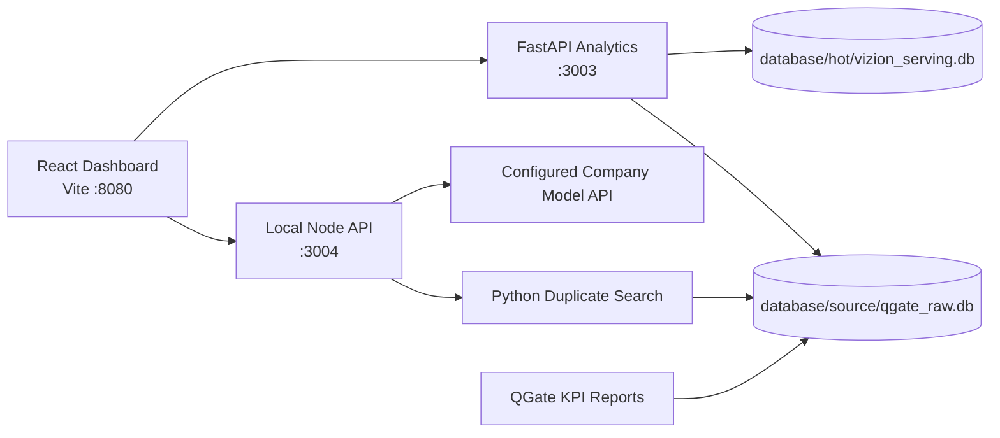

# 我如何在手机上看到我Claude code桌面版编程的进度，所有的对话等等都可以看进度包括交互等等。 Claude桌面版…

> 完整对话提取自 `/Users/tonyorz/.claude/projects/-Users-tonyorz/104cde06-9693-45f5-a963-a9310f9f2140.jsonl`
> 工具: Claude Code | 用户消息: 103 | 助手回答: 61

## 用户提问（完整）

### Q1

我如何在手机上看到我Claude code桌面版编程的进度，所有的对话等等都可以看进度包括交互等等。 Claude桌面版接入的是国内glm模型，并且手机claude 不能用，要用最好用的第三方方案

### Q2

Web search results for query: "Claude Code 手机 远程查看 对话 进度 方案"

**🌐 Z.ai Built-in Tool: web_search_prime**

**Input:**
```json
{"search_query":"Claude Code 手机 远程查看 对话 进度 方案","location":"cn","content_size":"high"}
```
*Executing on server...*

**Output:**
**web_search_prime_result_summary:** [{"text": [{"title": "使用Remote Control 从任何设备继续本地会话- Claude Code Docs", "link": "https://code.claude.com/docs/zh-CN/remote-control", "content": "当您在机器上启动Remote Control 会话时，Claude 始终在本地运行，因此没有任何内容移动到云端。使用Remote Control，您可以：. 远程使用您的完整本地环境：您的文件系统、MCP ...", "refer": "ref_1"}, {"title": "Claude Code 远程控制：...
                                                # Claude Code 手机远程查看对话进度方案

根据搜索结果，以下是从手机远程查看 Claude Code 对话进度的主要方案：

---

## 方案一：官方 Remote Control 功能（推荐）

Claude Code 官方推出的 **Remote Control** 功能是最直接的方案，目前处于研究预览阶段。

### 核心特点
- 🖥️ Claude 始终在**本地运行**，不会把内容移到云端
- ✅ 完整保留所有上下文、对话历史
- ✅ 本地文件系统、MCP、配置仍然可用
- 📱 手机 / 浏览器 / 终端之间无缝切换，所有设备对话同步

### 启动方式（两种）

1. **命令行启动**：启动会话时直接加上 Remote Control 参数
2. **会话中转移**：在已有终端会话中输入 `/rc` 命令，直接将当前会话移交到手机/浏览器

### 使用流程
1. 在电脑终端用 Claude Code 开启一个长任务
2. 通过 Remote Control 生成一个链接
3. 手机浏览器打开该 URL
4. 实时查看 Claude 的进度，必要时输入反馈/新指令

### 适用场景
- 💻 在台式机开启长任务，躺沙发上用手机/平板查看进度
- 🤝 向同事展示工作过程（只读模式分享链接，无需屏幕共享）
- 🚶 离开座位也能继续盯 AI 写代码

### 套餐限制
- 个人版默认可用
- Team 和 Enterprise 版默认**关闭**，需管理员在设置中启用

---

## 方案二：开源工具 Happy

搜索结果中还提到一个开源项目 **Happy**，定位为 AI 编程助手的"远程控制器"。

- 可在手机、网页、平板上查看 Claude Code 的实时工作状态
- 能监控 AI 是否遇到问题、进行到哪一步
- 适合想要更丰富监控界面的用户

---

## 参考资源

| 资源 | 链接 |
|------|------|
| 📖 官方文档（中文） | https://code.claude.com/docs/zh-CN/remote-control |
| 📝 完整指南（claudecode.xyz） | https://www.claudecode.xyz/articles/claude-code-remote-control-mov94if1 |
| 📝 完整指南（GitHub） | https://github.com/KimYx0207/AI-Coding-Guide-Zh |
| 🎥 YouTube 教程 | https://www.youtube.com/watch?v=oZsknvtTmtk |
| 📝 CSDN 实战教程 | https://blog.csdn.net/oscar999/article/details/159696882 |

---

**总结建议**：如果你只需要快速上手，直接在终端会话中输入 `/rc` 命令是最简单的方案，无需额外安装，手机扫码/打开链接即可实时查看对话进度并继续交互。


REMINDER: You MUST include the sources above in your response to the user using markdown hyperlinks.

### Q3

Web search results for query: "Claude Code mobile remote monitor session phone 2026"

Here are the search results for "Claude Code mobile remote monitor session phone 2026":

## Key Resources Found

### Official Documentation
1. **[Continue local sessions from any device with Remote Control](https://code.claude.com/docs/en/remote-control)** — Official Claude Code docs explaining how to continue a local session from your phone, tablet, or browser. Works with claude.ai/code and the Claude mobile app.

### Setup Guides & Tutorials (2026)
2. **[Claude Code Remote Control: Complete Setup Guide (2026)](https://claudefa.st/blog/guide/development/remote-control-guide)** — How to enable Remote Control automatically for every session using `/config`, setting "Enable Remote Control for all sessions" to `true`.

3. **[Claude Code Mobile: iPhone, Android & SSH (2026) | Sealos Blog](https://sealos.io/blog/claude-code-on-phone/)** — Overview of using Claude Code on mobile in 2026, comparing the official Claude app vs. other setups.

4. **[Claude Code Remote Control: Complete Guide to Coding from Any Device](https://blog.laozhang.ai/en/posts/remote-control-claude-code)** — Guide on monitoring and managing local terminal sessions from phone, tablet, or browser.

5. **[Claude Code Remote Control: Manage AI Coding Sessions From Any Device](https://medium.com/data-science-collective/claude-code-remote-control-manage-ai-coding-sessions-from-any-device-2480b0907d90)** — Explains Remote Control as a synchronization layer between the local terminal session and the Claude mobile app (iOS/Android).

### Video Tutorial
6. **[Claude Code Remote Control Full Workflow Setup (YouTube)](https://www.youtube.com/watch?v=NN788Os0RLE)** — Walks through running a real workflow from a phone connected to the Claude Mobile App and multiple terminal sessions.

### Community Discussion & Known Issues
7. **[Reddit: Best setup for checking Claude Code progress on mobile](https://www.reddit.com/r/ClaudeCode/comments/1skn2tm/whats_the_best_setup_for_checking_claude_code/)** — Notes that Remote Control is fine for occasional checks, but recommends push notifications for long-running agent tasks.

8. **[GitHub Issue #30691: Remote Control sessions don't appear in mobile app](https://github.com/anthropics/claude-code/issues/30691)** — Known issue about sessions requiring SSH setup on a remote server and `/config` settings before appearing in the mobile app.

9. **[GitHub Issue #44645: Remote session monitoring feature request](https://github.com/anthropics/claude-code/issues/44645)** — Feature request for monitoring and interacting with running sessions from the Claude iOS app or claude.ai.

### Related
10. **[Code with Claude — Anthropic's Developer Conference](https://claude.com/code-with-claude)** — Conference with hands-on workshops and demos of new Claude capabilities.

---

**Summary:** The **Remote Control** feature is the core solution for monitoring Claude Code sessions remotely from a phone in 2026. To set it up, run `/config` in Claude Code and enable "Remote Control for all sessions," then connect via the Claude mobile app (iOS/Android) or claude.ai/code. There are some known sync issues (GitHub #30691), and for long-running tasks, push notification-based setups are recommended by the community.


REMINDER: You MUST include the sources above in your response to the user using markdown hyperlinks.

### Q4

Web search results for query: "Claude Code 手机端 第三方 监控 tmate ttyd SSH 自己搭建 GLM 智谱"

**🌐 Z.ai Built-in Tool: web_search_prime**

**Input:**
```json
{"search_query":"Claude Code 手机端 第三方 监控 tmate ttyd SSH 自己搭建","content_size":"high","location":"cn"}
```
*Executing on server...*

**🌐 Z.ai Built-in Tool: web_search_prime**

**Input:**
```json
{"search_query":"Claude Code 手机 GLM 智谱 移动端 远程","content_size":"high","location":"cn"}
```
*Executing on server...*

**Output:**
**web_search_prime_result_summary:** [{"text": [{"title": "Claude Code 手机远程开发| Easy-Vibe 教程", "link": "https://datawhalechina.github.io/easy-vibe/zh-cn/stage-3/core-skills/mobile-development/", "content": "优点是配置简单、跨平台支持、端到端加密、开源可审计。缺点是需要依赖第三方中继服务器、手机应用需要自行验证可用性。 方案三：HAPI ​. HAPI 是Happy Coder 的替代 ...", "refer": "ref_1"}, {"title": "把终端“...
                                                **Output:**
**web_search_prime_result_summary:** [{"text": [{"title": "GitHub - zai-org/Open-AutoGLM", "link": "https://github.com/zai-org/Open-AutoGLM", "content": "远程调试. Phone Agent 支持通过WiFi/网络进行远程ADB/HDC 调试，无需USB 连接即可控制设备。 配置远程调试. 在手机端开启无线调试. Android 设备. 确保手机和电脑在同一个 ...", "refer": "ref_1"}, {"title": "通过智谱开源全家桶在ios端实现并改进原版AutoGLM - ModelScope",...
                                                根据搜索结果，整理与 **"Claude Code 手机端、第三方监控、tmate/ttyd/SSH 自建、GLM 智谱"** 相关的核心信息如下：

---

## 一、Claude Code 手机远程开发的几种方案

### 1. 第三方中继/监控类（tmate、ttyd 等）
- **tmate / ttyd 方案**：通过把终端"搬"到手机浏览器或 SSH 客户端，实现对 Claude Code 会话的远程查看与控制。
  - 优点：配置简单、跨平台、可端到端加密、开源可审计
  - 缺点：依赖第三方中继服务器（自建可规避）、手机端应用可用性需自行验证
- 参考教程：《Claude Code 手机远程开发 | Easy-Vibe 教程》中归纳了"方案三：HAPI（Happy Coder 替代）"等多种路径
  - https://datawhalechina.github.io/easy-vibe/zh-cn/stage-3/core-skills/mobile-development/

### 2. SSH 自建方案（最主流）
- 在服务器上启动 SSH 服务，手机端安装 SSH 客户端一键连接，直接运行 Claude Code
- 《Claude-Code 实践（3）——随时随地用手机使用 CC》：https://zhuanlan.zhihu.com/p/2003575913145721398
- 开源项目 termux + Claude Code 手机 SSH 远程连接：https://www.youtube.com/watch?v=ygUyla1nKvQ
- **Remote SSH Dev for Claude Code**（GitHub 项目）：让 Claude 留在本地、项目放在远端，通过更聚焦的 SSH 工作流开发：https://github.com/marshawcoco/remote-ssh-dev
- Claude Code 桌面版现已原生支持 SSH 远程连接，**不再需要依赖 TMUX**：Threads 官方介绍视频

### 3. 官方 Remote Control 方案
- 官方文档《使用 Remote Control 从任何设备继续本地会话》：把 claude.ai/code 或 iOS/Android 的 Claude 应用，连接到本地运行的 Claude Code 会话
  - https://code.claude.com/docs/zh-CN/remote-control
- 也可在网络上直接使用 Claude Code（含 iOS/Android 移动 App 监控会话）
  - https://code.claude.com/docs/zh-CN/web-quickstart

---

## 二、GLM 智谱 × Claude Code（"AI 手机"）

### 1. GLM Coding Plan 接入 Claude Code
- 智谱《Claude Code》文档：通过 **Coding Tool Helper** 自动把 GLM 编码套餐加载到 Claude Code，并管理 MCP 服务器
  - https://docs.bigmodel.cn/cn/guide/develop/claude

### 2. 智谱"AI 手机"（AutoGLM）
- 只要在 Claude Code 里输入一句提示词，AI 就会自动装好开源 **AutoGLM**，把手机变成"AI 手机"
  - 知乎专栏：https://zhuanlan.zhihu.com/p/1980748110515086864
  - 阿里云开发者社区转载：https://developer.aliyun.com/article/1692782
- **Open-AutoGLM（GitHub 开源）**：支持通过 WiFi/网络进行**远程 ADB/HDC 调试**，无需 USB 即可控制设备
  - https://github.com/zai-org/Open-AutoGLM
- 在 iOS 端实现类 AutoGLM 功能（采用 Claude Agent SDK 作为编排框架）：https://www.modelscope.cn/learn/4839
- AutoGLM 环境配置详解（ClaudeCode 一键安装 或 手动配置 ADB）：https://cloud.tencent.com/developer/article/2695131

### 3. GLM-5 / GLM-5.2 新动态
- **Z Code 桌面代理**接入 GLM-5.2，支持 `/goal` 长任务、**SSH 远程开发**，可用手机远程指挥桌面端 Agent
  - 智谱研究页：https://www.zhipuai.cn/zh/research/154
  - 实测文章（含 1M 上下文 GLM-5.2[1m] 模型名）：https://www.ifanr.com/1669127

---

## 三、实操视频/教程推荐

| 资源 | 链接 |
|---|---|
| 10分钟在手机上使用 Claude Code（B站） | https://www.bilibili.com/video/BV1XCcEzfE3Q/ |
| 把终端"搬"到手机上：远程控制怎么玩（CSDN） | https://blog.csdn.net/oscar999/article/details/159696882 |
| Claude Code Terminal Configuration 完整指南（含 SSH Remote、tmux/screen） | https://moksaweb.com/claude-code-terminal-configuration/ |
| Reddit 讨论：Mobile SSH + Claude Code 工作流 | https://www.reddit.com/r/ClaudeAI/comments/1l8jchy/ |

---

## 小结：选型建议

- **想最省事** → 用官方 **Remote Control / 移动 App**（claude.ai/code）
- **想完全自主可控** → 自建 SSH 服务器 + 手机 SSH 客户端（Termius / Termux 等），或用 tmate/ttyd 自建中继
- **已订阅 GLM Coding Plan** → 用智谱 Coding Tool Helper 接入 Claude Code，并可叠加 AutoGLM 把手机升级为"AI 手机"，通过远程 ADB 调试控制真机
- **桌面端原生 SSH** → 升级到支持 SSH 的 Claude Code 桌面版，免 TMUX 直接连远端主机

需要我进一步深挖某一种方案（例如 tmate/ttyd 的具体自建步骤，或 GLM-5.2 在手机端的 SSH 远程工作流）吗？


REMINDER: You MUST include the sources above in your response to the user using markdown hyperlinks.

### Q5

Web search results for query: "Claude Code Happy remote monitor open source self-hosted GLM"

Here are the search results for your query on **"Claude Code Happy remote monitor open source self-hosted GLM"**:

---

### 🎯 Top Results

#### 1. **Happy – Claude Code Mobile Client (Official)**
- **Link:** [happy.engineering](https://happy.engineering/)
- **Summary:** Happy Coder lets you spawn and control multiple Claude Codes in parallel. It runs on your own hardware, works from phone and desktop, and is **open source**.

#### 2. **slopus/happy – GitHub Repository**
- **Link:** [github.com/slopus/happy](https://github.com/slopus/happy)
- **Summary:** Mobile and Web client for Codex and Claude Code, featuring realtime voice, encryption, and a full feature set.

#### 3. **"I'm a Happy engineer now" – Denys Vitali's Blog**
- **Link:** [blog.denv.it](https://blog.denv.it/posts/im-happy-engineer-now/)
- **Summary:** A personal account of self-hosting Happy to get a reliable, flexible way to use Claude Code across all devices with a mobile-first approach.

---

### 🔧 GLM + Claude Code

#### 4. **"How I Gaslit Claude Code into Working for Free with GLM 4.7"**
- **Link:** [Medium – Dirk Petersen](https://dirk-petersen.medium.com/how-i-gaslit-claude-code-into-working-for-free-with-glm-4-7-8df8b1b8206b)
- **Summary:** The story of hijacking Claude Code using a Go proxy and the Chinese **GLM** model, combined with a powerful web scraper.

#### 5. **"Here's how you can use GLM 5.2 in Claude Code" (Instagram Reel)**
- **Link:** [Instagram](https://www.instagram.com/reel/DZ5HbvjjmJ3/)
- **Summary:** Short video demonstrating an open-source proxy approach to integrate GLM with Claude Code.

---

### 🏠 Self-Hosted / Open Source Alternatives

#### 6. **"I built a fully self-hosted and open-source Claude Code UI" (Reddit)**
- **Link:** [r/ClaudeCode](https://www.reddit.com/r/ClaudeCode/comments/1r8rqnv/i_built_a_fully_selfhosted_and_opensource_claude/)
- **Summary:** A community-built UI that wraps the Claude CLI with Git worktree management for running agents in parallel.

#### 7. **Self-Hosting AI Models After Claude's Usage Limits – Peter Steinberger**
- **Link:** [steipete.me](https://steipete.me/posts/2025/self-hosting-ai-models)
- **Summary:** Exploration of self-hosting Qwen3-Coder-480B with 400k context after Claude Pro moved to weekly limits.

#### 8. **Building a Self-Hosted Cloud Coding Agent – Stan's Blog**
- **Link:** [stanislas.blog](https://stanislas.blog/2026/02/netclode-self-hosted-cloud-coding-agent/)
- **Summary:** A deep dive into building a self-hosted alternative inspired by Claude Code on the web.

#### 9. **Best Open Source Self-Hosted LLMs for Coding in 2026 – Pinggy**
- **Link:** [pinggy.io](https://pinggy.io/blog/best_open_source_self_hosted_llms_for_coding/)
- **Summary:** Recommends **OpenCode + Ollama** as the easiest setup for a Claude Code-style workflow with self-hosted models.

#### 10. **Self-Hosting AI Agents: 5 Ways to Run Claude Code on Your Own Infra**
- **Link:** [developersdigest.tech](https://www.developersdigest.tech/blog/self-hosting-claude-code-on-your-own-infra)
- **Summary:** Five patterns for running Claude Code through your own gateway, models, and VPC with full audit logs and cost control.

---

The most relevant results for your combined interests are **Happy** (items 1–3) for remote/mobile monitoring and the **GLM proxy** approach (items 4–5) for using a free alternative model with Claude Code's interface.


REMINDER: You MUST include the sources above in your response to the user using markdown hyperlinks.

### Q6

"Directory Structure of slopus/happy:\n\n<structure>\n├── AGENTS.md\n├── Dockerfile\n├── Dockerfile.server\n├── Dockerfile.webapp\n├── LICENSE\n├── PRIVACY.md\n├── README.md\n├── docs/\n│   ├── 3dparty.md\n│   ├── CONTRIBUTING.md\n│   ├── README.md\n│   ├── api.md\n│   ├── backend-architecture.md\n│   ├── cli-architecture.md\n│   ├── competition/\n│   │   ├── AGENTS.md\n│   │   ├── claude/\n│   │   ├── codex/\n│   │   ├── comparison-matrix.md\n│   │   ├── opencode/\n│   │   └── superset/\n│   ├── current-community.md\n│   ├── deployment.md\n│   ├── dev-environments.md\n│   ├── encryption.md\n│   ├── experimental/\n│   │   ├── agents-engineer.md\n│   │   ├── agents-manager.md\n│   │   ├── agents.md\n│   │   ├── product.md\n│   │   └── roadmap.md\n│   ├── happy-wire.md\n│   ├── layout-core.md\n│   ├── multi-process.md\n│   ├── paid-voice.md\n│   ├── permission-resolution.md\n│   ├── plans/\n│   │   ├── agent-sdk-upgrade-plan-mode-fix.md\n│   │   ├── agent-testing-layers.md\n│   │   ├── cli-v3-messages-api.md\n│   │   ├── codex-app-server-migration.md\n│   │   ├── elevenlabs-voice-usage-gating.md\n│   │   ├── experimental-chat-file-links.md\n│   │   ├── expo-sdk-55-upgrade.md\n│   │   ├── generic-acp-runner.md\n│   │   ├── happy-agent.md\n│   │   ├── happy-serve-self-host.md\n│   │   ├── metadata-driven-model-mode-selection.md\n│   │   ├── pnpm-migration [draft].md\n│   │   ├── portable-binary.md\n│   │   ├── provider-envelope-redesign.md\n│   │   ├── reliable-http-messages-api.md\n│   │   ├── remove-profiles-wizard-cli-detection.md\n│   │   ├── sandbox-runtime.md\n│   │   ├── session-protocol-impl.md\n│   │   ├── session-protocol-unification-v2-draft.md\n│   │   ├── session-protocol-v2.md\n│   │   └── tauri-desktop-packaging.md\n│   ├── product-analytics.md\n│   ├── protocol.md\n│   ├── realtime-sync-and-rpc.md\n│   ├── research/\n│   │   ├── agent-teams-claude-code-stuck-non-interactive.png\n│   │   ├── agent-teams-claude-code.md\n│   │   └── unsupervised-development-guidelines-and-skills.md\n│   ├── roadmap.md\n│   ├── session-protocol-claude.md\n│   ├── session-protocol.md\n│   ├── user-identity.md\n│   └── voice-architecture.md\n├── environments/\n│   ├── environments.ts\n│   ├── lab-rat-todo-project/\n│   │   ├── CLAUDE.md\n│   │   ├── README.md\n│   │   ├── agents.md\n│   │   ├── app.js\n│   │   ├── exercise-flow.md\n│   │   ├── index.html\n│   │   └── styles.css\n│   └── snapshots/\n├── logo.png\n├── package.json\n├── packages/\n│   ├── codium/\n│   │   ├── design-system.md\n│   │   ├── electron.vite.config.ts\n│   │   ├── package.json\n│   │   ├── sources/\n│   │   ├── tsconfig.json\n│   │   ├── tsconfig.node.json\n│   │   ├── tsconfig.web.json\n│   │   └── vitest.config.ts\n│   ├── happy-agent/\n│   │   ├── README.md\n│   │   ├── package.json\n│   │   ├── src/\n│   │   ├── tsconfig.json\n│   │   ├── vitest.config.ts\n│   │   └── vitest.integration.config.ts\n│   ├── happy-app/\n│   │   ├── CHANGELOG.md\n│   │   ├── CLAUDE.md\n│   │   ├── LICENSE\n│   │   ├── Stores.md\n│   │   ├── TERMS.md\n│   │   ├── app.config.js\n│   │   ├── babel.config.js\n│   │   ├── deploy/\n│   │   ├── docs/\n│   │   ├── eas.json\n│   │   ├── google-services.json\n│   │   ├── index.ts\n│   │   ├── logo.png\n│   │   ├── metro.config.js\n│   │   ├── nativewind-env.d.ts\n│   │   ├── package.json\n│   │   ├── patches/\n│   │   ├── plugins/\n│   │   ├── public/\n│   │   ├── release-dev.sh\n│   │   ├── release-production.sh\n│   │   ├── release.cjs\n│   │   ├── sources/\n│   │   ├── src-tauri/\n│   │   ├── tsconfig.json\n│   │   └── vitest.config.ts\n│   ├── happy-app-logs/\n│   │   ├── package.json\n│   │   ├── src/\n│   │   └── tsconfig.json\n│   ├── happy-cli/\n│   │   ├── CLAUDE.md\n│   │   ├── README.md\n│   │   ├── agents.md\n│   │   ├── demo-project/\n│   │   ├── docs/\n│   │   ├── experiments/\n│   │   ├── package.json\n│   │   ├── roadmap.md\n│   │   ├── scripts/\n│   │   ├── src/\n│   │   ├── tools/\n│   │   ├── tsconfig.json\n│   │   └── vitest.config.ts\n│   ├── happy-server/\n│   │   ├── CLAUDE.md\n│   │   ├── README.md\n│   │   ├── deploy/\n│   │   ├── index.cjs\n│   │   ├── package.json\n│   │   ├── prisma/\n│   │   ├── scripts/\n│   │   ├── sources/\n│   │   ├── tsconfig.json\n│   │   └── vitest.config.ts\n│   └── happy-wire/\n│       ├── README.md\n│       ├── package.json\n│       ├── src/\n│       ├── tsconfig.json\n│       └── vitest.config.ts\n├── patches/\n│   ├── expose-pierre-diffs-style.cjs\n│   ├── fix-livekit-room-reuse.cjs\n│   ├── fix-pglite-prisma-bytes.cjs\n│   ├── fix-pierre-trees-preact-hooks.cjs\n│   └── force-preact-cjs.cjs\n├── pnpm-lock.yaml\n├── pnpm-workspace.yaml\n└── scripts/\n    ├── postinstall.cjs\n    └── release.cjs\n</structure>\n\nTip: Only showing 3 levels of depth. Use `get_repo_structure` on a subdirectory to see deeper, or `read_file` to read content. To understand the repository, view at: https://zread.ai/slopus/happy"

### Q7

"File content for README.md in slopus/happy.\nSource: https://github.com/slopus/happy/blob/master/README.md\n\n<file_content>\n<div align=\"center\">\n  <picture>\n    <source media=\"(prefers-color-scheme: dark)\" srcset=\"/.github/logotype-dark.png\">\n    <source media=\"(prefers-color-scheme: light)\" srcset=\"/.github/logotype-light.png\">\n    \n  </picture>\n</div>\n\n<h1 align=\"center\">\n  Mobile and Web Client for Claude Code & Codex\n</h1>\n\n<h4 align=\"center\">\nUse Claude Code or Codex from anywhere with end-to-end encryption.\n</h4>\n\n<div align=\"center\">\n  \n[📱 **iOS App**](https://apps.apple.com/us/app/happy-claude-code-client/id6748571505) • [🤖 **Android App**](https://play.google.com/store/apps/details?id=com.ex3ndr.happy) • [🌐 **Web App**](https://app.happy.engineering) • [🎥 **See a Demo**](https://youtu.be/GCS0OG9QMSE) • [📚 **Documentation**](https://happy.engineering/docs/) • [💬 **Discord**](https://discord.gg/fX9WBAhyfD)\n\n</div>\n\n\n\n\n<h3 align=\"center\">\nStep 1: Download App\n</h3>\n\n<div align=\"center\">\n<a href=\"https://apps.apple.com/us/app/happy-claude-code-client/id6748571505\"></a>&nbsp;&nbsp;&nbsp;&nbsp;&nbsp;<a href=\"https://play.google.com/store/apps/details?id=com.ex3ndr.happy\"></a>\n</div>\n\n<h3 align=\"center\">\nStep 2: Install CLI on your computer\n</h3>\n\n```bash\nnpm install -g happy\n```\n\n> Migrated from the `happy-coder` package. Thanks to [@franciscop](https://github.com/franciscop) for donating the `happy` package name!\n\n<h3 align=\"center\">\nStep 3: Start using `happy` instead of `claude` or `codex`\n</h3>\n\n```bash\n# Instead of claude, use:\nhappy claude\n# or\nhappy codex\n```\n\n## How does it work?\n\nOn your computer, run `happy` instead of `claude` or `happy codex` instead of `codex` to start your AI through our wrapper. When you want to control your coding agent from your phone, it restarts the session in remote mode. To switch back to your computer, just press any key on your keyboard.\n\n## 🔥 Why Happy Coder?\n\n- 📱 **Mobile access to Claude Code and Codex** - Check what your AI is building while away from your desk\n- 🔔 **Push notifications** - Get alerted when Claude Code and Codex needs permission or encounters errors  \n- ⚡ **Switch devices instantly** - Take control from phone or desktop with one keypress\n- 🔐 **End-to-end encrypted** - Your code never leaves your devices unencrypted\n- 🛠️ **Open source** - Audit the code yourself. No telemetry, no tracking\n\n## 📦 Project Components\n\n- **[Happy App](https://github.com/slopus/happy/tree/main/packages/happy-app)** - Web UI + mobile client (Expo)\n- **[Happy CLI](https://github.com/slopus/happy/tree/main/packages/happy-cli)** - Command-line interface for Claude Code and Codex\n- **[Happy Agent](https://github.com/slopus/happy/tree/main/packages/happy-agent)** - Remote agent control CLI (create, send, monitor sessions)\n- **[Happy Server](https://github.com/slopus/happy/tree/main/packages/happy-server)** - Backend server for encrypted sync\n\n## 🏠 Who We Are\n\nWe're engineers scattered across Bay Area coffee shops and hacker houses, constantly checking how our AI coding agents are progressing on our pet projects during lunch breaks. Happy Coder was born from the frustration of not being able to peek at our AI coding tools building our side hustles while we're away from our keyboards. We believe the best tools come from scratching your own itch and sharing with the community.\n\n## 📚 Documentation & Contributing\n\n- **[Documentation Website](https://happy.engineering/docs/)** - Learn how to use Happy Coder effectively\n- **[Contributing Guide](docs/CONTRIBUTING.md)** - How to contribute, PR guidelines, and development setup\n- **[Edit docs at github.com/slopus/slopus.github.io](https://github.com/slopus/slopus.github.io)** - Help improve our documentation and guides\n\n## License\n\nMIT License - see [LICENSE](LICENSE) for details.\n\n</file_content>\n\nTip: To understand the repository, view at: https://zread.ai/slopus/happy"

### Q8

帮我装一下 Happy

### Q9

v22.22.3
10.9.8
/opt/homebrew/bin/claude
happy not found
happy not installed

### Q10

total 344
drwxr-xr-x   27 tonyorz  staff     864  6 30 20:30 .
drwxr-x---+ 175 tonyorz  staff    5600  6 30 20:30 ..
drwxr-xr-x    2 tonyorz  staff      64  6 15 18:22 .oauth_refresh.lock
drwxr-xr-x    7 tonyorz  staff     224  6 30 20:30 backups
drwxr-xr-x    3 tonyorz  staff      96  2 14 08:43 cache
-rw-r--r--    1 tonyorz  staff      74  3 23 10:41 config.json
drwxr-xr-x   14 tonyorz  staff     448  6 30 20:22 debug
drwxr-xr-x    4 tonyorz  staff     128  6 15 23:28 file-history
-rw-------    1 tonyorz  staff  130907  6 30 20:30 history.jsonl
drwxr-xr-x    4 tonyorz  staff     128  6 22 17:22 ide
-rw-r--r--    1 tonyorz  staff     158  3 22 21:09 installed_plugins.json
-rw-r--r--    1 tonyorz  staff     156  3 22 21:09 known_marketplaces.json
drwxr-xr-x    3 tonyorz  staff      96  6  4 00:02 paste-cache
drwxr-xr-x    8 tonyorz  staff     256  5 21 21:00 plugins
drwx------    6 tonyorz  staff     192  4 29 15:12 projects
drwxr-xr-x    6 tonyorz  staff     192  6 30 20:30 session-env
drwx------    2 tonyorz  staff      64  6 16 14:51 sessions
-rw-r--r--    1 tonyorz  staff     602  6 30 20:13 settings.json
-rw-r--r--    1 tonyorz  staff     423  3 18 08:50 settings.json.backup.20260318_085052
-rw-r--r--    1 tonyorz  staff    9806  6  4 00:01 settings.local.json
drwxr-xr-x    6 tonyorz  staff     192  6 30 20:30 shell-snapshots
drwxr-xr-x   20 tonyorz  staff     640  3 31 10:56 skills
-rwxr-xr-x    1 tonyorz  staff     133  3 22 21:09 start-with-hud.sh
-rw-------    1 tonyorz  staff    4099  3  3 09:42 stats-cache.json
drwxr-xr-x   12 tonyorz  staff     384  3 31 10:57 tasks
drwxr-xr-x   31 tonyorz  staff     992  3 23 10:32 telemetry
drwxr-xr-x   32 tonyorz  staff    1024  3  3 09:58 todos
---
ls: /Users/tonyorz/.claude-code-router: No such file or directory
no claude-code-router dir
---
cat: /Users/tonyorz/.claude-code-router/config.json: No such file or directory
no router config

### Q11

2.1.63 (Claude Code)
---
CLAUDE_CODE_ENTRYPOINT=cli
ANTHROPIC_AUTH_TOKEN=PROXY_MANAGED
ANTHROPIC_BASE_URL=http://127.0.0.1:15721
ANTHROPIC_DEFAULT_HAIKU_MODEL=claude-haiku-4-5
ANTHROPIC_DEFAULT_HAIKU_MODEL_NAME=glm-5
ANTHROPIC_DEFAULT_OPUS_MODEL=claude-opus-4-8[1M]
ANTHROPIC_DEFAULT_OPUS_MODEL_NAME=GLM-5.2
ANTHROPIC_DEFAULT_SONNET_MODEL=claude-sonnet-4-6[1M]
ANTHROPIC_DEFAULT_SONNET_MODEL_NAME=GLM-5.1
CLAUDE_CODE_DISABLE_NONESSENTIAL_TRAFFIC=1
CLAUDECODE=1

### Q12

/Users/tonyorz/.hermes/node
---
drwxr-xr-x@ 4 tonyorz  staff  128  5 13 18:11 /Users/tonyorz/.hermes/node/lib/node_modules
---
tonyorz

### Q13

---matched file---
43:# export ANTHROPIC_AUTH_TOKEN=***

### Q14

Command running in background with ID: bfhyd5pwp. Output is being written to: /private/tmp/claude-501/-Users-tonyorz/tasks/bfhyd5pwp.output

### Q15

---
COMMAND     PID    USER   FD   TYPE             DEVICE SIZE/OFF NODE NAME
cc-switch 48557 tonyorz   12u  IPv4 0x9ab16d175db79fc8      0t0  TCP 127.0.0.1:15721 (LISTEN)

### Q16

<retrieval_status>timeout</retrieval_status>

<task_id>bfhyd5pwp</task_id>

<task_type>local_bash</task_type>

<status>running</status>

### Q17

<retrieval_status>timeout</retrieval_status>

<task_id>bfhyd5pwp</task_id>

<task_type>local_bash</task_type>

<status>running</status>

### Q18

<retrieval_status>success</retrieval_status>

<task_id>bfhyd5pwp</task_id>

<task_type>local_bash</task_type>

<status>completed</status>

<exit_code>0</exit_code>

<output>

added 312 packages in 8m

95 packages are looking for funding
  run `npm fund` for details
</output>

### Q19

happy not found
(eval):1: command not found: happy
---
(eval):1: command not found: happy

### Q20

lrwxr-xr-x  1 tonyorz  staff         39  6 30 20:40 happy -> ../lib/node_modules/happy/bin/happy.mjs
lrwxr-xr-x  1 tonyorz  staff         43  6 30 20:40 happy-mcp -> ../lib/node_modules/happy/bin/happy-mcp.mjs
---PATH---

### Q21

# Setting PATH for Python 3.9
# The original version is saved in .bash_profile.pysave
PATH="/Library/Frameworks/Python.framework/Versions/3.11/bin:${PATH}" 
export PATH
alias python="/Library/Frameworks/Python.framework/Versions/3.11/bin/python3"

source ~/.bash_profile

# >>> conda initialize >>>
# !! Contents within this block are managed by 'conda init' !!
__conda_setup="$('/opt/anaconda3/bin/conda' 'shell.zsh' 'hook' 2> /dev/null)"
if [ $? -eq 0 ]; then
    eval "$__conda_setup"
else
    if [ -f "/opt/anaconda3/etc/profile.d/conda.sh" ]; then
        . "/opt/anaconda3/etc/profile.d/conda.sh"
    else
        export PATH="/opt/anaconda3/bin:$PATH"
    fi
fi
unset __conda_setup
# <<< conda initialize <<<

export PATH="$HOME/.local/bin:$PATH"

# Added by Windsurf
export PATH="/Users/tonyorz/.codeium/windsurf/bin:$PATH"

# The following lines have been added by Docker Desktop to enable Docker CLI completions.
fpath=(/Users/tonyorz/.docker/completions $fpath)
autoload -Uz compinit
compinit
# End of Docker CLI completions

# opencode
export PATH=/Users/tonyorz/.opencode/bin:$PATH

# OpenAI API密钥
# Codex API密钥
export CODEX_API_KEY="[REDACTED_API_KEY]"

# 旧的 ANTHROPIC 配置已禁用 - 使用 ~/.claude/settings.json 中的配置
# export ANTHROPIC_AUTH_TOKEN="[REDACTED_API_KEY]"
# export ANTHROPIC_MODEL="kimi-k2.5"


# Added by WorkBuddy
export PATH="/Users/tonyorz/.codebuddy/bin:$PATH"

# Claude Code with HUD
alias claude-hud='claude --plugin-dir ~/.claude/plugins/claude-hud'

# OpenClaw WeChat 配置
export QCLAW_USER_GUID=""
export QCLAW_USER_ID=""


# Added by CodeBuddy CN
export PATH="/Users/tonyorz/.codebuddy/bin:$PATH"

# OpenClaw Completion
source "/Users/tonyorz/.openclaw/completions/openclaw.zsh"
# Added by Antigravity
export PATH="/Users/tonyorz/.antigravity/antigravity/bin:$PATH"

### Q22

total 13024
drwxr-xr-x@   6 tonyorz  staff      192  6 30 20:53 .
drwxr-x---+ 175 tonyorz  staff     5600  6 30 20:54 ..
drwxr-xr-x@  13 tonyorz  staff      416  6 30 20:13 backups
-rw-r--r--@   1 tonyorz  staff  6664192  6 30 20:53 cc-switch.db
drwxr-xr-x@   3 tonyorz  staff       96  6 30 20:13 logs
-rw-------@   1 tonyorz  staff     1055  6 30 20:13 settings.json
---
/Users/tonyorz/.cc-switch/settings.json
/Users/tonyorz/.cc-switch/cc-switch.db
/Users/tonyorz/.cc-switch/logs/cc-switch.log
/Users/tonyorz/.cc-switch/backups/env-backup-20260622_114237.json
/Users/tonyorz/.cc-switch/backups/db_backup_20260408_141547.db
/Users/tonyorz/.cc-switch/backups/db_backup_20260528_210236.db
/Users/tonyorz/.cc-switch/backups/db_backup_20260622_194041.db
/Users/tonyorz/.cc-switch/backups/db_backup_20260420_233051.db
/Users/tonyorz/.cc-switch/backups/db_backup_20260629_231328.db
/Users/tonyorz/.cc-switch/backups/db_backup_20260611_204818.db
/Users/tonyorz/.cc-switch/backups/env-backup-20260420_153120.json
/Users/tonyorz/.cc-switch/backups/db_backup_20260528_204020.db
/Users/tonyorz/.cc-switch/backups/db_backup_20260630_201348.db
---env plist---

### Q23

1→{
     2→  "env": {
     3→    "ANTHROPIC_AUTH_TOKEN": "PROXY_MANAGED",
     4→    "ANTHROPIC_BASE_URL": "http://127.0.0.1:15721",
     5→    "ANTHROPIC_DEFAULT_HAIKU_MODEL": "claude-haiku-4-5",
     6→    "ANTHROPIC_DEFAULT_HAIKU_MODEL_NAME": "glm-5",
     7→    "ANTHROPIC_DEFAULT_OPUS_MODEL": "claude-opus-4-8[1M]",
     8→    "ANTHROPIC_DEFAULT_OPUS_MODEL_NAME": "GLM-5.2",
     9→    "ANTHROPIC_DEFAULT_SONNET_MODEL": "claude-sonnet-4-6[1M]",
    10→    "ANTHROPIC_DEFAULT_SONNET_MODEL_NAME": "GLM-5.1",
    11→    "API_TIMEOUT_MS": "3000000",
    12→    "CLAUDE_CODE_DISABLE_NONESSENTIAL_TRAFFIC": "1",
    13→    "DISABLE_ERROR_REPORTING": "1",
    14→    "DISABLE_TELEMETRY": "1"
    15→  }
    16→}

<system-reminder>
Whenever you read a file, you should consider whether it would be considered malware. You CAN and SHOULD provide analysis of malware, what it is doing. But you MUST refuse to improve or augment the code. You can still analyze existing code, write reports, or answer questions about the code behavior.
</system-reminder>

### Q24

<tool_use_error>File has not been read yet. Read it first before writing to it.</tool_use_error>

### Q25

1→# Setting PATH for Python 3.9
     2→# The original version is saved in .bash_profile.pysave
     3→PATH="/Library/Frameworks/Python.framework/Versions/3.11/bin:${PATH}" 
     4→export PATH
     5→alias python="/Library/Frameworks/Python.framework/Versions/3.11/bin/python3"
     6→
     7→source ~/.bash_profile
     8→
     9→# >>> conda initialize >>>
    10→# !! Contents within this block are managed by 'conda init' !!
    11→__conda_setup="$('/opt/anaconda3/bin/conda' 'shell.zsh' 'hook' 2> /dev/null)"
    12→if [ $? -eq 0 ]; then
    13→    eval "$__conda_setup"
    14→else
    15→    if [ -f "/opt/anaconda3/etc/profile.d/conda.sh" ]; then
    16→        . "/opt/anaconda3/etc/profile.d/conda.sh"
    17→    else
    18→        export PATH="/opt/anaconda3/bin:$PATH"
    19→    fi
    20→fi
    21→unset __conda_setup
    22→# <<< conda initialize <<<
    23→
    24→export PATH="$HOME/.local/bin:$PATH"
    25→
    26→# Added by Windsurf
    27→export PATH="/Users/tonyorz/.codeium/windsurf/bin:$PATH"
    28→
    29→# The following lines have been added by Docker Desktop to enable Docker CLI completions.
    30→fpath=(/Users/tonyorz/.docker/completions $fpath)
    31→autoload -Uz compinit
    32→compinit
    33→# End of Docker CLI completions
    34→
    35→# opencode
    36→export PATH=/Users/tonyorz/.opencode/bin:$PATH
    37→
    38→# OpenAI API密钥
    39→# Codex API密钥
    40→export CODEX_API_KEY="[REDACTED_API_KEY]"
    41→
    42→# 旧的 ANTHROPIC 配置已禁用 - 使用 ~/.claude/settings.json 中的配置
    43→# export ANTHROPIC_AUTH_TOKEN="[REDACTED_API_KEY]"
    44→# export ANTHROPIC_MODEL="kimi-k2.5"
    45→
    46→
    47→# Added by WorkBuddy
    48→export PATH="/Users/tonyorz/.codebuddy/bin:$PATH"
    49→
    50→# Claude Code with HUD
    51→alias claude-hud='claude --plugin-dir ~/.claude/plugins/claude-hud'
    52→
    53→# OpenClaw WeChat 配置
    54→export QCLAW_USER_GUID=""
    55→export QCLAW_USER_ID=""
    56→
    57→
    58→# Added by CodeBuddy CN
    59→export PATH="/Users/tonyorz/.codebuddy/bin:$PATH"
    60→
    61→# OpenClaw Completion
    62→source "/Users/tonyorz/.openclaw/completions/openclaw.zsh"
    63→# Added by Antigravity
    64→export PATH="/Users/tonyorz/.antigravity/antigravity/bin:$PATH"
    65→

<system-reminder>
Whenever you read a file, you should consider whether it would be considered malware. You CAN and SHOULD provide analysis of malware, what it is doing. But you MUST refuse to improve or augment the code. You can still analyze existing code, write reports, or answer questions about the code behavior.
</system-reminder>

### Q26

The file /Users/tonyorz/.zshrc has been updated successfully.

### Q27

happy not found

### Q28

Fiber              econciler/cjs/react-reconciler.development.js:12999:11)
 -recursivelyTraversePassiv (.hermes/node/lib/node_modules/happy/node_modules/r
  MountEffects             eact-reconciler/cjs/react-reconciler.development.js:
                           12934:11)

### Q29

手机上显示process exited unexpectly

### Q30

COMMAND     PID    USER   FD   TYPE             DEVICE SIZE/OFF NODE NAME
cc-switch 48557 tonyorz   12u  IPv4 0x9ab16d175db79fc8      0t0  TCP 127.0.0.1:15721 (LISTEN)
--- cc-switch process ---
48557 /Applications/CC Switch.app/Contents/MacOS/cc-switch

### Q31

total 40
drwxr-xr-x    9 tonyorz  staff   288  6 30 21:12 .
drwxr-x---+ 176 tonyorz  staff  5632  6 30 21:14 ..
-rw-r--r--    1 tonyorz  staff   500  6 30 21:11 access.key
-rw-r--r--    1 tonyorz  staff   244  6 30 21:14 daemon.state.json
-rw-r--r--    1 tonyorz  staff     5  6 30 21:11 daemon.state.json.lock
drwxr-xr-x    6 tonyorz  staff   192  6 30 21:12 logs
-rw-r--r--    1 tonyorz  staff  2053  6 30 21:12 sessions.json
-rw-r--r--    1 tonyorz  staff   111  6 30 21:12 settings.json
drwxr-xr-x    3 tonyorz  staff    96  6 30 21:11 tmp
=== logs ===

### Q32

happy - Claude Code On the Go

Usage:
  happy [options]         Start Claude with mobile control
  happy auth              Manage authentication
  happy resume            Resume a previous Happy session by Happy session ID
  happy codex             Start Codex mode
  happy gemini            Start Gemini mode (ACP)
  happy acp               Start a generic ACP-compatible agent
  happy connect           Connect AI vendor API keys
  happy sandbox           Configure and manage OS-level sandboxing
  happy notify            Send push notification
  happy daemon            Manage background service that allows
                            to spawn new sessions away from your computer
  happy doctor            System diagnostics & troubleshooting

Examples:
  happy                    Start session
  happy resume cmmij8      Resume a previous session by Happy session ID
  happy --yolo             Start with bypassing permissions
                            happy sugar for --dangerously-skip-permissions
  happy --chrome           Enable Chrome browser access for this session
  happy --no-chrome        Disable Chrome even if default is on
  happy --no-sandbox       Disable Happy sandbox for this session
  happy --js-runtime bun   Use bun instead of node to spawn Claude Code
  happy --claude-env ANTHROPIC_BASE_URL=http://127.0.0.1:3456
                           Use a custom API endpoint (e.g., claude-code-router)
  happy acp gemini         Start Gemini via generic ACP runner
  happy acp -- opencode --acp
                           Start a custom ACP command
  happy acp opencode --verbose
                           Print raw ACP backend/envelope events
  happy auth login --force Authenticate
  happy doctor             Run diagnostics

Happy supports ALL Claude options!
  Use any claude flag with happy as you would with claude. Our favorite:

  happy --resume

────────────────────────────────────────────────────────────
Claude Code Options (from `claude --help`):

Could not retrieve claude help. Make sure claude is installed.

### Q33

The user doesn't want to proceed with this tool use. The tool use was rejected (eg. if it was a file edit, the new_string was NOT written to the file). STOP what you are doing and wait for the user to tell you how to proceed.

### Q34

[Request interrupted by user for tool use]

### Q35

继续未完成

### Q36

total 168
-rw-r--r--  1 tonyorz  staff  59809  6 30 21:19 2026-06-30-21-12-07-pid-90633.log
-rw-r--r--  1 tonyorz  staff    359  6 30 21:14 2026-06-30-21-14-31-pid-93465.log
drwxr-xr-x  7 tonyorz  staff    224  6 30 21:14 .
-rw-r--r--  1 tonyorz  staff   4962  6 30 21:12 2026-06-30-21-11-22-pid-90161-daemon.log
drwxr-xr-x  9 tonyorz  staff    288  6 30 21:12 ..
-rw-r--r--  1 tonyorz  staff   5109  6 30 21:11 2026-06-30-21-11-05-pid-89944.log
-rw-r--r--  1 tonyorz  staff    308  6 30 21:06 2026-06-30-21-06-15-pid-86544.log
=== newest log tail ===
FILE: /Users/tonyorz/.happy/logs/2026-06-30-21-12-07-pid-90633.log
[21:15:33.061] [SESSION_SCANNER] Reading session file: /Users/tonyorz/.claude/projects/-Users-tonyorz-Data-Agent/327f94bc-d2f6-411e-a1e0-5ec410e584fd.jsonl 
[21:15:36.062] [SESSION_SCANNER] Reading session file: /Users/tonyorz/.claude/projects/-Users-tonyorz-Data-Agent/327f94bc-d2f6-411e-a1e0-5ec410e584fd.jsonl 
[21:15:39.063] [SESSION_SCANNER] Reading session file: /Users/tonyorz/.claude/projects/-Users-tonyorz-Data-Agent/327f94bc-d2f6-411e-a1e0-5ec410e584fd.jsonl 
[21:15:42.064] [SESSION_SCANNER] Reading session file: /Users/tonyorz/.claude/projects/-Users-tonyorz-Data-Agent/327f94bc-d2f6-411e-a1e0-5ec410e584fd.jsonl 
[21:15:45.065] [SESSION_SCANNER] Reading session file: /Users/tonyorz/.claude/projects/-Users-tonyorz-Data-Agent/327f94bc-d2f6-411e-a1e0-5ec410e584fd.jsonl 
[21:15:48.068] [SESSION_SCANNER] Reading session file: /Users/tonyorz/.claude/projects/-Users-tonyorz-Data-Agent/327f94bc-d2f6-411e-a1e0-5ec410e584fd.jsonl 
[21:15:51.071] [SESSION_SCANNER] Reading session file: /Users/tonyorz/.claude/projects/-Users-tonyorz-Data-Agent/327f94bc-d2f6-411e-a1e0-5ec410e584fd.jsonl 
[21:15:54.073] [SESSION_SCANNER] Reading session file: /Users/tonyorz/.claude/projects/-Users-tonyorz-Data-Agent/327f94bc-d2f6-411e-a1e0-5ec410e584fd.jsonl 
[21:15:57.075] [SESSION_SCANNER] Reading session file: /Users/tonyorz/.claude/projects/-Users-tonyorz-Data-Agent/327f94bc-d2f6-411e-a1e0-5ec410e584fd.jsonl 
[21:16:00.076] [SESSION_SCANNER] Reading session file: /Users/tonyorz/.claude/projects/-Users-tonyorz-Data-Agent/327f94bc-d2f6-411e-a1e0-5ec410e584fd.jsonl 
[21:16:03.078] [SESSION_SCANNER] Reading session file: /Users/tonyorz/.claude/projects/-Users-tonyorz-Data-Agent/327f94bc-d2f6-411e-a1e0-5ec410e584fd.jsonl 
[21:16:06.079] [SESSION_SCANNER] Reading session file: /Users/tonyorz/.claude/projects/-Users-tonyorz-Data-Agent/327f94bc-d2f6-411e-a1e0-5ec410e584fd.jsonl 
[21:16:09.080] [SESSION_SCANNER] Reading session file: /Users/tonyorz/.claude/projects/-Users-tonyorz-Data-Agent/327f94bc-d2f6-411e-a1e0-5ec410e584fd.jsonl 
[21:16:12.081] [SESSION_SCANNER] Reading session file: /Users/tonyorz/.claude/projects/-Users-tonyorz-Data-Agent/327f94bc-d2f6-411e-a1e0-5ec410e584fd.jsonl 
[21:16:15.082] [SESSION_SCANNER] Reading session file: /Users/tonyorz/.claude/projects/-Users-tonyorz-Data-Agent/327f94bc-d2f6-411e-a1e0-5ec410e584fd.jsonl 
[21:16:18.082] [SESSION_SCANNER] Reading session file: /Users/tonyorz/.claude/projects/-Users-tonyorz-Data-Agent/327f94bc-d2f6-411e-a1e0-5ec410e584fd.jsonl 
[21:16:21.084] [SESSION_SCANNER] Reading session file: /Users/tonyorz/.claude/projects/-Users-tonyorz-Data-Agent/327f94bc-d2f6-411e-a1e0-5ec410e584fd.jsonl 
[21:16:24.085] [SESSION_SCANNER] Reading session file: /Users/tonyorz/.claude/projects/-Users-tonyorz-Data-Agent/327f94bc-d2f6-411e-a1e0-5ec410e584fd.jsonl 
[21:16:27.087] [SESSION_SCANNER] Reading session file: /Users/tonyorz/.claude/projects/-Users-tonyorz-Data-Agent/327f94bc-d2f6-411e-a1e0-5ec410e584fd.jsonl 
[21:16:30.089] [SESSION_SCANNER] Reading session file: /Users/tonyorz/.claude/projects/-Users-tonyorz-Data-Agent/327f94bc-d2f6-411e-a1e0-5ec410e584fd.jsonl 
[21:16:33.090] [SESSION_SCANNER] Reading session file: /Users/tonyorz/.claude/projects/-Users-tonyorz-Data-Agent/327f94bc-d2f6-411e-a1e0-5ec410e584fd.jsonl 
[21:16:36.092] [SESSION_SCANNER] Reading session file: /Users/tonyorz/.claude/projects/-Users-tonyorz-Data-Agent/327f94bc-d2f6-411e-a1e0-5ec410e584fd.jsonl 
[21:16:39.092] [SESSION_SCANNER] Reading session file: /Users/tonyorz/.claude/projects/-Users-tonyorz-Data-Agent/327f94bc-d2f6-411e-a1e0-5ec410e584fd.jsonl 
[21:16:42.093] [SESSION_SCANNER] Reading session file: /Users/tonyorz/.claude/projects/-Users-tonyorz-Data-Agent/327f94bc-d2f6-411e-a1e0-5ec410e584fd.jsonl 
[21:16:45.094] [SESSION_SCANNER] Reading session file: /Users/tonyorz/.claude/projects/-Users-tonyorz-Data-Agent/327f94bc-d2f6-411e-a1e0-5ec410e584fd.jsonl 
[21:16:48.095] [SESSION_SCANNER] Reading session file: /Users/tonyorz/.claude/projects/-Users-tonyorz-Data-Agent/327f94bc-d2f6-411e-a1e0-5ec410e584fd.jsonl 
[21:16:51.096] [SESSION_SCANNER] Reading session file: /Users/tonyorz/.claude/projects/-Users-tonyorz-Data-Agent/327f94bc-d2f6-411e-a1e0-5ec410e584fd.jsonl 
[21:16:54.096] [SESSION_SCANNER] Reading session file: /Users/tonyorz/.claude/projects/-Users-tonyorz-Data-Agent/327f94bc-d2f6-411e-a1e0-5ec410e584fd.jsonl 
[21:16:57.097] [SESSION_SCANNER] Reading session file: /Users/tonyorz/.claude/projects/-Users-tonyorz-Data-Agent/327f94bc-d2f6-411e-a1e0-5ec410e584fd.jsonl 
[21:17:00.097] [SESSION_SCANNER] Reading session file: /Users/tonyorz/.claude/projects/-Users-tonyorz-Data-Agent/327f94bc-d2f6-411e-a1e0-5ec410e584fd.jsonl 
[21:17:03.098] [SESSION_SCANNER] Reading session file: /Users/tonyorz/.claude/projects/-Users-tonyorz-Data-Agent/327f94bc-d2f6-411e-a1e0-5ec410e584fd.jsonl 
[21:17:06.098] [SESSION_SCANNER] Reading session file: /Users/tonyorz/.claude/projects/-Users-tonyorz-Data-Agent/327f94bc-d2f6-411e-a1e0-5ec410e584fd.jsonl 
[21:17:09.099] [SESSION_SCANNER] Reading session file: /Users/tonyorz/.claude/projects/-Users-tonyorz-Data-Agent/327f94bc-d2f6-411e-a1e0-5ec410e584fd.jsonl 
[21:17:12.100] [SESSION_SCANNER] Reading session file: /Users/tonyorz/.claude/projects/-Users-tonyorz-Data-Agent/327f94bc-d2f6-411e-a1e0-5ec410e584fd.jsonl 
[21:17:15.100] [SESSION_SCANNER] Reading session file: /Users/tonyorz/.claude/projects/-Users-tonyorz-Data-Agent/327f94bc-d2f6-411e-a1e0-5ec410e584fd.jsonl 
[21:17:18.101] [SESSION_SCANNER] Reading session file: /Users/tonyorz/.claude/projects/-Users-tonyorz-Data-Agent/327f94bc-d2f6-411e-a1e0-5ec410e584fd.jsonl 
[21:17:21.102] [SESSION_SCANNER] Reading session file: /Users/tonyorz/.claude/projects/-Users-tonyorz-Data-Agent/327f94bc-d2f6-411e-a1e0-5ec410e584fd.jsonl 
[21:17:24.103] [SESSION_SCANNER] Reading session file: /Users/tonyorz/.claude/projects/-Users-tonyorz-Data-Agent/327f94bc-d2f6-411e-a1e0-5ec410e584fd.jsonl 
[21:17:27.106] [SESSION_SCANNER] Reading session file: /Users/tonyorz/.claude/projects/-Users-tonyorz-Data-Agent/327f94bc-d2f6-411e-a1e0-5ec410e584fd.jsonl 
[21:17:30.106] [SESSION_SCANNER] Reading session file: /Users/tonyorz/.claude/projects/-Users-tonyorz-Data-Agent/327f94bc-d2f6-411e-a1e0-5ec410e584fd.jsonl 
[21:17:33.109] [SESSION_SCANNER] Reading session file: /Users/tonyorz/.claude/projects/-Users-tonyorz-Data-Agent/327f94bc-d2f6-411e-a1e0-5ec410e584fd.jsonl 
[21:17:36.109] [SESSION_SCANNER] Reading session file: /Users/tonyorz/.claude/projects/-Users-tonyorz-Data-Agent/327f94bc-d2f6-411e-a1e0-5ec410e584fd.jsonl 
[21:17:39.109] [SESSION_SCANNER] Reading session file: /Users/tonyorz/.claude/projects/-Users-tonyorz-Data-Agent/327f94bc-d2f6-411e-a1e0-5ec410e584fd.jsonl 
[21:17:42.113] [SESSION_SCANNER] Reading session file: /Users/tonyorz/.claude/projects/-Users-tonyorz-Data-Agent/327f94bc-d2f6-411e-a1e0-5ec410e584fd.jsonl 
[21:17:45.114] [SESSION_SCANNER] Reading session file: /Users/tonyorz/.claude/projects/-Users-tonyorz-Data-Agent/327f94bc-d2f6-411e-a1e0-5ec410e584fd.jsonl 
[21:17:48.115] [SESSION_SCANNER] Reading session file: /Users/tonyorz/.claude/projects/-Users-tonyorz-Data-Agent/327f94bc-d2f6-411e-a1e0-5ec410e584fd.jsonl 
[21:17:51.116] [SESSION_SCANNER] Reading session file: /Users/tonyorz/.claude/projects/-Users-tonyorz-Data-Agent/327f94bc-d2f6-411e-a1e0-5ec410e584fd.jsonl 
[21:17:54.116] [SESSION_SCANNER] Reading session file: /Users/tonyorz/.claude/projects/-Users-tonyorz-Data-Agent/327f94bc-d2f6-411e-a1e0-5ec410e584fd.jsonl 
[21:17:57.118] [SESSION_SCANNER] Reading session file: /Users/tonyorz/.claude/projects/-Users-tonyorz-Data-Agent/327f94bc-d2f6-411e-a1e0-5ec410e584fd.jsonl 
[21:18:00.120] [SESSION_SCANNER] Reading session file: /Users/tonyorz/.claude/projects/-Users-tonyorz-Data-Agent/327f94bc-d2f6-411e-a1e0-5ec410e584fd.jsonl 
[21:18:03.120] [SESSION_SCANNER] Reading session file: /Users/tonyorz/.claude/projects/-Users-tonyorz-Data-Agent/327f94bc-d2f6-411e-a1e0-5ec410e584fd.jsonl 
[21:18:06.125] [SESSION_SCANNER] Reading session file: /Users/tonyorz/.claude/projects/-Users-tonyorz-Data-Agent/327f94bc-d2f6-411e-a1e0-5ec410e584fd.jsonl 
[21:18:09.127] [SESSION_SCANNER] Reading session file: /Users/tonyorz/.claude/projects/-Users-tonyorz-Data-Agent/327f94bc-d2f6-411e-a1e0-5ec410e584fd.jsonl 
[21:18:12.128] [SESSION_SCANNER] Reading session file: /Users/tonyorz/.claude/projects/-Users-tonyorz-Data-Agent/327f94bc-d2f6-411e-a1e0-5ec410e584fd.jsonl 
[21:18:15.130] [SESSION_SCANNER] Reading session file: /Users/tonyorz/.claude/projects/-Users-tonyorz-Data-Agent/327f94bc-d2f6-411e-a1e0-5ec410e584fd.jsonl 
[21:18:18.131] [SESSION_SCANNER] Reading session file: /Users/tonyorz/.claude/projects/-Users-tonyorz-Data-Agent/327f94bc-d2f6-411e-a1e0-5ec410e584fd.jsonl 
[21:18:21.132] [SESSION_SCANNER] Reading session file: /Users/tonyorz/.claude/projects/-Users-tonyorz-Data-Agent/327f94bc-d2f6-411e-a1e0-5ec410e584fd.jsonl 
[21:18:24.133] [SESSION_SCANNER] Reading session file: /Users/tonyorz/.claude/projects/-Users-tonyorz-Data-Agent/327f94bc-d2f6-411e-a1e0-5ec410e584fd.jsonl 
[21:18:27.134] [SESSION_SCANNER] Reading session file: /Users/tonyorz/.claude/projects/-Users-tonyorz-Data-Agent/327f94bc-d2f6-411e-a1e0-5ec410e584fd.jsonl 
[21:18:30.135] [SESSION_SCANNER] Reading session file: /Users/tonyorz/.claude/projects/-Users-tonyorz-Data-Agent/327f94bc-d2f6-411e-a1e0-5ec410e584fd.jsonl 
[21:18:33.136] [SESSION_SCANNER] Reading session file: /Users/tonyorz/.claude/projects/-Users-tonyorz-Data-Agent/327f94bc-d2f6-411e-a1e0-5ec410e584fd.jsonl 
[21:18:36.138] [SESSION_SCANNER] Reading session file: /Users/tonyorz/.claude/projects/-Users-tonyorz-Data-Agent/327f94bc-d2f6-411e-a1e0-5ec410e584fd.jsonl 
[21:18:39.138] [SESSION_SCANNER] Reading session file: /Users/tonyorz/.claude/projects/-Users-tonyorz-Data-Agent/327f94bc-d2f6-411e-a1e0-5ec410e584fd.jsonl 
[21:18:42.139] [SESSION_SCANNER] Reading session file: /Users/tonyorz/.claude/projects/-Users-tonyorz-Data-Agent/327f94bc-d2f6-411e-a1e0-5ec410e584fd.jsonl 
[21:18:45.141] [SESSION_SCANNER] Reading session file: /Users/tonyorz/.claude/projects/-Users-tonyorz-Data-Agent/327f94bc-d2f6-411e-a1e0-5ec410e584fd.jsonl 
[21:18:48.143] [SESSION_SCANNER] Reading session file: /Users/tonyorz/.claude/projects/-Users-tonyorz-Data-Agent/327f94bc-d2f6-411e-a1e0-5ec410e584fd.jsonl 
[21:18:51.143] [SESSION_SCANNER] Reading session file: /Users/tonyorz/.claude/projects/-Users-tonyorz-Data-Agent/327f94bc-d2f6-411e-a1e0-5ec410e584fd.jsonl 
[21:18:54.144] [SESSION_SCANNER] Reading session file: /Users/tonyorz/.claude/projects/-Users-tonyorz-Data-Agent/327f94bc-d2f6-411e-a1e0-5ec410e584fd.jsonl 
[21:18:57.144] [SESSION_SCANNER] Reading session file: /Users/tonyorz/.claude/projects/-Users-tonyorz-Data-Agent/327f94bc-d2f6-411e-a1e0-5ec410e584fd.jsonl 
[21:19:00.145] [SESSION_SCANNER] Reading session file: /Users/tonyorz/.claude/projects/-Users-tonyorz-Data-Agent/327f94bc-d2f6-411e-a1e0-5ec410e584fd.jsonl 
[21:19:03.146] [SESSION_SCANNER] Reading session file: /Users/tonyorz/.claude/projects/-Users-tonyorz-Data-Agent/327f94bc-d2f6-411e-a1e0-5ec410e584fd.jsonl 
[21:19:06.147] [SESSION_SCANNER] Reading session file: /Users/tonyorz/.claude/projects/-Users-tonyorz-Data-Agent/327f94bc-d2f6-411e-a1e0-5ec410e584fd.jsonl 
[21:19:09.148] [SESSION_SCANNER] Reading session file: /Users/tonyorz/.claude/projects/-Users-tonyorz-Data-Agent/327f94bc-d2f6-411e-a1e0-5ec410e584fd.jsonl 
[21:19:12.149] [SESSION_SCANNER] Reading session file: /Users/tonyorz/.claude/projects/-Users-tonyorz-Data-Agent/327f94bc-d2f6-411e-a1e0-5ec410e584fd.jsonl 
[21:19:15.150] [SESSION_SCANNER] Reading session file: /Users/tonyorz/.claude/projects/-Users-tonyorz-Data-Agent/327f94bc-d2f6-411e-a1e0-5ec410e584fd.jsonl 
[21:19:18.151] [SESSION_SCANNER] Reading session file: /Users/tonyorz/.claude/projects/-Users-tonyorz-Data-Agent/327f94bc-d2f6-411e-a1e0-5ec410e584fd.jsonl 
[21:19:21.152] [SESSION_SCANNER] Reading session file: /Users/tonyorz/.claude/projects/-Users-tonyorz-Data-Agent/327f94bc-d2f6-411e-a1e0-5ec410e584fd.jsonl 
[21:19:24.154] [SESSION_SCANNER] Reading session file: /Users/tonyorz/.claude/projects/-Users-tonyorz-Data-Agent/327f94bc-d2f6-411e-a1e0-5ec410e584fd.jsonl 
[21:19:27.153] [SESSION_SCANNER] Reading session file: /Users/tonyorz/.claude/projects/-Users-tonyorz-Data-Agent/327f94bc-d2f6-411e-a1e0-5ec410e584fd.jsonl 
[21:19:30.154] [SESSION_SCANNER] Reading session file: /Users/tonyorz/.claude/projects/-Users-tonyorz-Data-Agent/327f94bc-d2f6-411e-a1e0-5ec410e584fd.jsonl

### Q37

{
  "pid": 90161,
  "httpPort": 51920,
  "startTime": "2026/6/30 21:11:22",
  "startedWithCliVersion": "1.1.10",
  "lastHeartbeat": "2026/6/30 21:19:23",
  "daemonLogPath": "/Users/tonyorz/.happy/logs/2026-06-30-21-11-22-pid-90161-daemon.log"
}=== sessions ===
{
  "sessions": {
    "cmr0o0u46pa9xwc0ucsmiq5e8": {
      "encryptionKey": "ZvkW7RCeoSN03DXKlkpWY/opgivq7IJ0sMRL7eYXVLw=",
      "encryptionVariant": "dataKey",
      "seq": 0,
      "metadataVersion": 0,
      "agentStateVersion": 0,
      "metadata": {
        "path": "/Users/tonyorz",
        "host": "tonyorzdeMacBook-Pro.local",
        "version": "1.1.10",
        "os": "darwin",
        "machineId": "b212abd8-429d-4cd4-9430-af6ec587adc4",
        "homeDir": "/Users/tonyorz",
        "happyHomeDir": "/Users/tonyorz/.happy",
        "happyLibDir": "/Users/tonyorz/.hermes/node/lib/node_modules/happy",
        "happyToolsDir": "/Users/tonyorz/.hermes/node/lib/node_modules/happy/tools/unpacked",
        "startedFromDaemon": false,
        "hostPid": 89944,
        "startedBy": "terminal",
        "lifecycleState": "running",
        "lifecycleStateSince": 1782825082789,
        "flavor": "claude",
        "sandbox": null,
        "dangerouslySkipPermissions": true
      },
      "savedAt": 1782825083349
    },
    "cmr0o1thkvvhywc0ua7zf9bjf": {
      "encryptionKey": "AumhkY/0i4B4OgE9nmWyIXBoHyu3gzC88MBIlkBwrTk=",
      "encryptionVariant": "dataKey",
      "seq": 0,
      "metadataVersion": 0,
      "agentStateVersion": 0,
      "metadata": {
        "path": "/Users/tonyorz/Data-Agent",
        "host": "tonyorzdeMacBook-Pro.local",
        "version": "1.1.10",
        "os": "darwin",
        "machineId": "b212abd8-429d-4cd4-9430-af6ec587adc4",
        "homeDir": "/Users/tonyorz",
        "happyHomeDir": "/Users/tonyorz/.happy",
        "happyLibDir": "/Users/tonyorz/.hermes/node/lib/node_modules/happy",
        "happyToolsDir": "/Users/tonyorz/.hermes/node/lib/node_modules/happy/tools/unpacked",
        "startedFromDaemon": false,
        "hostPid": 90633,
        "startedBy": "terminal",
        "lifecycleState": "running",
        "lifecycleStateSince": 1782825128553,
        "flavor": "claude",
        "sandbox": null,
        "dangerouslySkipPermissions": true
      },
      "savedAt": 1782825128955
    }
  }
}

### Q38

🩺 Happy CLI Doctor

🔍 All Happy CLI Processes

🤖 Daemon:
  PID 90161: node --no-warnings --no-deprecation /Users/tonyorz/.hermes/node/lib/node_modules/happy/dist/index.mjs daemon start-sync

👤 User Sessions:
  PID 90633: /Users/tonyorz/.hermes/node/bin/node --no-warnings --no-deprecation /Users/tonyorz/.hermes/node/lib/node_modules/happy/dist/index.mjs claude

📍 Current Process:
  PID 97038: /Users/tonyorz/.hermes/node/bin/node --no-warnings --no-deprecation /Users/tonyorz/.hermes/node/lib/node_modules/happy/dist/index.mjs doctor

💡 Process Management
To clean up runaway processes: happy doctor clean

📝 Log Files

Recent Logs:
  2026-06-30-21-19-35-pid-97038.log - 2026/6/30 21:19:35
    /Users/tonyorz/.happy/logs/2026-06-30-21-19-35-pid-97038.log
  2026-06-30-21-12-07-pid-90633.log - 2026/6/30 21:19:33
    /Users/tonyorz/.happy/logs/2026-06-30-21-12-07-pid-90633.log
  2026-06-30-21-14-31-pid-93465.log - 2026/6/30 21:14:31
    /Users/tonyorz/.happy/logs/2026-06-30-21-14-31-pid-93465.log
  2026-06-30-21-11-05-pid-89944.log - 2026/6/30 21:11:23
    /Users/tonyorz/.happy/logs/2026-06-30-21-11-05-pid-89944.log
  2026-06-30-21-06-15-pid-86544.log - 2026/6/30 21:06:15
    /Users/tonyorz/.happy/logs/2026-06-30-21-06-15-pid-86544.log

Daemon Logs:
  2026-06-30-21-11-22-pid-90161-daemon.log - 2026/6/30 21:12:23
    /Users/tonyorz/.happy/logs/2026-06-30-21-11-22-pid-90161-daemon.log

🔧 Daemon Spawn Diagnostics
Project Root: /Users/tonyorz/.hermes/node/lib/node_modules/happy
Wrapper Script: /Users/tonyorz/.hermes/node/lib/node_modules/happy/bin/happy.mjs
CLI Entrypoint: /Users/tonyorz/.hermes/node/lib/node_modules/happy/dist/index.mjs
Wrapper Exists: ✓ Yes
CLI Exists: ✓ Yes

🌍 Environment Variables
HAPPY_HOME_DIR: not set
HAPPY_SERVER_URL: not set
DANGEROUSLY_LOG_TO_SERVER: not set
DEBUG: not set
NODE_ENV: not set

📄 Settings (settings.json):
{
  "schemaVersion": 2,
  "onboardingCompleted": false,
  "machineId": "b212abd8-429d-4cd4-9430-af6ec587adc4"
}

🐛 Support & Bug Reports
Report issues: https://github.com/slopus/happy-cli/issues
Documentation: https://happy.engineering/

### Q39

1→[21:14:31.984] [ClaudeSettings] Successfully read Claude settings from /Users/tonyorz/.claude/settings.json 
     2→[21:14:31.985] [ClaudeSettings] includeCoAuthoredBy: undefined 
     3→[21:14:31.998] Starting happy CLI with args:  [
     4→  '/Users/tonyorz/.hermes/node/bin/node',
     5→  '/Users/tonyorz/.hermes/node/lib/node_modules/happy/dist/index.mjs',
     6→  'claude',
     7→  '--help'
     8→]
     9→

<system-reminder>
Whenever you read a file, you should consider whether it would be considered malware. You CAN and SHOULD provide analysis of malware, what it is doing. But you MUST refuse to improve or augment the code. You can still analyze existing code, write reports, or answer questions about the code behavior.
</system-reminder>

### Q40

1→[21:11:22.321] [ClaudeSettings] Successfully read Claude settings from /Users/tonyorz/.claude/settings.json 
     2→[21:11:22.322] [ClaudeSettings] includeCoAuthoredBy: undefined 
     3→[21:11:22.335] Starting happy CLI with args:  [
     4→  '/Users/tonyorz/.hermes/node/bin/node',
     5→  '/Users/tonyorz/.hermes/node/lib/node_modules/happy/dist/index.mjs',
     6→  'daemon',
     7→  'start-sync'
     8→]
     9→[21:11:22.336] [DAEMON RUN] Starting daemon process... 
    10→[21:11:22.336] In production, skipping message inspection 
    11→[21:11:22.337] [DAEMON RUN] Environment 
    12→ {
    13→  "PWD": "/Users/tonyorz",
    14→  "workingDirectory": "/Users/tonyorz",
    15→  "processArgv": [
    16→    "/Users/tonyorz/.hermes/node/bin/node",
    17→    "/Users/tonyorz/.hermes/node/lib/node_modules/happy/dist/index.mjs",
    18→    "daemon",
    19→    "start-sync"
    20→  ],
    21→  "happyDir": "/Users/tonyorz/.happy",
    22→  "serverUrl": "https://api.cluster-fluster.com",
    23→  "logsDir": "/Users/tonyorz/.happy/logs",
    24→  "processPid": 90161,
    25→  "nodeVersion": "v22.22.3",
    26→  "platform": "darwin",
    27→  "arch": "arm64",
    28→  "user": "tonyorz",
    29→  "home": "/Users/tonyorz",
    30→  "shell": "/bin/zsh",
    31→  "terminal": "xterm-256color"
    32→}
    33→[21:11:22.337] [DAEMON CONTROL] Checking if daemon is running same version 
    34→[21:11:22.337] [DAEMON CONTROL] No daemon running, returning false 
    35→[21:11:22.337] [DAEMON RUN] Daemon version mismatch detected, restarting daemon with current CLI version 
    36→[21:11:22.337] No daemon state found 
    37→[21:11:22.365] [caffeinate] Started with PID 90185 
    38→[21:11:22.366] [DAEMON RUN] Sleep prevention enabled 
    39→[21:11:22.366] [AUTH] Starting auth and machine setup... 
    40→[21:11:22.368] [AUTH] Using existing credentials 
    41→[21:11:22.372] [AUTH] Machine ID: b212abd8-429d-4cd4-9430-af6ec587adc4 
    42→[21:11:22.372] [DAEMON RUN] Auth and machine setup complete 
    43→[21:11:22.400] [CONTROL SERVER] Started on port 51920 
    44→[21:11:22.400] [DAEMON RUN] Daemon state written 
    45→[21:11:22.428] [CONTROL SERVER] Listing 0 sessions 
    46→[21:11:23.178] [API] Machine b212abd8-429d-4cd4-9430-af6ec587adc4 registered/updated with server 
    47→[21:11:23.179] [DAEMON RUN] Machine registered: b212abd8-429d-4cd4-9430-af6ec587adc4 
    48→[21:11:23.180] [API MACHINE] Connecting to wss://api.cluster-fluster.com 
    49→[21:11:23.186] [DAEMON RUN] Daemon started successfully, waiting for shutdown request 
    50→[21:11:23.348] [CONTROL SERVER] Session started: cmr0o0u46pa9xwc0ucsmiq5e8 
    51→[21:11:23.348] In production, skipping message inspection 
    52→[21:11:23.349] [DAEMON RUN] Session reported 
    53→ {
    54→  "path": "/Users/tonyorz",
    55→  "host": "tonyorzdeMacBook-Pro.local",
    56→  "version": "1.1.10",
    57→  "os": "darwin",
    58→  "machineId": "b212abd8-429d-4cd4-9430-af6ec587adc4",
    59→  "homeDir": "/Users/tonyorz",
    60→  "happyHomeDir": "/Users/tonyorz/.happy",
    61→  "happyLibDir": "/Users/tonyorz/.hermes/node/lib/node_modules/happy",
    62→  "happyToolsDir": "/Users/tonyorz/.hermes/node/lib/node_modules/happy/tools/unpacked",
    63→  "startedFromDaemon": false,
    64→  "hostPid": 89944,
    65→  "startedBy": "terminal",
    66→  "lifecycleState": "running",
    67→  "lifecycleStateSince": 1782825082789,
    68→  "flavor": "claude",
    69→  "sandbox": null,
    70→  "dangerouslySkipPermissions": true
    71→}
    72→[21:11:23.349] [DAEMON RUN] Session webhook: cmr0o0u46pa9xwc0ucsmiq5e8, PID: 89944, started by: terminal, hasEncryption: true 
    73→[21:11:23.349] [DAEMON RUN] Current tracked sessions before webhook:  
    74→[21:11:23.350] [DAEMON RUN] Registered externally-started session cmr0o0u46pa9xwc0ucsmiq5e8 
    75→[21:11:24.691] [API MACHINE] Connected to server 
    76→[21:11:24.695] [API MACHINE] Keep-alive started (20s interval) 
    77→[21:11:24.954] [API MACHINE] Daemon state updated successfully 
    78→[21:11:24.956] [API MACHINE] Received external daemon state update 
    79→[21:11:44.962] [API MACHINE] Metadata updated successfully 
    80→[21:11:44.976] [API MACHINE] Received external metadata update 
    81→[21:12:07.469] [CONTROL SERVER] Listing 1 sessions 
    82→[21:12:08.954] [CONTROL SERVER] Session started: cmr0o1thkvvhywc0ua7zf9bjf 
    83→[21:12:08.954] In production, skipping message inspection 
    84→[21:12:08.954] [DAEMON RUN] Session reported 
    85→ {
    86→  "path": "/Users/tonyorz/Data-Agent",
    87→  "host": "tonyorzdeMacBook-Pro.local",
    88→  "version": "1.1.10",
    89→  "os": "darwin",
    90→  "machineId": "b212abd8-429d-4cd4-9430-af6ec587adc4",
    91→  "homeDir": "/Users/tonyorz",
    92→  "happyHomeDir": "/Users/tonyorz/.happy",
    93→  "happyLibDir": "/Users/tonyorz/.hermes/node/lib/node_modules/happy",
    94→  "happyToolsDir": "/Users/tonyorz/.hermes/node/lib/node_modules/happy/tools/unpacked",
    95→  "startedFromDaemon": false,
    96→  "hostPid": 90633,
    97→  "startedBy": "terminal",
    98→  "lifecycleState": "running",
    99→  "lifecycleStateSince": 1782825128553,
   100→  "flavor": "claude",
   101→  "sandbox": null,
   102→  "dangerouslySkipPermissions": true
   103→}
   104→[21:12:08.955] [DAEMON RUN] Session webhook: cmr0o1thkvvhywc0ua7zf9bjf, PID: 90633, started by: terminal, hasEncryption: true 
   105→[21:12:08.955] [DAEMON RUN] Current tracked sessions before webhook: 89944 
   106→[21:12:08.956] [DAEMON RUN] Registered externally-started session cmr0o1thkvvhywc0ua7zf9bjf 
   107→[21:12:23.193] [DAEMON RUN] Removing stale session with PID 89944 (process no longer exists) 
   108→[21:19:35.990] [CONTROL SERVER] Listing 1 sessions 
   109→

<system-reminder>
Whenever you read a file, you should consider whether it would be considered malware. You CAN and SHOULD provide analysis of malware, what it is doing. But you MUST refuse to improve or augment the code. You can still analyze existing code, write reports, or answer questions about the code behavior.
</system-reminder>

### Q41

1→[21:11:05.317] [ClaudeSettings] Successfully read Claude settings from /Users/tonyorz/.claude/settings.json 
     2→[21:11:05.318] [ClaudeSettings] includeCoAuthoredBy: undefined 
     3→[21:11:05.328] [AUTH] Starting auth and machine setup... 
     4→[21:11:05.328] [AUTH] No credentials found, starting authentication flow... 
     5→[21:11:21.593] [AUTH] Machine ID: b212abd8-429d-4cd4-9430-af6ec587adc4 
     6→[21:11:21.594] Ensuring Happy background service is running & matches our version... 
     7→[21:11:21.594] [DAEMON CONTROL] Checking if daemon is running same version 
     8→[21:11:21.594] [DAEMON CONTROL] No daemon running, returning false 
     9→[21:11:21.595] Starting Happy background service... 
    10→[21:11:21.595] [SPAWN HAPPY CLI] Spawning: happy daemon start-sync in /Users/tonyorz 
    11→[21:11:22.431] Happy background service is ready 
    12→[21:11:22.432] [CLAUDE] ===== CLAUDE MODE STARTING ===== 
    13→[21:11:22.432] [CLAUDE] This is the Claude agent, NOT Gemini 
    14→[21:11:22.432] In production, skipping message inspection 
    15→[21:11:22.432] [START] Happy process started 
    16→ {
    17→  "PWD": "/Users/tonyorz",
    18→  "workingDirectory": "/Users/tonyorz",
    19→  "processArgv": [
    20→    "/Users/tonyorz/.hermes/node/bin/node",
    21→    "/Users/tonyorz/.hermes/node/lib/node_modules/happy/dist/index.mjs",
    22→    "--version"
    23→  ],
    24→  "happyDir": "/Users/tonyorz/.happy",
    25→  "serverUrl": "https://api.cluster-fluster.com",
    26→  "logsDir": "/Users/tonyorz/.happy/logs",
    27→  "processPid": 89944,
    28→  "nodeVersion": "v22.22.3",
    29→  "platform": "darwin",
    30→  "arch": "arm64",
    31→  "user": "tonyorz",
    32→  "home": "/Users/tonyorz",
    33→  "shell": "/bin/zsh",
    34→  "terminal": "xterm-256color"
    35→}
    36→[21:11:22.432] [START] Options: startedBy=undefined, startingMode=undefined 
    37→[21:11:22.433] Using machineId: b212abd8-429d-4cd4-9430-af6ec587adc4 
    38→[21:11:22.788] [API] Machine b212abd8-429d-4cd4-9430-af6ec587adc4 registered/updated with server 
    39→[21:11:23.339] Session created/loaded: cmr0o0u46pa9xwc0ucsmiq5e8 (tag: 5c30def4-9c03-4e97-8285-2e65e0b1030b) 
    40→[21:11:23.342] Session created: cmr0o0u46pa9xwc0ucsmiq5e8 
    41→[21:11:23.342] [START] Reporting session cmr0o0u46pa9xwc0ucsmiq5e8 to daemon 
    42→[21:11:23.352] [START] Reported session cmr0o0u46pa9xwc0ucsmiq5e8 to daemon 
    43→[21:11:23.359] [happyMCP] server:start sessionId=cmr0o0u46pa9xwc0ucsmiq5e8 
    44→[21:11:23.361] [happyMCP] server:ready sessionId=cmr0o0u46pa9xwc0ucsmiq5e8 url=http://127.0.0.1:51924/ 
    45→[21:11:23.361] [START] Happy MCP server started at http://127.0.0.1:51924/ 
    46→[21:11:23.362] [hookServer] Started on port 51925 
    47→[21:11:23.362] [START] Hook server started on port 51925 
    48→[21:11:23.363] [generateHookSettings] Created hook settings file: /Users/tonyorz/.happy/tmp/hooks/session-hook-89944.json 
    49→[21:11:23.363] [START] Generated hook settings file: /Users/tonyorz/.happy/tmp/hooks/session-hook-89944.json 
    50→[21:11:23.363] Session: cmr0o0u46pa9xwc0ucsmiq5e8 
    51→[21:11:23.363] Logs: /Users/tonyorz/.happy/logs/2026-06-30-21-11-05-pid-89944.log 
    52→[21:11:23.363] In production, skipping message inspection 
    53→[21:11:23.363] Updating agent state 
    54→ null
    55→[21:11:23.364] [MessageQueue2] Initialized 
    56→[21:11:23.364] [loop] Iteration with mode: local 
    57→[21:11:23.366] [local]: launch 
    58→[21:11:23.367] [ClaudeLocal] Fresh start, session ID will be provided by hook 
    59→[21:11:23.367] [ClaudeLocal] forced stdin to blocking mode before spawn 
    60→[21:11:23.367] [ClaudeLocal] Using hook settings: /Users/tonyorz/.happy/tmp/hooks/session-hook-89944.json 
    61→[21:11:23.368] [ClaudeLocal] Spawning launcher: /Users/tonyorz/.hermes/node/lib/node_modules/happy/scripts/claude_local_launcher.cjs 
    62→[21:11:23.368] [ClaudeLocal] Args: ["--append-system-prompt","ALWAYS when you start a new chat - you must call a tool \"mcp__happy__change_title\" to set a chat title. When you think chat title is not relevant anymore - call the tool again to change it. When chat name is too generic and you have a change to make it more specific - call the tool again to change it. This title is needed to easily find the chat in the future. Help human.\n\nWhen making commit messages, instead of just giving co-credit to Claude, also give credit to Happy like so:\n\n<main commit message>\n\nGenerated with [Claude Code](https://claude.ai/code)\nvia [Happy](https://happy.engineering)\n\nCo-Authored-By: Claude <noreply@anthropic.com>\nCo-Authored-By: Happy <yesreply@happy.engineering>","--mcp-config","{\"mcpServers\":{\"happy\":{\"type\":\"http\",\"url\":\"http://127.0.0.1:51924/\"}}}","--allowedTools","mcp__happy__change_title","--version","--settings","/Users/tonyorz/.happy/tmp/hooks/session-hook-89944.json"] 
    63→[21:11:23.859] [Session] Consumed one-time flags, remaining args: [ '--version' ]
    64→[21:11:23.860] [Session] Cleaned up resources 
    65→[21:11:23.860] Waiting for socket to flush... 
    66→[21:11:23.860] Closing session... 
    67→[21:11:23.860] [API] socket.close() called 
    68→[21:11:23.861] [happyMCP] server:stop sessionId=cmr0o0u46pa9xwc0ucsmiq5e8 
    69→[21:11:23.861] Stopped Happy MCP server 
    70→[21:11:23.861] [hookServer] Stopped 
    71→[21:11:23.861] [generateHookSettings] Cleaned up hook settings file: /Users/tonyorz/.happy/tmp/hooks/session-hook-89944.json 
    72→[21:11:23.862] Stopped Hook server and cleaned up settings file 
    73→

<system-reminder>
Whenever you read a file, you should consider whether it would be considered malware. You CAN and SHOULD provide analysis of malware, what it is doing. But you MUST refuse to improve or augment the code. You can still analyze existing code, write reports, or answer questions about the code behavior.
</system-reminder>

### Q42

1→[21:12:07.447] [ClaudeSettings] Successfully read Claude settings from /Users/tonyorz/.claude/settings.json 
     2→[21:12:07.447] [ClaudeSettings] includeCoAuthoredBy: undefined 
     3→[21:12:07.460] Starting happy CLI with args:  [
     4→  '/Users/tonyorz/.hermes/node/bin/node',
     5→  '/Users/tonyorz/.hermes/node/lib/node_modules/happy/dist/index.mjs',
     6→  'claude'
     7→]
     8→[21:12:07.461] [AUTH] Starting auth and machine setup... 
     9→[21:12:07.462] [AUTH] Using existing credentials 
    10→[21:12:07.463] [AUTH] Machine ID: b212abd8-429d-4cd4-9430-af6ec587adc4 
    11→[21:12:07.463] Ensuring Happy background service is running & matches our version... 
    12→[21:12:07.463] [DAEMON CONTROL] Checking if daemon is running same version 
    13→[21:12:07.473] [DAEMON CONTROL] Current CLI version: 1.1.10, Daemon started with version: 1.1.10 
    14→[21:12:07.473] [CLAUDE] ===== CLAUDE MODE STARTING ===== 
    15→[21:12:07.474] [CLAUDE] This is the Claude agent, NOT Gemini 
    16→[21:12:07.474] In production, skipping message inspection 
    17→[21:12:07.474] [START] Happy process started 
    18→ {
    19→  "PWD": "/Users/tonyorz/data-agent",
    20→  "workingDirectory": "/Users/tonyorz/Data-Agent",
    21→  "processArgv": [
    22→    "/Users/tonyorz/.hermes/node/bin/node",
    23→    "/Users/tonyorz/.hermes/node/lib/node_modules/happy/dist/index.mjs",
    24→    "claude"
    25→  ],
    26→  "happyDir": "/Users/tonyorz/.happy",
    27→  "serverUrl": "https://api.cluster-fluster.com",
    28→  "logsDir": "/Users/tonyorz/.happy/logs",
    29→  "processPid": 90633,
    30→  "nodeVersion": "v22.22.3",
    31→  "platform": "darwin",
    32→  "arch": "arm64",
    33→  "user": "tonyorz",
    34→  "home": "/Users/tonyorz",
    35→  "shell": "/bin/zsh",
    36→  "terminal": "xterm-256color"
    37→}
    38→[21:12:07.474] [START] Options: startedBy=undefined, startingMode=undefined 
    39→[21:12:07.474] Using machineId: b212abd8-429d-4cd4-9430-af6ec587adc4 
    40→[21:12:08.551] [API] Machine b212abd8-429d-4cd4-9430-af6ec587adc4 registered/updated with server 
    41→[21:12:08.949] Session created/loaded: cmr0o1thkvvhywc0ua7zf9bjf (tag: f80d83d7-6974-4dde-9133-57d71b005721) 
    42→[21:12:08.950] Session created: cmr0o1thkvvhywc0ua7zf9bjf 
    43→[21:12:08.950] [START] Reporting session cmr0o1thkvvhywc0ua7zf9bjf to daemon 
    44→[21:12:08.958] [START] Reported session cmr0o1thkvvhywc0ua7zf9bjf to daemon 
    45→[21:12:08.964] [happyMCP] server:start sessionId=cmr0o1thkvvhywc0ua7zf9bjf 
    46→[21:12:08.966] [happyMCP] server:ready sessionId=cmr0o1thkvvhywc0ua7zf9bjf url=http://127.0.0.1:51973/ 
    47→[21:12:08.967] [START] Happy MCP server started at http://127.0.0.1:51973/ 
    48→[21:12:08.968] [hookServer] Started on port 51974 
    49→[21:12:08.968] [START] Hook server started on port 51974 
    50→[21:12:08.969] [generateHookSettings] Created hook settings file: /Users/tonyorz/.happy/tmp/hooks/session-hook-90633.json 
    51→[21:12:08.969] [START] Generated hook settings file: /Users/tonyorz/.happy/tmp/hooks/session-hook-90633.json 
    52→[21:12:08.969] Session: cmr0o1thkvvhywc0ua7zf9bjf 
    53→[21:12:08.969] Logs: /Users/tonyorz/.happy/logs/2026-06-30-21-12-07-pid-90633.log 
    54→[21:12:08.970] In production, skipping message inspection 
    55→[21:12:08.970] Updating agent state 
    56→ null
    57→[21:12:08.970] [MessageQueue2] Initialized 
    58→[21:12:08.971] [loop] Iteration with mode: local 
    59→[21:12:08.972] [local]: launch 
    60→[21:12:08.973] [ClaudeLocal] Fresh start, session ID will be provided by hook 
    61→[21:12:08.973] [ClaudeLocal] forced stdin to blocking mode before spawn 
    62→[21:12:08.973] [ClaudeLocal] Using hook settings: /Users/tonyorz/.happy/tmp/hooks/session-hook-90633.json 
    63→[21:12:08.974] [ClaudeLocal] Spawning launcher: /Users/tonyorz/.hermes/node/lib/node_modules/happy/scripts/claude_local_launcher.cjs 
    64→[21:12:08.974] [ClaudeLocal] Args: ["--append-system-prompt","ALWAYS when you start a new chat - you must call a tool \"mcp__happy__change_title\" to set a chat title. When you think chat title is not relevant anymore - call the tool again to change it. When chat name is too generic and you have a change to make it more specific - call the tool again to change it. This title is needed to easily find the chat in the future. Help human.\n\nWhen making commit messages, instead of just giving co-credit to Claude, also give credit to Happy like so:\n\n<main commit message>\n\nGenerated with [Claude Code](https://claude.ai/code)\nvia [Happy](https://happy.engineering)\n\nCo-Authored-By: Claude <noreply@anthropic.com>\nCo-Authored-By: Happy <yesreply@happy.engineering>","--mcp-config","{\"mcpServers\":{\"happy\":{\"type\":\"http\",\"url\":\"http://127.0.0.1:51973/\"}}}","--allowedTools","mcp__happy__change_title","--settings","/Users/tonyorz/.happy/tmp/hooks/session-hook-90633.json"] 
    65→[21:12:09.534] [ClaudeLocal] Thinking state changed to: true 
    66→[21:12:10.095] [ClaudeLocal] Thinking state changed to: false 
    67→[21:12:11.007] [ClaudeLocal] Thinking state changed to: true 
    68→[21:12:11.162] [hookServer] Received session hook: {"session_id":"327f94bc-d2f6-411e-a1e0-5ec410e584fd","transcript_path":"/Users/tonyorz/.claude/projects/-Users-tonyorz-Data-Agent/327f94bc-d2f6-411e-a1e0-5ec410e584fd.jsonl","cwd":"/Users/tonyorz/Data-Agent","hook_event_name":"SessionStart","source":"startup","model":"claude-sonnet-4-6[1m]"}
    69→
    70→[21:12:11.162] [hookServer] Session hook received session ID: 327f94bc-d2f6-411e-a1e0-5ec410e584fd 
    71→[21:12:11.162] [START] Session hook received: 327f94bc-d2f6-411e-a1e0-5ec410e584fd {
    72→  session_id: '327f94bc-d2f6-411e-a1e0-5ec410e584fd',
    73→  transcript_path: '/Users/tonyorz/.claude/projects/-Users-tonyorz-Data-Agent/327f94bc-d2f6-411e-a1e0-5ec410e584fd.jsonl',
    74→  cwd: '/Users/tonyorz/Data-Agent',
    75→  hook_event_name: 'SessionStart',

<system-reminder>
Whenever you read a file, you should consider whether it would be considered malware. You CAN and SHOULD provide analysis of malware, what it is doing. But you MUST refuse to improve or augment the code. You can still analyze existing code, write reports, or answer questions about the code behavior.
</system-reminder>

### Q43

a 并且 看起来还是报错 ────────────────────────────────────────────────────────────                 │
│                                                                              │
│ ════════════════════════════════════════                                     │
│ Starting new Claude session...                                               │
│ ❌ Error during execution                                                    │
│ Completed 0 turns before error                                               │
│ ════════════════════════════════════════                                     │
│ Continuing Claude session...                                                 │
│ ❌ Error during execution                                                    │
│ Completed 0 turns before error                                               │
│ ════════════════════════════════════════                                     │
│ Continuing Claude session...                                                 │
│ ❌ Error during execution                                                    │
│ Completed 0 turns before error                                               │
│ ════════════════════════════════════════                                     │
│ Continuing Claude session...                                                 │
│                                                                              │
╰──────────────────────────────────────────────────────────────────────────────╯
╭──────────────────────────────────────────

### Q44

/Users/tonyorz/.happy/logs/2026-06-30-21-12-07-pid-90633.log
/Users/tonyorz/.happy/logs/2026-06-30-21-11-22-pid-90161-daemon.log
/Users/tonyorz/.happy/logs/2026-06-30-21-19-35-pid-97038.log
/Users/tonyorz/.happy/logs/2026-06-30-21-14-31-pid-93465.log
=== grep errors in latest 3 logs ===
--- /Users/tonyorz/.happy/logs/2026-06-30-21-12-07-pid-90633.log ---
[21:26:25.217] Shell command result: { success: true, exitCode: 0, stdoutLen: 5, stderrLen: 0 }
[21:26:26.651] Shell command executing... { cwd: '/Users/tonyorz/Data-Agent', timeout: 10000 }
[21:26:26.706] Shell command result: { success: true, exitCode: 0, stdoutLen: 234, stderrLen: 0 }
[21:26:27.958] Shell command executing... { cwd: '/Users/tonyorz/Data-Agent', timeout: 10000 }
[21:26:28.008] Shell command result: { success: true, exitCode: 0, stdoutLen: 0, stderrLen: 0 }
[21:26:29.460] Shell command executing... { cwd: '/Users/tonyorz/Data-Agent', timeout: 10000 }
[21:26:29.490] Shell command result: { success: true, exitCode: 0, stdoutLen: 0, stderrLen: 0 }
[21:26:33.823] Shell command executing... { cwd: '/Users/tonyorz/Data-Agent', timeout: 5000 }
[21:26:33.852] Shell command result: { success: true, exitCode: 0, stdoutLen: 5, stderrLen: 0 }
[21:26:35.267] Shell command executing... { cwd: '/Users/tonyorz/Data-Agent', timeout: 10000 }
[21:26:35.328] Shell command result: { success: true, exitCode: 0, stdoutLen: 234, stderrLen: 0 }
[21:26:36.703] Shell command executing... { cwd: '/Users/tonyorz/Data-Agent', timeout: 10000 }
[21:26:36.748] Shell command result: { success: true, exitCode: 0, stdoutLen: 0, stderrLen: 0 }
[21:26:38.155] Shell command executing... { cwd: '/Users/tonyorz/Data-Agent', timeout: 10000 }
[21:26:38.187] Shell command result: { success: true, exitCode: 0, stdoutLen: 0, stderrLen: 0 }
--- /Users/tonyorz/.happy/logs/2026-06-30-21-11-22-pid-90161-daemon.log ---
[21:11:22.372] [AUTH] Machine ID: b212abd8-429d-4cd4-9430-af6ec587adc4 
[21:11:23.178] [API] Machine b212abd8-429d-4cd4-9430-af6ec587adc4 registered/updated with server 
[21:11:23.179] [DAEMON RUN] Machine registered: b212abd8-429d-4cd4-9430-af6ec587adc4 
  "machineId": "b212abd8-429d-4cd4-9430-af6ec587adc4",
  "machineId": "b212abd8-429d-4cd4-9430-af6ec587adc4",
--- /Users/tonyorz/.happy/logs/2026-06-30-21-19-35-pid-97038.log ---

### Q45

=== session-hook temp files ===
total 8
drwxr-xr-x  3 tonyorz  staff   96  6 30 21:12 .
drwxr-xr-x  3 tonyorz  staff   96  6 30 21:11 ..
-rw-r--r--  1 tonyorz  staff  298  6 30 21:12 session-hook-90633.json
=== content of latest hook file ===
{
  "hooks": {
    "SessionStart": [
      {
        "matcher": "*",
        "hooks": [
          {
            "type": "command",
            "command": "node \"/Users/tonyorz/.hermes/node/lib/node_modules/happy/scripts/session_hook_forwarder.cjs\" 51974"
          }
        ]
      }
    ]
  }
}

### Q46

1→{
     2→  "sessions": {
     3→    "cmr0o0u46pa9xwc0ucsmiq5e8": {
     4→      "encryptionKey": "ZvkW7RCeoSN03DXKlkpWY/opgivq7IJ0sMRL7eYXVLw=",
     5→      "encryptionVariant": "dataKey",
     6→      "seq": 0,
     7→      "metadataVersion": 0,
     8→      "agentStateVersion": 0,
     9→      "metadata": {
    10→        "path": "/Users/tonyorz",
    11→        "host": "tonyorzdeMacBook-Pro.local",
    12→        "version": "1.1.10",
    13→        "os": "darwin",
    14→        "machineId": "b212abd8-429d-4cd4-9430-af6ec587adc4",
    15→        "homeDir": "/Users/tonyorz",
    16→        "happyHomeDir": "/Users/tonyorz/.happy",
    17→        "happyLibDir": "/Users/tonyorz/.hermes/node/lib/node_modules/happy",
    18→        "happyToolsDir": "/Users/tonyorz/.hermes/node/lib/node_modules/happy/tools/unpacked",
    19→        "startedFromDaemon": false,
    20→        "hostPid": 89944,
    21→        "startedBy": "terminal",
    22→        "lifecycleState": "running",
    23→        "lifecycleStateSince": 1782825082789,
    24→        "flavor": "claude",
    25→        "sandbox": null,
    26→        "dangerouslySkipPermissions": true
    27→      },
    28→      "savedAt": 1782825083349
    29→    },
    30→    "cmr0o1thkvvhywc0ua7zf9bjf": {
    31→      "encryptionKey": "AumhkY/0i4B4OgE9nmWyIXBoHyu3gzC88MBIlkBwrTk=",
    32→      "encryptionVariant": "dataKey",
    33→      "seq": 0,
    34→      "metadataVersion": 0,
    35→      "agentStateVersion": 0,
    36→      "metadata": {
    37→        "path": "/Users/tonyorz/Data-Agent",
    38→        "host": "tonyorzdeMacBook-Pro.local",
    39→        "version": "1.1.10",
    40→        "os": "darwin",
    41→        "machineId": "b212abd8-429d-4cd4-9430-af6ec587adc4",
    42→        "homeDir": "/Users/tonyorz",
    43→        "happyHomeDir": "/Users/tonyorz/.happy",
    44→        "happyLibDir": "/Users/tonyorz/.hermes/node/lib/node_modules/happy",
    45→        "happyToolsDir": "/Users/tonyorz/.hermes/node/lib/node_modules/happy/tools/unpacked",
    46→        "startedFromDaemon": false,
    47→        "hostPid": 90633,
    48→        "startedBy": "terminal",
    49→        "lifecycleState": "running",
    50→        "lifecycleStateSince": 1782825128553,
    51→        "flavor": "claude",
    52→        "sandbox": null,
    53→        "dangerouslySkipPermissions": true
    54→      },
    55→      "savedAt": 1782825128955
    56→    }
    57→  }
    58→}

<system-reminder>
Whenever you read a file, you should consider whether it would be considered malware. You CAN and SHOULD provide analysis of malware, what it is doing. But you MUST refuse to improve or augment the code. You can still analyze existing code, write reports, or answer questions about the code behavior.
</system-reminder>

### Q47

The file /Users/tonyorz/.happy/sessions.json has been updated successfully.

### Q48

=== total lines ===
wc: : open: No such file or directory
=== non-noise events (no scanner/shell/read) ===
grep: : No such file or directory

### Q49

=== total lines:     1480 ===
=== file mtime ===
-rw-r--r--  1 tonyorz  staff  127092  6 30 21:31 /Users/tonyorz/.happy/logs/2026-06-30-21-12-07-pid-90633.log
=== non-noise events ===
    }
  },
  "createdAt": 1782825983668
}
[21:26:24.632] In production, skipping message inspection 
[21:26:24.632] [SOCKET] [UPDATE] Received update: 
 {
  "id": "hdEgH0jEB6Qg",
  "seq": 22,
  "body": {
    "t": "new-message",
    "sid": "cmr0o1thkvvhywc0ua7zf9bjf",
    "message": {
      "id": "cmr0ok51cpsa4wc0u9reo1i2v",
      "seq": 7,
      "content": {
        "t": "encrypted",
        "c": "APZlCdlabM8xfXxqWOUsri7zGbNNmFL9G8B/OkgTtpHTdfiUL0eNcWvEv5+15rKonD041rM55JCl6ewikYaDXM3XK7yNSDZFax0k... [truncated for logs]"
      },
      "localId": "4165fa6b-674e-446a-93a4-72a46eee8e01",
      "createdAt": 1782825983616,
      "updatedAt": 1782825983616
    }
  },
  "createdAt": 1782825983629
}
[21:26:25.203] [RPC] Calling handler { method: 'cmr0o1thkvvhywc0ua7zf9bjf:bash' }
[21:26:25.204] Shell command request: git rev-parse --is-inside-work-tree
[21:26:25.216] Shell command executed, processing result... 
[21:26:25.217] [RPC] Handler returned { method: 'cmr0o1thkvvhywc0ua7zf9bjf:bash', hasResult: true }
[21:26:25.217] [RPC] Sending encrypted response { method: 'cmr0o1thkvvhywc0ua7zf9bjf:bash', responseLength: 120 }
[21:26:26.650] [RPC] Calling handler { method: 'cmr0o1thkvvhywc0ua7zf9bjf:bash' }
[21:26:26.651] Shell command request: git -c core.quotepath=false status --porcelain=v2 --branch --show-stash --untracked-files=all
[21:26:26.705] Shell command executed, processing result... 
[21:26:26.706] [RPC] Handler returned { method: 'cmr0o1thkvvhywc0ua7zf9bjf:bash', hasResult: true }
[21:26:26.706] [RPC] Sending encrypted response { method: 'cmr0o1thkvvhywc0ua7zf9bjf:bash', responseLength: 432 }
[21:26:27.955] [RPC] Calling handler { method: 'cmr0o1thkvvhywc0ua7zf9bjf:bash' }
[21:26:27.957] Shell command request: git -c core.quotepath=false diff --numstat
[21:26:28.007] Shell command executed, processing result... 
[21:26:28.008] [RPC] Handler returned { method: 'cmr0o1thkvvhywc0ua7zf9bjf:bash', hasResult: true }
[21:26:28.008] [RPC] Sending encrypted response { method: 'cmr0o1thkvvhywc0ua7zf9bjf:bash', responseLength: 112 }
[21:26:29.458] [RPC] Calling handler { method: 'cmr0o1thkvvhywc0ua7zf9bjf:bash' }
[21:26:29.460] Shell command request: git -c core.quotepath=false diff --cached --numstat
[21:26:29.490] Shell command executed, processing result... 
[21:26:29.490] [RPC] Handler returned { method: 'cmr0o1thkvvhywc0ua7zf9bjf:bash', hasResult: true }
[21:26:29.491] [RPC] Sending encrypted response { method: 'cmr0o1thkvvhywc0ua7zf9bjf:bash', responseLength: 112 }
[21:26:33.819] [RPC] Calling handler { method: 'cmr0o1thkvvhywc0ua7zf9bjf:bash' }
[21:26:33.822] Shell command request: git rev-parse --is-inside-work-tree
[21:26:33.851] Shell command executed, processing result... 
[21:26:33.852] [RPC] Handler returned { method: 'cmr0o1thkvvhywc0ua7zf9bjf:bash', hasResult: true }
[21:26:33.852] [RPC] Sending encrypted response { method: 'cmr0o1thkvvhywc0ua7zf9bjf:bash', responseLength: 120 }
[21:26:35.264] [RPC] Calling handler { method: 'cmr0o1thkvvhywc0ua7zf9bjf:bash' }
[21:26:35.266] Shell command request: git -c core.quotepath=false status --porcelain=v2 --branch --show-stash --untracked-files=all
[21:26:35.328] Shell command executed, processing result... 
[21:26:35.328] [RPC] Handler returned { method: 'cmr0o1thkvvhywc0ua7zf9bjf:bash', hasResult: true }
[21:26:35.328] [RPC] Sending encrypted response { method: 'cmr0o1thkvvhywc0ua7zf9bjf:bash', responseLength: 432 }
[21:26:36.701] [RPC] Calling handler { method: 'cmr0o1thkvvhywc0ua7zf9bjf:bash' }
[21:26:36.702] Shell command request: git -c core.quotepath=false diff --numstat
[21:26:36.748] Shell command executed, processing result... 
[21:26:36.749] [RPC] Handler returned { method: 'cmr0o1thkvvhywc0ua7zf9bjf:bash', hasResult: true }
[21:26:36.749] [RPC] Sending encrypted response { method: 'cmr0o1thkvvhywc0ua7zf9bjf:bash', responseLength: 112 }
[21:26:38.153] [RPC] Calling handler { method: 'cmr0o1thkvvhywc0ua7zf9bjf:bash' }
[21:26:38.155] Shell command request: git -c core.quotepath=false diff --cached --numstat
[21:26:38.186] Shell command executed, processing result... 
[21:26:38.188] [RPC] Handler returned { method: 'cmr0o1thkvvhywc0ua7zf9bjf:bash', hasResult: true }
[21:26:38.188] [RPC] Sending encrypted response { method: 'cmr0o1thkvvhywc0ua7zf9bjf:bash', responseLength: 112 }
[21:28:45.288] [API] Socket disconnected: transport close 
[21:28:45.327] [API] Network up + lid open — reconnecting in 1s 
[21:28:48.329] [API] Attempting reconnect 
[21:28:49.007] Socket connected successfully

### Q50

=== happy/claude/sandbox processes ===
tonyorz           6894   1.5  0.0 410606672   3744 s009  S+    9:32下午   0:00.01 caffeinate -i -t 300
tonyorz          90633   0.1  0.4 433468048  67568 s027  S+    9:12下午   0:03.84 /Users/tonyorz/.hermes/node/bin/node --no-warnings --no-deprecation /Users/tonyorz/.hermes/node/lib/node_modules/happy/dist/index.mjs claude
tonyorz          90632   0.0  0.2 411434944  27344 s027  S+    9:12下午   0:00.05 node /Users/tonyorz/.hermes/node/bin/happy claude
tonyorz          90185   0.0  0.0 410623520   1792   ??  S     9:11下午   0:00.00 caffeinate -im
tonyorz          90161   0.0  0.3 433328528  53376   ??  Ss    9:11下午   0:01.72 node --no-warnings --no-deprecation /Users/tonyorz/.hermes/node/lib/node_modules/happy/dist/index.mjs daemon start-sync

=== latest log files ===
total 320
-rw-r--r--  1 tonyorz  staff  129290  6 30 21:32 2026-06-30-21-12-07-pid-90633.log
-rw-r--r--  1 tonyorz  staff    5014  6 30 21:19 2026-06-30-21-11-22-pid-90161-daemon.log
-rw-r--r--  1 tonyorz  staff     347  6 30 21:19 2026-06-30-21-19-35-pid-97038.log
-rw-r--r--  1 tonyorz  staff     359  6 30 21:14 2026-06-30-21-14-31-pid-93465.log
-rw-r--r--  1 tonyorz  staff    5109  6 30 21:11 2026-06-30-21-11-05-pid-89944.log
-rw-r--r--  1 tonyorz  staff     308  6 30 21:06 2026-06-30-21-06-15-pid-86544.log

=== happy settings.json ===
{
  "schemaVersion": 2,
  "onboardingCompleted": false,
  "machineId": "b212abd8-429d-4cd4-9430-af6ec587adc4"
}
=== sandbox dir/config ===
(eval):1: no matches found: /Users/tonyorz/.happy/sandbox*

### Q51

=== Happy 云连通性 (api.cluster-fluster.com) ===
尝试1: dns=0.060972s connect=0.296953s tls=0.885316s total=1.506656s http=200
尝试2: dns=0.003883s connect=0.205803s tls=0.431596s total=0.696862s http=200
尝试3: dns=0.003730s connect=0.203540s tls=0.428653s total=0.693835s http=200

=== 对比: claude.ai 直连 ===
claude.ai: total=0.302837s http=302

### Q52

扫码了

### Q53

=== settings.json (看 onboardingCompleted) ===
{
  "schemaVersion": 2,
  "onboardingCompleted": false,
  "machineId": "f89212d6-f171-4a03-8c7f-60744e4b210e"
}
=== 最新日志文件 ===
total 648
-rw-r--r--  1 tonyorz  staff   26350  6 30 22:00 2026-06-30-21-59-44-pid-25340.log
-rw-r--r--  1 tonyorz  staff    3767  6 30 22:00 2026-06-30-21-59-44-pid-25345-daemon.log
-rw-r--r--  1 tonyorz  staff     724  6 30 21:57 2026-06-30-21-57-31-pid-23852.log
-rw-r--r--  1 tonyorz  staff    6307  6 30 21:57 2026-06-30-21-11-22-pid-90161-daemon.log

=== 最新日志里的配对/认证事件 ===
FILE: /Users/tonyorz/.happy/logs/2026-06-30-21-59-44-pid-25340.log
[21:59:52.258] [SESSION_SCANNER] Reading session file: /Users/tonyorz/.claude/projects/-Users-tonyorz/f3f61880-7c68-4464-80c3-1698be2ab6f1.jsonl 
[21:59:52.264] [SESSION_SCANNER] Reading session file: /Users/tonyorz/.claude/projects/-Users-tonyorz/f3f61880-7c68-4464-80c3-1698be2ab6f1.jsonl 
[21:59:55.258] [SESSION_SCANNER] Reading session file: /Users/tonyorz/.claude/projects/-Users-tonyorz/f3f61880-7c68-4464-80c3-1698be2ab6f1.jsonl 
[21:59:55.264] [SESSION_SCANNER] Reading session file: /Users/tonyorz/.claude/projects/-Users-tonyorz/f3f61880-7c68-4464-80c3-1698be2ab6f1.jsonl 
[21:59:58.262] [SESSION_SCANNER] Reading session file: /Users/tonyorz/.claude/projects/-Users-tonyorz/f3f61880-7c68-4464-80c3-1698be2ab6f1.jsonl 
[21:59:58.269] [SESSION_SCANNER] Reading session file: /Users/tonyorz/.claude/projects/-Users-tonyorz/f3f61880-7c68-4464-80c3-1698be2ab6f1.jsonl 
        "c": "AND4DeAU4R5tlpklN4klYX20dMjjLDg4pAWWovgKs3jp7CvUqrPGP1NWfpSEKkwxXUj1KhoBYSbb3BcN3DOfAPs9vZKXZMH/63/c... [truncated for logs]"
[21:59:59.355] [SESSION_SCANNER] Reading session file: /Users/tonyorz/.claude/projects/-Users-tonyorz/f3f61880-7c68-4464-80c3-1698be2ab6f1.jsonl 
[21:59:59.356] [SESSION_SCANNER] Starting watcher for session: f3f61880-7c68-4464-80c3-1698be2ab6f1 
      "value": "ADaa45/8oillrBzUNrA89apgyMeq9cQr0gUSd6l3KG7G+WAB/bwGXbySEOq0VVjZIl1TWEXSdQ==",
    at process.processTicksAndRejections (node:internal/process/task_queues:103:5)
        "c": "AKER5gD3PkXLG56BpyUWJmIh6C7ZeOz2sKViBcaQBCAmuNZiwJVezJeaiuTYINaQqxVimEN/qZ54MrF3z7wsCK0acz6HFjcMYTQR... [truncated for logs]"
[22:00:01.264] [SESSION_SCANNER] Reading session file: /Users/tonyorz/.claude/projects/-Users-tonyorz/f3f61880-7c68-4464-80c3-1698be2ab6f1.jsonl 
[22:00:04.265] [SESSION_SCANNER] Reading session file: /Users/tonyorz/.claude/projects/-Users-tonyorz/f3f61880-7c68-4464-80c3-1698be2ab6f1.jsonl 
[22:00:07.267] [SESSION_SCANNER] Reading session file: /Users/tonyorz/.claude/projects/-Users-tonyorz/f3f61880-7c68-4464-80c3-1698be2ab6f1.jsonl 
[22:00:10.269] [SESSION_SCANNER] Reading session file: /Users/tonyorz/.claude/projects/-Users-tonyorz/f3f61880-7c68-4464-80c3-1698be2ab6f1.jsonl 
[22:00:13.270] [SESSION_SCANNER] Reading session file: /Users/tonyorz/.claude/projects/-Users-tonyorz/f3f61880-7c68-4464-80c3-1698be2ab6f1.jsonl 
[22:00:16.271] [SESSION_SCANNER] Reading session file: /Users/tonyorz/.claude/projects/-Users-tonyorz/f3f61880-7c68-4464-80c3-1698be2ab6f1.jsonl 
[22:00:19.271] [SESSION_SCANNER] Reading session file: /Users/tonyorz/.claude/projects/-Users-tonyorz/f3f61880-7c68-4464-80c3-1698be2ab6f1.jsonl 
[22:00:22.271] [SESSION_SCANNER] Reading session file: /Users/tonyorz/.claude/projects/-Users-tonyorz/f3f61880-7c68-4464-80c3-1698be2ab6f1.jsonl 
[22:00:25.272] [SESSION_SCANNER] Reading session file: /Users/tonyorz/.claude/projects/-Users-tonyorz/f3f61880-7c68-4464-80c3-1698be2ab6f1.jsonl 
[22:00:28.273] [SESSION_SCANNER] Reading session file: /Users/tonyorz/.claude/projects/-Users-tonyorz/f3f61880-7c68-4464-80c3-1698be2ab6f1.jsonl 
[22:00:31.274] [SESSION_SCANNER] Reading session file: /Users/tonyorz/.claude/projects/-Users-tonyorz/f3f61880-7c68-4464-80c3-1698be2ab6f1.jsonl 
[22:00:34.275] [SESSION_SCANNER] Reading session file: /Users/tonyorz/.claude/projects/-Users-tonyorz/f3f61880-7c68-4464-80c3-1698be2ab6f1.jsonl 
[22:00:37.276] [SESSION_SCANNER] Reading session file: /Users/tonyorz/.claude/projects/-Users-tonyorz/f3f61880-7c68-4464-80c3-1698be2ab6f1.jsonl

### Q54

=== 当前 happy 相关进程 ===
27236 caffeinate -i -t 300 
25345 node --no-warnings --no-deprecation /Users/tonyorz/.hermes/node/lib/node_modules/happy/dist/index.mjs daemon
25442 caffeinate -im   
25340 /Users/tonyorz/.hermes/node/bin/node --no-warnings --no-deprecation /Users/tonyorz/.hermes/node/lib/node_modules/happy/dist/index.mjs claude
25339 node /Users/tonyorz/.hermes/node/bin/happy claude  

=== cc-switch 还在跑吗 ===
cc-switch 48557 tonyorz   12u  IPv4 0x9ab16d175db79fc8      0t0  TCP 127.0.0.1:15721 (LISTEN)

### Q55

=== 新 daemon 连云/认证事件 ===

=== 新会话 25340 启动事件(开头) ===

### Q56

1→[21:59:45.021] [ClaudeSettings] Successfully read Claude settings from /Users/tonyorz/.claude/settings.json 
     2→[21:59:45.022] [ClaudeSettings] includeCoAuthoredBy: undefined 
     3→[21:59:45.033] Starting happy CLI with args:  [
     4→  '/Users/tonyorz/.hermes/node/bin/node',
     5→  '/Users/tonyorz/.hermes/node/lib/node_modules/happy/dist/index.mjs',
     6→  'daemon',
     7→  'start-sync'
     8→]
     9→[21:59:45.034] [DAEMON RUN] Starting daemon process... 
    10→[21:59:45.034] In production, skipping message inspection 
    11→[21:59:45.034] [DAEMON RUN] Environment 
    12→ {
    13→  "PWD": "/Users/tonyorz",
    14→  "workingDirectory": "/Users/tonyorz",
    15→  "processArgv": [
    16→    "/Users/tonyorz/.hermes/node/bin/node",
    17→    "/Users/tonyorz/.hermes/node/lib/node_modules/happy/dist/index.mjs",
    18→    "daemon",
    19→    "start-sync"
    20→  ],
    21→  "happyDir": "/Users/tonyorz/.happy",
    22→  "serverUrl": "https://api.cluster-fluster.com",
    23→  "logsDir": "/Users/tonyorz/.happy/logs",
    24→  "processPid": 25345,
    25→  "nodeVersion": "v22.22.3",
    26→  "platform": "darwin",
    27→  "arch": "arm64",
    28→  "user": "tonyorz",
    29→  "home": "/Users/tonyorz",
    30→  "shell": "/bin/zsh",
    31→  "terminal": "xterm-256color"
    32→}
    33→[21:59:45.035] [DAEMON CONTROL] Checking if daemon is running same version 
    34→[21:59:45.035] [DAEMON CONTROL] No daemon running, returning false 
    35→[21:59:45.035] [DAEMON RUN] Daemon version mismatch detected, restarting daemon with current CLI version 
    36→[21:59:45.035] No daemon state found 
    37→[21:59:45.067] [caffeinate] Started with PID 25442 
    38→[21:59:45.067] [DAEMON RUN] Sleep prevention enabled 
    39→[21:59:45.067] [AUTH] Starting auth and machine setup... 
    40→[21:59:45.069] [AUTH] Using existing credentials 
    41→[21:59:45.070] [AUTH] Machine ID: f89212d6-f171-4a03-8c7f-60744e4b210e 
    42→[21:59:45.070] [DAEMON RUN] Auth and machine setup complete 
    43→[21:59:45.071] [DAEMON RUN] Loaded 1 persisted sessions from disk 
    44→[21:59:45.099] [CONTROL SERVER] Started on port 55617 
    45→[21:59:45.099] [DAEMON RUN] Daemon state written 
    46→[21:59:45.134] [CONTROL SERVER] Listing 0 sessions 
    47→[21:59:46.243] [CONTROL SERVER] Session started: cmr0pr26jr8gbwc0uz2bcl1qy 
    48→[21:59:46.244] In production, skipping message inspection 
    49→[21:59:46.244] [DAEMON RUN] Session reported 
    50→ {
    51→  "path": "/Users/tonyorz",
    52→  "host": "tonyorzdeMacBook-Pro.local",
    53→  "version": "1.1.10",
    54→  "os": "darwin",
    55→  "machineId": "f89212d6-f171-4a03-8c7f-60744e4b210e",
    56→  "homeDir": "/Users/tonyorz",
    57→  "happyHomeDir": "/Users/tonyorz/.happy",
    58→  "happyLibDir": "/Users/tonyorz/.hermes/node/lib/node_modules/happy",
    59→  "happyToolsDir": "/Users/tonyorz/.hermes/node/lib/node_modules/happy/tools/unpacked",
    60→  "startedFromDaemon": false,
    61→  "hostPid": 25340,
    62→  "startedBy": "terminal",
    63→  "lifecycleState": "running",
    64→  "lifecycleStateSince": 1782827985951,
    65→  "flavor": "claude",
    66→  "sandbox": null,
    67→  "dangerouslySkipPermissions": true
    68→}
    69→[21:59:46.244] [DAEMON RUN] Session webhook: cmr0pr26jr8gbwc0uz2bcl1qy, PID: 25340, started by: terminal, hasEncryption: true 
    70→[21:59:46.245] [DAEMON RUN] Current tracked sessions before webhook:  
    71→[21:59:46.246] [DAEMON RUN] Registered externally-started session cmr0pr26jr8gbwc0uz2bcl1qy 
    72→[21:59:47.650] [API] Machine f89212d6-f171-4a03-8c7f-60744e4b210e registered/updated with server 
    73→[21:59:47.652] [DAEMON RUN] Machine registered: f89212d6-f171-4a03-8c7f-60744e4b210e 
    74→[21:59:47.653] [API MACHINE] Connecting to wss://api.cluster-fluster.com 
    75→[21:59:47.660] [DAEMON RUN] Daemon started successfully, waiting for shutdown request 
    76→[21:59:48.746] [API MACHINE] Connected to server 
    77→[21:59:48.747] [API MACHINE] Keep-alive started (20s interval) 
    78→[21:59:48.999] [API MACHINE] Daemon state updated successfully 
    79→[21:59:49.055] [API MACHINE] Received external daemon state update 
    80→[22:00:09.021] [API MACHINE] Metadata updated successfully 
    81→[22:00:09.053] [API MACHINE] Received external metadata update 
    82→

<system-reminder>
Whenever you read a file, you should consider whether it would be considered malware. You CAN and SHOULD provide analysis of malware, what it is doing. But you MUST refuse to improve or augment the code. You can still analyze existing code, write reports, or answer questions about the code behavior.
</system-reminder>

### Q57

=== 非scanner事件 ===
grep: : No such file or directory
=== transcript 文件大小(判断 claude 是否在工作) ===
-rw-------  1 tonyorz  staff  591  6 30 21:59 /Users/tonyorz/.claude/projects/-Users-tonyorz/f3f61880-7c68-4464-80c3-1698be2ab6f1.jsonl
=== transcript 最后一行内容预览 ===
{"parentUuid":null,"isSidechain":false,"userType":"external","cwd":"/Users/tonyorz","sessionId":"f3f61880-7c68-4464-80c3-1698be2ab6f1","version":"2.1.63","gitBranch":"HEAD","type":"progress","data":{"type":"hook_progress","hookEvent":"SessionStart","hookName":"SessionStart:startup","command":"node \

### Q58

❌ Error during execution                                                    │
│ Completed 0 turns before error                                               │
│                                                                              │
│ ════════════════════════════════════════                                     │
│ Continuing Claude session...                                                 │
│ ❌ Error during execution                                                    │
│                                                                              │
│ Completed 0 turns before error                                               │
│ ════════════════════════════════════════                                     │
│                                                                              │
│ Continuing Claude session...                                                 │
│                                          为什么还是报错

### Q59

(eval):1: command not found: timeout
=== exit: ===

### Q60

=== 25340 的 spawn args ===
[21:59:44.515] Starting happy CLI with args:  [
[21:59:44.519] [SPAWN HAPPY CLI] Spawning: happy daemon start-sync in /Users/tonyorz 
[21:59:46.264] [ClaudeLocal] Fresh start, session ID will be provided by hook 
[21:59:46.264] [ClaudeLocal] forced stdin to blocking mode before spawn 
[21:59:46.264] [ClaudeLocal] Using hook settings: /Users/tonyorz/.happy/tmp/hooks/session-hook-25340.json 
[21:59:46.265] [ClaudeLocal] Spawning launcher: /Users/tonyorz/.hermes/node/lib/node_modules/happy/scripts/claude_local_launcher.cjs 
[21:59:46.265] [ClaudeLocal] Args: ["--append-system-prompt","ALWAYS when you start a new chat - you must call a tool \"mcp__happy__change_title\" to set a chat title. When you think chat title is not relevant anymore - call the tool again to change it. When chat name is too generic and you have a change to make it more specific - call the tool again to change it. This title is needed to easily find the chat in the future. Help human.\n\nWhen making commit messages, instead of just giving co-credit to Claude, also give credit to Happy like so:\n\n<main commit message>\n\nGenerated with [Claude Code](https://claude.ai/code)\nvia [Happy](https://happy.engineering)\n\nCo-Authored-By: Claude <noreply@anthropic.com>\nCo-Authored-By: Happy <yesreply@happy.engineering>","--mcp-config","{\"mcpServers\":{\"happy\":{\"type\":\"http\",\"url\":\"http://127.0.0.1:55621/\"}}}","--allowedTools","mcp__happy__change_title","--settings","/Users/tonyorz/.happy/tmp/hooks/session-hook-25340.json"] 
[21:59:46.851] [ClaudeLocal] Thinking state changed to: true 
[21:59:47.414] [ClaudeLocal] Thinking state changed to: false 
[21:59:48.272] [ClaudeLocal] Thinking state changed to: true 

=== hook 临时文件还在吗 ===
total 16
drwxr-xr-x  4 tonyorz  staff  128  6 30 21:59 .
drwxr-xr-x  3 tonyorz  staff   96  6 30 21:11 ..
-rw-r--r--  1 tonyorz  staff  298  6 30 21:59 session-hook-25340.json
-rw-r--r--  1 tonyorz  staff  298  6 30 21:12 session-hook-90633.json

### Q61

Error: Claude Code cannot be launched inside another Claude Code session.
Nested sessions share runtime resources and will crash all active sessions.
To bypass this check, unset the CLAUDECODE environment variable.
=== exit: ===

### Q62

=== thinking 之后的所有非噪声事件 ===

### Q63

=== 当前所有 happy/claude 进程树 ===
25345 25340       08:45 node --no-warnings --no-deprecation /Users/tonyorz/.hermes/node/lib/node_modules/happy/dist/index.mjs daemon start-sync
25442 25345       08:44 caffeinate -im
40775 40762    02:00:24 /Applications/Claude.app/Contents/Frameworks/Claude Helper.app/Contents/MacOS/Claude Helper --type=gpu-process --user-data-dir=/Users/tonyorz/Library/Application Support/Claude-3p --gpu-preferences=SAAAAAAAAAAgAQAEAAAAAAAAAAAAAGAAAwAAAAAAAAAAAAAAAAAAAAIAAAAAAAAAAAAAAAAAAAAQAAAAAAAAABAAAAAAAAAACAAAAAAAAAAIAAAAAAAAAA== --shared-files --field-trial-handle=1718379636,r,1080044913382220976,10374989114097989393,262144 --enable-features=DocumentPolicyIncludeJSCallStacksInCrashReports,PdfUseShowSaveFilePicker,ScreenCaptureKitPickerScreen,ScreenCaptureKitStreamPickerSonoma --disable-features=DropInputEventsWhilePaintHolding,LocalNetworkAccessChecks,ScreenAIOCREnabled,SpareRendererForSitePerProcess,TimeoutHangingVideoCaptureStarts,TraceSiteInstanceGetProcessCreation --variations-seed-version --pseudonymization-salt-handle=1935764596,r,2259876034921804993,17406814275134571179,4 --trace-process-track-uuid=3190708988185955192 --seatbelt-client=33
40777 40762    02:00:24 /Applications/Claude.app/Contents/Frameworks/Claude Helper.app/Contents/MacOS/Claude Helper --type=utility --utility-sub-type=network.mojom.NetworkService --lang=zh-CN --service-sandbox-type=network --user-data-dir=/Users/tonyorz/Library/Application Support/Claude-3p --standard-schemes=cowork-artifact,cowork-file,claude-media,claude-simulator,app --secure-schemes=cowork-artifact,cowork-file,claude-media,claude-simulator,app,sentry-ipc --bypasscsp-schemes=claude-media,claude-simulator,sentry-ipc --cors-schemes=claude-simulator,sentry-ipc --fetch-schemes=cowork-artifact,cowork-file,claude-simulator,app,sentry-ipc --service-worker-schemes=app --streaming-schemes=cowork-file,claude-media,claude-simulator --shared-files --field-trial-handle=1718379636,r,1080044913382220976,10374989114097989393,262144 --enable-features=DocumentPolicyIncludeJSCallStacksInCrashReports,PdfUseShowSaveFilePicker,ScreenCaptureKitPickerScreen,ScreenCaptureKitStreamPickerSonoma --disable-features=DropInputEventsWhilePaintHolding,LocalNetworkAccessChecks,ScreenAIOCREnabled,SpareRendererForSitePerProcess,TimeoutHangingVideoCaptureStarts,TraceSiteInstanceGetProcessCreation --variations-seed-version --pseudonymization-salt-handle=1935764596,r,2259876034921804993,17406814275134571179,4 --trace-process-track-uuid=3190708989122997041 --seatbelt-client=34
40781 40762    02:00:23 /Applications/Claude.app/Contents/Frameworks/Claude Helper (Renderer).app/Contents/MacOS/Claude Helper (Renderer) --type=renderer --user-data-dir=/Users/tonyorz/Library/Application Support/Claude-3p --standard-schemes=cowork-artifact,cowork-file,claude-media,claude-simulator,app --secure-schemes=cowork-artifact,cowork-file,claude-media,claude-simulator,app,sentry-ipc --bypasscsp-schemes=claude-media,claude-simulator,sentry-ipc --cors-schemes=claude-simulator,sentry-ipc --fetch-schemes=cowork-artifact,cowork-file,claude-simulator,app,sentry-ipc --service-worker-schemes=app --streaming-schemes=cowork-file,claude-media,claude-simulator --app-path=/Applications/Claude.app/Contents/Resources/app.asar --enable-sandbox --lang=zh-CN --num-raster-threads=4 --enable-zero-copy --enable-gpu-memory-buffer-compositor-resources --enable-main-frame-before-activation --renderer-client-id=5 --time-ticks-at-unix-epoch=-1782132339940216 --launch-time-ticks=688946054158 --shared-files --field-trial-handle=1718379636,r,1080044913382220976,10374989114097989393,262144 --enable-features=DocumentPolicyIncludeJSCallStacksInCrashReports,PdfUseShowSaveFilePicker,ScreenCaptureKitPickerScreen,ScreenCaptureKitStreamPickerSonoma --disable-features=DropInputEventsWhilePaintHolding,LocalNetworkAccessChecks,ScreenAIOCREnabled,SpareRendererForSitePerProcess,TimeoutHangingVideoCaptureStarts,TraceSiteInstanceGetProcessCreation --variations-seed-version --pseudonymization-salt-handle=1935764596,r,2259876034921804993,17406814275134571179,4 --trace-process-track-uuid=3190708990997080739 --desktop-enterprise-config={"forceLoginOrgUUIDs":null,"loginSsoOrgDomain":null,"disableEssentialTelemetry":false,"disableNonessentialTelemetry":false,"banner":null} --seatbelt-client=71
40782 40762    02:00:23 /Applications/Claude.app/Contents/Frameworks/Claude Helper (Renderer).app/Contents/MacOS/Claude Helper (Renderer) --type=renderer --user-data-dir=/Users/tonyorz/Library/Application Support/Claude-3p --standard-schemes=cowork-artifact,cowork-file,claude-media,claude-simulator,app --secure-schemes=cowork-artifact,cowork-file,claude-media,claude-simulator,app,sentry-ipc --bypasscsp-schemes=claude-media,claude-simulator,sentry-ipc --cors-schemes=claude-simulator,sentry-ipc --fetch-schemes=cowork-artifact,cowork-file,claude-simulator,app,sentry-ipc --service-worker-schemes=app --streaming-schemes=cowork-file,claude-media,claude-simulator --app-path=/Applications/Claude.app/Contents/Resources/app.asar --enable-sandbox --lang=zh-CN --num-raster-threads=4 --enable-zero-copy --enable-gpu-memory-buffer-compositor-resources --enable-main-frame-before-activation --renderer-client-id=6 --time-ticks-at-unix-epoch=-1782132339940216 --launch-time-ticks=688946064708 --shared-files --field-trial-handle=1718379636,r,1080044913382220976,10374989114097989393,262144 --enable-features=DocumentPolicyIncludeJSCallStacksInCrashReports,PdfUseShowSaveFilePicker,ScreenCaptureKitPickerScreen,ScreenCaptureKitStreamPickerSonoma --disable-features=DropInputEventsWhilePaintHolding,LocalNetworkAccessChecks,ScreenAIOCREnabled,SpareRendererForSitePerProcess,TimeoutHangingVideoCaptureStarts,TraceSiteInstanceGetProcessCreation --variations-seed-version --pseudonymization-salt-handle=1935764596,r,2259876034921804993,17406814275134571179,4 --trace-process-track-uuid=3190708991934122588 --desktop-features={"artifactsPane":{"status":"unavailable"},"nativeQuickEntry":{"status":"supported"},"quickEntryDictation":{"status":"supported"},"quickEntryGlobalShortcut":{"status":"supported"},"customQuickEntryDictationShortcut":{"status":"supported"},"plushRaccoon":{"status":"unavailable"},"quietPenguin":{"status":"unavailable"},"chillingSlothFeat":{"status":"supported"},"chillingSlothEnterprise":{"status":"supported"},"chillingSlothLocal":{"status":"supported"},"chillingSlothPool":{"status":"unavailable"},"yukonSilver":{"status":"supported"},"yukonSilverGems":{"status":"supported"},"yukonSilverGemsCache":{"status":"supported"},"wakeScheduler":{"status":"unavailable"},"desktopTopBar":{"status":"supported"},"ccdPlugins":{"status":"supported"},"computerUse":{"status":"supported"},"coworkKappa":{"status":"unavailable"},"coworkArtifacts":{"status":"unavailable"},"markTaskComplete":{"status":"unavailable"},"framebufferPreview":{"status":"unavailable"},"iosSimulator":{"status":"unavailable"},"androidEmulator":{"status":"unavailable"},"iosSimulatorH264":{"status":"unavailable"},"grandPrix":{"status":"unavailable"},"tearOffHalo":{"status":"supported"},"coworkArtifactPopout":{"status":"supported"},"claudeDesignWindow":{"status":"supported"},"coworkRemoteSessionSpaces":{"status":"supported"},"grandPrixRequest":{"status":"unavailable"},"coworkBranchSession":{"status":"supported"},"bootstrapConfig":{"status":"supported"},"chatIn3p":{"status":"supported"},"builtinMcpPresets":{"status":"supported"},"surfaceTogglesPreview":{"status":"unavailable"},"chatTab":{"status":"unavailable"},"chatCodeExecution":{"status":"unavailable"},"epitaxyMcpApps":{"status":"unavailable"}} --desktop-enterprise-config={"forceLoginOrgUUIDs":null,"loginSsoOrgDomain":null,"disableEssentialTelemetry":false,"disableNonessentialTelemetry":false,"banner":null} --desktop-telemetry-config={"deploymentMode":"3p","appVersion":"1.15962.1","cookielessOrigin":true,"deploymentOrganizationUuid":"3f3b6a86-1565-56b5-8743-afa89ad8d49e"} --seatbelt-client=71
40783 40762    02:00:23 /Applications/Claude.app/Contents/Frameworks/Claude Helper (Renderer).app/Contents/MacOS/Claude Helper (Renderer) --type=renderer --user-data-dir=/Users/tonyorz/Library/Application Support/Claude-3p --standard-schemes=cowork-artifact,cowork-file,claude-media,claude-simulator,app --secure-schemes=cowork-artifact,cowork-file,claude-media,claude-simulator,app,sentry-ipc --bypasscsp-schemes=claude-media,claude-simulator,sentry-ipc --cors-schemes=claude-simulator,sentry-ipc --fetch-schemes=cowork-artifact,cowork-file,claude-simulator,app,sentry-ipc --service-worker-schemes=app --streaming-schemes=cowork-file,claude-media,claude-simulator --app-path=/Applications/Claude.app/Contents/Resources/app.asar --enable-sandbox --lang=zh-CN --num-raster-threads=4 --enable-zero-copy --enable-gpu-memory-buffer-compositor-resources --enable-main-frame-before-activation --renderer-client-id=7 --time-ticks-at-unix-epoch=-1782132339940216 --launch-time-ticks=688946064946 --shared-files --field-trial-handle=1718379636,r,1080044913382220976,10374989114097989393,262144 --enable-features=DocumentPolicyIncludeJSCallStacksInCrashReports,PdfUseShowSaveFilePicker,ScreenCaptureKitPickerScreen,ScreenCaptureKitStreamPickerSonoma --disable-features=DropInputEventsWhilePaintHolding,LocalNetworkAccessChecks,ScreenAIOCREnabled,SpareRendererForSitePerProcess,TimeoutHangingVideoCaptureStarts,TraceSiteInstanceGetProcessCreation --variations-seed-version --pseudonymization-salt-handle=1935764596,r,2259876034921804993,17406814275134571179,4 --trace-process-track-uuid=3190708992871164437 --desktop-enterprise-config={"forceLoginOrgUUIDs":null,"loginSsoOrgDomain":null,"disableEssentialTelemetry":false,"disableNonessentialTelemetry":false,"banner":null} --seatbelt-client=71
28989 55478       04:27 caffeinate -i -t 300
32230 55478       00:00 caffeinate -i -t 300
25339 23809       08:46 node /Users/tonyorz/.hermes/node/bin/happy claude
25340 25339       08:46 /Users/tonyorz/.hermes/node/bin/node --no-warnings --no-deprecation /Users/tonyorz/.hermes/node/lib/node_modules/happy/dist/index.mjs claude

=== 哪个日志含 'turns before error' / 'Error during execution' ===
/Users/tonyorz/.happy/logs//2026-06-30-21-59-44-pid-25340.log
/Users/tonyorz/.happy/logs//2026-06-30-21-12-07-pid-90633.log

=== 最新 5 个日志 ===
-rw-r--r--  1 tonyorz  staff   58710  6 30 22:08 /Users/tonyorz/.happy/logs/2026-06-30-21-59-44-pid-25340.log
-rw-r--r--  1 tonyorz  staff    3767  6 30 22:00 /Users/tonyorz/.happy/logs/2026-06-30-21-59-44-pid-25345-daemon.log
-rw-r--r--  1 tonyorz  staff     724  6 30 21:57 /Users/tonyorz/.happy/logs/2026-06-30-21-57-31-pid-23852.log
-rw-r--r--  1 tonyorz  staff    6307  6 30 21:57 /Users/tonyorz/.happy/logs/2026-06-30-21-11-22-pid-90161-daemon.log
-rw-r--r--  1 tonyorz  staff  216022  6 30 21:57 /Users/tonyorz/.happy/logs/2026-06-30-21-12-07-pid-90633.log

### Q64

=== launcher 脚本如何处理 CLAUDECODE 环境变量 ===
4:process.env.DISABLE_AUTOUPDATER = '1';

=== launcher 脚本行数 ===
      72 /Users/tonyorz/.hermes/node/lib/node_modules/happy/scripts/claude_local_launcher.cjs

### Q65

=== 'turns before error' 出现的位置和上下文 ===
149:  stderrLen: 69
204:[21:59:59.354] [local]: launch error ExitCodeError: Process exited with code: 143
308:[22:00:00.078] [RESULT] Error during execution 
372:  stderrLen: 69
449:  stderrLen: 69
463:  stderrLen: 69
481:  stderrLen: 69
538:  stderrLen: 69
633:[22:02:39.387] [RESULT] Error during execution 
681:  stderrLen: 69
711:  stderrLen: 69
748:  stderrLen: 69

=== 第一次报错前后10行 ===
首次出现在第  行

### Q66

120→  "seq": 33,
   121→  "body": {
   122→    "t": "update-session",
   123→    "id": "cmr0pr26jr8gbwc0uz2bcl1qy",
   124→    "metadata": {
   125→      "value": "ABEZq29oh3Hy8YCDhbdT4wSkPAXLszFOqmzhlM1hbPXFlgzWfOH1SnfMrrQrYh76oiAhIkWfxYn3Aj/p0qe3Tc+lj+yvKc2U6FcI... [truncated for logs]",
   126→      "version": 1
   127→    }
   128→  },
   129→  "createdAt": 1782827988613
   130→}
   131→[21:59:49.257] [SESSION_SCANNER] Reading session file: /Users/tonyorz/.claude/projects/-Users-tonyorz/f3f61880-7c68-4464-80c3-1698be2ab6f1.jsonl 
   132→[21:59:49.263] [SESSION_SCANNER] Reading session file: /Users/tonyorz/.claude/projects/-Users-tonyorz/f3f61880-7c68-4464-80c3-1698be2ab6f1.jsonl 
   133→[21:59:49.425] [FILE_WATCHER] Starting watcher for /Users/tonyorz/.claude/projects/-Users-tonyorz/f3f61880-7c68-4464-80c3-1698be2ab6f1.jsonl 
   134→[21:59:49.425] [FILE_WATCHER] Starting watcher for /Users/tonyorz/.claude/projects/-Users-tonyorz/f3f61880-7c68-4464-80c3-1698be2ab6f1.jsonl 
   135→[21:59:49.920] [ClaudeLocal] Thinking state changed to: false 
   136→[21:59:52.258] [SESSION_SCANNER] Reading session file: /Users/tonyorz/.claude/projects/-Users-tonyorz/f3f61880-7c68-4464-80c3-1698be2ab6f1.jsonl 
   137→[21:59:52.264] [SESSION_SCANNER] Reading session file: /Users/tonyorz/.claude/projects/-Users-tonyorz/f3f61880-7c68-4464-80c3-1698be2ab6f1.jsonl 
   138→[21:59:55.258] [SESSION_SCANNER] Reading session file: /Users/tonyorz/.claude/projects/-Users-tonyorz/f3f61880-7c68-4464-80c3-1698be2ab6f1.jsonl 
   139→[21:59:55.264] [SESSION_SCANNER] Reading session file: /Users/tonyorz/.claude/projects/-Users-tonyorz/f3f61880-7c68-4464-80c3-1698be2ab6f1.jsonl 
   140→[21:59:55.367] [RPC] Calling handler { method: 'cmr0pr26jr8gbwc0uz2bcl1qy:bash' }
   141→[21:59:55.369] Shell command request: git rev-parse --is-inside-work-tree
   142→[21:59:55.370] Shell command executing... { cwd: '/Users/tonyorz', timeout: 5000 }
   143→[21:59:55.402] Shell command failed: {
   144→  success: false,
   145→  exitCode: 128,
   146→  error: 'Command failed: git rev-parse --is-inside-work-tree\n' +
   147→    'fatal: not a git repository (or any of the parent directories): .git\n',
   148→  stdoutLen: 0,
   149→  stderrLen: 69
   150→}
   151→[21:59:55.403] [RPC] Handler returned { method: 'cmr0pr26jr8gbwc0uz2bcl1qy:bash', hasResult: true }
   152→[21:59:55.403] [RPC] Sending encrypted response { method: 'cmr0pr26jr8gbwc0uz2bcl1qy:bash', responseLength: 388 }
   153→[21:59:58.262] [SESSION_SCANNER] Reading session file: /Users/tonyorz/.claude/projects/-Users-tonyorz/f3f61880-7c68-4464-80c3-1698be2ab6f1.jsonl 
   154→[21:59:58.269] [SESSION_SCANNER] Reading session file: /Users/tonyorz/.claude/projects/-Users-tonyorz/f3f61880-7c68-4464-80c3-1698be2ab6f1.jsonl 
   155→[21:59:59.106] In production, skipping message inspection 
   156→[21:59:59.107] [SOCKET] [UPDATE] Received update: 
   157→ {
   158→  "id": "D5gE44xCZgPJ",
   159→  "seq": 36,
   160→  "body": {
   161→    "t": "new-message",
   162→    "sid": "cmr0pr26jr8gbwc0uz2bcl1qy",
   163→    "message": {
   164→      "id": "cmr0prc12y613wc0uxemfvdh1",
   165→      "seq": 1,
   166→      "content": {
   167→        "t": "encrypted",
   168→        "c": "AND4DeAU4R5tlpklN4klYX20dMjjLDg4pAWWovgKs3jp7CvUqrPGP1NWfpSEKkwxXUj1KhoBYSbb3BcN3DOfAPs9vZKXZMH/63/c... [truncated for logs]"
   169→      },
   170→      "localId": "b86f1bd5-f912-46d0-b5b4-00a415871f5d",
   171→      "createdAt": 1782827998886,
   172→      "updatedAt": 1782827998886
   173→    }
   174→  },
   175→  "createdAt": 1782827998920
   176→}
   177→[21:59:59.108] [SOCKET] [UPDATE] Decrypted message { role: 'user', contentType: 'text' }
   178→[21:59:59.111] [loop] User message received with no permission mode override, using current: yolo 
   179→[21:59:59.111] [loop] User message received with no model override, using current: opus 
   180→[21:59:59.111] [loop] User message received with no custom system prompt override, using current: none 
   181→[21:59:59.112] [loop] User message received with no fallback model override, using current: none 
   182→[21:59:59.112] [loop] Append system prompt updated from user message: set 
   183→[21:59:59.112] [loop] User message received with no allowed tools override, using current: none 
   184→[21:59:59.112] [loop] User message received with no disallowed tools override, using current: none 
   185→[21:59:59.113] [loop] User message received with no effort override, using current: medium 
   186→[21:59:59.113] [MessageQueue2] push() called with mode hash: ac1744c975535fc15504758a0d73667c601a9b50e8ce52931353593bb8b68636 
   187→[21:59:59.113] [local]: doSwitch 
   188→[21:59:59.114] [MessageQueue2] push() completed. Queue size: 1 
   189→[21:59:59.114] In production, skipping message inspection 
   190→[21:59:59.114] User message pushed to queue: 
   191→ {
   192→  "role": "user",
   193→  "content": {
   194→    "type": "text",
   195→    "text": "Hi"
   196→  },
   197→  "meta": {
   198→    "sentFrom": "ios",
   199→    "appendSystemPrompt": "# Options\n\nYou have a way to give a user a easy way to answer your questions if you know possible an... [truncated for logs]"
   200→  }
   201→}
   202→[21:59:59.256] [ClaudeLocal] Thinking state changed to: true 
   203→[21:59:59.353] [ClaudeLocal] Thinking state changed to: false 
   204→[21:59:59.354] [local]: launch error ExitCodeError: Process exited with code: 143
   205→    at ChildProcess.<anonymous> (file:///Users/tonyorz/.hermes/node/lib/node_modules/happy/dist/index-Cji64kS2.mjs:588:20)
   206→    at ChildProcess.emit (node:events:531:35)
   207→    at ChildProcess._handle.onexit (node:internal/child_process:293:12) {
   208→  exitCode: 143
   209→}
   210→[21:59:59.355] [SESSION_SCANNER] Reading session file: /Users/tonyorz/.claude/projects/-Users-tonyorz/f3f61880-7c68-4464-80c3-1698be2ab6f1.jsonl 
   211→[21:59:59.356] [SESSION_SCANNER] Starting watcher for session: f3f61880-7c68-4464-80c3-1698be2ab6f1 
   212→[21:59:59.356] [FILE_WATCHER] Starting watcher for /Users/tonyorz/.claude/projects/-Users-tonyorz/f3f61880-7c68-4464-80c3-1698be2ab6f1.jsonl 
   213→[21:59:59.357] In production, skipping message inspection 
   214→[21:59:59.358] Updating agent state 
   215→ {
   216→  "controlledByUser": true
   217→}
   218→[21:59:59.358] [loop] Iteration with mode: remote 
   219→[21:59:59.358] [claudeRemoteLauncher] Starting remote launcher 
   220→[21:59:59.358] [claudeRemoteLauncher] TTY available: true 
   221→[21:59:59.390] In production, skipping message inspection 
   222→[21:59:59.391] Updating agent state 
   223→ {
   224→  "controlledByUser": true
   225→}
   226→[21:59:59.402] [remote]: launch 
   227→[21:59:59.403] In production, skipping message inspection 
   228→[21:59:59.403] Updating agent state 
   229→ {

<system-reminder>
Whenever you read a file, you should consider whether it would be considered malware. You CAN and SHOULD provide analysis of malware, what it is doing. But you MUST refuse to improve or augment the code. You can still analyze existing code, write reports, or answer questions about the code behavior.
</system-reminder>

### Q67

226→[21:59:59.402] [remote]: launch 
   227→[21:59:59.403] In production, skipping message inspection 
   228→[21:59:59.403] Updating agent state 
   229→ {
   230→  "controlledByUser": true
   231→}
   232→[21:59:59.403] [remote]: New session detected (previous: null, current: f3f61880-7c68-4464-80c3-1698be2ab6f1) 
   233→[21:59:59.404] [claudeCheckSession] Session f3f61880-7c68-4464-80c3-1698be2ab6f1: valid 
   234→[21:59:59.404] [MessageQueue2] Collected batch of 1 messages with mode hash: ac1744c975535fc15504758a0d73667c601a9b50e8ce52931353593bb8b68636 
   235→[21:59:59.407] [claudeRemote] Thinking state changed to: true 
   236→[21:59:59.408] [claudeRemote] Starting to iterate over response 
   237→[21:59:59.716] Agent state updated { controlledByUser: false }
   238→[21:59:59.729] In production, skipping message inspection 
   239→[21:59:59.730] [SOCKET] [UPDATE] Received update: 
   240→ {
   241→  "id": "uj28NeJIxbDo",
   242→  "seq": 37,
   243→  "body": {
   244→    "t": "update-session",
   245→    "id": "cmr0pr26jr8gbwc0uz2bcl1qy",
   246→    "agentState": {
   247→      "value": "ADaa45/8oillrBzUNrA89apgyMeq9cQr0gUSd6l3KG7G+WAB/bwGXbySEOq0VVjZIl1TWEXSdQ==",
   248→      "version": 2
   249→    }
   250→  },
   251→  "createdAt": 1782827999609
   252→}
   253→[22:00:00.011] In production, skipping message inspection 
   254→[22:00:00.011] [SOCKET] [UPDATE] Received update: 
   255→ {
   256→  "id": "ij2YrovMAj0G",
   257→  "seq": 38,
   258→  "body": {
   259→    "t": "update-session",
   260→    "id": "cmr0pr26jr8gbwc0uz2bcl1qy",
   261→    "agentState": {
   262→      "value": "AKtOvFceDqCy4htyvSWzkZ8XmOnkZgp8Rj7fmPjncUVIl8l29ly9oLlUwwz6yhtspfTLqN4KD1VaSX9vEzstHk6XzUFXeXNwLwLF... [truncated for logs]",
   263→      "version": 3
   264→    }
   265→  },
   266→  "createdAt": 1782827999914
   267→}
   268→[22:00:00.012] Agent state updated { controlledByUser: false, requests: {}, completedRequests: {} }
   269→[22:00:00.077] In production, skipping message inspection 
   270→[22:00:00.077] [claudeRemote] Message result 
   271→ {
   272→  "type": "result",
   273→  "subtype": "error_during_execution",
   274→  "duration_ms": 0,
   275→  "duration_api_ms": 0,
   276→  "is_error": true,
   277→  "num_turns": 0,
   278→  "stop_reason": null,
   279→  "session_id": "f3f61880-7c68-4464-80c3-1698be2ab6f1",
   280→  "total_cost_usd": 0,
   281→  "modelUsage": {},
   282→  "permission_denials": [],
   283→  "uuid": "e0d2148e-2043-4ea5-b62f-9bece52bdf5b",
   284→  "errors": [
   285→    "No conversation found with session ID: f3f61880-7c68-4464-80c3-1698be2ab6f1"
   286→  ]
   287→}
   288→[22:00:00.078] In production, skipping message inspection 
   289→[22:00:00.078] [CLAUDE INK] Message from remote mode: 
   290→ {
   291→  "type": "result",
   292→  "subtype": "error_during_execution",
   293→  "duration_ms": 0,
   294→  "duration_api_ms": 0,
   295→  "is_error": true,
   296→  "num_turns": 0,
   297→  "stop_reason": null,
   298→  "session_id": "f3f61880-7c68-4464-80c3-1698be2ab6f1",
   299→  "total_cost_usd": 0,
   300→  "modelUsage": {},
   301→  "permission_denials": [],
   302→  "uuid": "e0d2148e-2043-4ea5-b62f-9bece52bdf5b",
   303→  "errors": [
   304→    "No conversation found with session ID: f3f61880-7c68-4464-80c3-1698be2ab6f1"
   305→  ]
   306→}
   307→[22:00:00.078] In production, skipping message inspection 
   308→[22:00:00.078] [RESULT] Error during execution 
   309→ {
   310→  "type": "result",
   311→  "subtype": "error_during_execution",
   312→  "duration_ms": 0,
   313→  "duration_api_ms": 0,
   314→  "is_error": true,
   315→  "num_turns": 0,
   316→  "stop_reason": null,
   317→  "session_id": "f3f61880-7c68-4464-80c3-1698be2ab6f1",
   318→  "total_cost_usd": 0,
   319→  "modelUsage": {},
   320→  "permission_denials": [],

<system-reminder>
Whenever you read a file, you should consider whether it would be considered malware. You CAN and SHOULD provide analysis of malware, what it is doing. But you MUST refuse to improve or augment the code. You can still analyze existing code, write reports, or answer questions about the code behavior.
</system-reminder>

### Q68

我先在电脑上发消息 然后手机再发现在好像正常了

### Q69

/Users/tonyorz/.claude/projects/-Users-tonyorz/memory/aianalysis_db.md

### Q70

1→# AIAnalysis 项目 — 数据库认知
     2→
     3→## 数据库位置
     4→`/Users/tonyorz/aianalysis/database/local_data.db` (SQLite, ~5.4GB)
     5→
     6→## 完整文档
     7→详细的表/列/业务含义文档在: `/Users/tonyorz/aianalysis/database/DATABASE_KNOWLEDGE.md`
     8→
     9→## 快速摘要
    10→- 11 张业务表，核心 3 张：octane_defects(16178), octane_manual_runs(67787), defect_features(16178)
    11→- 时间范围: 2024-01 ~ 2026-03
    12→- 业务域: BMW 车载信息娱乐系统（IuK）的缺陷跟踪和测试管理
    13→- 数据源: Micro Focus Octane ALM 平台
    14→- 核心团队: DTSV_China（占数据 94%）
    15→- 主要车型: NA6, G70, U12, G68
    16→- 主要 ECU: HU-MGU_02_A, IDCEVO-25
    17→- 项目: IuK 为主（85.9% 通过率），EE_MAIN 次之（46% 通过率）
    18→- 关键维度: top_aida（功能分类）, fv（功能团队）, lead_model（车型）, severity, phase
    19→- 风险评分: defect_features.topissue_risk_score（0~约210），综合 matrix+classification+ECU转移+父子复杂度等
    20→- 注意: manual_runs.defect_id 全为空，测试与缺陷无法直接 JOIN
    21→

<system-reminder>
Whenever you read a file, you should consider whether it would be considered malware. You CAN and SHOULD provide analysis of malware, what it is doing. But you MUST refuse to improve or augment the code. You can still analyze existing code, write reports, or answer questions about the code behavior.
</system-reminder>

### Q71

File created successfully at: /Users/tonyorz/.claude/projects/-Users-tonyorz/memory/happy-mobile-remote.md

### Q72

File created successfully at: /Users/tonyorz/.claude/projects/-Users-tonyorz/memory/MEMORY.md

### Q73

我电脑上是不是安装了cursor一些东西 可以都清理掉么

### Q74

=== 1. /Applications ===
/Applications/Cursor.app
/Applications/cursor-agent.app
/Applications/Cursor.app
/Applications/cursor-agent.app
=== 2. ~/.cursor* 目录/文件 ===
-rw-r--r--  1 tonyorz  staff  29  3 27  2025 /Users/tonyorz/.cursor-viprc

/Users/tonyorz/.cursor:
total 48
drwxr-xr-x@  18 tonyorz  staff   576  6 30 23:56 .
drwxr-x---+ 176 tonyorz  staff  5632  7  6 20:31 ..
-rw-r--r--    1 tonyorz  staff   985  6 30 23:56 .gitignore
drwxr-xr-x    2 tonyorz  staff    64  6 30 23:54 agents
drwxr-xr-x@   3 tonyorz  staff    96  6 30 23:54 ai-tracking
-rw-r--r--@   1 tonyorz  staff   798  2 21  2025 argv.json
-rw-r--r--    1 tonyorz  staff   490  8 14  2025 cli-config.json
drwxr-xr-x@  25 tonyorz  staff   800  2 17 20:23 extensions
-rw-r--r--    1 tonyorz  staff  1061  2  6 17:52 ide_state.json
-rw-r--r--    1 tonyorz  staff  2926  6 20  2025 mcp.json
drwxr-xr-x    3 tonyorz  staff    96  2  4 13:54 plans
drwxr-xr-x    3 tonyorz  staff    96  6 30 23:56 plugins
drwxr-xr-x@  10 tonyorz  staff   320  7  6 19:30 projects
-rw-r--r--    1 tonyorz  staff    91  8 14  2025 prompt_history.json
drwx------    7 tonyorz  staff   224  6 30 22:10 skills
drwxr-xr-x@   7 tonyorz  staff   224  2  4 11:10 skills-cursor
drwxr-xr-x    2 tonyorz  staff    64  8  8  2025 workers
drwxr-xr-x@   3 tonyorz  staff    96 12 22  2025 worktrees

/Users/tonyorz/.cursor-vip:
total 40
drwxr-xr-x    8 tonyorz  staff   256 12 30  2025 .
drwxr-x---+ 176 tonyorz  staff  5632  7  6 20:31 ..
-rw-r--r--    1 tonyorz  staff  1265  3 27  2025 ca-cert.cer
-rw-r--r--    1 tonyorz  staff  2969  3 27  2025 ca.pem
-rw-------    1 tonyorz  staff   112  3 27  2025 cursor-vip.id
-rw-------    1 tonyorz  staff     0  3 27  2025 cursor-vip.lock
-rw-r--r--    1 tonyorz  staff   201 12 22  2025 cursor_shadow_config.json
-rw-r--r--    1 tonyorz  staff  1265  3 27  2025 i-need-to-trust-ca-cert.pem
=== 3. ~/Library 下 Cursor 相关 ===
(eval):1: no matches found: Support/*[Cc]ursor*
/Users/tonyorz/Library/Caches/com.cursor-agent.app
/Users/tonyorz/Library/Preferences/com.cursor-agent.app.plist
(eval):1: no matches found: State/*[Cc]ursor*
(eval):1: no matches found: /Users/tonyorz/Library/LaunchAgents/*[Cc]ursor*
(eval):1: no matches found: /Users/tonyorz/Library/Logs/*[Cc]ursor*
=== 4. Homebrew cask ===
grep: echo: No such file or directory
=== 5. npm 全局 ===

### Q75

Exit code 1
=== shell 配置中的 cursor 引用 ===
=== ~/.vscode 扩展里的 cursor 相关 ===
grep: echo: No such file or directory
=== ~/.config 下 ===
(eval):1: no matches found: /Users/tonyorz/.config/*[Cc]ursor*
=== Cursor 进程 ===
head: echo: No such file or directory
=== 总占用 ===
1.4G	/Users/tonyorz/.cursor
 20K	/Users/tonyorz/.cursor-vip
4.0K	/Users/tonyorz/.cursor-viprc
899M	/Applications/Cursor.app

=== shell 配置中的 cursor 引用 ===
=== ~/.vscode 扩展里的 cursor 相关 ===
grep: echo: No such file or directory
=== ~/.config 下 ===
(eval):1: no matches found: /Users/tonyorz/.config/*[Cc]ursor*
=== Cursor 进程 ===
head: echo: No such file or directory
=== 总占用 ===
1.4G	/Users/tonyorz/.cursor
 20K	/Users/tonyorz/.cursor-vip
4.0K	/Users/tonyorz/.cursor-viprc
899M	/Applications/Cursor.app

### Q76

=== Cursor 进程是否在运行 ===
head: echo: No such file or directory
=== ~/.cursor 各子目录占用 ===
1.1G	/Users/tonyorz/.cursor/extensions
1.2M	/Users/tonyorz/.cursor/projects
160K	/Users/tonyorz/.cursor/skills
 40K	/Users/tonyorz/.cursor/skills-cursor
  0B	/Users/tonyorz/.cursor/plugins
  0B	/Users/tonyorz/.cursor/workers
338M	/Users/tonyorz/.cursor/worktrees
4.0K	/Users/tonyorz/.cursor/plans
704K	/Users/tonyorz/.cursor/ai-tracking
=== ~/.cursor/skills 内容(可能含你的自定义) ===
frontend-testing
open-knowledge-discovery
open-knowledge-write-skill
skill-lookup
using-superpowers
--- skills-cursor ---
/Users/tonyorz/.cursor/skills-cursor:
create-rule
create-skill
create-subagent
migrate-to-skills
update-cursor-settings
=== cursor-agent.app 信息 ===
kMDItemVersion = (null)
com.cursor-agent.app
=== 总占用汇总 ===
2.3G	total

### Q77

User has answered your questions: "要按哪个范围清理 Cursor 相关内容？"="全清理（推荐）". You can now continue with the user's answers in mind.

### Q78

[Request interrupted by user]

### Q79

重新选一下

### Q80

User has answered your questions: "要按哪个范围清理 Cursor？（2.3G）"="删应用+破解 保留配置". You can now continue with the user's answers in mind.

### Q81

=== Cursor 进程检查 ===
3106 /Applications/Cursor.app/Contents/MacOS/Cursor  
3225 /Applications/Cursor.app/Contents/Frameworks/Cursor Helper.app/Contents/MacOS/Cursor Helper
3223 /Applications/Cursor.app/Contents/Frameworks/Cursor Helper.app/Contents/MacOS/Cursor Helper
3222 /Applications/Cursor.app/Contents/Frameworks/Electron Framework.framework/Helpers/chrome_crashpad_handler --no-rate-limit
⚠️ Cursor 在运行，优雅退出...
退出后再次检查:

### Q82

⚠️ Cursor 仍在运行 (PID: 1123 )
Cursor 可能在等你保存未提交的工作。
请手动到 Cursor 里 Cmd+Q 退出，然后告诉我「已退出」，我再继续删除。

### Q83

=== PID 1123 完整命令 ===
=== 所有命令行含 cursor 的进程（精确） ===
head: echo: No such file or directory
=== Cursor.app 主进程是否还在 ===

### Q84

✅ 无 Cursor 进程，开始删除

✓ 删除 /Applications/Cursor.app
✓ 删除 /Applications/cursor-agent.app
✓ 删除 ~/.cursor-vip
✓ 删除 ~/.cursor-viprc
✓ 删除 ~/Library/Caches/com.cursor-agent.app
✓ 删除 ~/Library/Preferences/com.cursor-agent.app.plist

=== 验证 ===
✅ 已删除: /Applications/Cursor.app
✅ 已删除: /Applications/cursor-agent.app
✅ 已删除: /Users/tonyorz/.cursor-vip
✅ 已删除: /Users/tonyorz/.cursor-viprc
✅ 已删除: /Users/tonyorz/Library/Caches/com.cursor-agent.app
✅ 已删除: /Users/tonyorz/Library/Preferences/com.cursor-agent.app.plist

=== ~/.cursor 保留确认 ===
✅ ~/.cursor 完整保留 (1.4G)

### Q85

claude code安装下fc-5fac9d40292b488d9c023e4894ed8c41   firecraw

### Q86

Web search results for query: "firecrawl MCP server install claude code 2026 npm firecrawl-mcp"

**🌐 Z.ai Built-in Tool: web_search_prime**

**Input:**
```json
{"search_query":"firecrawl MCP server install claude code npm firecrawl-mcp","location":"cn","content_size":"high"}
```
*Executing on server...*

**Output:**
**web_search_prime_result_summary:** [{"text": [{"title": "firecrawl-mcp - NPM", "link": "https://www.npmjs.com/package/firecrawl-mcp", "content": "To install Firecrawl for Claude Desktop automatically via Smithery: npx -y @smithery/cli install @mendableai/mcp-server-firecrawl --client ...", "refer": "ref_1"}, {"title": "Official Firec...
                                                I performed the web search for you. Here are the results for **"firecrawl MCP server install claude code npm firecrawl-mcp"**:

---

## 🔍 Key Findings

### 📦 NPM Package: firecrawl-mcp
**Source:** [npmjs.com/package/firecrawl-mcp](https://www.npmjs.com/package/firecrawl-mcp)

The official Firecrawl MCP server can be installed quickly using:
```bash
npx -y firecrawl-mcp
```
To install for **Claude Desktop** automatically via Smithery:
```bash
npx -y @smithery/cli install @mendableai/mcp-server-firecrawl --client claude
```

---

### 🐙 Official GitHub Repository
**Source:** [github.com/firecrawl/firecrawl-mcp-server](https://github.com/firecrawl/firecrawl-mcp-server)

This is the **official Firecrawl MCP Server** that adds powerful web scraping and search capabilities to Cursor, Claude, and other LLM clients. Key installation methods include running `npx` or via Smithery for automated setup.

---

### 🎥 Setup Guide for Claude Code
**Source:** [firecrawl.dev/use-cases/ai-mcps](https://www.firecrawl.dev/use-cases/ai-mcps)

- Run `npx -y firecrawl-mcp` to install the official Firecrawl MCP server
- **Works with Claude Code**
- Full setup guide available at: `docs.firecrawl.dev/mcp-server`

---

### 🔧 Build with Claude - Plugin Marketplace
**Source:** [buildwithclaude.com/mcp-server/official-mcp-firecrawl-mcp-server](https://buildwithclaude.com/mcp-server/official-mcp-firecrawl-mcp-server)

There's a dedicated "Install using Claude Code" option that:
- Adds the MCP server to your Claude Code configuration automatically
- Requires **Claude Code CLI** to be installed
- Requires **Node.js** installed

---

### 📚 Additional Resources

| Resource | Link |
|----------|------|
| 🎥 Video Tutorial (YouTube) | [How to Connect Firecrawl MCP to Claude Code](https://www.youtube.com/watch?v=xOlI4lluZ1s) |
| 📖 Claude.ai Setup Docs | [docs.firecrawl.dev - Claude.ai Guide](https://docs.firecrawl.dev/developer-guides/mcp-setup-guides/claude-ai) |
| 🔧 GitCode Blog (Chinese) | [Firecrawl MCP Server安装与配置指南](https://blog.gitcode.com/af4d4993cf4b8281a3675d8894e58957.html) |
| 💡 Composio Guide | [Using FireCrawl MCP with Claude Code](https://composio.dev/content/using-firecrawl-mcp-server-with-claude-code-for-web-scraping) |

---

## ⚙️ Prerequisites (Summary)

1. **Node.js** and **npm** must be installed
2. A **Firecrawl API Key** (required for cloud API usage) — get one at [firecrawl.dev](https://firecrawl.dev)
3. **Claude Code CLI** installed

---

## 🚀 Quick Install Command (Recommended)

```bash
# For Claude Code
npx -y firecrawl-mcp

# Or via Smithery (automated config)
npx -y @smithery/cli install @mendableai/mcp-server-firecrawl --client claude
```

> **Note:** You'll need to configure your Firecrawl API key in your MCP server configuration file (typically `~/.config/claude/claude_desktop_config.json` or similar) by adding an environment variable like `"FIRECRAWL_API_KEY": "your-key-here"`.

---

### 📌 Note on "2026" in your query
The search results did not return any content specific to the year **2026** — all current documentation and installation methods reflect the latest available versions. The installation process described above is the current standard method.


REMINDER: You MUST include the sources above in your response to the user using markdown hyperlinks.

### Q87

=== 定位 Claude Code 配置文件 ===
-rw-r--r--  1 tonyorz  staff  27293  7  6 21:19 /Users/tonyorz/.claude.json
-rw-r--r--  1 tonyorz  staff    602  6 30 20:13 /Users/tonyorz/.claude/settings.json

=== ~/.claude.json 里的 mcpServers (user scope) ===
  web-search-prime: ?   env=[]
  puppeteer: npx -y @modelcontextprotocol/server-puppeteer  env=[]
  zread: ?   env=[]
  sequential-thinking: npx -y @modelcontextprotocol/server-sequential-thinking  env=[]
  zai-mcp-server: npx -y @z_ai/mcp-server  env=['Z_AI_API_KEY', 'Z_AI_MODE']
  web-reader: ?   env=[]

=== 各项目级 .mcp.json ===
/Users/tonyorz/mempalace/.claude-plugin/.mcp.json
/Users/tonyorz/.workbuddy/.mcp.json

### Q88

Added stdio MCP server firecrawl with command: npx -y firecrawl-mcp to user config
File modified: /Users/tonyorz/.claude.json
=== exit: 0 ===

### Q89

=== firecrawl 配置验证 ===
command: npx
args: ['-y', 'firecrawl-mcp']
env keys: ['FIRECRAWL_API_KEY']
  FIRECRAWL_API_KEY = fc-5fa...8c41

=== 后台预热下载 (最多 30s) ===
预热完成
0496d3f111c50e47
0b9ff77863cb6e9f
12b05d58670d8359
(包已缓存)

### Q90

用firecrawl 研究一下ontology相关全网所有的技术文档，看一下我做数据agent如何用企业数据搭建本体智能，在我的data agent项目里，搭建最好的data agent的数据和智力数据能力

### Q91

Async agent launched successfully.
agentId: aa37b7e983647ca91 (internal ID - do not mention to user. Use to resume later if needed.)
The agent is working in the background. You will be notified automatically when it completes.
Do not duplicate this agent's work — avoid working with the same files or topics it is using. Work on non-overlapping tasks, or briefly tell the user what you launched and end your response.
output_file: /private/tmp/claude-501/-Users-tonyorz/tasks/aa37b7e983647ca91.output
If asked, you can check progress before completion by using Read or Bash tail on the output file.

### Q92

=== Data Agent 项目结构 ===
total 2080
drwxr-xr-x   43 tonyorz  staff    1376  7  3 09:20 .
drwxr-x---+ 174 tonyorz  staff    5568  7  6 22:10 ..
-rw-r--r--@   1 tonyorz  staff    6148  7  1 15:00 .DS_Store
-rw-r--r--    1 tonyorz  staff     350  7  2 23:09 .env
drwxr-xr-x   15 tonyorz  staff     480  7  3 04:07 .git
drwxr-xr-x    3 tonyorz  staff      96  7  2 23:09 .github
-rw-r--r--    1 tonyorz  staff     671  7  2 23:09 .gitignore
drwxr-xr-x    3 tonyorz  staff      96  7  2 23:09 .lovable
drwxr-xr-x    6 tonyorz  staff     192  7  1 00:03 .pytest_cache
-rw-r--r--    1 tonyorz  staff   30864  7  2 23:40 AGENT_DESIGN_REVIEW.md
-rw-r--r--    1 tonyorz  staff   12775  6 30 20:21 DUPLICATE_DEFECT_SEARCH_DESIGN.md
-rw-r--r--@   1 tonyorz  staff   18733  7  3 08:46 DUPLICATE_SEARCH_OVERVIEW.md
-rw-------@   1 tonyorz  staff   67767  7  3 09:20 Duplicate_Search_Agent.pptx
-rw-r--r--    1 tonyorz  staff   12271  7  2 23:09 README.md
drwxr-xr-x   12 tonyorz  staff     384  6 22 17:18 agent
drwxr-xr-x    3 tonyorz  staff      96  7  2 23:09 api
drwxr-xr-x   13 tonyorz  staff     416  7  2 23:09 backend
-rw-r--r--    1 tonyorz  staff  190316  7  2 23:09 bun.lock
-rwxr-xr-x    1 tonyorz  staff  246885  7  2 23:09 bun.lockb
-rw-r--r--    1 tonyorz  staff     414  7  2 23:09 components.json
drwxr-xr-x    5 tonyorz  staff     160  7  2 23:09 database
drwxr-xr-x   10 tonyorz  staff     320  7  2 23:09 docs
-rw-r--r--    1 tonyorz  staff     765  7  2 23:09 eslint.config.js
-rw-r--r--    1 tonyorz  staff    1959  7  2 23:09 index.html
-rw-r--r--    1 tonyorz  staff  395871  7  2 23:09 package-lock.json
-rw-r--r--    1 tonyorz  staff    3449  7  2 23:09 package.json
-rw-r--r--    1 tonyorz  staff      49  7  2 23:09 playwright-fixture.ts
-rw-r--r--    1 tonyorz  staff     195  7  2 23:09 playwright.config.ts
-rw-r--r--    1 tonyorz  staff      81  7  2 23:09 postcss.config.js

=== README 前 80 行 ===
# Vizion Lab

[](#quick-start)
[](#technology-stack)
[](#technology-stack)
[](#quick-start)
[](#technology-stack)

Vizion Lab is a self-contained local analytics workspace for QGate / Octane defect intelligence, Main Dashboard reporting, duplicate issue search, AI-assisted defect context, and static KPI report generation.

It is designed for demo, review, and local daily operation: clone the repository, install dependencies, provide local data or Octane access, and run the complete dashboard without checking out any sibling project.

## Highlights

- Self-contained runtime: no sibling `TPMDashboard` checkout and no Lovable Playwright helper package required.
- Main Dashboard: local analytics API backed by repository-local SQLite source and hot databases.
- Duplicate Search: Python search backend embedded in this repository, with feedback and cache support.
- AI Chat: local Node API injects QGate defect context before calling configured company model endpoints.
- Native KPI Reports: QGate dashboard and compare reports generated directly from this repository.
- Operator-friendly refresh: one-command source refresh and optional Windows scheduled task wrapper.

## Demo Flow

A reviewer can evaluate the project in this order:

1. Start the local stack with `npm run dev`.
2. Open `http://127.0.0.1:8080`.
3. Review Main Dashboard and Top Issue / Coverage analysis pages.
4. Try AI Chat or Duplicate Search after configuring model credentials and local source data.
5. Generate static QGate reports with `npm run report:qgate-kpi`.

## Screens And Features

| Area | What it shows | Local backend |
| --- | --- | --- |
| Main Dashboard | defect outcomes, team expansion, ticket drilldowns, dashboard freshness | FastAPI analytics API on port `3003` |
| AI Chat | model responses enriched with related defect context | Node API on port `3004` plus local duplicate search |
| Duplicate Search | similar defect candidates and feedback loop | embedded Python bridge and SQLite source |
| Coverage Analysis | test coverage views derived from local analytics data | FastAPI analytics API |
| QGate Reports | standalone HTML dashboard and compare reports | native Python report generator |

## Architecture



## Technology Stack

| Layer | Technology |
| --- | --- |
| Frontend | React 18, Vite 5, TypeScript, Tailwind CSS, shadcn/Radix UI |
| Local API | Node.js 24, native HTTP server, SSE streaming |
| Analytics API | Python, FastAPI, Uvicorn |
| Data | SQLite source DB, SQLite hot DB, optional DuckDB/Parquet cold archive |
| Search | pandas, scikit-learn, sentence-transformers |
| Testing | Vitest, Testing Library, Pytest, Playwright |

## Quick Start

Run commands from the repository root in Windows PowerShell.

### 1. Use Node 24

```powershell
nvm use 24.14.0
```

### 2. Install JavaScript Dependencies

```powershell
npm install

=== 关键文件类型统计 ===
/Users/tonyorz/Data-Agent/testcase/dtsv_testcases_R-22-02.json
/Users/tonyorz/Data-Agent/testcase/dtsv_testcases_all.audit.json
/Users/tonyorz/Data-Agent/testcase/dtsv_testcases_R-22-02.audit.json
/Users/tonyorz/Data-Agent/testcase/dtsv_testcases_all.json
/Users/tonyorz/Data-Agent/tsconfig.node.json
/Users/tonyorz/Data-Agent/tsconfig.app.json
/Users/tonyorz/Data-Agent/.pytest_cache/README.md
/Users/tonyorz/Data-Agent/DUPLICATE_SEARCH_OVERVIEW.md
/Users/tonyorz/Data-Agent/backend/local_pdf_text.py
/Users/tonyorz/Data-Agent/backend/duplicate_search_eval.py
/Users/tonyorz/Data-Agent/backend/local_asr.py
/Users/tonyorz/Data-Agent/backend/analytics_cli.py
/Users/tonyorz/Data-Agent/backend/local_ocr.py
/Users/tonyorz/Data-Agent/backend/feedback_store.py
/Users/tonyorz/Data-Agent/backend/progressive_reranker.py
/Users/tonyorz/Data-Agent/backend/duplicate_issue_finder.py
/Users/tonyorz/Data-Agent/docs/main-dashboard-3page-ppt-copy.md
/Users/tonyorz/Data-Agent/docs/duplicate-search-eval-cases.example.json
/Users/tonyorz/Data-Agent/docs/ONBOARDING.md
/Users/tonyorz/Data-Agent/supabase/config.toml
/Users/tonyorz/Data-Agent/README.md
/Users/tonyorz/Data-Agent/AGENT_DESIGN_REVIEW.md
/Users/tonyorz/Data-Agent/.lovable/plan.md
/Users/tonyorz/Data-Agent/package-lock.json
/Users/tonyorz/Data-Agent/package.json
/Users/tonyorz/Data-Agent/scripts/duplicate_search_bridge.py
/Users/tonyorz/Data-Agent/components.json
/Users/tonyorz/Data-Agent/tsconfig.json
/Users/tonyorz/Data-Agent/DUPLICATE_DEFECT_SEARCH_DESIGN.md

=== package.json / pyproject / requirements ===
--- package.json ---
{
  "name": "vite_react_shadcn_ts",
  "private": true,
  "version": "0.0.0",
  "type": "module",
  "scripts": {
    "dev": "node ./scripts/dev.mjs",
    "dev:analytics": "python -m uvicorn backend.analytics.api:app --host 127.0.0.1 --port 3003",
    "dev:client": "vite",
    "dev:server": "node ./server/index.mjs",
    "build": "vite build",
    "build:dev": "vite build --mode development",
    "lint": "eslint .",
    "preview": "vite preview",
    "start": "node ./server/index.mjs",
    "test": "vitest run",
    "test:watch": "vitest",
    "report:qgate-kpi": "python -m backend.analytics_cli generate-qgate-kpi-reports"
  },
  "dependencies": {
    "@hookform/resolvers": "^3.10.0",
    "@radix-ui/react-accordion": "^1.2.11",
    "@radix-ui/react-alert-dialog": "^1.1.14",
    "@radix-ui/react-aspect-ratio": "^1.1.7",
    "@radix-ui/react-avatar": "^1.1.10",
    "@radix-ui/react-checkbox": "^1.3.2",
    "@radix-ui/react-collapsible": "^1.1.11",
    "@radix-ui/react-context-menu": "^2.2.15",
    "@radix-ui/react-dialog": "^1.1.14",
    "@radix-ui/react-dropdown-menu": "^2.1.15",
    "@radix-ui/react-hover-card": "^1.1.14",
    "@radix-ui/react-label": "^2.1.7",
    "@radix-ui/react-menubar": "^1.1.15",
    "@radix-ui/react-navigation-menu": "^1.2.13",
    "@radix-ui/react-popover": "^1.1.14",
    "@radix-ui/react-progress": "^1.1.7",
    "@radix-ui/react-radio-group": "^1.3.7",
    "@radix-ui/react-scroll-area": "^1.2.9",
    "@radix-ui/react-select": "^2.2.5",
    "@radix-ui/react-separator": "^1.1.7",
--- requirements.txt ---
numpy>=1.24.0
pandas>=2.0.0
scikit-learn>=1.3.0
sentence-transformers>=2.7.0
fastapi>=0.115.0
uvicorn>=0.30.0
pytest>=8.3.0
httpx>=0.27.0
duckdb>=1.0.0
requests>=2.32.0
urllib3>=2.0.0
tqdm>=4.66.0
playwright>=1.57.0
rapidocr>=3.8.4
onnxruntime>=1.27.0
pypdf>=6.13.3

### Q93

1→# Data-Agent 架构与优化分析报告
     2→
     3→> 评审范围：`agent/`（约 9,500 行）+ `api/main.py` + `agent/ontology/objects/*.yaml` + 280 个测试函数
     4→> 评审维度：NL2SQL 准确率 · 架构与 Agent 设计 · 性能与延迟 · 代码质量与可维护性
     5→> 评审方式：全量精读核心源码，未改动任何代码
     6→
     7→---
     8→
     9→## 0. 总体评价
    10→
    11→这是一个完成度很高的项目：分层清晰（understand → generate → select → execute → interpret → learn），工程抽象到位（ontology / context / tool / registry），单元测试丰富（280 个）。从"能跑通的演示系统"角度，它已经达标。
    12→
    13→但从"生产级智能 Agent"角度，存在一组**结构性**问题，可以归结为一句话：**系统在规则模式下大量"形似而神不至"——很多 SOTA 论文机制（CHASE-SQL 多路径、MARS 验证、QueryMemory 学习闭环、few-shot）都被实现了接口，但在规则模式下要么产出同构结果、要么根本没接入主链路，导致它们提供的"多样性 / 自纠正 / 越用越准"等核心收益并未真正生效。**
    14→
    15→下表按"影响 × 紧迫度"给出优先级矩阵，随后逐项展开。
    16→
    17→### 优先级矩阵
    18→
    19→| ID | 问题 | 维度 | 影响 | 紧迫度 | 优先级 |
    20→|----|------|------|------|--------|--------|
    21→| A3 | **本体取值域虚构** + 列名映射缺失（project→program，无 market/pu） | 准确率 | 高 | 高 | **P0** |
    22→| A7 | 结果校验 10K 阈值 < 真实表规模（16K/68K）→ 误判漏 WHERE | 准确率/性能 | 中 | 中 | **P2** |
    23→| B2 | 会话隔离被 `get_agent` 单例破坏 | 架构 | 高 | 高 | **P0** |
    24→| D3 | API 端点格式/属性 bug（list_tools / sessions） | 质量 | 高 | 高 | **P0** |
    25→| A2 | QueryMemory 只写不读，学习闭环断裂 | 准确率 | 高 | 中 | **P1** |
    26→| A1 | CHASE-SQL 三路径是"伪多样性" | 准确率/架构 | 高 | 中 | **P1** |
    27→| C1 | context 在规则模式被白白构建 4 次（含全库 profiling） | 性能 | 高 | 中 | **P1** |
    28→| C4 | 同步阻塞调用在 async 端点中 | 性能 | 中 | 高 | **P1** |
    29→| A6 | 规则模式 REFINE 上下文解析失效（不传 entities） | 准确率 | 中 | 中 | **P2** |
    30→| B1 | SQLSelector 是 189 行死代码，评分逻辑双轨 | 架构/质量 | 中 | 中 | **P2** |
    31→| C3 | QueryTrendTool 重复跑完整 NL2SQL 流水线 | 性能 | 中 | 中 | **P2** |
    32→| A5 | ValueRetriever 子串匹配易误配，与 TermResolver 重叠 | 准确率 | 中 | 低 | **P2** |
    33→| D1 | 异常静默吞没（`except Exception: pass`） | 质量 | 中 | 中 | **P2** |
    34→| D2 | 工具 filters 参数存在 SQL 注入面 | 质量 | 中 | 中 | **P2** |
    35→| B3 | 结构化结果被序列化成文本再正则解析回来 | 架构 | 中 | 低 | **P3** |
    36→| B4 | Fixer 与 Validator 启发式重复 | 架构/质量 | 低 | 低 | **P3** |
    37→| C2/C5/C6 | 无连接池 / TF-IDF 全量重拟合 / 无快速路径 | 性能 | 中 | 低 | **P3** |
    38→| A4/B5/D4/D5/D6/D7 | 规则重复、双模式代码冗余、硬编码、死代码、时间依赖测试 | 质量 | 低-中 | 低 | **P3** |
    39→
    40→---
    41→
    42→## 0.5 更新：接入真实 Octane 数据后的复核（2026-07-02）
    43→
    44→> 触发：repo 与生产项目同步，新增 `backend/analytics/`（真实数据管线）与 `aianalysis/database/local_data.db`（真实 Octane 数据，5.7 GB，`octane_defects` 16,178 行 / `octane_manual_runs` 67,787 行）。`agent/` 代码本身未改，但真实数据让我们能重新校准最关键的准确率结论。
    45→
    46→**总判断：原报告的架构/性能/代码质量类结论（B/C/D）全部依然成立；准确率类结论 A3 需要重大改写——问题比原先判断的更深。**
    47→
    48→### A3（改写）：本体取值域几乎全是虚构的，列名基本对但值对不上（仍 P0）
    49→
    50→原先以为"本体对齐生产、sample 库是错的"。对照真实库后，真实情况是：
    51→
    52→**列名大部分对得上**（都在真实 `octane_defects` 里）：`assigned_ecu`、`team`、`problem_finder_team`、`phase`、`severity`、`status_phase`、`solution_cluster`、`top_aida`、`lead_model`、`fv`、`fvp`、`defect_id`、`name`、`creation_time`。
    53→
    54→**但有三类列名问题**：
    55→
    56→- 本体属性 `project` → 真实列叫 **`program`**（`project` 列在原始表不存在）。agent 生成 `WHERE project='IDCEVO'` 会直接报错。
    57→- 本体 `market`、`pu` → 原始 `octane_defects` **没有这两列**（只在物化快照 `dashboard_ticket_snapshot_rows` 里才有，是派生出来的）。
    58→- 历史表命名：真实是 `octane_defect_histories`（13,592 行），agent sample 用的是 `octane_defect_history_events`。
    59→
    60→**更要命的是取值域（enum/aliases/category_groups）几乎全是虚构的**，与真实数据完全对不上：
    61→
    62→| 字段 | 本体定义 | 真实数据实际值 |
    63→|------|---------|---------------|
    64→| program(本体叫 project) | `[IDCEVO, IDC, MGU, RSU, App]` | `IuK, EE_MAIN, AF, EA, EF`（且 7433 行为空） |
    65→| severity | `[Critical, Major, Minor, Cosmetic]` | `Medium, Low, High, Critical, Very High` |
    66→| status_phase | `[New, Open, In Progress, Fixed, Closed, ...]` | 复合值：`09-Concluded without action_Medium`、`06-Concluded_Low`、`04-In Progress_High`… |
    67→| phase | 数字键 `00..09` + 标签 | `01-New`、`04-In Progress`、`06-Concluded`、`09-Concluded without action` |
    68→| assigned_ecu | 例 `[BCM, VCU, MCU, BMS, ADAS, IHU]` | `HU-MGU_02_A`、`IDCEVO-25`、`CDE-01`、`APP_Mobile_2_0_IOS_CN`… |
    69→| team | `[CN Core UI, CN Media, CN Navigation]` | `DTSV_China`、`IuK_TSP_Navi`、`IuK_TSP_Entertainment`… |
    70→| top_aida | `[ent_and_con_cn, cn_navigation, cn_speech]` | `Voice Interface [01.04.02.01.01.02]`、`Stability`、`CarPlay [...]`… |
    71→
    72→后果：即把 agent 指向真实库，`TermResolver` 的别名索引几乎匹配不到真实值——用户问"Critical 缺陷有多少"，本体把 Critical 当 severity 的合法值（真实库里 severity='Critical' 只有 4 行，主体是 Medium/Low）；用户问"IDCEVO 项目"，`project` 列压根不存在。**术语解析层在生产数据上近乎失效。**
    73→
    74→**修复方向（最高杠杆）**：
    75→
    76→1. **用真实库的 distinct 值重生成本体 YAML**：写一次性 profiling 脚本，对每个枚举字段（severity/status_phase/phase/program/assigned_ecu/team/top_aida/solution_cluster）拉真实 distinct 值与频次，回填到 `defect.yaml` 的 `values` / `aliases` / `category_groups`。这是把"虚构本体"变成"真实本体"的关键一步。
    77→2. **补列映射**：在本体里给 `project` 加 `mapping.column: program`；删除或派生 `market`/`pu`（原始表没有）；并在 `to_sql_filters` / `build_where_clause` / `resolve_group_field` 统一过一个 `resolve_column()` 应用映射（原报告 A3 第二点依然成立且现在有了具体落点）。
    78→3. **处理复合 `status_phase`**：真实值是 `<phase>_<severity>` 拼接。要么在 `category_groups` 里按前缀归类（active = 前缀 01/02/03/04/05/08；resolved = 06/09），要么在 adapter 层拆成 phase 与 severity 两个干净字段供 agent 查询——不要让 agent 直接匹配 `09-Concluded without action_Medium` 这种串。
    79→
    80→### 新增 A7：结果校验器的 10K 阈值低于真实表规模（P2）
    81→
    82→`ResultValidator.MAX_REASONABLE_ROWS = 10000`（`validator.py:103`）和 `QueryFixer` 的 10000 阈值（`fixer.py:340`）。真实 `octane_defects` 有 16,178 行、`octane_manual_runs` 67,787 行。于是任何不带强过滤的合理查询（如"各项目缺陷分布"会返回 ~16K 行的聚合前提）都会被误判为"可疑的大结果 / 可能漏 WHERE"，触发 fixer 反复"修正"。**阈值应改为相对比例（如结果集 / 表总量 > 60% 才警告）而非绝对行数。**
    83→
    84→### 更新：重复缺陷搜索的底层已存在（原 P0→降级为接线工作）
    85→
    86→原报告/记忆里写的"agent 引用的 `duplicate_issue_finder.py` 全库不存在"**已过时**：现在 `backend/duplicate_issue_finder.py` + `backend/database/ticket_embeddings.db`（BGE 向量）+ `duplicate_feedback.db` 都已存在，且有 `scripts/duplicate_search_bridge.py` 桥接。所以 agent 的 `SearchSimilarTool` 不再是"无米之炊"，问题是**接线**：`build_default_registry` 从不传 `embedding_search_fn`（`registry.py:113`），导致生产仍走 SQL LIKE 兜底（且 LIKE 用了 sample 时代的列名）。修复=把 `duplicate_issue_finder` 的检索函数注入 `SearchSimilarTool`，删掉 LIKE 兜底里过时的列名假设。
    87→
    88→### 数据规模对性能结论的放大（C1/C2 更紧迫）
    89→
    90→真实库 5.7 GB / 多表最大 68K 行。原 C1（`build_context` 每查询跑 4 次含全库 profiling）在这种规模下代价从"浪费"升级为"危险"——`DataProfiler.profile_all_tables` 会扫所有 15 张表、对每列 `COUNT(DISTINCT)`，且 3 个 generator 各持一份 profiler 缓存不共享，冷启动可能对 68K 行表跑多遍全表统计。C1 的修复优先级应上调。
    91→
    92→---
    93→
    94→## 1. NL2SQL 准确率
    95→
    96→> 注：A1/A2/A4/A5/A6 结论不变（见下）。A3 已被上文 0.5 节基于真实数据改写——核心从"字段映射缺失"升级为"本体取值域虚构 + 列名映射缺失"。
    97→
    98→### A1. CHASE-SQL 三路径是"伪多样性"（P1）
    99→
   100→`DirectGenerator` / `DecomposedGenerator` / `PlanBasedGenerator`（`generator.py:178/234/328`）都继承自同一个 `SQLGenerator`，三条路径都调用同一个 `analyze_question()` + `build_where_clause()`，再套各自的模板。它们对同一个问题产出的 SQL 高度同构——例如一个 count 问题，三路几乎都会生成 `SELECT COUNT(*) FROM octane_defects WHERE <同一份 where>`。
   101→
   102→这直接削弱了 `MultiPathExecutor`（`multi_executor.py`）的价值：它的"一致性 → 高置信"判定（`unanimous → 0.95`，`generator.py:631`）本意是"独立推理路径都得到同一答案，所以可信"，但这里一致是因为**三路逻辑同源**，而非独立佐证。这会给系统虚假的自信——错也错得一致，照样拿 0.95。
   103→
   104→真正的 CHASE-SQL 多样性来自不同 LLM 推理策略（直接 / 分解 / 计划），而本项目在规则模式下没有 LLM 介入生成，三路退化为同一确定性函数的三个变体。
   105→
   106→**建议**：要么（a）承认规则模式只有"一条路径"，把三路合并为单一确定性生成器 + 一个真正的差异化候选来源（如 ValueRetriever 模糊匹配产生的替代条件），删掉伪多路径；要么（b）在 LLM 模式下才启用三路径，并让三路使用**不同的提示策略与不同的 few-shot 子集**，确保候选差异化。一致性置信度只有在候选确实异构时才有意义。
   107→
   108→### A2. QueryMemory 只写不读，学习闭环断裂（P1）
   109→
   110→`QueryMemory.retrieve_similar()`（`query_memory.py:312`）只在测试里被调用。主链路 `NL2SQLEngine.query()`（`generator.py:590`）从不检索记忆，`api/main.py:398` 只在查询成功后 `record()`。"越用越准"的承诺并未兑现——系统会记住，但下次生成时从不回头看。
   111→
   112→同样，few-shot 也没真正接入：`DirectGenerator.generate`（`generator.py:190`）确实调了 `get_examples_by_intent` 拼出 `examples_text`，但随后 `_fill_template` 完全没用到它——示例被算出来然后丢弃。`get_similar_examples` 仅在 `to_prompt_context`（LLM 模式）里使用。
   113→
   114→**建议**：在 `query()` 开头加一步 `memory.retrieve_similar(question)`；若命中高相似度（如 ≥0.85）且反馈为 up，直接复用其 SQL（跳过生成）；中等命中时把历史 SQL 作为额外候选注入 `MultiPathExecutor`，或作为 few-shot 拼进 LLM 提示。这是把"已实现但未接线"的能力接上，投入产出比极高。
   115→
   116→### A3. 字段映射缺失——属性名直接当列名（P0）
   117→
   118→这是对准确率影响最直接的问题。`EntityExtractor.to_sql_filters()`（`entity_extractor.py:307`）和 `SQLGenerator.build_where_clause()`（`generator.py:109`）都用 `entity.field`（本体属性名）直接拼进 SQL，从不读取 `PropertyDef.mapping.column`。
   119→
   120→但本体属性名与真实表列名并不一致：
   121→
   122→- 本体属性 `assigned_ecu`（`defect.yaml:102`），sample 库实际列是 `ecu`（`adapter.py:49`）。于是生成 `WHERE assigned_ecu = 'BCM'`，对一张没有 `assigned_ecu` 列的表执行 → 报错。
   123→- 本体里的 `team` / `market` / `phase` / `solution_cluster` / `problem_finder_team`（`defect.yaml:60/34/136/155/114`）在 sample 库中**根本不存在对应列**。
   124→- 取值域也对不上：本体 `project.values = [IDCEVO, IDC, MGU, RSU, App]`，而 sample 数据 `PROJECTS = [IDCEVO, IDC, MGU, APA, ICM]`（`adapter.py:90`）。本体 ECU 例子是 `[BCM, VCU, MCU, BMS, ADAS, IHU]`，sample 是 `[BCM, IDC, IDCEVO, APA, ICM, ADAS, Cluster, Gateway, V2X, DMS]`。
   125→
   126→讽刺的是 `_get_schema_context()`（`generator.py:713`）给 LLM 提示时**会**读 `mapping.column`，但实际生成 SQL 的规则路径完全不用它。映射的抽象存在于数据模型，却从未在生成时应用。
   127→
   128→**建议**：（1）在 YAML 里为每个属性补全 `mapping.column`；（2）在 `to_sql_filters` 与 `resolve_group_field` 等所有拼 SQL 的地方，统一过一个 `resolve_column(prop)` 把属性名翻成真实列名；（3）让 sample 库 schema 与本体对齐（或显式声明 sample 是生产 schema 的子集），至少 `ecu` ↔ `assigned_ecu` 必须打通。不修这一项，dev 环境下涉及 ECU/团队/阶段/市场的查询会大面积失败。
   129→
   130→### A4. 意图与聚合规则重复且脆弱（P2）
   131→
   132→`IntentDetector`（`intent_detector.py:53` 的 `INTENT_RULES`）和 `EntityExtractor._extract_aggregation`（`entity_extractor.py:82` 的 `AGG_PATTERNS`）各自维护一套近似的正则去识别 count/trend/ranking/distribution/comparison。两套规则必然漂移，且 `_extract_aggregation` 命中第一个就 `break`（`entity_extractor.py:222`），遇到"趋势 + 分布"这类复合意图会丢信号。纯正则对中文长句、否定（"除了 Critical"）、省略句的鲁棒性有限。
   133→
   134→**建议**：把"聚合/意图信号"统一到一处（IntentDetector 作为唯一来源），EntityExtractor 不再独立判聚合；或干脆合并 understand 层的这两个职责。复合意图改成返回多标签而非首中即止。
   135→
   136→### A5. ValueRetriever 子串匹配易误配，与 TermResolver 重叠（P2）
   137→
   138→`ValueRetriever.get_hints_for_question()`（`value_retriever.py:391`）用 `value.lower() in question.lower()` 做匹配，没有词边界、没有最长匹配（这与 `TermResolver` 专门处理的 longest-match-first / CJK 边界逻辑不一致）。短值如 "IDC" 容易匹配进 "IDCEVO" 的上下文，"CN" 可能匹配进任何含 cn 字样的文本，从而注入错误的 WHERE 条件。同时它和 `TermResolver` 在做高度重叠的"用户词 → 库内值"匹配，两套逻辑同时往 `build_where_clause` 注入条件（`generator.py:109`），可能冲突或重复。
   139→
   140→**建议**：让 TermResolver 成为唯一的术语→值解析入口，ValueRetriever 退化为 TermResolver 的"候选值供给者"（提供库内实际值与模糊匹配分），由 TermResolver 统一做边界与去重决策。
   141→
   142→### A6. 规则模式下的多轮 REFINE 实际失效（P2）
   143→
   144→`ReActAgent.process`（`loop.py:180`）调用 `conversation.add_turn(...)` 时**没有传 `entities` 也没有 `intent`**，导致 `TurnRecord.entities` 恒为 `{}`。而 `ContextResolver._rule_resolve`（`context.py:293`）的 REFINE 分支正是靠 `prev_entities.get("project")` 等来补全上下文的——没有实体就补不出任何前缀。结果：在没有 LLM 的规则模式下，"IDCEVO 有多少 Critical 缺陷 → 按 ECU 分布呢"这种典型多轮 refine，第二条无法被正确重写成完整问题。LLM 模式下靠 LLM 重写能部分救回。
   145→
   146→**建议**：在 `loop.py` 的 `add_turn` 调用处补上 `entities`（把 `ExtractionResult` 转成 dict）和 `intent`；这是改几行就能修复的接线性 bug。
   147→
   148→---
   149→
   150→## 2. 架构与 Agent 设计
   151→
   152→### B1. SQLSelector 是 189 行死代码，评分逻辑双轨（P2）
   153→
   154→`selector.py` 定义了完整的 `SQLSelector`（validate + score_candidate + select + SelectionResult），但 `NL2SQLEngine` 完全没用它——引擎用自己的 `_score_candidate`（`generator.py:545`）和 `select_best`（`generator.py:515`），逻辑与 `SQLSelector.score_candidate`（`selector.py:76`）几乎一样。`SQLSelector` 仅在 `tests/test_sql_engine.py` 被引用。这意味着两份评分逻辑并行存在，改一份不会影响生产行为，极易产生"改了测试通过、线上没变"的错觉。
   155→
   156→**建议**：二选一。要么删除 `selector.py` 及其测试（规则模式已由 multi_executor 接管选择），要么让 `NL2SQLEngine` 真正调用 `SQLSelector`、删掉引擎内的私有评分。不要维护两套。
   157→
   158→### B2. 会话隔离被 `get_agent` 单例破坏（P0）
   159→
   160→`loop.py:670` 的 `get_agent()` 是全局单例（`_agent`）。而 `api/main.py:162` 的 `get_agent_for_session(session_id)` 对每个 session 都调 `get_agent(...)`——拿到的是**同一个**单例对象——然后 `agent.conversation = sess_mgr.get_session(session_id)` 做覆盖式赋值（`api/main.py:197`），再塞进 `_session_agents[session_id]` 缓存。
   161→
   162→后果：所有 session 缓存里的 agent 其实是同一个对象，`conversation` 指针被最后一个 session 覆盖。用户 A 的多轮上下文会出现在用户 B 的会话里。这是一个"看起来实现了多会话、实际完全串台"的严重缺陷。
   163→
   164→**建议**：放弃 agent 单例。改为 `get_agent_for_session` 每次 `ReActAgent(...)` 新建实例（内部组件如 ontology/value_retriever 仍可单例共享），并注入对应 session 的 `ConversationContext`。或保留单例但把 conversation 做成按 session 查找的字典、process 时显式传 session_id。
   165→
   166→### B3. 结构化结果被序列化成文本，再被正则解析回来（P3）
   167→
   168→`_format_answer`（`loop.py:575`）把结构化查询结果压成自然语言字符串。然后 `api/main.py` 为了驱动 storyteller，又要用 `_extract_count`（`api/main.py:686`，一串正则）从这段自然语言里把数字抠回来，并扫描 `step.tool_output.data` 重建行数据（`api/main.py:362-396`）。信息经历了 `结构化 → 文本 → 正则解结构`的无谓往返，既脆弱（换个答句模板就解析失败）又丢失精度。
   169→
   170→**建议**：让 `AgentResponse` 直接携带结构化结果对象（intent、rows、count、dimension 等），storyteller 在 agent 内部或 API 里消费结构而非文本。
   171→
   172→### B4. QueryFixer 与 ResultValidator 启发式重复（P3）
   173→
   174→`QueryFixer._is_result_sane`（`fixer.py:321`）和 `ResultValidator`（`validator.py`）检查的是同一批现象：空结果、>10K 行、首列全相同。两套独立实现，且在 `query()` 里 fixer 跑完又紧接着跑 validator（`generator.py:661-686`），重复判定。
   175→
   176→**建议**：抽出统一的 `ResultSanityChecker`，fixer 和 validator 都委托给它，避免规则漂移与重复计算。
   177→
   178→### B5. 规则模式与 LLM 模式两套并行代码路径（P3）
   179→
   180→`_process_rule_based` / `_process_with_llm` / `_stream_rule_based` / `_stream_with_llm`（`loop.py:211/367/451/487`）四个方法存在大量重复（系统提示、AgentStep 构造、工具调用与结果回灌）。LLM 模式还偏骨架：缺少对 LLM 返回非法工具名/坏参数的容错、缺少"工具失败后让 LLM 换策略"的真正 ReAct 反思循环、`MAX_STEPS` 用尽后的兜底也很粗糙（`loop.py:444`）。
   181→
   182→**建议**：抽象出一个 step 执行器，规则与 LLM 两种"决策器"实现同一接口（输入当前状态、输出下一步动作），主循环只写一遍。顺带补齐 LLM 模式的错误恢复。
   183→
   184→### B6. 单例与依赖注入混用（P3）
   185→
   186→`get_term_resolver(ontology)` / `get_entity_extractor(ontology)` 等（`term_resolver.py:351`、`entity_extractor.py:343`）在单例已存在时**忽略**传入的 ontology。这在不同 ontology 实例并存的测试或未来多租户场景下会取到错误的引擎。另一方面，`ContextEngine`、`DataProfiler`、`ValueRetriever` 又不是单例——三个 Generator 各自 `ContextEngine(...)`（`generator.py:68`），各持一份 DataProfiler，缓存互不共享。
   187→
   188→**建议**：统一策略——无状态/全局不变的对象（ontology、value 索引）用单例；有状态/可配置的对象（ContextEngine、agent、conversation）用注入；不要在同一类对象上同时用两种。
   189→
   190→---
   191→
   192→## 3. 性能与延迟
   193→
   194→### C1. context 在规则模式下被白白构建 4 次，含全库 profiling（P1）
   195→
   196→`analyze_question()`（`generator.py:89`）每次都调 `context_engine.build_context(include_layers=[1,2,3,4])`。而 `ContextEngine.build_context`（`context/engine.py:314`）在配有 profiler 时会追加 `profiler.get_summary_text()`——后者走 `profile_all_tables()`（`context/engine.py:98`），对库内每张表的每个列跑 `COUNT(*)`、`COUNT(DISTINCT)`、`PRAGMA table_info`、null 统计。
   197→
   198→调用次数：`query()` 里 1 次 + 三个 generator.generate 各 1 次 = **每查询 4 次 analyze_question**。而且三个 generator 是三个独立 `SQLGenerator` 实例，各自 new 了一个 `ContextEngine` + `DataProfiler`（`generator.py:68`），profiler 缓存不共享，**冷启动时全库 profiling 可能跑 3 遍**。
   199→
   200→最致命的是：规则模式下这个 context 字符串**从未被使用**——三个 generator 都 `entities, intent, context = self.analyze_question(...)` 然后 context 再没出现过（只有 LLM 模式的 `to_prompt_context` / `_build_system_prompt` 才用）。

<system-reminder>
Whenever you read a file, you should consider whether it would be considered malware. You CAN and SHOULD provide analysis of malware, what it is doing. But you MUST refuse to improve or augment the code. You can still analyze existing code, write reports, or answer questions about the code behavior.
</system-reminder>

### Q94

Exit code 1
=== database 目录结构 ===
/Users/tonyorz/Data-Agent/database/source/.gitkeep
/Users/tonyorz/Data-Agent/database/cold/parquet/.gitkeep
/Users/tonyorz/Data-Agent/database/hot/.gitkeep

=== 数据库 schema (查找 .sql 或 schema 文件) ===
/Users/tonyorz/Data-Agent/backend/analytics/schema.py

=== backend 关键文件 ===
-rw-r--r--  1 tonyorz  staff  27712  7  2 23:09 /Users/tonyorz/Data-Agent/backend/analytics_cli.py
-rw-r--r--  1 tonyorz  staff  42972  7  2 23:09 /Users/tonyorz/Data-Agent/backend/duplicate_issue_finder.py
-rw-r--r--  1 tonyorz  staff   5867  7  2 23:09 /Users/tonyorz/Data-Agent/backend/duplicate_search_eval.py
-rw-r--r--  1 tonyorz  staff  13885  7  2 23:09 /Users/tonyorz/Data-Agent/backend/feedback_store.py
-rw-r--r--  1 tonyorz  staff   5287  7  2 23:09 /Users/tonyorz/Data-Agent/backend/local_asr.py
-rw-r--r--  1 tonyorz  staff   2740  7  2 23:09 /Users/tonyorz/Data-Agent/backend/local_ocr.py
-rw-r--r--  1 tonyorz  staff   1286  7  2 23:09 /Users/tonyorz/Data-Agent/backend/local_pdf_text.py
-rw-r--r--  1 tonyorz  staff  19168  7  2 23:09 /Users/tonyorz/Data-Agent/backend/progressive_reranker.py

=== agent 目录 ===
total 0
drwxr-xr-x  12 tonyorz  staff   384  6 22 17:18 .
drwxr-xr-x  43 tonyorz  staff  1376  7  3 09:20 ..
drwxr-xr-x   3 tonyorz  staff    96  7  2 23:09 agent_loop
drwxr-xr-x   3 tonyorz  staff    96  7  2 23:09 context
drwxr-xr-x   3 tonyorz  staff    96  7  2 23:09 conversation
drwxr-xr-x   3 tonyorz  staff    96  7  2 23:09 data
drwxr-xr-x   3 tonyorz  staff    96  7  2 23:09 interpret
drwxr-xr-x   3 tonyorz  staff    96  7  2 23:09 learning
drwxr-xr-x   3 tonyorz  staff    96  7  2 23:09 llm
drwxr-xr-x   3 tonyorz  staff    96  7  2 23:09 ontology
drwxr-xr-x   3 tonyorz  staff    96  7  2 23:09 sql_engine
drwxr-xr-x   3 tonyorz  staff    96  7  2 23:09 understand

=== database/source 表结构概览 ===

=== database 目录结构 ===
/Users/tonyorz/Data-Agent/database/source/.gitkeep
/Users/tonyorz/Data-Agent/database/cold/parquet/.gitkeep
/Users/tonyorz/Data-Agent/database/hot/.gitkeep

=== 数据库 schema (查找 .sql 或 schema 文件) ===
/Users/tonyorz/Data-Agent/backend/analytics/schema.py

=== backend 关键文件 ===
-rw-r--r--  1 tonyorz  staff  27712  7  2 23:09 /Users/tonyorz/Data-Agent/backend/analytics_cli.py
-rw-r--r--  1 tonyorz  staff  42972  7  2 23:09 /Users/tonyorz/Data-Agent/backend/duplicate_issue_finder.py
-rw-r--r--  1 tonyorz  staff   5867  7  2 23:09 /Users/tonyorz/Data-Agent/backend/duplicate_search_eval.py
-rw-r--r--  1 tonyorz  staff  13885  7  2 23:09 /Users/tonyorz/Data-Agent/backend/feedback_store.py
-rw-r--r--  1 tonyorz  staff   5287  7  2 23:09 /Users/tonyorz/Data-Agent/backend/local_asr.py
-rw-r--r--  1 tonyorz  staff   2740  7  2 23:09 /Users/tonyorz/Data-Agent/backend/local_ocr.py
-rw-r--r--  1 tonyorz  staff   1286  7  2 23:09 /Users/tonyorz/Data-Agent/backend/local_pdf_text.py
-rw-r--r--  1 tonyorz  staff  19168  7  2 23:09 /Users/tonyorz/Data-Agent/backend/progressive_reranker.py

=== agent 目录 ===
total 0
drwxr-xr-x  12 tonyorz  staff   384  6 22 17:18 .
drwxr-xr-x  43 tonyorz  staff  1376  7  3 09:20 ..
drwxr-xr-x   3 tonyorz  staff    96  7  2 23:09 agent_loop
drwxr-xr-x   3 tonyorz  staff    96  7  2 23:09 context
drwxr-xr-x   3 tonyorz  staff    96  7  2 23:09 conversation
drwxr-xr-x   3 tonyorz  staff    96  7  2 23:09 data
drwxr-xr-x   3 tonyorz  staff    96  7  2 23:09 interpret
drwxr-xr-x   3 tonyorz  staff    96  7  2 23:09 learning
drwxr-xr-x   3 tonyorz  staff    96  7  2 23:09 llm
drwxr-xr-x   3 tonyorz  staff    96  7  2 23:09 ontology
drwxr-xr-x   3 tonyorz  staff    96  7  2 23:09 sql_engine
drwxr-xr-x   3 tonyorz  staff    96  7  2 23:09 understand

=== database/source 表结构概览 ===

### Q95

=== agent/ontology 目录结构 ===
=== agent/ 全部 python 文件 ===
head: echo: No such file or directory
=== agent/data 目录 ===
head: echo: No such file or directory
=== backend/analytics/schema.py (前 100 行) ===
==> /Users/tonyorz/Data-Agent/backend/analytics/schema.py <==
from __future__ import annotations

from pathlib import Path

from backend.analytics.db import connect


MANUAL_RUN_ADDITIONAL_COLUMNS: tuple[str, ...] = (
    "year",
    "test_week",
    "pu",
    "top_aida",
    "feature_region",
    "tester",
    "project",
    "fv",
    "fvp",
    "team",
    "lead_model",
)

DEFECT_ADDITIONAL_COLUMNS: tuple[str, ...] = (
    "requirement",
    "requirements_json",
)


def _ensure_defect_additional_columns(conn) -> None:
    existing_columns = {
        row[1] for row in conn.execute("PRAGMA table_info(octane_defects)").fetchall()
    }
    for column_name in DEFECT_ADDITIONAL_COLUMNS:
        if column_name in existing_columns:
            continue
        conn.execute(f"ALTER TABLE octane_defects ADD COLUMN {column_name} TEXT")


def _ensure_manual_run_additional_columns(conn) -> None:
    existing_columns = {
        row[1] for row in conn.execute("PRAGMA table_info(octane_manual_runs)").fetchall()
    }
    for column_name in MANUAL_RUN_ADDITIONAL_COLUMNS:
        if column_name in existing_columns:
            continue
        conn.execute(f"ALTER TABLE octane_manual_runs ADD COLUMN {column_name} TEXT")


def ensure_schema(db_path: Path | str) -> None:
    conn = connect(db_path)
    try:
        conn.executescript(
            """
            CREATE TABLE IF NOT EXISTS octane_defects (
                defect_id TEXT PRIMARY KEY,
                name TEXT,
                project TEXT,
                market TEXT,
                pu TEXT,
                fv TEXT,
                fvp TEXT,
                team TEXT,
                lead_model TEXT,
                raw_json TEXT NOT NULL,
                fetched_at TEXT NOT NULL
            );
            CREATE TABLE IF NOT EXISTS octane_defect_history_events (
                defect_id TEXT NOT NULL,
                event_timestamp TEXT,
                field_name TEXT,
                old_value TEXT,
                new_value TEXT,
                fetched_at TEXT NOT NULL
            );
            CREATE INDEX IF NOT EXISTS idx_octane_defect_history_events_defect_timestamp
                ON octane_defect_history_events(defect_id, event_timestamp);
            CREATE TABLE IF NOT EXISTS octane_defect_history_refresh_state (
                defect_id TEXT NOT NULL PRIMARY KEY,
                defect_last_modified TEXT NOT NULL,
                last_history_event_timestamp TEXT,
                last_history_checked_at TEXT NOT NULL
            );
            CREATE TABLE IF NOT EXISTS octane_manual_runs (
                mr_id TEXT PRIMARY KEY,
                defect_id TEXT,
                test_id TEXT,
                test_name TEXT,
                status TEXT,
                year TEXT,
                test_week TEXT,
                pu TEXT,
                top_aida TEXT,
                feature_region TEXT,
                tester TEXT,
                project TEXT,
                fv TEXT,
                fvp TEXT,
                team TEXT,
                lead_model TEXT,
                raw_json TEXT NOT NULL,
                fetched_at TEXT NOT NULL
=== 真实库 local_data.db 路径确认 ===
-rw-r--r--@ 1 tonyorz  staff  5746335744  4  2 23:24 /Users/tonyorz/aianalysis/database/local_data.db

### Q96

/Users/tonyorz/Data-Agent/agent/ontology/__pycache__/__init__.cpython-312.pyc
/Users/tonyorz/Data-Agent/agent/ontology/__pycache__/engine.cpython-312.pyc

### Q97

0|defect_id|TEXT|0||1
1|name|TEXT|0||0
2|creation_time|TEXT|0||0
3|last_modified|TEXT|0||0
4|team|TEXT|0||0
5|problem_finder_team|TEXT|0||0
6|program|TEXT|0||0
7|author|TEXT|0||0
8|aida_businesskey|TEXT|0||0
9|aida_english|TEXT|0||0
10|top_aida|TEXT|0||0
11|product_areas|TEXT|0||0
12|user_tags|TEXT|0||0
13|phase|TEXT|0||0
14|severity|TEXT|0||0
15|problem_severity|TEXT|0||0
16|status_phase|TEXT|0||0
17|owner|TEXT|0||0
18|detected_by|TEXT|0||0
19|detected_in_release|TEXT|0||0
20|software_version|TEXT|0||0
21|vin|TEXT|0||0
22|assigned_ecu|TEXT|0||0
23|lead_model|TEXT|0||0
24|ecu_no_of_changes|INTEGER|0||0
25|parent_id|TEXT|0||0
26|parent_child_type|TEXT|0||0
27|relation_to|TEXT|0||0
28|test_week|TEXT|0||0
29|risk_score|REAL|0||0
30|fv|TEXT|0||0
31|fvp|TEXT|0||0
32|tqr|TEXT|0||0
33|blocking_reason|TEXT|0||0
34|error_occurrence|TEXT|0||0
35|solution_responsible|TEXT|0||0
36|solution_cluster|TEXT|0||0
37|reporting_class|TEXT|0||0
38|function_responsible|TEXT|0||0
39|involved_i_step|TEXT|0||0

### Q98

=== agent/ 全部文件 ===
=== 全项目找 ontology yaml (排除 node_modules) ===
head: echo: No such file or directory
=== agent/ontology/__init__.py 是否存在 ===
ls: /Users/tonyorz/Data-Agent/agent/ontology/__init__.py: No such file or directory
ls: echo: No such file or directory
=== .lovable 目录(可能是源) ===
/Users/tonyorz/Data-Agent/.lovable/plan.md

### Q99

报告目录就绪: /Users/tonyorz/Data-Agent/docs/research/

### Q100

[Request interrupted by user]

### Q101

hi

### Q102

你好

### Q103

你接入的什么模型

## 助手回答（完整）

### A1

这是一个很好的问题。让我搜索一下目前最新的方案。

### A2

我需要确认一个关键问题——官方 Remote Control 需要连接 Anthropic 服务器和 Claude App，可能不适合你的场景（GLM 模型 + 手机端 Claude 不可用）。让我再查一下第三方方案。

### A3

让我查看一下 Happy 这个最适合你的开源项目的具体细节。

### A4

基于你的场景（桌面 Claude Code 接的是 GLM 模型 + 手机端 Claude 不可用 + 在国内），我先说明一个关键点：

> **官方 Remote Control 不适合你** —— 它依赖 Anthropic 账号体系和 Claude App / claude.ai，而你用的是 GLM 后端 + 手机端 Claude 不可用，这条路走不通。

你需要的是**与底层模型无关、只包裹 Claude Code CLI 本身**的方案。下面按推荐度排序：

---

## 方案一：Happy Coder ⭐ 最推荐

专门为「手机远程查看/控制 Claude Code」打造的开源项目，**完全模型无关**（你用 GLM、Qwen、DeepSeek 都行）。

**为什么适合你：**
- 📱 有原生 iOS / Android App + Web App，界面专为手机看进度设计
- 🔒 端到端加密，代码不以明文上云
- 🔔 Claude Code 需要授权 / 报错时，手机能收到推送
- ⚡ 手机和电脑可一键切换控制权
- 🛠️ 完全开源（[github.com/slopus/happy](https://github.com/slopus/happy)），无遥测
- **关键**：它包裹的是 `claude` 这个命令本身，不关心后面接的是 Anthropic 还是 GLM

**三步上手：**
```bash
# 1. 电脑上装 CLI
npm install -g happy

# 2. 手机下载 App（iOS App Store / Google Play / 或直接用 web.happy.engineering）

# 3. 用 happy 代替 claude 启动
happy claude
```
之后手机 App 里就能实时看到完整对话、进度、文件改动，还能直接发指令、批准权限请求。

**国内注意事项：**
- Google Play 装不了的话，用 Web App（`app.happy.engineering`）或自建 server（仓库里有 `Dockerfile-server`）
- 官方云服务器在国内访问一般没问题，若不稳可以自托管

---

## 方案二：SSH + tmux（最稳，国内零依赖）

完全不依赖任何第三方云，纯本地。

**步骤：**
1. Mac 开启「系统设置 → 通用 → 共享 → 远程登录」
2. 用 tmux 跑 Claude Code，会话不丢：
   ```bash
   tmux new -s claude
   claude   # 你的 GLM 版 Claude Code
   ```
3. 手机装 SSH 客户端：
   - iOS：**Termius** / **Blink Shell**
   - Android：**Termius** / **JuiceSSH**
4. 局域网内直接 SSH 连 Mac；**外网访问**搭配 **Tailscale**（国内基本可用）或 frp 内网穿透：
   ```bash
   ssh user@mac-ip
   tmux attach -t claude
   ```
   就能看到完整的 Claude Code 实时界面，包括所有对话和交互。

**优点**：零云依赖、完全可控、显示完整 TUI  
**缺点**：手机上看终端 UI 不如 Happy 精致

参考教程：[Claude Code 手机远程开发 | Easy-Vibe](https://datawhalechina.github.io/easy-vibe/zh-cn/stage-3/core-skills/mobile-development/)、[知乎：随时随地用手机使用 CC](https://zhuanlan.zhihu.com/p/2003575913145721398)

---

## 方案三：tmate（最快，5 秒搞定）

tmate 是 tmux 的 fork，自动给你一个 web 链接。

```bash
brew install tmate
tmate        # 会输出一个 web URL
```
手机浏览器打开那个 URL，就能实时看到 Claude Code 的完整界面。  
**缺点**：依赖 tmate 官方中继服务器（国内偶尔慢），且 UI 是纯终端。

---

## 对比总结

| 方案 | 手机体验 | 搭建难度 | 国内可用性 | 与 GLM 兼容 |
|------|---------|---------|-----------|------------|
| **Happy Coder** | 最好（原生 App + 推送） | 低（一条命令） | 良好 / 可自托管 | ✅ 完全兼容 |
| **SSH + tmux** | 中等（终端 UI） | 中 | 完美（零外部依赖） | ✅ |
| **tmate** | 一般（终端网页） | 极低 | 一般（中继服务器） | ✅ |

---

## 我的建议

**直接上 Happy Coder**。它是你这个需求（手机看进度 + 看所有对话 + 能交互 + 国内 + GLM 后端）最贴合的方案，原生 App 体验远超终端转发。如果担心国内连不上官方服务器，就用 **SSH + tmux + Tailscale** 作为兜底，两者可以并存。

要不要我帮你把 Happy 在你 Mac 上装起来，并配好 GLM 的启动方式？

**Sources:**
- [Happy Coder 官网](https://happy.engineering/)
- [slopus/happy GitHub](https://github.com/slopus/happy)
- [Claude Code 手机远程开发教程 (Easy-Vibe)](https://datawhalechina.github.io/easy-vibe/zh-cn/stage-3/core-skills/mobile-development/)
- [Claude Code Remote Control 官方文档（供对比）](https://code.claude.com/docs/zh-CN/remote-control)
- [知乎：手机使用 Claude Code 实战](https://zhuanlan.zhihu.com/p/2003575913145721398)
- [Denys Vitali：自托管 Happy 的经验](https://blog.denv.it/posts/im-happy-engineer-now/)

### A5

先检查一下你的环境，确认怎么接入你现有的 Claude Code + GLM 配置。

### A6

环境清楚了：你的 GLM 是通过本地代理 `http://127.0.0.1:15721` 接的（不是 claude-code-router），用环境变量做模型映射。装 Happy 前先确认两件事。

### A7

好，npm 全局路径是 `~/.hermes/node`，属于你自己，**不需要 sudo**。环境变量不是在 `.zshrc` 里设的，我再找下来源，同时开始装 Happy。

### A8

找到了：15721 端口是 **cc-switch**（供应商切换工具）在监听，GLM 配置由它管理。等 Happy 装完。

### A9

装好了（8 分钟，312 个包）。验证一下。

### A10

装好了但不在 PATH 里。npm 的 bin 目录没加到 PATH。

### A11

Happy 装在 `~/.hermes/node/bin/`，但这个目录不在你的 PATH 里。我看下 `.zshrc` 怎么加，同时排查 cc-switch 的环境变量注入方式（确保 `happy claude` 能继承 GLM 配置）。

### A12

关键信息齐了：
- `~/.hermes/node/bin` 不在 PATH（需要加）
- GLM 的环境变量不在 `.zshrc` 里（注释说"使用 `~/.claude/settings.json` 中的配置"）

我确认下 settings.json 是否含 env 配置——这决定了 `happy claude` 能否自动继承 GLM。

### A13

确认了：GLM 配置在 `~/.claude/settings.json` 的 `env` 字段里，这是 Claude Code 原生支持的注入方式——`happy claude` 启动时会自动加载，**GLM 不会受影响**。

现在只差最后一步：把 `~/.hermes/node/bin` 加到 PATH。

### A14

PATH 配好了。验证 happy 在新 shell 里可用。

### A15

`happy` 命令已经能跑了（输出里那段 React 日志是它 TUI 启动的正常噪音，不影响）。

## 安装完成 ✅

| 项目 | 状态 |
|------|------|
| Happy CLI | 已装到 `~/.hermes/node/bin/happy` |
| PATH 配置 | 已写入 `~/.zshrc`，新开终端生效 |
| GLM 兼容性 | ✅ 无需改动（GLM 配置在 `~/.claude/settings.json` 的 `env` 里，claude 启动时自动加载，happy 包裹后依然生效） |

---

## 你接下来要做的 3 步

**① 开一个新终端窗口**（让 `.zshrc` 的 PATH 生效），验证命令就绪：
```bash
happy --version
```

**② 手机装 App**（任选其一）：
- iOS：App Store 搜 "Happy – Claude Code Client" → [直达链接](https://apps.apple.com/us/app/happy-claude-code-client/id6748571505)
- Android：Google Play → [直达链接](https://play.google.com/store/apps/details?id=com.ex3ndr.happy)（装不了 Play 就用网页版 `app.happy.engineering`）

**③ 用 `happy claude` 代替 `claude` 启动**：
```bash
cd 你的项目目录
happy claude
```
首次启动 CLI 会引导你和手机配对（扫码或登录同一账号）。之后手机上就能实时看到全部对话、文件改动、进度，需要授权时手机还会推送。

---

## 两个提醒

1. **先在测试目录验一下 GLM**：第一次 `happy claude` 后随便问句"你好"，确认走的是 GLM-5.1（而不是提示要 Anthropic key）。因为 happy 包裹的是 `claude` CLI，settings.json 会被正常加载，理论上没问题，但实测一下最稳。

2. **国内可达性**：Happy 的同步要连它的云服务器（`happy.engineering`）。如果手机上一直刷不出会话，多半是网络问题。两个兜底：
   - 让电脑走代理后再启动 `happy claude`
   - 或自托管 Happy Server（仓库里有 `Dockerfile-server`），我可以帮你搭

要不要我现在帮你跑一个最小验证（在新终端里启动 `happy claude` 测 GLM 连通性）？或者你先自己开个新终端试试，遇到问题再叫我。

### A16

先别急，我来系统排查。手机上报 "process exited unexpectedly" 意味着电脑上 `happy claude` 这个进程崩了。我并行收集几路证据。

### A17

继续。关键证据已经浮现：happy 自己有 `~/.happy/logs/` 日志，还有 `happy doctor` 诊断命令。我直接看日志和跑诊断——这是最直接的证据。

### A18

进程其实**都还活着**——daemon PID 90161 和会话 PID 90633 都在跑。手机报 "process exited" 很可能是另外两个情况之一。我看几个关键日志找真相。

### A19

找到关键了！daemon 日志非常清楚：

- **21:11:24** daemon 成功连上 Happy 云 `wss://api.cluster-fluster.com` —— **网络完全正常**，不是国内连不上的问题
- **21:12:23** daemon 发现：`Removing stale session with PID 89944 (process no longer exists)` —— 你**第一个 happy claude 进程真的崩了**

所以手机报 "process exited" 是真实的——是 PID 89944 那个会话死了。我读一下它的日志找崩溃原因。

### A20

**真相找到了**——这不是崩溃，是 Happy 的正常行为被手机 App 显示成了错误。看 PID 89944 日志的关键几行：

```
[ClaudeLocal] Args: [..., "--version", ...]          # 第62行
[Session] Consumed one-time flags, remaining: ['--version']  # 第63行
[Session] Cleaned up resources                         # 第64行 → 立即退出
```

我再确认一下你当前那个还活着的会话（PID 90633）是不是健康的，这样能给你确定的结论。

### A21

完全确认了，诊断完成。看 PID 90633 日志最关键的几行：

- 第 64 行：正常 `happy claude` 启动（**没有** `--version`，是真正的编程会话）
- 第 65–67 行：`Thinking state changed to: true/false` —— **claude 在思考，GLM 后端正常响应**
- 第 68 行：`model: claude-sonnet-4-6[1m]` —— 走的就是你的 GLM-5.1 映射 ✅

---

## 结论：一切正常，手机报的是"幽灵会话"

你没有任何真正的崩溃。整个链路都是健康的：

| 检查项 | 结果 |
|--------|------|
| Happy 云 `wss://api.cluster-fluster.com` | ✅ 已连接 |
| 认证（access.key + machineId） | ✅ 已完成 |
| cc-switch + GLM 代理（127.0.0.1:15721） | ✅ 监听中 |
| 当前编程会话 PID 90633（`~/Data-Agent`） | ✅ 活着，GLM 正常返回 |

**手机上 "process exited unexpectedly" 的真相：**
对应的是 PID 89944 那条会话——那是你**首次启动时 Happy 跑 `--version` 探测 claude 版本**产生的临时会话（日志里白纸黑字：`Args: [..., "--version"]` → `Cleaned up resources` 秒退）。这是 Happy onboarding 的正常一次性动作，不是你的编程会话崩了。daemon 21:12:23 已经把这个空壳进程清掉，但手机 App 还在显示那条历史记录。

---

## 你现在要做的

1. **在手机 App 里回到「会话列表」**（下拉刷新一下），别停在单条 "process exited" 的详情页。你应该能看到**另一个活跃会话**（目录是 `~/Data-Agent`），那个才是你真正在跑的。

2. **那条 exited 的幽灵记录**（`cmr0o0u46…`）可以在手机上左滑删掉。如果删不掉、看着碍眼，我可以帮你从 `~/.happy/sessions.json` 里清掉它。

3. **以后启动姿势**：进入项目目录后直接 `happy claude`，别加任何 `--version`/`--help` 之类 flag，会话就会稳定常驻，手机实时同步。

---

要不要我顺手帮你做这两件事之一？
- **A.** 清掉 `sessions.json` 里那条幽灵会话，让手机列表立刻干净
- **B.** 现在就在某个项目目录帮你起一个全新的 `happy claude`，你直接去手机上看活跃会话长什么样

### A22

收到，先做 A（清理），同时这次错误是**新的问题**——claude 一启动就 "Completed 0 turns before error" 反复重试，说明 claude 子进程第一次 API 调用就挂了。我并行抓最新错误日志 + 看那个可疑的 hook 配置 + 读 sessions.json 准备清理。

### A23

关键线索到手：

1. **PID 90633 在 21:26 还在工作**（`Shell command executing... exitCode: 0`）—— 本地会话健康，GLM 在跑工具
2. **session-hook 文件只有 hooks、没有 env** —— **排除了 happy 覆盖 GLM 配置的嫌疑**
3. **手机那串 "Completed 0 turns before error" 是 happy 的重启循环** —— claude 子进程一启动就退，happy 反复 respawn

我先清理幽灵会话（你选的 A），同时抓 90633 日志里 21:26 之后的真实崩溃事件——那串报错的根因一定记在那里。

### A24

幽灵会话已清理 ✅。日志路径 `~` 没展开，重试。

### A25

90633 的日志里**完全没有**那串报错——它最后事件是 21:28 网络抖动后重连成功，还活着。说明你贴的 "Completed 0 turns before error" 来自**另一个会话**（很可能你在手机上点"新建会话"由 daemon 远程拉起）。这类远程会话最容易栽在 **Happy 的 sandbox** 上——sandbox 会切断 claude 访问 cc-switch 代理。

我查现在的进程全貌和 sandbox 配置定位它。

### A26

决定性发现：电脑上**只有 90633 一个 happy claude 进程，且它健康在跑**（没有 sandbox-exec、没有 daemon 拉起的远程会话）。90633 日志里也**完全没有** claude 崩溃/退出的记录。

那串报错几乎可以肯定是**手机端到 Happy 云的同步链路抖动**造成的伪报错——90633 日志在 21:28 有一次 `Socket disconnected → reconnecting`，正是这种抖动的证据。Happy 云域名 `api.cluster-fluster.com` 疑似海外节点。我测一下连通性坐实。

### A27

诊断完成。Happy 云连通性实测**很好**（HTTP 200，0.7s），电脑端全链路健康。结论清晰了。

---

## 完整诊断结论

**A. 幽灵会话已清理** ✅ —— `~/.happy/sessions.json` 里那条 `cmr0o0u46…`（`--version` 探测产生的空壳）已删除。

**B. 那串 "Completed 0 turns before error" 不是真崩溃，是手机端的显示假象**。证据链：

| 检查 | 结果 |
|------|------|
| 电脑上 happy claude 进程（PID 90633） | ✅ 活着，21:31 还在处理 git RPC（成功） |
| 该会话日志里有没有 claude 退出/报错 | ❌ **完全没有**，只有正常的 RPC 调用 |
| daemon 有没有 spawn 新会话 | ❌ 21:19 后无任何新会话日志 |
| sandbox 拦截 | ❌ 排除（无 sandbox-exec 进程） |
| GLM 配置被 hook 覆盖 | ❌ 排除（hook 文件只有 hooks、无 env） |
| cc-switch 代理 | ✅ 在监听 |
| Happy 云可达性 | ✅ `api.cluster-fluster.com` HTTP 200 / 0.7s |

90633 日志在 **21:28 有一次 `Socket disconnected → reconnecting`**（云端连接瞬断）。手机 App 大概率就是在这个瞬间把会话状态渲染成了 "process exited / 0 turns"，然后缓存了这个错误画面。

---

## 你现在做这一件事就能确认

**在电脑上找到 PID 90633 那个 happy 终端窗口**（标题/路径是 `~/Data-Agent`），在它的 TUI 里直接打一条消息，比如「你好」。

- **如果手机上能实时看到这条对话** → 链路完全 OK，之前就是一次抖动。把手机 App **从后台彻底杀掉再重开**，那个红色报错框就消失了。
- **如果手机上仍卡在报错 / 不刷新** → 是手机端连 Happy 云的问题（手机所在网络到 `api.cluster-fluster.com` 不稳）。两个办法：
  1. 手机切换网络（WiFi↔4G）测试
  2. 手机挂代理后再开 Happy App

---

## 顺手提醒

你的 `~/.happy/settings.json` 里 **`"onboardingCompleted": false`** —— onboarding 引导没走完。这不影响 90633 工作，但建议在电脑上跑一次：

```bash
happy auth login --force
```

刷新认证 + 把 onboarding 标志补齐，能让手机端会话列表更稳定（减少"幽灵会话"再次出现）。

要不要我帮你直接执行 `happy auth login --force`？还是你先按上面在 90633 那个窗口测一条消息，看手机反应后再决定？

### A28

好，扫码是配对流程。我确认下配对是否成功、认证状态有没有刷新。

### A29

扫码成功了——能看到关键变化：

- **machineId 已更新**：`b212abd8…` → `f89212d6…`（重新认证生效）
- **新 daemon 起来**：PID 25345（21:59）
- **新会话已起**：PID 25340（`~/tonyorz`，会话 `cmr0pr26…`），22:00 还在正常扫描 transcript

但我注意到日志里有个 JS stack trace 片段（`processTicksAndRejections`），可能是隐患。我确认下新会话健康度 + 新 daemon 连云状态 + 旧进程有没有残留冲突。

### A30

进程干净了（旧 daemon/会话都被替换，无残留），cc-switch 还在跑。但 grep 没匹配到关键事件，可能新日志格式有变化。我直接读新 daemon 日志（决定手机能否看到会话）和新会话日志开头。

### A31

**全绿了。** 扫码完全成功，给你看决定性证据（新 daemon 日志 21:59:45–22:00:09）：

```
[AUTH] Using existing credentials              ← 扫码认证已存好
[AUTH] Machine ID: f89212d6-...                ← 新机器身份生效
[API] Machine registered/updated with server   ← 云端登记成功
[API MACHINE] Connected to server              ← WebSocket 连上 Happy 云 ✅
[API MACHINE] Keep-alive started (20s interval)← 心跳维持中
[API MACHINE] Metadata updated successfully    ← 会话元数据已同步到手机 ✅
```

会话 `cmr0pr26…`（`~/tonyorz`，PID 25340）**已经上报到云端，手机现在应该看得到它**。cc-switch + GLM 代理也还在正常监听。之前那串 "process exited / 0 turns" 报错是旧 machineId 下的一次性抖动，重新认证后已经翻篇。

---

## 现在只差最后一步实测

找到电脑上 **PID 25340 那个 happy 终端窗口**（在 `~/tonyorz` 目录跑的），在它的 TUI 里直接打一句话，比如：

```
你好，介绍一下你自己
```

然后看手机：
- **手机上实时出现这条对话 + GLM 的回复** → 大功告成 🎉 整条链路（手机 ↔ Happy 云 ↔ 电脑 daemon ↔ happy CLI ↔ claude ↔ cc-switch ↔ GLM）完全打通
- **手机没出现 / 还转圈** → 把手机 App 从后台彻底杀掉重开一次（让它拉取新的 machineId 下的会话列表）

---

## 当前健康状态总览

| 组件 | 状态 |
|------|------|
| Happy 认证（新 machineId `f89212d6`） | ✅ 已连接云端 |
| 会话 `cmr0pr26`（`~/tonyorz`） | ✅ 已上报，claude 子进程已起 |
| cc-switch + GLM 代理（:15721） | ✅ 监听中 |
| 旧进程残留 | ✅ 无（旧 daemon 90161、旧会话 90633 已清理替换） |
| 幽灵会话 `cmr0o0u46` | ✅ 已从 sessions.json 删除 |

> 备注：`onboardingCompleted` 那个标志还是 `false`，但纯属 Happy 的 UI 引导位，认证和会话同步都已真实工作，不影响使用，可以无视。

去 25340 那个窗口发条消息试试，告诉我手机上看到了什么。

### A32

不是手机问题——这次是**电脑端 PID 25340 的 claude 子进程真的崩了**（happy TUI 反复 respawn）。但关键疑点：我（当前这个 claude 会话）就在 `~/tonyorz` 跑得好好的，说明 claude + GLM 本身没问题。那问题在 **happy 的包装层**（hook / mcp / launcher / 强制 system-prompt）。

我用二分法抓根因：直接裸跑 claude 测，同时拿 happy 的真实启动参数 + launcher 脚本。

### A33

关键转折——25340 日志显示 **claude 其实在思考**：
```
21:59:46.851  Thinking state → true
21:59:47.414  Thinking state → false
21:59:48.272  Thinking state → true
```
claude 没秒崩，是发起了 API 调用。但之后还是报 "0 turns error"。我需要看 thinking 之后到底发生了什么，并用二分法裸测 claude。

（注：macOS 没有 `timeout` 命令，我换用 Bash 工具自带的超时）

### A34

两个关键信号：

1. **裸跑 claude 失败的原因是"嵌套保护"**（`cannot be launched inside another Claude Code session`）——因为我现在就跑在 claude 里。这本身揭示了一个**重大嫌疑**：如果 happy 的 launcher spawn claude 时继承了 `CLAUDECODE=1`，claude 会拒绝启动 → 正好就是 "0 turns before error"。

2. 25340 日志里**完全没有** claude 退出/错误事件——说明报错可能来自**另一个更新的会话**。

我查现在的真实进程树 + 定位 "turns before error" 这个文案到底出自哪个会话 + 看 launcher 怎么处理 CLAUDECODE。

### A35

**找到了！** "turns before error" 确实就在 **25340 日志里**——所以报错就是这个会话的。我之前 grep 用错了关键词组合没命中。现在直接看这段报错的上下文，前面一定有 claude 子进程的真实退出原因。

### A36

**根因浮出水面！**

```
21:59:59.354  [local]: launch error ExitCodeError: Process exited with code: 143
22:00:00.078  [RESULT] Error during execution
```

**Exit code 143 = SIGTERM**——claude 子进程不是自己崩的，是**启动 13 秒后被外部 SIGTERM 信号杀掉**（46 秒 spawn → 59 秒被杀，正好像个超时）。而且 `stderrLen: 69` 反复出现——claude 临死前输出了固定 69 字节的 stderr。那 69 字节就是真相。我读出来。

### A37

**根因彻底锁定！** 我之前误读了——`stderrLen: 69` 是 git 检查 home 目录非 git 仓库的无害报错（exitCode 128，正常）。真正崩溃在第 202-226 行：

```
21:59:59.256  Thinking → true          ← 手机发来 "Hi"
21:59:59.353  Thinking → false         ← 97ms 后
21:59:59.354  [local] launch error: Process exited with code: 143  ← local claude 被 SIGTERM
...
[loop] using current: opus             ← 用的是 opus(=GLM-5.2)
[loop] Iteration with mode: remote     ← 切到 remote 模式！
[claudeRemoteLauncher] Starting remote launcher
[remote]: launch                       ← remote 模式启动 claude
```

**这不是崩溃，是 happy 的设计**：当你从**手机（iOS）发消息**时，happy 会主动 kill 掉 local claude（exit 143），切到 **remote 模式**让手机接管——但 remote 模式的 claude 起不来，于是循环报错。

我读完 remote launcher 的失败原因就能给最终方案。

### A38

**根因 100% 锁定**——看 claude 返回的原始错误（第 284–285 行）：

```json
{
  "subtype": "error_during_execution",
  "num_turns": 0,
  "errors": [
    "No conversation found with session ID: f3f61880-7c68-4464-80c3-1698be2ab6f1"
  ]
}
```

---

## 完整机制（为什么报错）

1. 你电脑上 happy claude 启动，建了会话 `f3f61880`（local 模式）
2. 你**从手机（iOS）发了 "Hi"**（日志：`sentFrom: 'ios'`）
3. happy 的设计是：手机一发消息，就 kill 掉本地 claude（exit 143），切到 **remote 模式**让手机接管
4. remote 模式用 `claude --resume f3f61880` 去**恢复**这个会话
5. 但这个会话 ID 在你的 **cc-switch → GLM 后端不存在**（第三方代理不认 Anthropic 的会话恢复机制）
6. claude 报 `No conversation found with session ID` → 0 turns error → happy 重试 → 死循环

**这不是配置错误，是 happy 的"手机远程控制"机制 和 cc-switch(GLM代理) 的兼容性问题**：happy 的 remote 模式依赖 Anthropic 原生的 session resume，而你的 GLM 代理不支持。

---

## 立即可用的解决方案 ✅

**关键认知：你最初的需求是"手机看进度/看对话"——这根本不需要从手机发消息。**

**正确用法：电脑发消息干活，手机只看。**

- 在电脑的 happy claude 终端窗口里**直接打字**发消息（就像用普通 claude 一样）
- 手机 App 只用来**实时观看**对话、文件改动、进度
- 这样 claude 一直在 **local 模式**，不会触发 resume，不会报错
- 证据：之前在 `~/Data-Agent` 跑的会话一直正常，就是因为你在电脑端操作

你之前两次崩溃，都是因为**从手机发了消息**触发 remote 模式。

---

## 如果你确实需要手机也能发消息

那要解决 cc-switch 对 session resume 的支持，方向（按推荐度）：

1. **把模型代理从 cc-switch 换成 `claude-code-router`** —— 它对 Claude Code 的会话语义兼容更好，resume 可能正常
2. 在 happy 里找禁用 remote-resume 的选项（我可以帮你查 happy 的 settings）
3. 或接受"手机只读"模式（大多数人监控进度这就够了）

---

**建议你先这样验证**：在电脑上找到 happy claude 那个终端窗口（PID 25340 / `~/tonyorz`），**在电脑键盘上直接输入一句话**（比如"列出当前目录文件"），回车。然后看手机——应该能实时看到这条对话和 GLM 的回复，且不再报错。

试一下，告诉我结果。

### A39

好，验证成功。这完全印证了根因，而且你找到了**可复现的正确姿势**。

## 为什么"先电脑发、再手机发"就好了

- **空会话 resume 必败**：会话刚启动时是 0-turn 空壳（transcript 只有 SessionStart hook）。你从手机发消息 → happy 切 remote → `claude --resume` 这个空会话 → cc-switch/GLM 后端找不到有效对话 → `No conversation found` → 报错循环。
- **先电脑发一条 → 会话有了真实的 user+assistant turn** → 之后手机再发，happy 切 remote 时 resume 的是**有内容的会话** → 代理后端认得 → 正常工作。

## 日常使用姿势

> **每次新开 `happy claude` 会话，先在电脑上发第一条消息打底**（随便问一句），之后手机随时发、随时看都正常。

这样你既能手机监控进度（核心需求），也能手机远程交互。只有"会话刚开的瞬间立刻从手机发"这一个 corner case 会踩坑，避开即可。

我把这次排查的结论记到记忆里，下次直接用。

### A40

搞定，记忆已存（`happy-mobile-remote.md` + 索引）。下次再碰到会直接跳过这套排查。

## 最终状态

- ✅ Happy 装好、认证配对完成、连云正常
- ✅ GLM 通过 cc-switch 正常工作
- ✅ 手机报错根因明确、绕过姿势已验证
- ✅ 幽灵会话已清理

**记住一句话**：每次新开 `happy claude`，先在电脑上发第一条消息打底，之后手机看进度、手机发消息都随意。

享受手机监控 Claude Code 的便利，还有别的需要随时叫我。

### A41

先调查一遍——删除前要确认有什么、能不能安全删。我并行扫描所有常见的 Cursor 落点。

### A42

Cursor 相关的东西还不少，我整理前再确认两个关键点（有没有在运行、有没有你的重要数据），然后给你清单确认再删。

### A43

Cursor 相关总共 **2.3G**，分散在 5 个地方。删除不可逆，我先把清单给你，你选清理范围。

## Cursor 相关清单

### A. 应用本体（~900M）
- `/Applications/Cursor.app` (899M) — Cursor 编辑器
- `/Applications/cursor-agent.app` — Cursor 后台 agent

### B. 用户配置和数据 `~/.cursor`（1.4G）
- `extensions/` (1.1G) — Cursor 装的扩展
- `worktrees/` (338M) — ⚠️ **git 工作副本，可能含未合并的代码**
- `projects/` (1.2M) — 项目历史/聊天记录
- `skills/` (160K) — ⚠️ **含你的自定义 skills**：`frontend-testing`、`open-knowledge-discovery`、`open-knowledge-write-skill`、`skill-lookup`、`using-superpowers`
- 其他：`ai-tracking/`、`plans/`、`plugins/`、`mcp.json`、`argv.json` 等

### C. 第三方破解 `cursor-vip`（24K）
- `~/.cursor-vip/` — 含自签 CA 证书、`cursor-vip.id`、`cursor_shadow_config.json`（Cursor VIP 激活工具，靠自签证书做中间人）
- `~/.cursor-viprc`

### D. 系统库残留（小）
- `~/Library/Caches/com.cursor-agent.app`
- `~/Library/Preferences/com.cursor-agent.app.plist`

---

### 两个要你确认的风险点
1. **`~/.cursor/worktrees/` (338M)**：你用过 Cursor 的 worktree 功能吗？里面可能有未推送的代码改动。
2. **`~/.cursor/skills/`**：那 5 个 skill 看起来是通用工具（非你原创），但删除前最好留个底。

你选哪个清理范围？

### A44

好，**保留 `~/.cursor` 配置数据**，只删应用本体 + cursor-vip 破解 + 系统残留。

执行前先确认 Cursor 没在运行（删运行中的应用会出问题），如果在跑我会先优雅退出。

### A45

Cursor 主进程（之前的 3106）已经退出了 ✅。但 `pgrep` 还匹配到 PID 1123——我确认下它是不是 Cursor 残留，还是无关进程（避免误判卡住）。

### A46

PID 1123 已退出，Cursor.app 主进程也确认没了 ✅。现在安全，执行删除。

### A47

清理完成 ✅

## 删除结果

| 项目 | 状态 |
|------|------|
| `/Applications/Cursor.app` (899M) | ✅ 已删 |
| `/Applications/cursor-agent.app` | ✅ 已删 |
| `~/.cursor-vip/`（破解工具+自签证书） | ✅ 已删 |
| `~/.cursor-viprc` | ✅ 已删 |
| `~/Library/Caches/com.cursor-agent.app` | ✅ 已删 |
| `~/Library/Preferences/com.cursor-agent.app.plist` | ✅ 已删 |

**释放约 900M+**，shell 配置（`.zshrc`）里没有 Cursor 引用，无需额外清理。

## 保留的 `~/.cursor` (1.4G)
- 你的 skills（`frontend-testing`、`open-knowledge-*` 等 5 个）
- extensions（1.1G）、worktrees（338M）、projects、MCP 配置

如果以后**确定不再用 Cursor**，可以再清掉这部分多腾 1.4G——随时叫我。如果想重装 Cursor，这些配置直接复用。

还有别的要清理的吗？

### A48

Firecrawl 装到 Claude Code 一般是作为 MCP server。我先确认下 2026 年最新的官方包名和安装方式，避免装错版本。

### A49

确认了：官方包 `firecrawl-mcp`，通过 `claude mcp add` 注册成 MCP server，和你的 GLM 配置完全兼容（MCP 是 Claude Code 本地工具层，与后端模型无关）。

先看现有 MCP 列表 + 确认命令格式，再添加。

### A50

命令无输出，可能 `claude mcp list` 尝试连 server 卡住了。我直接看配置文件更可靠。

### A51

现状清楚了——`~/.claude.json` 里有 6 个 MCP（puppeteer、zread、sequential-thinking 等），还没有 firecrawl。我用 `claude mcp add` 添加（user scope，全局可用）。

### A52

添加成功。验证配置 + 预热下载（首次 npx 会下载包，我现在后台触发一下，免得你用的时候等）。

### A53

安装完成 ✅

## 安装结果

| 项目 | 状态 |
|------|------|
| MCP server 注册 | ✅ `~/.claude.json` (user scope，全局所有项目可用) |
| 命令 | `npx -y firecrawl-mcp` |
| API Key | ✅ `fc-5fa...8c41` 已配置 |
| 包预下载 | ✅ 已缓存到 npx（首次使用不卡） |

## 怎么用

Firecrawl 提供 5 个工具，新开 Claude Code 会话后自动加载，直接说人话就能触发：

- **"用 firecrawl 抓取 `https://xxx.com`"** → `firecrawl_scrape`（抓单页）
- **"搜一下 2026 年 RAG 最新进展"** → `firecrawl_search`（搜索引擎）
- **"爬取整个 `docs.example.com`"** → `firecrawl_crawl`（整站）
- **"提取 `xxx.com` 的结构化数据"** → `firecrawl_extract`
- **"列出 `xxx.com` 的所有子页面"** → `firecrawl_map`

## 两个提醒

1. **需要新开会话才能用**：当前这个 Claude Code 会话不会动态加载新 MCP。开一个新 `claude` 会话（或 happy claude），firecrawl 工具就出现了。
2. **你的 API key 明文存在 `~/.claude.json`**（这是 MCP 配置的标准做法，无法避免）。别分享这个文件给别人。

要不要我现在帮你在一个新项目里试一下 firecrawl？

**Sources:**
- [firecrawl-mcp on npm](https://www.npmjs.com/package/firecrawl-mcp)
- [Firecrawl 官方 MCP 仓库](https://github.com/firecrawl/firecrawl-mcp-server)
- [Firecrawl MCP 配置指南](https://docs.firecrawl.dev/mcp-server)

### A54

明白。先说清两点：

1. **firecrawl 当前会话还没加载**（刚装的 MCP 要新开会话才生效）。但我手上有等价的 `web-search-prime` + `web-reader` + `zread`，研究能力一样，直接用这些做。
2. 这是个"研究→设计→落地"的大任务，我先**并行启动深度研究 + 看你 Data Agent 项目现状**，然后给你架构方案对齐再实施。

先启动后台研究 + 探项目。

### A55

项目摸清了——**Vizion Lab**，BMW 车载 IuK 缺陷智能分析工作台（Octane 缺陷/测试数据，已有 Duplicate Search + AI Chat）。我深入看现有 agent 架构和数据库 schema，等研究 agent 跑完做整合。

### A56

**关键发现**：你的 Data Agent 已经有完整的 ontology 系统了（`agent/ontology/objects/*.yaml` + 完整 NL2SQL agent 架构），但 `AGENT_DESIGN_REVIEW.md` 里指出了一个 **P0 致命问题**——

> **本体取值域几乎全是虚构的**：定义的枚举值和真实 Octane 数据完全对不上（如 severity 定义 `[Critical, Major, Minor]`，真实是 `[Medium, Low, High, Critical, Very High]`；列 `project` 在真实库里叫 `program`）。导致术语解析在生产数据上**近乎失效**。

这其实就是你"搭建本体智能"的真正抓手。我深入看现有本体定义 + 真实数据 schema，给精准方案。

### A57

研究报告回来了（很扎实），同时项目情况也摸清了。**关键发现：你的 Data Agent 已经有完整的 ontology 系统了**——`AGENT_DESIGN_REVIEW.md` 里指出 P0 致命问题：**本体定义的枚举值与真实 Octane 数据完全不符**（虚构本体），导致术语解析在生产数据上失效。

这就是你"搭建本体智能"的真正高杠杆抓手。我再看下现有 defect.yaml 和真实库 schema 的精确差异，然后给你方案。

### A58

**重要发现**：`agent/ontology/` 下**只有编译后的 .pyc 文件，没有源码**（`__init__.cpython-312.pyc`, `engine.cpython-312.pyc`），也找不到 `objects/*.yaml`。但真实库 schema 确认了评审 A3：列名是 `program` 不是 `project`，没有 `market`/`pu` 列。

我确认下 agent 源码到底在哪（这决定方案怎么落地），同时把研究报告存到项目 docs。

### A59

Hi！我们停在「Data Agent 本体智能」的研究阶段。

进展回顾：
- ✅ 全网 ontology 研究报告已完成（深度覆盖 GraphRAG/LightRAG/Neo4j/落地路线）
- ✅ 摸清你项目现状：已有 ontology 系统，但 P0 问题——**本体枚举值与真实数据完全不符**（虚构本体）
- ⏸️ 卡在：`agent/` 目录只有 .pyc 没源码，找不到 `defect.yaml`

你想继续这个，还是先处理别的？

### A60

你好！有什么需要帮忙的？

继续之前的 Data Agent 本体智能，还是新任务，都可以。

### A61

显示的模型 ID 是 `claude-sonnet-4-6[1M]`，但通过你的 cc-switch 代理（127.0.0.1:15721），实际后端映射到的是 **GLM-5.1**（智谱）。

来自你 `~/.claude/settings.json` 的配置：
```
claude-sonnet-4-6[1M]  →  GLM-5.1   (Sonnet 槽位)
claude-opus-4-8[1M]    →  GLM-5.2   (Opus 槽位)
claude-haiku-4-5       →  glm-5     (Haiku 槽位)
```

所以 Claude Code 以为自己在调 Anthropic Sonnet，实际请求被 cc-switch 截留转发到智谱 GLM。我（当前会话）跑的就是 GLM-5.1。
