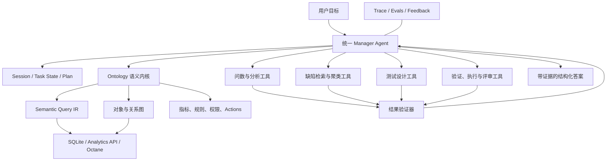
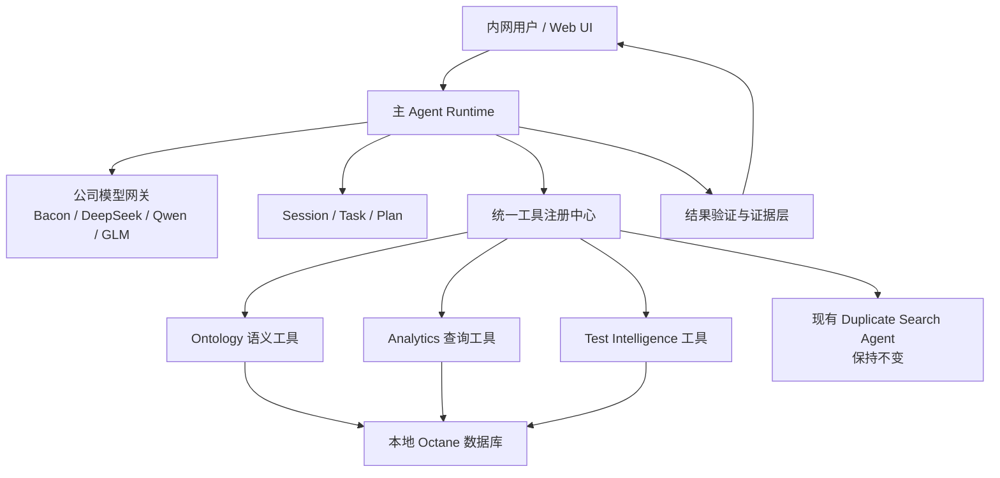

# /goal 全网深度分析我的项目里的agent，分析一下我这个智能问数agent如何才能像pi agent或者codex…

> 完整对话提取自 `/Users/tonyorz/.codex/sessions/2026/07/14/rollout-2026-07-14T07-14-09-019f5dc2-679b-7921-847b-530d2d4c2220.jsonl`
> 工具: Codex | 用户消息: 5 | 助手回答: 8

## 用户提问（完整）

### Q1

/goal 全网深度分析我的项目里的agent，分析一下我这个智能问数agent如何才能像pi agent或者codex那样智能，能根据我的项目数据对话，并且基于缺陷和测试数据等等，可以根据用户需求生成测试用例等等。 我也搭建了ontology本体智能，如何也发挥他的作用， 让我的agent拥有顶级的匹配coding agent的智能和能力，对于我的项目还有顶级的业务理解

### Q2

我现在做的主agent,不要改duplicate search agent。我这个主agent是我公司内部的一个CoPilot工具来做的,接入的模型是我公司Bacon,DeepSeek,或者Qwen,或者Glm模型。然后我需要达到的目的就是我把我的Octane存储了我的测试和缺陷数据,团队的,把这些数据我存储到了本地的数据库。然后我这个之前是对数据库做了一些异常的一些抽象,然后制作了这个ontology这个语音本体智能的模式。然后我把项目部到我的本地电脑,目前是用户通过内网,其他团队成员访问我这个本地的项目。当然未来是希望也能部署到Linux虚拟机这样,甚至部署到云端,让更多的人能访问我这个平台。当我的agent设计出来,我是希望大家可以通过我的agent能够实时地进行智能问述。同时大家也能在界面上感受到我的这个agent,它的一些实时调用的能力啊,智能啊,等等等等。那种类CodeX,类GPT,类Cloudy那种能力去查询到数据。然后同时这个agent也能从业务上指导我们,比如说用户问了,发现了什么什么问题,能不能针对这个问题创建一些测试用例等等这些需求。

### Q3

没问题,但是那个主Agent Runtime可以用现在比较火的一些开源的Agent框架来做吗?比如说Pi Agent,或者甚至是CodeX?

### Q4

好的

### Q5

规格批准

## 助手回答（完整）

### A1

## 核心结论

你的项目已经具备不错的数据、Dashboard、重复缺陷检索、测试数据和 Ontology 原型，但目前更接近“带工具的智能问答”，还不是 Codex/Pi 级 Agent。

真正的瓶颈不是再写一个更长的 Prompt，而是三套能力彼此割裂：

1. JavaScript 主对话 Agent：负责 Dashboard 工具调用和缺陷检索。
2. Python Ontology：有实体对齐、规则、治理和记忆，但没有进入主对话。
3. Test Agent：能生成测试建议，但没有接入服务端路由，也没有验证闭环。

因此当前综合成熟度大约是“Agent 产品化 3～4/10、数据资产 6/10、Ontology 原型 5/10”。要达到接近 Codex/Pi 的体验，需要建设一个统一的 Agent Runtime，把 Ontology 变成可执行的业务语义内核。

## 当前项目的关键发现

### 1. 主 Agent 只有工具循环，没有完整任务循环

当前流程是：

> 关键词正则触发 → LLM 选择 Dashboard 工具 → 最多 4 轮工具调用 → 生成回答

参见 [mainAgentToolLoop.mjs](/Users/tonyorz/Data-Agent/server/mainAgentToolLoop.mjs:5) 和 [index.mjs](/Users/tonyorz/Data-Agent/server/index.mjs:58)。

它已经具备工具调用雏形，但缺少 Codex 式能力：

- 没有显式计划、任务状态和完成条件。
- 没有工具结果验证、交叉校验和失败后的策略修复。
- 没有持久化 Session、长期任务、分支和上下文压缩。
- 没有“执行后检查结果是否满足用户目标”的闭环。
- 只有 6 个偏 Dashboard 的工具，工具面不足以支撑复杂业务调查。
- 系统提示甚至要求“最多调用一个 Dashboard 工具”，这会限制跨数据域推理。

Codex 的核心是持续的“推理 → 工具 → 观察 → 修正”循环，并通过上下文压缩保持长任务连续性；Pi 也提供持久 Session、分支、压缩和可扩展工具，而不是一次性聊天。[Codex Agent Loop](https://openai.com/index/unrolling-the-codex-agent-loop/)、[Pi Coding Agent](https://github.com/earendil-works/pi/blob/main/packages/coding-agent/README.md)。

### 2. 模型不是唯一问题，但当前调用方式限制了上限

当前默认模型是内部的 DeepSeek/Qwen/GLM，使用 Chat Completions 风格接口，输出预算分别只有 2048 或 900 tokens，见 [chatModelConfig.mjs](/Users/tonyorz/Data-Agent/server/chatModelConfig.mjs:1) 和 [chatModelConfig.mjs](/Users/tonyorz/Data-Agent/server/chatModelConfig.mjs:145)。

复杂任务中，这个预算不足以稳定完成：

- 多步骤业务调查；
- 多表关系推理；
- 测试方案生成与自审；
- 工具失败后的修复；
- 大量证据综合。

建议先用最强可用模型建立评测上限，再按任务路由低成本模型，而不是一开始追求便宜。OpenAI 当前也建议复杂推理和编码任务先使用旗舰模型建立能力基线，再做成本优化。[官方模型指南](https://developers.openai.com/api/docs/models)。

### 3. Test Agent 目前没有真正可用

前端会调用：

- `/api/test-agent/stats`
- `/api/test-agent/analyze`

见 [TestAgent.tsx](/Users/tonyorz/Data-Agent/src/components/dashboard/pages/TestAgent.tsx:150)。

但服务端没有注册这两个路由；只有孤立的处理函数，见 [testAgent.mjs](/Users/tonyorz/Data-Agent/server/testAgent.mjs:349) 和当前路由表 [index.mjs](/Users/tonyorz/Data-Agent/server/index.mjs:243)。

而且它现在只是：

> 聚合统计 → 拼成 Prompt → 一次性生成 5～15 条测试建议

没有：

- 需求/Story/Feature 深度检索；
- 现有测试去重；
- 测试步骤、前置条件和测试数据生成；
- Test Oracle/期望结果可靠性验证；
- 需求—测试—缺陷追踪检查；
- 执行、覆盖率或故障暴露反馈；
- 人工审批和写回 Octane。

### 4. 测试数据不足以支撑高质量测试生成

我检查了现有数据：

- 5,335 个测试用例；
- 15,000 次执行；
- 933 个测试用例关联缺陷；
- 只有 148 个关联 Feature，134 个关联 Story；
- 没有测试步骤、前置条件、测试数据、期望结果字段。

数据文件见 [dtsv_testcases_all.json](/Users/tonyorz/Data-Agent/testcase/dtsv_testcases_all.json)。

因此现在模型最多能生成“测试建议标题”，无法可靠生成可直接执行的完整测试用例。必须补充：

- Feature/Story/Requirement 完整描述和验收标准；
- 现有测试的前置条件、步骤、参数和 Expected Result；
- Defect 的复现步骤、根因、修复版本、环境与评论证据；
- Build/Commit/Release/ECU/配置数据。

好消息是项目已有 `Epic → Feature → Story → TestCase → ManualRun → Defect` 图结构，见 [traceability_models.py](/Users/tonyorz/Data-Agent/backend/analytics/traceability_models.py:239)。这正适合作为业务 Ontology 的主骨架。

### 5. Ontology 方向正确，但当前实现存在正确性风险

已有优点：

- 数据 Profiling；
- 实体和业务术语对齐；
- 属性、关系、指标、公理；
- 权限、脱敏和审计；
- 查询记忆；
- Local/Global/Drift/Basic 接口。

但它尚未接入 JavaScript 主 Agent，并且行为验证发现了严重问题：

- 演示数据库真实字段是 `project`；
- Profiler 却强制映射为 `program`，见 [profiler.py](/Users/tonyorz/Data-Agent/agent/ontology/profiler.py:83)；
- “按项目分布”实际返回错误的 `program(8)`，正确结果应为 `IuK(2)、EE_MAIN(2)、AF(2)…`；
- 现有测试反而把错误映射当成期望值，见 [test_ontology_intelligence.py](/Users/tonyorz/Data-Agent/tests/test_ontology_intelligence.py:42)。

此外：

- 所谓 Vector Retrieval 实际只是 SQL 查询，却被标为 `vector`，见 [rag.py](/Users/tonyorz/Data-Agent/agent/ontology/rag.py:163)；
- Global 只是逐字段 `GROUP BY`，不是真正 GraphRAG 社区摘要；
- Drift 只是单层关系查询，不是基于问题的多跳图探索；
- 推理阶段没有把检索出的实体 ID 传给 Reasoning Engine，而是重新处理数据库前 N 条记录，见 [engine.py](/Users/tonyorz/Data-Agent/agent/ontology/engine.py:160)；
- 高相似度查询会直接返回历史答案，不重新查询最新数据，容易产生过期数字，见 [engine.py](/Users/tonyorz/Data-Agent/agent/ontology/engine.py:124)。

微软 GraphRAG 的 Local、Global、DRIFT 都建立在真正的图索引、社区层次、文本证据和查询扩展上；当前实现只是借用了这些名字。[GraphRAG 查询架构](https://microsoft.github.io/graphrag/query/overview/)。

## 建议的目标架构



### Ontology 应成为“可执行语义内核”

不要仅把整个 Ontology 文本塞进 Prompt。应把它编译成模型可调用的工具：

- `resolve_business_term`
- `describe_object_type`
- `get_metric_definition`
- `query_object_set`
- `traverse_links`
- `compute_metric`
- `get_traceability_path`
- `find_coverage_gaps`
- `rank_test_risks`
- `validate_test_case`
- `save_test_case_draft`

每次只动态加载与问题相关的 Ontology 子图，形成渐进式上下文。

对象建议至少包括：

- Project、Release、Build、Commit；
- Epic、Feature、Story、Requirement；
- TestCase、TestRun、TestEnvironment；
- Defect、DefectCluster、RootCause；
- ECU、Component、Team、Owner。

Ontology 不只描述名词，还应包含：

- Metric：指标及唯一计算口径；
- Policy：权限、数据范围、时间语义；
- Action：创建测试草稿、更新追踪关系等；
- Function：风险计算、覆盖缺口、影响分析；
- Provenance：数据源、快照时间、Ontology 版本和查询计划。

这更接近 Palantir 将 Ontology 定义为包含 Objects、Links、Functions、Actions 和安全策略的组织数字孪生，而不只是知识图谱。[Palantir Ontology](https://www.palantir.com/docs/foundry/ontology/overview)、[Ontology Agents](https://www.palantir.com/docs/foundry/agents/overview)。

## 测试用例生成应采用闭环

建议流程：

1. 解析用户测试目标和范围。
2. 从 Ontology 获取 Requirement/Feature、组件、环境和约束。
3. 检索相关缺陷、历史失败、相似测试和变更影响。
4. 计算风险：严重度 × 频率 × 最近性 × 暴露度 × 覆盖缺口。
5. 先生成测试条件矩阵，再生成测试用例。
6. 覆盖功能、边界、负向、状态转换、组合、集成和回归场景。
7. 与现有 5,335 个测试做语义去重。
8. 验证每条测试是否具有可信的 Expected Result。
9. 检查 Requirement→TestCase→Defect 追踪完整性。
10. 可自动化时执行编译/测试/覆盖率/Mutation Testing。
11. 由 Critic 重新审查，不合格则修复。
12. 人工批准后才写回 Octane。

Meta 的 TestGen-LLM 并不是直接相信模型生成结果，而是通过构建、稳定运行和覆盖率提升等过滤器验证测试；CoverUp 也依靠覆盖率反馈反复生成与修复。[TestGen-LLM](https://arxiv.org/abs/2402.09171)、[CoverUp](https://arxiv.org/abs/2403.16218)。

## 分阶段路线

### P0：正确性和接线，1～2 周

- 修复 Ontology 列映射并验证列真实存在。
- 禁止把不存在的 SQLite 标识符当作字符串继续执行。
- 将 Ontology 暴露为主 Agent 的结构化工具。
- 把 Test Agent 注册进服务端，或直接改成主 Agent 工具。
- 所有回答携带数据快照、筛选条件、指标定义和证据。
- 建立首批 100 条黄金问数用例。
- 增加端到端测试，不能只测试孤立模块。

### P1：统一 Agent Runtime，3～6 周

- 引入持久 Session、Task、Plan、Checkpoint 和上下文压缩。
- 建立真正的 Observe→Plan→Act→Validate→Repair 循环。
- 使用 Semantic Query IR，模型不直接拼 SQL。
- 结果验证器交叉检查总数、分组和过滤条件。
- 建立短小的 `AGENTS.md` 作为业务知识导航，详细知识放入版本化文档和 Ontology。OpenAI 的实践也是“给 Agent 地图，而不是一千页手册”。[Harness Engineering](https://openai.com/index/harness-engineering/)。

### P2：测试智能闭环，6～10 周

- 补齐 Requirement、测试步骤、前置条件和 Expected Result 数据。
- 建立风险覆盖矩阵和现有测试向量索引。
- 实现生成→去重→Critic→验证→人工审批。
- 支持从缺陷复现步骤生成回归用例。
- 支持从 Feature/Story 生成 BDD、手工测试和自动化候选。

### P3：顶级业务 Agent，3～6 个月

- 变更影响分析：Commit/Build→Component→Requirement→TestCase→Defect。
- 受控写操作与 Human-in-the-loop。
- 成功轨迹、失败轨迹和用户反馈驱动的记忆。
- 持续离线评测、线上抽样和 Agent Trace。
- 按任务做模型路由，而不是统一使用一个模型。

## 必须建立的评测指标

问数 Agent：

- 查询结果准确率 ≥95%；
- Filter、时间范围、指标口径解析准确率 ≥98%；
- 数据类结论证据覆盖率 100%；
- 多轮上下文成功率 ≥90%；
- 不该猜测时主动澄清率；
- 工具轨迹正确率、延迟和单次成功成本。

测试生成：

- Requirement/Defect 追踪覆盖率；
- 与现有测试重复率；
- 人工接受率和平均修改量；
- 构建成功率、稳定通过率和 Flaky Rate；
- 新增分支覆盖率和 Mutation Score；
- 对历史缺陷的 Fault Exposure Rate。

Agent SDK 的 Trace 会记录模型调用、工具、Guardrail 和 Handoff；这类轨迹级观测应成为你的评测基础，而不能只看最终文字是否“像专家”。[OpenAI Agents SDK Tracing](https://openai.github.io/openai-agents-js/guides/tracing/)。

## 最重要的决策

第一阶段不要急着堆多个 Agent。先做一个强 Manager Agent，加一组清晰、无重叠、可验证的工具。只有当工具选择和指令复杂度确实超过单 Agent 上限时，再拆出 Test Design、Defect Investigation、Business Analytics 专家 Agent。

你的真正护城河不会是“使用哪个大模型”，而是：

> 经过验证的业务 Ontology + 高质量项目数据 + 可执行工具 + 长任务 Harness + 真实评测与反馈闭环。

本轮是只读审计，没有修改项目文件。验证结果为 Ontology 27/27、主 Agent 35/35 单元测试通过，但同时通过端到端行为审计确认了上述 Ontology 错误分布和 Test Agent 未接线问题。

目标记录：使用 235,128 tokens，用时约 6 分 48 秒。

### A2

明白了。你的目标不是重做 Duplicate Search Agent，而是把“主 Agent”做成公司内部的业务智能入口。

边界明确如下：

- Duplicate Search Agent 完全保持不变，只作为主 Agent 可调用的一个现有工具。
- 继续使用公司内部 Bacon、DeepSeek、Qwen、GLM，不依赖 Codex/OpenAI 模型。
- Octane 缺陷、测试、执行、需求关系等数据仍存储在本地数据库。
- Ontology 负责项目业务语义、指标口径、实体关系和规则。
- 当前部署在本地电脑，先服务内网用户，之后平滑迁移至 Linux 虚拟机或云端。
- 主 Agent 既能智能问数，也能提供业务分析、风险判断和测试用例建议。
- UI 要实时展示 Agent 正在理解问题、查询数据、调用工具、验证结果和生成答案。

## 三种建设方式

### 方案一：继续增强当前 Prompt 和工具

在现有 `mainAgentToolLoop` 上增加更多工具和提示词。

优点是开发快，但很快会遇到上限：

- Prompt 越来越大；
- 工具容易选错；
- 多轮上下文不稳定；
- Ontology 只能作为文本注入；
- 很难支持复杂调查和测试用例生成。

适合短期演示，不适合作为最终架构。

### 方案二：统一主 Agent Runtime，推荐

保留现有技术栈和内部模型，在当前 Node 服务中建设真正的主 Agent Runtime：

- 统一管理对话、计划、工具、状态和验证；
- Ontology 作为可调用的语义内核；
- Analytics API 负责确定性数据计算；
- Test Intelligence 作为主 Agent 的业务工具；
- Duplicate Search Agent 原封不动，以工具形式接入；
- UI 通过结构化事件实时显示执行过程。

这是最符合你现状、风险最低、又能逐步达到 Codex 类体验的方案。

### 方案三：立即拆成多个专业 Agent

建立问数 Agent、缺陷 Agent、测试 Agent、Ontology Agent、报告 Agent，再由 Manager 调度。

长期可以这么演进，但现在太早。当前基础工具、Session、评测和 Ontology 正确性还没有稳定，多 Agent 会放大错误和排障难度。

## 推荐架构



## 主 Agent 应有的运行过程

用户问：

> “最近一周导航模块有什么高风险问题？针对这些问题设计测试用例。”

主 Agent 不应该一次性回答，而应执行：

1. 判断这是“缺陷调查 + 测试设计”复合任务。
2. 从 Ontology 获取“最近一周”“导航模块”“高风险”的业务定义。
3. 生成结构化任务计划。
4. 调用 Analytics 工具查询缺陷数量、严重度、ECU、趋势。
5. 必要时调用现有 Duplicate Search Agent 查找相似缺陷。
6. 获取关联 Feature、Story、历史测试和执行结果。
7. 验证不同数据结果是否一致。
8. 形成风险矩阵。
9. 生成测试用例草稿。
10. 对草稿进行去重、可执行性和证据检查。
11. 向用户返回业务结论、数据证据和测试建议。

这才是 Codex 类 Agent 的关键：不是回答更长，而是能够持续调查、调用工具、观察结果和修正计划。

## Ontology 的正确定位

Ontology 不应该作为一个独立聊天机器人，也不应该整份塞进 Prompt。

它应该提供这些工具：

- `resolve_business_terms`：把用户语言映射到真实项目、ECU、阶段和严重度。
- `get_metric_definition`：返回指标口径。
- `get_relevant_schema`：只返回当前问题涉及的表、字段和关系。
- `build_semantic_query`：生成结构化查询计划，而不是直接生成 SQL。
- `traverse_business_links`：沿 Feature→Story→TestCase→Run→Defect 查询。
- `explain_business_rule`：解释为什么某个缺陷被判为高风险。
- `validate_query_plan`：阻止不存在字段或错误业务口径。
- `get_permitted_actions`：确定当前用户能查询、导出或创建什么。

换句话说：

> 模型负责推理，Ontology 负责业务世界观，Analytics 负责精确计算，Validator 负责防止错误。

## UI 如何展示“实时智能”

不要展示模型隐藏思维过程，而要展示可验证的工作事件：

- 正在理解用户目标；
- 已识别项目、时间范围和业务指标；
- 正在查询缺陷趋势；
- 调用工具：`query_defect_high_frequency_analysis`；
- 查询完成：找到 27 个相关缺陷；
- 正在检查关联测试覆盖；
- 发现 8 个高风险覆盖缺口；
- 正在生成并校验测试用例；
- 最终结论和证据。

建议统一 SSE 事件协议：

```text
agent-start
plan-created
tool-start
tool-result
evidence-added
validation-start
validation-result
draft-created
agent-complete
agent-error
```

这样即使底层模型在 Bacon、DeepSeek、Qwen、GLM 之间切换，前端体验仍保持一致。

## 测试用例能力的定位

第一阶段应生成“测试用例草稿”，不要直接自动写入 Octane。

每个草稿至少包含：

- 标题；
- 测试目标；
- 关联 Requirement/Feature/Defect；
- 前置条件；
- 测试环境；
- 测试数据；
- 操作步骤；
- Expected Result；
- 测试类型；
- 风险优先级；
- 推荐理由；
- 使用的数据证据；
- 与现有测试的相似度。

后续经过用户确认，再增加“保存到 Octane”的 Action，并设置权限和审批。

## 建议拆成三个子项目

1. 主 Agent Runtime + Ontology 智能问数闭环  
   先解决 Session、计划、工具、语义查询、结果验证和实时 UI。

2. Test Intelligence  
   补充测试步骤和需求数据，实现风险分析、用例生成、去重、验证和审批。

3. Linux/云端部署  
   将 Node、Python Analytics、Ontology、数据同步和数据库服务容器化，增加登录、权限、日志、备份和并发控制。

第一阶段继续使用 SQLite 没问题，但要采用“同步写入库”和“查询快照库”分离，避免数据刷新阻塞所有内网用户。

我建议下一步先为第一个子项目《主 Agent Runtime + Ontology 智能问数闭环》写正式设计规格，并明确 Duplicate Search Agent 只作为不可修改的外部工具。这个优先顺序是否符合你的预期？

### A3

可以，而且建议使用开源 Agent 框架。但针对你的项目，我的明确选型是：

> **LangGraph JS 做主 Agent Runtime；Pi Agent Core 做备选 PoC；Codex 不作为业务主 Runtime。**

### 三个方案的适配结论

| 方案 | 内部模型兼容 | 持久会话/恢复/审批 | 业务 Agent 适配 | 结论 |
|---|---|---|---|---|
| **LangGraph JS** | 高，可保留现有 Bacon/DeepSeek/Qwen/GLM 适配层 | 原生 Checkpoint、流式事件、HITL、中断恢复 | 很高 | **主选** |
| **Pi Agent Core** | 很高，支持多 Provider 和自定义协议 | 基础循环和事件很好，但企业能力大量需要自建 | 中高 | 轻量 PoC/备选 |
| **Codex SDK** | 自定义 Provider 目前必须兼容 Responses API | 线程、事件、审批很强，但围绕代码、Shell、文件 | 低 | 只借鉴或做独立 Coding Agent |

### 为什么首选 LangGraph JS

你的项目本身已经是 Node/ESM，并且已有：

- 公司模型调用层：[companyChat.mjs](/Users/tonyorz/Data-Agent/server/companyChat.mjs)
- 主 Agent 工具循环：[mainAgentToolLoop.mjs](/Users/tonyorz/Data-Agent/server/mainAgentToolLoop.mjs)
- 类型化工具注册：[mainAgentTools.mjs](/Users/tonyorz/Data-Agent/server/mainAgentTools.mjs)

LangGraph 的 Functional API 可以先包住现有循环，逐步加入持久化、流式事件、人工审批和故障恢复，不要求第一天就全部重写成复杂 DAG。[LangGraph 官方说明](https://docs.langchain.com/oss/javascript/langgraph/functional-api)

它还原生支持：

- SQLite/PostgreSQL Checkpoint 和跨会话记忆。[持久化文档](https://docs.langchain.com/oss/javascript/langgraph/persistence)
- Token、工具开始/结束/错误、状态更新和自定义事件流。[流式事件文档](https://docs.langchain.com/oss/javascript/langgraph/streaming)
- 创建测试用例、写回 Octane 等操作前暂停，允许批准、修改或拒绝。[HITL 文档](https://docs.langchain.com/oss/javascript/langchain/human-in-the-loop)

首期只嵌入开源 `@langchain/langgraph` 核心库，关闭外部 tracing，不依赖 LangSmith 云服务，Octane 数据仍留在内网。

推荐的主运行图：

```text
理解用户需求
  → Ontology 解析业务实体和指标
  → 制定执行计划
  → 调用 Analytics / Database / Duplicate Search
  → 验证证据和口径
  → 判断是否需要继续查询
  → 生成答案或测试用例
```

同时保留三个分支：`clarify`、`human_approval`、`error_recovery`。

### Pi Agent 能不能用

可以，尤其是 `pi-agent-core`。它提供状态化 Agent loop、工具调用、上下文转换和完整事件流；`pi-ai` 也适合连接多种模型和自定义 Provider。[Pi 官方仓库](https://github.com/earendil-works/pi)、[Pi SDK](https://github.com/earendil-works/pi/blob/main/packages/coding-agent/docs/sdk.md)

但不建议直接部署完整 `pi-coding-agent`：

- 默认围绕 `read/write/edit/bash` 和代码目录设计。
- 会话主要采用本地 JSONL 文件。
- 官方明确说明没有内置权限系统，进程默认拥有启动用户的文件、网络和凭证权限。[Pi 权限说明](https://github.com/earendil-works/pi#permissions--containerization)
- 多用户会话、RBAC、持久审批、审计、幂等和宕机恢复仍需自行建设。

所以 Pi 很适合做一个小规模对比 PoC，但生产化成本会比 LangGraph 高。

### Codex 能不能用

技术上可以，但不适合当你的业务主 Runtime。

官方把 Codex SDK 定位为 **coding-focused threads**；如果 Codex 只是更大业务流程里的一个专家，官方也建议由更通用的编排层调度。[Codex SDK 官方文档](https://developers.openai.com/codex/sdk/)

Codex 当前虽然允许自定义模型 Provider，但 `wire_api` 只支持 OpenAI Responses API。[Codex 配置参考](https://developers.openai.com/codex/config-reference/) 你现有公司模型层主要是 Chat Completions 形态，因此还需要额外实现完整的 `/v1/responses`、SSE 和工具事件兼容桥。

更重要的是：

> 使用 Codex Runtime，不等于 Bacon、Qwen 或 DeepSeek 会自动获得 Codex 的智能。

Codex 的能力来自模型、提示词、工具定义、上下文管理和工程验证循环的共同优化。它更适合未来作为一个独立的“项目代码维护 Agent”，负责修 Bug、修改代码和运行测试，而不是负责 Octane 业务问数。

### 最终落位

```text
LangGraph JS 主 Runtime
├── InternalModelAdapter
│   ├── Bacon
│   ├── DeepSeek
│   ├── Qwen
│   └── GLM
├── Ontology Semantic Kernel
├── Analytics / Database typed tools
├── Duplicate Search（保持不改，仅作为工具）
├── Test Case Intelligence
├── Evidence Validator
└── Session / Approval / Audit / Streaming
```

不要同时套两层自主循环，例如“LangGraph 外面再包一个完整 Pi Agent”。主循环只能有一个控制者，否则状态、重试、工具调用和审批都会变得难以审计。

如果你确认，我下一步就按 **“LangGraph JS + InternalModelAdapter + Ontology/Analytics Typed Tools”** 定稿正式架构规格，同时保留一个 Pi Agent Core 小型对比 PoC。

### A4

正式架构规格已完成并提交：[主 Agent Runtime 架构设计](/Users/tonyorz/Data-Agent/docs/superpowers/specs/2026-07-14-main-agent-runtime-design.md)

核心结论：

- 主 Runtime 采用 LangGraph JS，利用 checkpoint、thread、interrupt/resume 构建可恢复状态图。[LangGraph Persistence](https://docs.langchain.com/oss/javascript/langgraph/persistence)
- Bacon、DeepSeek、Qwen、GLM 继续使用，通过统一 `InternalModelAdapter` 接入。
- Ontology 成为不可跳过的语义解析、计划验证、证据与业务规则内核。
- Pi SDK 仅用于隔离 PoC 对比。[Pi SDK](https://pi.dev/docs/latest/sdk)
- Codex 用作 Coding Agent 交互参考；其自定义 provider 当前面向 Responses wire API，与项目现有 Chat Completions 接口不直接匹配。[Codex 配置参考](https://developers.openai.com/codex/config-reference/)
- Duplicate Search Agent 内部完全不修改，只保留现有 adapter。
- 测试智能首期只生成有证据溯源的 `TestCaseDraft`，不写回 Octane。
- 已纳入可信身份、事件实时流、checkpoint 恢复、权限变化、并发 fencing、评测门槛及 Linux/云端演进方案。

文档通过 JSON、代码围栏和空白校验；提交为 `5081107a`。只提交了该规格，未修改生产代码，您原有的暂存内容保持不变。

请审阅后回复“规格批准”。获得批准后，我再编写 Phase 1 的逐文件实施计划。

::git-stage{cwd="/Users/tonyorz/Data-Agent"}
::git-commit{cwd="/Users/tonyorz/Data-Agent"}

### A5

当前规格已验证可进入实施规划，需您确认以下五项决策：

1. LangGraph JS 作为唯一主 Runtime。
2. Ontology 成为强制语义与证据门禁。
3. Duplicate Search Agent 内部保持不变。
4. 首期仅生成测试用例草稿，不写回 Octane。
5. Phase 1 先建设可恢复 Runtime、模型适配、实时事件和身份隔离。

请回复“规格批准”。随后我会立即编写 Phase 1 的逐文件实施计划；目前尚未修改生产代码。

### A6

当前目标已暂停在书面规格评审门槛，不是技术故障。

请审阅[主 Agent Runtime 架构设计](/Users/tonyorz/Data-Agent/docs/superpowers/specs/2026-07-14-main-agent-runtime-design.md)，然后回复：

> 规格批准

收到后我会恢复目标，开始编写 Phase 1 逐文件实施计划。目前未修改生产代码或 Duplicate Search Agent。

### A7

我先逐行核对已批准规格与当前 Phase 1 计划，重点整理 Task 11 以后必须落地的契约，并标出前 10 项的缺口或越界。

### A8

以下是只读规格对照结果。

## Task 11+ 必须覆盖的 Phase 1 内容

### Task 11：Policy 与 Typed Tool Registry

必须包含：

- 五个现有只读工具的 `ToolDefinition`：版本、R0 风险、输入/输出 schema、timeout、最大输出、幂等和有限重试；统一返回 `RawToolResult`。（spec 780-812）
- `ask_clarification` 不注册为新图工具，转换为持久化 interrupt。（814-825）
- `useDefectContext=false` 禁止直接 defect context 和 `search_duplicates`；`useAnalyticsContext=false` 禁止所有 analytics 工具；`pageContext` 不得绕过。（1651-1666）
- Duplicate Search 只能精确调用现有 `runDuplicateBridge({ action:"search", query, top_k })`，结果只能成为 `similarity` evidence，不能当统计总体。（116-126）
- schema 必须来自同一个 JSON Schema 2020-12 registry；未知字段拒绝，禁止静默删除。（810-812）
- timeout/cancel/retry、输出超限转 artifact、partial/truncated 显式化。（780-812）
- 最多 6 个模型/工具步骤、每步最多 3 个候选调用、相同 tool+args 无新 evidence 时禁止重复、连续两步无新 evidence 必须停止。（470-483）
- `shadow` 禁止 Duplicate Search，且结果不返回用户。（1635-1645）
- 不注册 SQL、shell、文件路径、任意网络或 Octane write tool。（141-150、1314-1321）

### Task 12：Legacy Semantic、Evidence 与 Claim Gate

必须实现：

- `LegacySemanticAdapter` 只输出 `ontologyVersion="legacy-provisional"`，不得声称 Ontology verified。（165-166、1664-1668）
- `LegacyPlanValidator` 强制 flags、scope、schema、预算、allowlist 和安全策略。（1662-1666）
- `legacy-v0` normalization，完整保存 raw payload hash、tool version、canonical args、truncation；没有真实 revision 时必须为 `sourceRevision.status="unknown"` 和 `groundingStatus="legacy_equivalence"`。（827-910）
- Duplicate 结果固定为 `similarity`，不得升级为 metric/statistic。（755-760、904-910）
- `LegacyClaimValidator` 逐项验证回答中的数字、日期、ID 和关键业务判断；无证据内容只能明确标为 hypothesis/recommendation/limitation。（912-944、1666）
- 完整持久化 `ClaimValidation`；render 只能消费 accepted claim IDs。（466-468、1666）
- 候选回答只在服务端缓冲；一次 repair 后仍失败使用确定性 fallback；先持久化 `AnswerEnvelope + contentHash`，再发布 delta。（466-468）
- 明确区分 zero、missing、unknown、partial、truncated；revision 变化不能混用旧新数值。（753-760、904-910、1389-1392）
- Phase 1 永远不能发出 `grounded` badge/event，UI 只能显示 provisional/legacy-equivalence。（1664-1668）

### Task 13：显式 LangGraph StateGraph

必须覆盖：

- 使用 `StateGraph`、显式节点和 conditional edges，不使用预构建 ReAct Agent。（195-197）
- 节点顺序至少覆盖 `receive_request → prepare_inputs → resolve_intent → provisional resolve_semantics → create/validate plan → execute → normalize evidence → claims → render/validate → publish → terminal`。（434-468）
- clarification 必须使用 LangGraph interrupt，并在同一 run resume。（441-448、825）
- reducers 必须显式定义 append/replace/按稳定 ID merge；`begin_new_run` 清理全部 run-scoped state，只保留允许继承的消息/摘要。（1062、1066）
- Graph state 只保存 JSON 和 refs，不保存 fetch、Response、AbortController、credential、bridge handle 或大 payload。（160、203-432）
- durable `modelTurns` 必须保留 assistant `tool_calls` 与 tool `tool_call_id` 一一对应，恢复时只能由这些 durable turns 重建模型输入。（432、505-558）
- planner certification、严格 structured output、一次 repair、认证 fallback 和 `model.fallback` event。（581、591-598）
- 实现 long-context budget/compaction：保留硬约束、否定条件、时间、scope、pending interaction、semantic/evidence refs。（1095-1102、1140）

### Task 14：Runtime、恢复、取消和 Reaper

必须覆盖：

- run create/resume/cancel/recover/reaper，单 thread 一个 active run，actor 最多 2 个、实例最多 20 个，30 run/min、burst 5。（1052-1076、1133-1140）
- `threadVersion` optimistic lock、`stateVersion` CAS、`leaseEpoch` fencing。（1058-1068）
- 相同 `(actorId,messageId)` 且相同语义请求返回同一 run；语义 body 不同返回 `409 IDEMPOTENCY_CONFLICT`。（1064）
- 所有 new-message/resume/fork/recovery takeover 前真正执行 `ensureCheckpointCaughtUp()`；从 step journal 投影遗漏 transition 并提升 canonical checkpoint，而非只抛错。（1117-1123）
- 只能使用精确 canonical checkpoint ID；Saver latest/orphan checkpoint 不得恢复或 fork。（1120-1121）
- 外部 model/tool 边界、resume、publish、event replay 前刷新 ActorContext；scope 变化使旧 plan/evidence/journal/approval/可见 event 失效。（1070-1074）
- waiting cancel 必须原子消费 interaction、fence worker、产生唯一 cancelled terminal；网络断开不取消。（1074-1076、1123-1125）
- interaction TTL、active budget、hard expiry、lease expiry 均由 reaper 原子处理，并确保每 run 恰好一个 terminal event。（1074-1076、1379-1395）
- 模型/工具 timeout、invalid JSON repair、partial failure、Duplicate unavailable、重启恢复均按错误表处理。（1379-1397）
- active run 固定 graph version；v2 不得直接 resume v1 checkpoint。（1068）

### Task 15：启动、Runtime Modes 与 HTTP API

必须实现以下接口：

- `GET /api/ai/models`，只返回非敏感 capability/certification DTO。（583-589）
- `POST /api/ai/chat` compatibility facade。（1281-1287）
- `POST /api/agent/runs`
- `GET /api/agent/runs/:runId/events`
- `POST /api/agent/runs/:runId/resume`
- `POST /api/agent/runs/:runId/cancel`
- `GET /api/agent/threads/:threadId`
- `POST /api/agent/threads/import`
- `POST /api/agent/threads/:threadId/fork`
- `PATCH /api/agent/threads/:threadId`
- `POST /api/agent/artifacts`
- `GET /api/agent/artifacts/:artifactId`（1289-1300）

明确禁止 Phase 1 增加 `POST /api/agent/approvals/:approvalId/decide`。（1302-1306）

其他必须项：

- 入口先 `loadLocalEnv()`，再动态创建 model/runtime registry；`server/index.mjs` 只做 composition/listen，app 可在测试中无副作用导入。（583-589、1730-1735）
- 默认 `legacy`；`shadow` 不返回答案、不重复 Duplicate；`langgraph` 只开放 legacy-equivalence allowlist，并可即时回滚。（1635-1668、1700-1706）
- 旧 `/api/ai/chat` 缺省 booleans 归一为 `false`；新 run API 必须显式传值。（1662）
- 新协议显式 `1.0`，不支持版本返回 `406`；同连接禁止新旧协议双发。（1276-1277）
- 响应头必须有 `X-Agent-Protocol`、`X-Agent-Run-ID`、`X-Agent-Thread-ID`。（1277）
- events 支持 `agent-v1`/`legacy-chat` profile、`Last-Event-ID`、actor/run 授权；过 retention 返回 `410` 和 snapshot link。（1308）
- cookie 模式必须 CSRF；bearer 禁止 URL/query/log；SSE 每次重连重新鉴权。（1324-1333）
- 内网多人模式必须 trusted identity、TLS、origin allowlist；否则仅允许 loopback。（1324-1327、1403-1415）

### Task 16：前端 SSE Decoder 与 Agent API Client

测试必须覆盖：

- incremental UTF-8、跨 byte JSON、CRLF、comments、multiline `data:`、未知 event、尾部残块。
- `eventId + sequence` 排序去重；重复 event 不重复追加答案。（1267-1270）
- `answer.delta` 严格校验 `answerId/contentHash/UTF-8 offset`，offset 不连续时停止并重连。（1216、1271-1272）
- heartbeat 不占 sequence。（1274）
- 只解析协商出的单一 profile，不猜测混合协议。（1276-1277）
- `410` 时加载 thread/final `AnswerEnvelope`，不从任意中间 sequence 猜状态。（1308）
- API client 覆盖 models/runs/events/import/artifact/resume/cancel/fork/metadata。

### Task 17：AIChat 历史、模型与 Artifact 迁移

必须覆盖：

- 主 Agent 模型列表改由 `/api/ai/models` 获取并显示 planner certification 限制。（581、585）
- localStorage 只做一次 import；为旧 conversation/message 生成稳定 ID 并回写，重试不得重生成。（1104-1111）
- import 后服务端是权威历史，每轮只提交新增消息、threadId、threadVersion。（1108-1111）
- 同一完整历史不一致重传返回冲突。（1111）
- 旧 base64 只在 import 时转 artifact；之后消息/checkpoint 只保存 refs。（1127-1129）
- artifact MIME、8 MiB 单件、5 件/run、20 MiB/run、200 MiB/actor、PDF 100 页、提取 200k 字符限制。（1129-1141）
- Duplicate Search 独立页面、模型、local history 和请求流程不得导入主 Runtime 或改写。（116-126、1702-1706）

### Task 18：Timeline、重连、停止与分支 UI

必须覆盖：

- lifecycle/tool/evidence 独立于答案文本，不混入模型 `<step>`。（1267-1269）
- 展示业务口径、工具、脱敏 args、证据、限制和可操作失败/澄清状态；不显示 `<think>` 或私有 CoT。（1268-1269、1450）
- 明确显示 `legacy-provisional` / `legacy_equivalence`，绝不显示 grounded。（1666-1668）
- Stop 调 cancel API，不把 AbortController 或断网等同取消。（482-483、1124）
- reconnect 从最后 event ID 继续。
- “重新生成”从选定 checkpoint 创建新 run branch；“编辑旧消息”创建新 thread branch；旧 checkpoint 不原地修改。（1113）
- rename/pin/archive/delete 使用 thread metadata/lifecycle API。（1113）
- 新事件解析失败时，使用响应头 run ID 对同一 run 以 legacy profile 重连；禁止重新 POST 用户消息。（1706）
- 做完整 Duplicate Search UI 回归，证明其模式未受影响。

### Task 19：Qualification、可观测性、依赖与部署交付

必须包括：

- 每 run 审计 actor/thread/run/model/prompt version、semantic/revision、节点耗时、usage、tool latency/retry、args hash、evidence、claim validation、terminal、cancel/recovery、安全拒绝；不得记录 CoT。（1439-1450）
- 依赖精确 pin、公司许可证审查、SBOM、漏洞审查；生产启动不得公网动态下载。（1653-1660）
- SQLite WAL/foreign keys/5s timeout、单 Node 实例、Octane DB 只读并与 Runtime DB 隔离。（1080-1093）
- Phase 1 不实现 PostgreSQL、systemd/container、Octane write 或 approval decide；这些属于 Phase 4。（1688-1694）
- PR smoke 60 条；认证模型使用相同冻结 fixture 独立运行 3 次，认证时关闭 fallback。（1454-1490、1625-1631）
- Runtime qualification 最小样本：
  - restart/resume chaos 200
  - model tool transcript 200
  - canonical checkpoint fencing 200
  - graph-version resume 100
  - identity scope rotation 100
  - waiting/cancel/deadline 200
  - actor/thread isolation 100 场景 × 每场 20 并发
  - long-context compaction 100（1471-1488）
- Phase 1 硬门槛至少包括：
  - tool schema 合法率 100%，任意 SQL/不支持工具 0
  - 数字/日期/ID 100%
  - zero/missing/unknown 误分类 0
  - evidence 覆盖 ≥98%，无证据关键结论 0
  - 校验前 answer bytes 0
  - 跨用户/thread 串台 0
  - 相同 message ID run 数 1
  - tool transcript 关联错误 0
  - stale lease/orphan checkpoint/错误图版本恢复 0
  - scope 变化后旧授权复用 0
  - waiting cancel/TTL/deadline 均有唯一 terminal
  - 重启恢复率 ≥99%（1579-1601）
- 性能：
  - 首 lifecycle event P95 ≤300 ms
  - 单模型首 token P95 ≤5 s
  - 单工具 P95 ≤12 s
  - 多工具 P95 ≤30 s
  - 20 并发错误率 <1% 且零串台
  - terminal event 100%
  - 预热 5 分钟，每条关键路径至少 500 次才报告 P95。（1614-1623）
- 不应把 Phase 2 Ontology 指标、Phase 3 TestCaseDraft 指标或 Phase 4 Action gate 冒充 Phase 1 已通过；三个 gate 必须分开。（1625-1629）

## 当前 Task 1–10 的关键缺口或风险

### Task 1

- `npm audit` 不等于许可证、SBOM、公司漏洞审查；必须在 Task 19 生成可审计交付物。（spec 1660）
- `.gitignore` 若希望保留 `.gitkeep`，通常还需先重新 include `database/runtime/` 目录本身。

### Task 2

- 当前使用默认 `Ajv`，实际是 draft-07；规格要求 JSON Schema 2020-12，应使用 `ajv/dist/2020.js`。（812）
- `ontology.resolved.semanticFrameRef` 被写成 string，规格是包含 ontologyVersion/schemaFingerprint/requestAnchorAt 的 ref 对象。（650-655、1157-1160）
- 目前只覆盖 run/event schema；resume/import/fork/artifact、state/plan/model/tool/evidence/claim contract 仍需补齐。（203-429、780-812、827-944、1289-1300）
- approval/grounded enum 可作为协议保留，但 Phase 1 运行时不得实际产生 approval flow 或 grounded 结果。（1664-1668）

### Task 3

- 通用 `DEFAULT_CAPABILITIES` 会替所有模型猜能力，违反“每模型独立声明、Runtime 不按名称或默认值猜能力”。（564-581）
- `enabled=Boolean(credential)` 不足；Bacon 缺 endpoint、完整 capability 或 certification 时不得出现在列表。（583-589）
- 配置不完整目前可能仅从 `listPublic()` 消失，而规格要求启动失败。（585-587）
- 默认 external base URL 仍可能让已知模型静默落到外部 DeepSeek；需要显式 endpoint/provider 配置。
- 修改共享 `chatModelConfig.mjs` 时必须确保 Duplicate Search 自己的配置语义不变；不能因为主 Registry 迁移而影响 Duplicate 专用调用。（587、116-126）

### Task 4

- 缺少完整 `stream()`、retryPolicy、structured-output/native/json-prompt/repair、planner certification/fallback、reasoning-field 丢弃测试。（555-562、581、591-598）
- `ExecutionContext` 测试只传 signal，未覆盖 actor/run/thread/lease/cancellation poll。（539-546）
- HTTP 错误把上游 body 拼进用户可见 Error，可能泄露不可信或敏感数据；应分离 safe message 与 diagnostic artifact。（1329-1332）
- 修改 `companyChat.mjs` 必须证明所有 legacy exports 和 Duplicate 相关消费者行为完全不变。

### Task 5

- ActorContext 测试只覆盖 workspace/project/team，未覆盖 allowed object/property、row policy、sensitive-field policy、scopeVersion/hash。（206-221）
- 未决定 cookie+CSRF 或 bearer 策略，也未覆盖 SSE 重鉴权。（1327）
- trusted-proxy 测试未证明 TLS termination、伪造 forwarded headers、非 trusted peer 拒绝。（1324-1327、1415）
- 未覆盖 actor/global active-run 和 rate limits。（1138-1139）

### Task 6

- schema 缺 thread branch 来源字段、conversation summaries、scopeVersion、import message-level stable IDs；难以满足 fork/compaction/import。（240-249、397-402、1062、1104-1113）
- `agent_messages.role` 不允许 `tool`，与 ConversationMessage contract 不一致。（229-237）
- artifact 表单一 `thread_id + UNIQUE(actor,hash)` 无法安全表达同一 artifact 绑定多个 thread/run；也缺 run-level binding，Task 10 无法计算 per-run quota。
- terminal event 唯一索引只保证“最多一个”，不能保证 terminal status 与 terminal event 同事务且“恰好一个”。（1125）
- 缺 checkpointer 自己的离线 setup/version check；生产启动不能首次使用时隐式创建 Saver 私有表。（1093）
- SQLite 单实例约束尚未实现。（1085）

### Task 7

- 示例中的 `sameInput` 未定义。
- 测试允许 `forceExpired: true` 立即抢占尚未过期 lease，等于公开绕过 fencing；takeover 只能由数据库确认 lease 过期或受控 reaper 执行。（1123）
- `completeRun/failRun/cancelRun` 尚未明确与 terminal outbox event 同事务。（1118、1125）
- `forkThread` 缺 schema 支撑 parent thread/run/checkpoint/supersedes message。（397-402、1113）
- 未覆盖 actor 2/global 20/rate limit。（1138-1139）
- interaction schema/实现需保存一次性 resume 的规范结果，才能安全返回旧结果或冲突。（1060）

### Task 8

- `append()` 不接收或校验 `leaseEpoch`，旧 worker 可以写事件，违反所有 outbox commit 都要 fencing。（1123）
- journal/result/state/evidence/event 未形成同一应用事务。（1118）
- terminal status 与 terminal event 没有同事务保证。（1125）
- `mapEventToLegacy(tool.completed)` 把 tool name 固定为 `"tool"`，可能破坏旧协议等价。
- 未完整映射 `tool.failed`、clarification、cancel 等 legacy terminal 状态。
- 任意未知 Last-Event-ID 都返回 expired；应区分错误 actor/run、伪造 cursor 与确实超过 retention，并返回 snapshot link。（1308）
- events replay 只按 actorId，未按最新 scope 重新过滤/授权。（1072）
- answer offset 测试只验证首 offset/总长度，需逐块验证 UTF-8 连续 offset、崩溃后接续和重复发布去重。（1271-1272）

### Task 9

- `started` journal 没有与 outbox event 同事务；completed 没有与 result/evidence ref、stateVersion、completed/failed event 同事务。（1117-1119）
- `ensureCheckpointCaughtUp()` 只比较后抛 `THREAD_RECOVERING`，没有真正从 journal 投影并提升 checkpoint。（1121）
- 当 canonical ID 为空时 `canonicalConfigForRun()` 可能让 Saver 读取“latest”，与禁止把 Saver latest 当权威冲突。（1120）
- graph version 被硬编码为 `main-agent-v1`，未体现按 active run 固定版本路由。（1068）
- “recovery worker 在 Task 13”与预期 Task 13 Graph、Task 14 Runtime 的责任编号应统一。

### Task 10

- 测试 helper、actor、otherActor 未定义。
- `put()` 没有 runId，却要求 per-run 20 MiB，无法实现；也遗漏每 run 最多 5 件。（1136）
- 未实现 actor 200 MiB 的释放/过期清理和默认 7 天 retention。（1137、1141）
- 只说调用“现有 PDF/OCR runner”，未落实隔离 worker、外链/脚本阻断、PDF 100 页和 parser timeout 测试。（1131）
- 公共测试直接断言/暴露 `storagePath`；外部 DTO 应只返回 artifact ref/metadata，不暴露服务端路径。（1317、1330）
- content-addressed `wx` 与跨 actor 相同 hash 的安全复用、thread/run ACL binding 仍需明确。

总体上，Task 11–19 可按上述职责继续，但建议先回补 Task 2、3、7、8、9、10 的高优先级契约问题，否则后面的 Graph/Runtime 会建立在不满足已批准规格的存储和 fencing 基础上。
